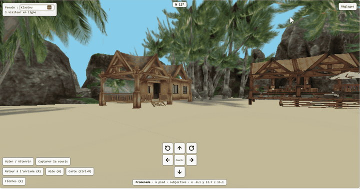

# web_3d

[English](README.md) | Français



*Région de démonstration PalmIsland (source : [Outworldz](https://www.outworldz.com/cgi/freesculpts.plx?q=OAR-)) : promenade dans une page web, sans installation.*

**web_3d** transforme une région d'un monde virtuel **OpenSim** (sauvegarde **OAR**) en une page web que l'on parcourt à pied, sans installation côté visiteur : l'OAR est convertie en modèle **glTF** (`.glb`), puis affichée avec **three.js** dans une page web « promenable » (avatar, collisions, visiteurs en temps réel, chat, zones et portails, carte des mondes). L'interface de la page, du viewer et des outils existe en **français et en anglais** (voir « Langue » plus bas).

Les manuels sont en français dans `docs/fr/` (`MANUEL.md`, `PROCEDURES.md`, `HISTORIQUE.md`) et en anglais dans `docs/en/`. Toutes les options de chaque outil, en français et en anglais : [`REFERENCE_OPTIONS.md`](REFERENCE_OPTIONS.md) ; `python glb2html.py --help` (et de même pour les autres outils) les affiche.

## Fichiers fabriqués

| Fichier fabriqué                         | Rôle                                                                                                                                                                                                                                                                      |
| ---------------------------------------- | ------------------------------------------------------------------------------------------------------------------------------------------------------------------------------------------------------------------------------------------------------------------------- |
| `glb-viewer.html`                        | Page de réglages et d'export : on charge un `.glb` (ou, depuis la v32, le dossier d'une région en tuiles), on règle la mer, le trou, la caméra, la promenade, les zones et la fiche de région, puis on exporte (région en tuiles : zones et ligne de commande seulement). |
| `glb2html.py`                            | Le même travail en ligne de commande (hors ligne, sans navigateur) : page unique, page modulaire ou coquille commune, régions en tuiles, `--update` pour mettre à jour une région publiée, `--scan-sites` pour la carte d'un site entier.                                 |
| `index.html`                             | La coquille commune, prête à copier à la racine d'un site (v45).                                                                                                                                                                                                          |
| `carte.html`                             | La page de la carte des mondes, identique pour tous les sites : elle lit `regions.json` à côté d'elle (v47).                                                                                                                                                              |
| `presence_server.py`                     | Serveur WebSocket de présence, chat, modération, compteurs de visiteurs et journal des visites.                                                                                                                                                                           |
| `oar2glb.py` ¹                           | Convertit une sauvegarde OpenSim (`.oar`) en `.glb` (convoar + réparation) ; `--terrain-only` ajoute le terrain complet des régions de plus de 256 m à un GLB existant.                                                                                                   |
| `glb2tiles.py` (+ `glb-stats.py` à côté) | Découpe un GLB énorme en tuiles autonomes (`X.tiles/*.glb` + `X.tiles.json`) et fabrique une vue d'ensemble légère `X.overview.glb` ; `--analyse` mesure et recommande sans rien écrire ; `--exclude` écarte les « boîtes de livraison » d'un catalogue.                  |

¹ **Prérequis** :  **oar2glb.py** s'appuie sur le convertisseur externe **convoar.exe** \
  Téléchargement : https://github.com/Misterblue/convoar/tree/master/bin \
  Sans convoar.exe, oar2glb.py ne peut pas effectuer la conversion OAR → GLB. Son emplacement s'indique avec `--convoar CHEMIN` (par défaut : la variable `CONVOAR`, sinon `convoar` du PATH, sinon `convoar.exe` à côté de `oar2glb.py`).

## Fabriquer

Il faut Python 3.9 ou plus.

```
python build.py
```

Le résultat est dans `dist/`. Au premier lancement, three.js r160 est téléchargé dans `.cache/` (ou `python build.py --vendor DOSSIER` avec un paquet npm `three` déjà décompressé). Les fichiers de `dist/` ne sont pas versionnés. La fabrication intègre les fichiers de langue (`src/i18n/*.json`) dans les pages et dans chaque outil Python : chaque outil de `dist/` est un fichier autonome.

## Utiliser

1. Ouvrir `dist/glb-viewer.html`, charger le `.glb`, régler, puis « Enregistrer dans un fichier » (section Réglages mémorisés) : on obtient `<nom>.reglages.json`.
2. Générer la page avec les mêmes réglages (une seule ligne) :

```
python glb2html.py "Region-final.glb" --settings --shared-shell --register regions.json -o "Region.html"
```

3. Lancer le serveur de présence : `python presence_server.py --log presence.log`.

Les étapes complètes (de l'OAR à la page, région en tuiles, mise à jour, zones, serveur de présence public, carte) sont dans `PROCEDURES.md`.

## Un site : une coquille, un dossier par région

Organisation conseillée (manuel § 29.8) : à la racine du site, une seule coquille `index.html` (copie de `dist/index.html`), le dossier `lib/`, `regions.json` et `carte.html` (copie de `dist/carte.html`) ; puis un dossier par région avec ses `NOM.glb` (ou ses tuiles), `NOM.config.json` et `NOM.zones.json`. Une région s'ouvre à `index.html?region=dossier/NOM`. Il faut servir le site en http/https (essai local : `python -m http.server`).

- Mettre à jour une région après une nouvelle version : `python glb2html.py --update -o "SITE/dossier/NOM.html" --shared-shell "SITE/index.html"` (le chemin de la coquille de la racine évite d'écrire une coquille inutile dans le dossier de la région).
- Mettre à jour la carte de tout le site : `python glb2html.py --scan-sites SITE --dry-run`, puis sans `--dry-run` (v49, manuel § 32).

## Mode modulaire et coquille commune

`--modular` écrit `Region.html` (coquille, identique pour toutes les régions : elle déduit ses fichiers de son propre nom), `Region.glb`, `Region.config.json` (réglages, relus à chaque F5), `Region.zones.json` (zones, relues à chaque F5) et `lib/three-0.160.0/`. Avec `--shared-shell`, une seule coquille et un seul `lib/` servent plusieurs régions : `-o` désigne la région, la coquille et `lib/` ne sont écrits que s'ils sont absents. NOM doit être un nom de fichier ou un chemin de sous-dossiers (`a/b/nom`) : adresses, `..`, nom vide ou commençant par un point sont refusés sans aucune requête réseau.

`--config-only` ne réécrit que la config, `--zones-only` que les zones. Le viewer exporte la même structure en `.zip`, à côté de « Exporter HTML autonome » (page unique qui s'ouvre depuis le disque). Détail : manuel § 16, référence des fichiers JSON : § 27.

## Régions en tuiles

Pour un modèle énorme, `glb2tiles.py` écrit les tuiles, et `glb2html.py --tiles X.tiles.json -o X.html --shared-shell` fabrique la page : les tuiles proches de l'avatar sont chargées et déchargées pendant la marche, une vue d'ensemble légère reste affichée, et les zones peuvent être liées à des objets des tuiles. Détail : manuel § 17.

## Carte des mondes

`regions.json` est la carte : une liste de fiches (nom, adresse, X, Y, arrivée, salon, serveur de présence, vignette), ou, depuis la v47, un objet `{"showUrl": ..., "regions": [...]}` avec un en-tête. Elle s'alimente de trois façons, qui gardent toutes l'en-tête et la forme du fichier : `--register` (la région en cours de génération), `--scan-sites` (toutes les régions d'un site, avec leurs vignettes) et les boutons « Importer / Exporter regions.json » du viewer (v50). `carte.html` la relit à chaque ouverture ; `--map-page` écrit à la place une page autonome qui contient la liste ; `--map-url a.json,b.json` fusionne les cartes de plusieurs propriétaires. Chaque tuile affiche le nombre de visiteurs. Détail : manuel § 27.6, § 30, § 32 et § 33.

## La page

- **Promenade** : avatar, collisions, course, saut, vol, trois vues (subjective, troisième personne, caméra libre), boussole, arrivées et portails, téléportation par la fenêtre Arrivées (L) ou par double-clic.
- **Fenêtres** : Aide (H), Informations (I), Arrivées (L), Réglages (O), déplaçables et retenues par le navigateur (v41) ; bouton « Copier le diagnostic » (v39) ; « Journal des visites… » quand la page a un serveur de présence (v48).
- **Commandes à l'écran** (v46) : ligne d'état, flèches 3 x 3 (touche K), mode tactile pour téléphone et tablette.
- **Rendu léger** (v42) : résolution, images par seconde, vue d'ensemble seule, rayon des tuiles, anticrénelage (`--light`).
- **Présence et chat** : visiteurs en temps réel, couleur d'avatar, chat avec historique, pseudo cité ; la page dit pourquoi la connexion s'est fermée (v45).

## Touches principales

| Touche                                                        | Effet                                                                                                                         |
| ------------------------------------------------------------- | ----------------------------------------------------------------------------------------------------------------------------- |
| **F** ou **P**                                                | entrer en promenade / en sortir                                                                                               |
| **ZQSD** ou **WASD**, flèches                                 | se déplacer ; **Maj** ou double appui : courir                                                                                |
| **Espace**                                                    | sauter ; maintenu en vol : monter                                                                                             |
| **Début**, le bouton de vol, ou **Page Haut** maintenu au sol | décoller / atterrir ; **Page Bas** ou **C** : descendre                                                                       |
| **E** ou clic                                                 | déclencher la zone proche (panneaux et portails)                                                                              |
| **V** / **M**                                                 | changer de vue / subjective ou troisième personne (hors promenade : carte des mondes) ; **Ctrl+M** : carte des mondes partout |
| **R**                                                         | retour à l'arrivée (vue globale : centrer sur l'arrivée)                                                                      |
| **H**, **I**, **L**, **O**                                    | fenêtres Aide, Informations, Arrivées, Réglages                                                                               |
| **K**                                                         | flèches à l'écran                                                                                                             |
| **T**                                                         | repères de portail (cônes)                                                                                                    |
| **G**                                                         | reprendre la souris après **Échap**                                                                                           |
| **Entrée**                                                    | écrire dans le chat                                                                                                           |

Le réglage « Clavier » (Auto, AZERTY ou QWERTY) ne change que les lettres affichées dans l'aide ; les touches physiques restent les mêmes. Tableau complet : manuel § 2 et § 20.2.

## Serveur de présence

Positions, chat (historique `--history-file`), modération depuis sa console (`liste`, `ejecter`, `bannir`, `bans`, `debannir`, `rooms`, `visits-key`, `creators`, `aide` ; alias anglais `list`, `kick`, `ban`, `unban`, `help`), compteurs de visiteurs pour la carte, journal des visites sans adresse IP (`--visits`, v48) que le créateur consulte avec `#visits` et sa clé, accueil d'autres créateurs (`--creators`, v51 : pages déclarées, salons réservés par un préfixe, manuel § 34). Le rendre public sans montrer son adresse IP : procédures § 11. Détail : manuel § 31.

## Langue

- **Page et viewer** : réglage « Langue / Language » (Auto = la première langue du navigateur qui existe, sinon l'anglais) ; `#lang=en` ou `#lang=fr` dans l'adresse l'emporte. Les textes saisis (noms de zones, panneaux, pseudos) ne sont jamais traduits.
- **Outils Python** : `--lang fr|en|auto` (défaut `auto`), sinon la variable `WEB3D_LANG`, sinon la langue du système, sinon l'anglais. `--lang` l'emporte sur `WEB3D_LANG`. Les noms d'options et les commandes de console du serveur de présence ne sont pas traduits.
- **Ajouter une langue** : copier `src/i18n/en.json` en `src/i18n/<code>.json`, traduire les valeurs (jamais les clés), lancer `python build.py`. Une clé absente retombe sur l'anglais, puis le français, puis la clé elle-même. `python tests/i18n.py` vérifie les fichiers.

## Développer

`REPRISE.md` (à la racine) donne l'état du dépôt, les décisions et ce qui reste à faire ; `CHANGELOG.md` et `HISTORIQUE.md` le détail de chaque version. Tests : `python build.py`, puis les scripts de `tests/` : `smoke.py`, `i18n.py`, `samples.py`, `doc_options.py`, `tools_lang.py`, `modulaire.py`, `tuiles.py`, `glb2tiles.py`, `oar2glb.py`, `terrain.py` et un fichier par version (`v23.py` à `v51.py`). Les tests dans le navigateur demandent Playwright et Chromium ; variables `THREE_DIR` (paquet npm `three`, hors ligne) et `CHROMIUM` (exécutable).

## Sécurité

Ne jamais committer : adresses Home Assistant (`*.zones.json`, `zones*.json`), `*.reglages.json`, `regions.json`, `presence_identities.json`, `presence_bans.json`, les journaux, le journal des visites, `presence_visits_keys.json` et `presence_creators.json`. Le `.gitignore` exclut les plus courants. Le profil `--profile public` retire les zones privées des pages publiées. ; ni l'historique du chat et le journal des visites (`*.jsonl`)

## Licence

Licence MIT (fichier `LICENSE`). three.js (MIT) et les décodeurs embarqués : voir `THIRD-PARTY.md`.

## Crédits

Conçu, dirigé et testé par Klaatou ; le code et les documents ont été écrits en grande partie avec Claude (Anthropic), un assistant d'IA.
