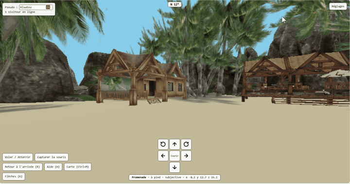
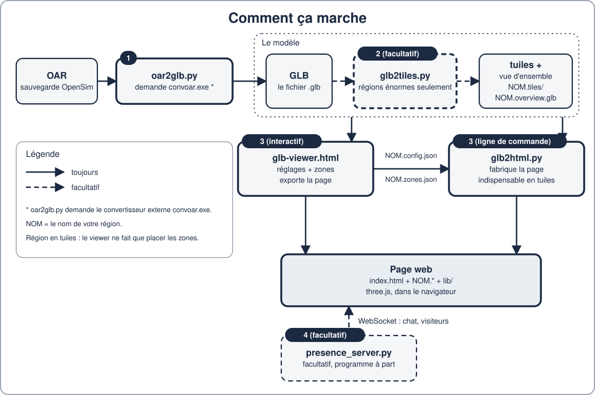
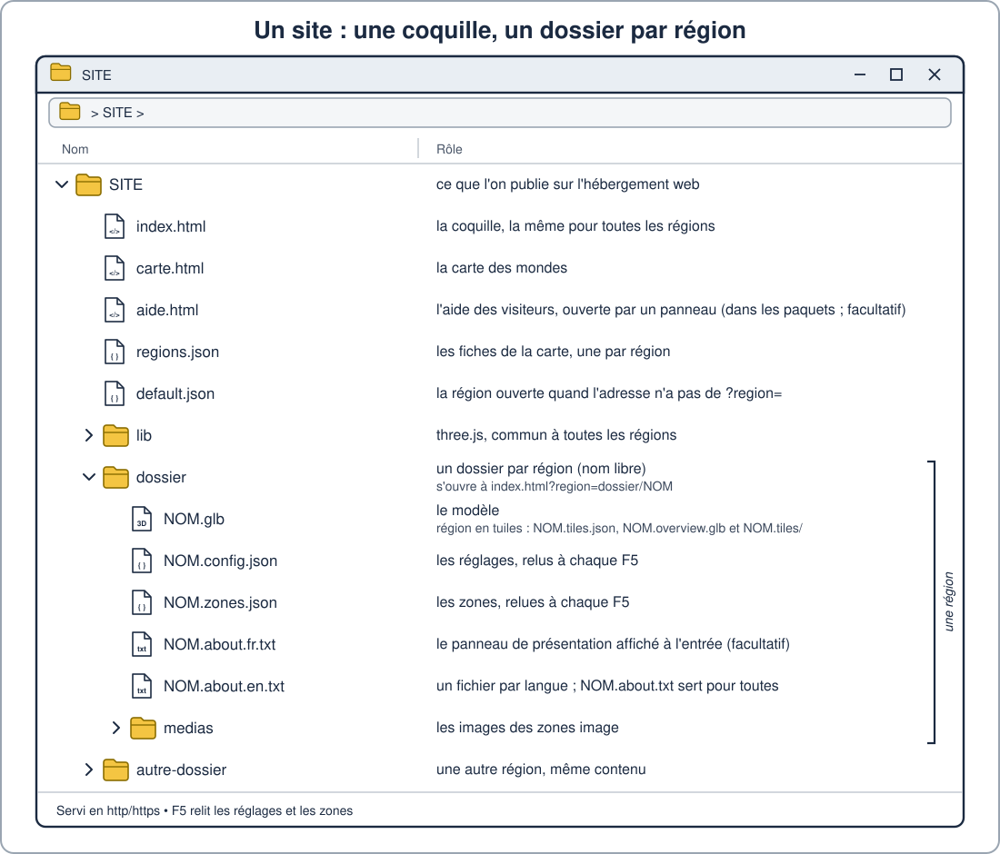

# web_3d

[English](README.md) | Français

[](https://klaatou.github.io/Web_3d_demo/)

*Région de démonstration PalmIsland (source : [Outworldz](https://www.outworldz.com/cgi/freesculpts.plx?q=OAR-)) : promenade dans une page web, sans installation.*

**[Essayer la démo en ligne](https://klaatou.github.io/Web_3d_demo/)** : deux régions reliées par des portails, et la carte des mondes (Avec serveur de présence).

**web_3d** transforme une région d'un monde virtuel **OpenSim** (sauvegarde **OAR**) en une page web que l'on parcourt à pied, sans installation côté visiteur : l'OAR devient un modèle **glTF** (`.glb`), que la page web_3d (`index.html`) affiche avec **three.js** dans un navigateur ordinaire. L'interface de la page, du viewer et des outils existe en **français et en anglais** (voir « Langue » plus bas).

**Trois mots** : une **OAR** est le fichier de sauvegarde d'une région OpenSim ; un **GLB** est un modèle 3D en un seul fichier `.glb`, que la page web_3d affiche dans un navigateur ordinaire ; les **tuiles** sont les morceaux dans lesquels on découpe une région énorme, chargés et déchargés autour de l'avatar pendant la marche.

## Ce que l'on peut faire

- **Marcher, courir, sauter et voler** dans la région : vue à la première personne, à la troisième ou caméra libre, avec collisions ; commandes à l'écran et mode tactile pour téléphones et tablettes (voir « Touches principales »).
- **Visiter une région énorme** : elle est découpée en tuiles qui se chargent autour de l'avatar (voir « Régions en tuiles »).
- **Placer des zones** dans le modèle : points d'arrivée, portails vers une autre région, panneaux, liens web, commandes Home Assistant, et **images sur les murs** (JPEG, PNG, GIF animé).
- **Être plusieurs** : voir les autres visiteurs et discuter, avec le serveur de présence facultatif (voir « Serveur de présence »).
- **Relier plusieurs régions** par une carte des mondes (`carte.html`) : une fiche par région, qui y mène (voir « Carte des mondes »).
- **Tout régler** dans le viewer (`glb-viewer.html` : mer, caméra, promenade, zones, fiche de région), ou directement dans les fichiers JSON (`NOM.config.json`, `NOM.zones.json`), qu'une page avec coquille relit à chaque F5.

## Deux sortes de page

- **Page autonome** : un seul fichier `.html` qui contient tout, modèle compris. On peut l'envoyer ou la donner à n'importe qui : elle s'ouvre depuis le disque, dans un navigateur, sans serveur web ni autre fichier. Limites : les zones image n'affichent rien quand la page est ouverte depuis le disque (elles demandent un hébergement web), et une région en tuiles n'a pas d'export autonome.
- **Page avec coquille** : une page commune `index.html` (la coquille) affiche toutes les régions du site ; chaque région garde ses fichiers à côté (`NOM.glb`, `NOM.config.json`, `NOM.zones.json`). Elle doit être servie en http/https : c'est la forme à publier, et celle à choisir pour plusieurs régions, la carte et le serveur de présence (voir « Un site : une coquille, un dossier par région » et « Mode modulaire et coquille commune » plus bas).

**Ce qui demande un serveur** : seul le serveur de présence demande autre chose qu'un hébergement web de base (c'est un programme Python, avec le paquet `websockets`, qui doit tourner sur un serveur). La page, la carte, les images et les zones sont de simples fichiers que n'importe quel hébergement web de base peut servir (la démo est sur GitHub Pages) ; seule une zone Home Assistant appelle votre propre Home Assistant.

## Comment ça marche



`oar2glb.py` demande le convertisseur externe `convoar.exe` (voir plus bas). Le viewer règle les réglages et les zones et exporte la page (région en tuiles : seulement les zones, avec la ligne de commande à lancer) ; `glb2html.py` fait le même travail en ligne de commande et est indispensable pour les régions en tuiles. Le serveur de présence ne fait pas partie de la page : c'est la page qui s'y connecte.

## Paquets prêts à l'emploi

Sans lire toute la documentation, deux paquets sont à télécharger sur la [page des versions](https://github.com/Klaatou/Web_3d/releases/latest) :

- **`region-simple.zip`** : votre région OpenSim (un fichier GLB) dans un navigateur. On met son GLB sous `site/region.glb` ; `renommer-region.bat` change le nom ; `site/readme.html` explique les réglages et comment obtenir un GLB depuis un OAR.
- **`galerie-photos.zip`** : une galerie de 30 photos en 3D. On remplace les images de `site/medias/` (`1.jpg` à `30.jpg`) ; `site/galerie.html` documente tout, `renommer-galerie.bat` change le nom.

**Ce que contient un paquet** :

- `site/` : tout ce qui se publie. Pour mettre la région en ligne, copiez le **contenu** de ce dossier sur un hébergement web.
- `presence/` : le serveur de présence, facultatif : un programme à faire tourner sur un serveur, **pas** une page. Ne le téléversez pas sur un hébergement web.
- les lanceurs `lancer-region.*` (`lancer-galerie.*` pour la galerie) et les scripts de renommage `renommer-*` : des outils pour votre propre ordinateur, jamais publiés. **`.bat` sous Windows, `.sh` sous Linux, `.command` sous macOS.**

**Deux choses séparées** :

1. *L'essayer sur votre ordinateur* : sous Windows, double-cliquez sur le `.bat` ; sous macOS, double-cliquez sur le `.command` (la première fois : clic droit, Ouvrir) ; sous Linux, tapez `sh lancer-region.sh` dans un terminal (Linux et macOS demandent Python 3.7 ou plus). Le lanceur démarre un petit serveur web local : gardez sa fenêtre ouverte pendant que vous regardez. Double-cliquer sur `site/index.html` ne marche pas : un message demande un serveur web.
2. *Publier* : copiez le contenu de `site/` sur un hébergement web. C'est une autre façon de montrer votre région, pas une étape suivante : le lanceur sert seulement à l'essayer chez soi.

**Vous avez déjà l'un de ces paquets ?** Ne dézippez pas le nouveau zip par-dessus votre dossier : il écraserait votre configuration, vos zones et vos images. Dézippez-le à part, puis copiez `index.html` et `carte.html` (toujours), et `aide.html` (l'aide des visiteurs, avec la ligne de crédit et les nouveaux textes d'aide) seulement si vous ne l'avez pas adapté ; si vous l'avez adapté, gardez le vôtre (`PROCEDURES_SIMPLES.md` § 10).

Un testeur a essayé le lanceur macOS (macOS Ventura 13.7.8, Firefox 159.0.1) avec `region-simple.zip` : la région s'affiche. Les sources sont dans `paquets/` ; `python fabriquer_paquets.py` refait les zips (`docs/fr/PROCEDURES.md` § 12, ou `docs/en/PROCEDURES.md` en anglais). **Ne prenez pas « Download ZIP » sur la page du dépôt** : c'est le code source, sans `index.html` ni `lib/` ; les lanceurs le disent.

Les manuels sont en français dans `docs/fr/` (`INDEX.md` pour s'y retrouver, `GUIDE.md` pour commencer, `MANUEL.md`, `PROCEDURES.md`, `REFERENCE_JSON.md`, `HISTORIQUE.md`) et en anglais dans `docs/en/`. Toutes les options de chaque outil, en français et en anglais : [`REFERENCE_OPTIONS.md`](REFERENCE_OPTIONS.md) ; `python glb2html.py --help` (et de même pour les autres outils) les affiche.

## Fichiers fabriqués

| Fichier fabriqué                         | Rôle                                                                                                                                                                                                                                                                      |
| ---------------------------------------- | ------------------------------------------------------------------------------------------------------------------------------------------------------------------------------------------------------------------------------------------------------------------------- |
| `glb-viewer.html`                        | Page de réglages et d'export : on charge un `.glb` (ou le dossier d'une région en tuiles), on règle la mer, le trou, la caméra, la promenade, les zones et la fiche de région, puis on exporte (région en tuiles : seulement les zones : le viewer exporte `NOM.zones.json` et écrit la ligne de commande `glb2html.py` à lancer). |
| `glb2html.py`                            | Le même travail en ligne de commande (hors ligne, sans navigateur) : page unique, page modulaire ou coquille commune, régions en tuiles, `--update` pour mettre à jour une région publiée, `--scan-sites` pour la carte d'un site entier.                                 |
| `index.html`                             | La coquille commune, prête à copier à la racine d'un site.                                                                                                                                                                                                          |
| `carte.html`                             | La page de la carte des mondes, identique pour tous les sites : elle lit `regions.json` à côté d'elle.                                                                                                                                                              |
| `presence_server.py`                     | Serveur WebSocket de présence, chat, modération, compteurs de visiteurs et journal des visites.                                                                                                                                                                           |
| `oar2glb.py` ¹                           | Convertit une sauvegarde OpenSim (`.oar`) en `.glb` (convoar + réparation) ; `--terrain-only` ajoute le terrain complet des régions de plus de 256 m à un GLB existant.                                                                                                   |
| `glb2tiles.py` (+ `glb-stats.py` à côté) | Découpe un GLB énorme en tuiles autonomes (`X.tiles/*.glb` + `X.tiles.json`) et fabrique une vue d'ensemble légère `X.overview.glb` ; `--analyse` mesure et recommande sans rien écrire ; `--exclude` écarte les « boîtes de livraison » d'un catalogue.                  |
| `extraire_batiments.py`                  | Sort d'un OAR et de son GLB un GLB par groupe d'objets (maison, meuble, arbre...), recentré ; `--list` montre les groupes.                                                                                                                                                |
| `iar2oar.py`                             | Transforme une archive d'inventaire (IAR) en OAR minimal, pour la suite `oar2glb.py` puis `extraire_batiments.py`.                                                                                                                                                        |
| `diag_carte.py`                          | Diagnostique pourquoi la carte n'affiche pas les pseudos : interroge le serveur de présence avec et sans la clé et dit ce qui manque.                                                                                                                                     |

¹ **Prérequis** :  **oar2glb.py** s'appuie sur le convertisseur externe **convoar.exe** \
  Téléchargement : https://github.com/Misterblue/convoar/tree/master/bin \
  Sans convoar.exe, oar2glb.py ne peut pas effectuer la conversion OAR → GLB. Son emplacement s'indique avec `--convoar CHEMIN` (par défaut : la variable `CONVOAR`, sinon `convoar` du PATH, sinon `convoar.exe` à côté de `oar2glb.py`).

## Fabriquer

**Les fichiers prêts à l'emploi sont déjà dans `dist/`** (viewer, générateur, serveur de présence, outils) : inutile de fabriquer pour les utiliser. `python build.py` ne sert que si tu modifies `src/` ou `tools/`.

Il faut Python 3.9 ou plus.

```
python build.py
```

Le résultat est dans `dist/`. Au premier lancement, three.js r160 est téléchargé dans `.cache/` (ou `python build.py --vendor DOSSIER` avec un paquet npm `three` déjà décompressé). Les fichiers de `dist/` sont versionnés et refaits par `python build.py`. La fabrication intègre les fichiers de langue (`src/i18n/*.json`) dans les pages et dans chaque outil Python : chaque outil de `dist/` est un fichier autonome.

## Utiliser

1. Ouvrir `dist/glb-viewer.html`, charger le `.glb`, régler, puis « Enregistrer dans un fichier » (section Réglages mémorisés) : on obtient `<nom>.reglages.json`.
2. Générer la page avec les mêmes réglages (une seule ligne) :

```
python glb2html.py "Region-final.glb" --settings --shared-shell --register regions.json -o "Region.html"
```

3. Lancer le serveur de présence : `python presence_server.py --log presence.log`.

Les étapes complètes (de l'OAR à la page, région en tuiles, mise à jour, zones, serveur de présence public, carte) sont dans `PROCEDURES.md`.

## Un site : une coquille, un dossier par région

Organisation conseillée (manuel § 6.2) : à la racine du site, une seule coquille `index.html` (copie de `dist/index.html`), le dossier `lib/`, `regions.json` et `carte.html` (copie de `dist/carte.html`) ; puis un dossier par région avec ses `NOM.glb` (ou ses tuiles), `NOM.config.json` et `NOM.zones.json`. Une région s'ouvre à `index.html?region=dossier/NOM`. Il faut servir le site en http/https (essai local : `python -m http.server`).

La même disposition, comme dans un explorateur de fichiers :



Une région s'ouvre à `index.html?region=dossier/NOM`.

- Mettre à jour une région après une nouvelle version : `python glb2html.py --update -o "SITE/dossier/NOM.html" --shared-shell "SITE/index.html"` (le chemin de la coquille de la racine évite d'écrire une coquille inutile dans le dossier de la région).
- Mettre à jour la carte de tout le site : `python glb2html.py --scan-sites SITE --dry-run`, puis sans `--dry-run` (manuel § 9.9).

## Mode modulaire et coquille commune

`--modular` écrit `Region.html` (coquille, identique pour toutes les régions : elle déduit ses fichiers de son propre nom), `Region.glb`, `Region.config.json` (réglages, relus à chaque F5), `Region.zones.json` (zones, relues à chaque F5) et `lib/three-0.160.0/`. Avec `--shared-shell`, une seule coquille et un seul `lib/` servent plusieurs régions : `-o` désigne la région, la coquille et `lib/` ne sont écrits que s'ils sont absents. NOM doit être un nom de fichier ou un chemin de sous-dossiers (`a/b/nom`) : adresses, `..`, nom vide ou commençant par un point sont refusés sans aucune requête réseau.

`--config-only` ne réécrit que la config, `--zones-only` que les zones. Le viewer exporte la même structure en `.zip`, à côté de « Exporter HTML autonome » (page unique qui s'ouvre depuis le disque). Détail : `REFERENCE_JSON.md` § 11.12.

## Régions en tuiles

Pour un modèle énorme, `glb2tiles.py` écrit les tuiles, et `glb2html.py --tiles X.tiles.json -o X.html --shared-shell` fabrique la page : les tuiles proches de l'avatar sont chargées et déchargées pendant la marche, une vue d'ensemble légère reste affichée, et les zones peuvent être liées à des objets des tuiles. Détail : manuel § 4.1.

## Carte des mondes

`regions.json` est la carte : une liste de fiches (nom, adresse, X, Y, arrivée, salon, serveur de présence, vignette), ou un objet `{"showUrl": ..., "regions": [...]}` avec un en-tête. Elle s'alimente de trois façons, qui gardent toutes l'en-tête et la forme du fichier : `--register` (la région en cours de génération), `--scan-sites` (toutes les régions d'un site, avec leurs vignettes) et les boutons « Importer / Exporter regions.json » du viewer. `carte.html` la relit à chaque ouverture ; `--map-page` écrit à la place une page autonome qui contient la liste ; `--map-url a.json,b.json` fusionne les cartes de plusieurs propriétaires. Chaque tuile affiche le nombre de visiteurs. Détail : `REFERENCE_JSON.md` § 11.6, manuel § 9, § 9.9 et § 9.13.

## La page

- **Promenade** : avatar, collisions, course, saut, vol, trois vues (subjective, troisième personne, caméra libre), boussole, arrivées et portails, téléportation par la fenêtre Arrivées (L) ou par double-clic.
- **Zones** : arrivées, portails, liens web, commandes Home Assistant et **images sur les murs** (fichiers déposés dans le sous-dossier `medias` de la région, légende dans le nom du fichier ou dans un fichier `.txt`) ; mode hébergé seulement (manuel § 5.11).
- **Fenêtres** : Aide (H), Informations (I), Arrivées (L), Réglages (O), déplaçables et retenues par le navigateur ; bouton « Copier le diagnostic » ; « Journal des visites… » quand la page a un serveur de présence.
- **Commandes à l'écran** : ligne d'état, flèches 3 x 3 (touche K), mode tactile pour téléphone et tablette.
- **Rendu léger** : résolution, images par seconde, vue d'ensemble seule, rayon des tuiles, anticrénelage (`--light`).
- **Présence et chat** : visiteurs en temps réel, couleur d'avatar, chat avec historique, pseudo cité ; la page dit pourquoi la connexion s'est fermée.

## Touches principales

| Touche                                                        | Effet                                                                                                                         |
| ------------------------------------------------------------- | ----------------------------------------------------------------------------------------------------------------------------- |
| **F** ou **P**                                                | entrer en promenade / en sortir                                                                                               |
| **ZQSD** ou **WASD**, flèches                                 | se déplacer ; **Maj** ou double appui : courir                                                                                |
| **Espace**                                                    | sauter ; maintenu en vol : monter                                                                                             |
| **Début**, le bouton de vol, ou **Page Haut** maintenu au sol | décoller / atterrir ; **Page Bas** ou **C** : descendre                                                                       |
| **E** ou clic                                                 | déclencher la zone proche (panneaux et portails)                                                                              |
| **V** / **M**                                                 | changer de vue / subjective ou troisième personne (hors promenade : carte des mondes) ; **Ctrl+M** : carte des mondes partout |
| **R**                                                         | retour à l'arrivée (vue globale : centrer sur l'arrivée)                                                                      |
| **H**, **I**, **L**, **O**                                    | fenêtres Aide, Informations, Arrivées, Réglages                                                                               |
| **K**                                                         | flèches à l'écran                                                                                                             |
| **T**                                                         | repères de portail (cônes)                                                                                                    |
| **G**                                                         | reprendre la souris après **Échap**                                                                                           |
| **Entrée**                                                    | écrire dans le chat                                                                                                           |

Le réglage « Clavier » (Auto, AZERTY ou QWERTY) ne change que les lettres affichées dans l'aide ; les touches physiques restent les mêmes. Tableau complet : manuel § 7.1 et § 7.2.

## Serveur de présence

Positions, chat (historique `--history-file`), modération depuis sa console (`liste`, `ejecter`, `bannir`, `bans`, `debannir`, `rooms`, `visits-key`, `creators`, `aide` ; alias anglais `list`, `kick`, `ban`, `unban`, `help`), compteurs de visiteurs pour la carte, journal des visites sans adresse IP (`--visits`) que le créateur consulte avec `#visits` et sa clé, accueil d'autres créateurs (`--creators` : pages déclarées, salons réservés par un préfixe, manuel § 10.10). Le rendre public sans montrer son adresse IP : procédures § 11. Détail : manuel § 10.

## Langue

- **Page et viewer** : réglage « Langue / Language » (Auto = la première langue du navigateur qui existe, sinon l'anglais) ; `#lang=en` ou `#lang=fr` dans l'adresse l'emporte. Les textes saisis (noms de zones, panneaux, pseudos) ne sont jamais traduits.
- **Outils Python** : `--lang fr|en|auto` (défaut `auto`), sinon la variable `WEB3D_LANG`, sinon la langue du système, sinon l'anglais. `--lang` l'emporte sur `WEB3D_LANG`. Les noms d'options et les commandes de console du serveur de présence ne sont pas traduits.
- **Ajouter une langue** : copier `src/i18n/en.json` en `src/i18n/<code>.json`, traduire les valeurs (jamais les clés), lancer `python build.py`. Une clé absente retombe sur l'anglais, puis le français, puis la clé elle-même. `python tests/i18n.py` vérifie les fichiers.

## Développer

`REPRISE.md` (à la racine) donne l'état du dépôt, les décisions et ce qui reste à faire ; `CHANGELOG.md` et `HISTORIQUE.md` le détail de chaque version. Tests : `python build.py`, puis les scripts de `tests/` : `smoke.py`, `i18n.py`, `samples.py`, `doc_options.py`, `tools_lang.py`, `modulaire.py`, `tuiles.py`, `glb2tiles.py`, `oar2glb.py`, `terrain.py` et un fichier par version (`v23.py` à `v51.py`). Les tests dans le navigateur demandent Playwright et Chromium ; variables `THREE_DIR` (paquet npm `three`, hors ligne) et `CHROMIUM` (exécutable).

## Sécurité

Ne jamais committer : adresses Home Assistant (`*.zones.json`, `zones*.json`), `*.reglages.json`, `regions.json`, `presence_identities.json`, `presence_bans.json`, les journaux, le journal des visites, `presence_visits_keys.json` et `presence_creators.json`. Le `.gitignore` exclut les plus courants. Le profil `--profile public` retire les zones privées des pages publiées. ; ni l'historique du chat et le journal des visites (`*.jsonl`)

## Licence

Licence MIT (fichier `LICENSE`). three.js (MIT) et les décodeurs embarqués : voir `THIRD-PARTY.md`.

## Crédits

Conçu, dirigé et testé par Klaatou ; le code et les documents ont été écrits en grande partie avec Claude (Anthropic), un assistant d'IA.
