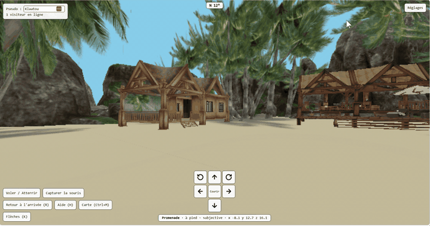
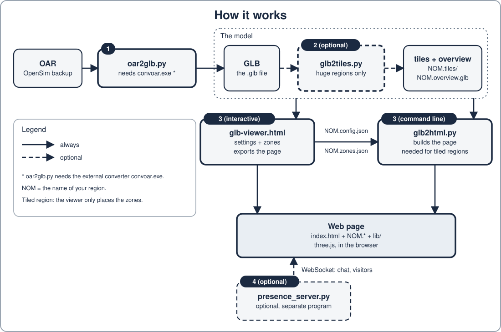
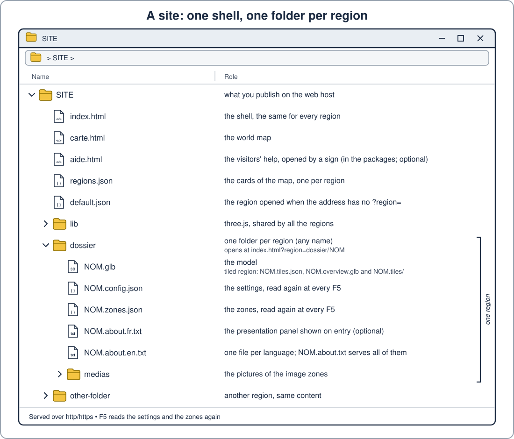

# web_3d

English | [Français](README.fr.md)

[](https://klaatou.github.io/Web_3d_demo/)

*Demo region PalmIsland (source: [Outworldz](https://www.outworldz.com/cgi/freesculpts.plx?q=OAR-)): walking in a web page, with nothing to install.*

**[Try the online demo](https://klaatou.github.io/Web_3d_demo/)**: two regions linked by portals, and the world map (With a presence server).

**Questions, help, news: [join the Discord server](https://discord.gg/BDG9r5gXwr).**

**web_3d** turns a region of an **OpenSim** virtual world (an **OAR** backup) into a web page that visitors can walk around, with nothing to install on their side: the OAR becomes a **glTF** model (`.glb`), which the web_3d page (`index.html`) displays with **three.js** in an ordinary browser. The interface of the page, of the viewer and of the Python tools is available in **English and French** (see "Language" below).

**Three terms**: an **OAR** is the backup file of an OpenSim region; a **GLB** is a 3D model in a single `.glb` file, which the web_3d page displays in an ordinary browser; **tiles** are the pieces a huge region is cut into, loaded and unloaded around the avatar while walking.

## What you can do

- **Walk, run, jump and fly** in the region: first person, third person or free camera, with collisions; on-screen controls and touch mode for phones and tablets (see "Main keys").
- **Visit a huge region**: it is cut into tiles that load around the avatar (see "Tiled regions").
- **Place zones** in the model: arrival points, portals to another region, signs, web links, Home Assistant commands, and **pictures on walls** (JPEG, PNG, animated GIF).
- **Be several**: see the other visitors and chat, with the optional presence server (see "Presence server").
- **Link several regions** with a world map (`carte.html`, *carte* is French for map): one card per region, each leading to it (see "World map").
- **Set everything up** in the viewer (`glb-viewer.html`: sea, camera, walking, zones, region card), or directly in the JSON files (`NOM.config.json`, `NOM.zones.json`), which a page with a shell reads again at every F5.

## Two kinds of page

- **Standalone page**: a single `.html` file with everything inside, the model included. You can send it or give it to anyone: it opens from the disk, in a browser, with no web server and no other file. Limits: picture zones show nothing when opened from the disk (they need a web host), and a tiled region has no standalone export.
- **Page with a shell**: a common page `index.html` (the shell) displays every region of the site; each region keeps its files next to it (`NOM.glb`, `NOM.config.json`, `NOM.zones.json`). It must be served over http/https: this is the form to publish, and the one to choose for several regions, the map and the presence server (see "A site: one shell, one folder per region" and "Modular mode and shared shell" below).

**What needs a server**: only the presence server needs more than a basic web host (it is a Python program, with the `websockets` package, that must run on a server). The page, the map, the pictures and the zones are plain files that any basic web host can serve (the demo is on GitHub Pages); only a Home Assistant zone calls your own Home Assistant.

## How it works



`oar2glb.py` needs the external converter `convoar.exe` (see below). The viewer sets the settings and the zones and exports the page (for a tiled region: only the zones, plus the command line to run); `glb2html.py` does the same job on the command line and is needed for tiled regions. The presence server is not part of the page: the page connects to it.

## Ready-to-use packages

Without reading all the documentation, two packages can be downloaded from the [releases page](https://github.com/Klaatou/Web_3d/releases/latest):

- **`region-simple.zip`**: your OpenSim region (a GLB file) in a browser. You put your GLB under `site/region.glb`; `renommer-region.bat` changes the name; `site/readme.html` explains the settings and how to get a GLB from an OAR.
- **`galerie-photos.zip`**: a 3D gallery of 30 photos. You replace the images in `site/medias/` (`1.jpg` to `30.jpg`); `site/galerie.html` documents everything, `renommer-galerie.bat` changes the name.

**What is in a package**:

- `site/`: everything that is published. To put the region online, copy the **contents** of this folder to a web host.
- `presence/`: the optional presence server: a program to run on a server, **not** a page. Do not upload it to a web host.
- the launchers `lancer-region.*` (*lancer* = launch; `lancer-galerie.*` for the gallery) and the renaming scripts `renommer-*` (*renommer* = rename): tools for your own computer, never published. **`.bat` on Windows, `.sh` on Linux, `.command` on macOS.**

**Two separate things**:

1. *Try it on your computer*: on Windows, double-click the `.bat`; on macOS, double-click the `.command` (the first time: right click, Open); on Linux, type `sh lancer-region.sh` in a terminal (Linux and macOS need Python 3.7 or later). The launcher starts a small local web server: keep its window open while you look. Double-clicking `site/index.html` does not work: a message asks for a web server.
2. *Publish*: copy the contents of `site/` to a web host. This is an alternative way to show your region, not a next step: the launcher is only for trying it at home.

**Already have one of these packages?** Do not unzip the new zip over your folder: it would overwrite your configuration, your zones and your images. Unzip it somewhere else, then copy `index.html` and `carte.html` (always), and `aide.html` (the visitors' help, with the credit line and the new help texts) only if you have not adapted it; if you have, keep yours (`SIMPLE_PROCEDURES.md` § 10).

A tester, [NightshadeCeres](https://opensimworld.com/user/NightshadeCeres), tried the macOS launcher (macOS Ventura 13.7.8, Firefox 159.0.1) with `region-simple.zip`: the region is displayed. The sources are in `paquets/`; `python fabriquer_paquets.py` rebuilds the zips (`docs/en/PROCEDURES.md` § 12, or `docs/fr/PROCEDURES.md` in French). **Do not use "Download ZIP" on the repository page**: it is the source code, without `index.html` or `lib/`; the launchers say so.

The manuals are in English in `docs/en/` (`INDEX.md` to find your way, `GUIDE.md` to start, `MANUAL.md`, `PROCEDURES.md`, `REFERENCE_JSON.md`, `HISTORY.md`) and in French in `docs/fr/`. All the options of every tool, in English and in French, are in [`REFERENCE_OPTIONS.md`](REFERENCE_OPTIONS.md); `python glb2html.py --help` (and the same for the other tools) prints them in the tools' language (see "Language" below).

## Files built

| Built file                                  | Role                                                                                                                                                                                                                                                                                             |
| ------------------------------------------- | ------------------------------------------------------------------------------------------------------------------------------------------------------------------------------------------------------------------------------------------------------------------------------------------------ |
| `glb-viewer.html`                           | Settings and export page: load a `.glb` (or the folder of a tiled region), adjust the sea, the hole, the camera, walking, the zones and the region card, then export (for a tiled region, only the zones: the viewer exports `NOM.zones.json` and writes the `glb2html.py` command line to run). |
| `glb2html.py`                               | The same job on the command line (offline, no browser): single page, modular page or shared shell, tiled regions, `--update` to update a published region, `--scan-sites` for the map of a whole site.                                                                                           |
| `index.html`                                | The shared shell, ready to copy to the root of a site.                                                                                                                                                                                                                                           |
| `carte.html`                                | The world map page, identical for every site: it reads the `regions.json` next to it.                                                                                                                                                                                                            |
| `presence_server.py`                        | WebSocket server for presence, chat, moderation, visitor counters and the visit log.                                                                                                                                                                                                             |
| `oar2glb.py`                              ¹ | Converts an OpenSim backup (`.oar`) to `.glb` (convoar + repair); `--terrain-only` adds the full terrain of regions over 256 m to an existing GLB.                                                                                                                                               |
| `glb2tiles.py` (+ `glb-stats.py` beside it) | Splits a huge GLB into self-contained tiles (`X.tiles/*.glb` + `X.tiles.json`) and builds a light overview `X.overview.glb`; `--analyse` measures and recommends without writing anything; `--exclude` drops catalogue "delivery boxes".                                                         |
| `extraire_batiments.py`                     | Outputs from an OAR and its GLB one recentred GLB per object group (house, furniture, tree...); `--list` shows the groups.                                                                                                                                                                       |
| `iar2oar.py`                                | Turns an inventory archive (IAR) into a minimal OAR, for the chain `oar2glb.py` then `extraire_batiments.py`.                                                                                                                                                                                    |
| `diag_carte.py`                             | Diagnoses why the world map shows no nicknames: asks the presence server with and without the key and says what is missing.                                                                                                                                                                      |
| `web3d_gui.py`                           | Opens the tools in a window: tool list, help of every option, command, run button; `--shortcuts` creates Windows shortcuts with the project icon. |

¹ **Prerequisites**: **oar2glb.py** relies on the external converter **convoar.exe** \
Download: https://github.com/Misterblue/convoar/tree/master/bin \
Without convoar.exe, oar2glb.py cannot perform the OAR → GLB conversion. Its location is given with `--convoar CHEMIN` (default: the `CONVOAR` variable, otherwise `convoar` from the PATH, otherwise `convoar.exe` next to `oar2glb.py`).

## Build

**The ready-to-use files are already in `dist/`** (viewer, generator, presence server, tools): there is no need to build to use them. `python build.py` is only needed if you change `src/` or `tools/`.

Python 3.9 or later is required.

```
python build.py
```

The result is in `dist/`. On first run three.js r160 is downloaded into `.cache/` (or use `python build.py --vendor DOSSIER` with an npm `three` package already unpacked). The files of `dist/` are versioned and rebuilt by `python build.py`. The build embeds the language files (`src/i18n/*.json`) in the pages and in each Python tool, so every tool in `dist/` is a standalone file.

## Use

1. Open `dist/glb-viewer.html`, load the `.glb`, adjust, then "Save to a file" (remembered settings): you get `<nom>.reglages.json`.
2. Generate the page with the same settings (one line):

```
python glb2html.py "Region-final.glb" --settings --shared-shell --register regions.json -o "Region.html"
```

3. Start the presence server: `python presence_server.py --log presence.log`.

The full steps (OAR to page, tiled region, update, zones, public presence server, map) are in `PROCEDURES.md`.

## A site: one shell, one folder per region

Recommended layout (manual § 6.2): at the root of the site, a single shell `index.html` (copy of `dist/index.html`), the `lib/` folder, `regions.json` and `carte.html` (copy of `dist/carte.html`); then one folder per region with its `NOM.glb` (or its tiles), `NOM.config.json` and `NOM.zones.json`. A region opens at `index.html?region=dossier/NOM`. The site must be served over http/https (local test: `python -m http.server`).

The same layout, as in a file explorer:



A region opens at `index.html?region=dossier/NOM`.

- Update a region after a new version: `python glb2html.py --update -o "SITE/dossier/NOM.html" --shared-shell "SITE/index.html"` (the path of the root shell avoids writing a useless shell into the region's folder).
- Update the map of the whole site: `python glb2html.py --scan-sites SITE --dry-run`, then without `--dry-run` (manual § 9.9).

## Modular mode and shared shell

`--modular` writes `Region.html` (a shell, identical for every region: it derives its files from its own name), `Region.glb`, `Region.config.json` (settings, read again on every F5), `Region.zones.json` (zones, read again on every F5) and `lib/three-0.160.0/`. With `--shared-shell`, one shell and one `lib/` serve several regions: `-o` names the region, and the shell and `lib/` are only written when missing. NAME must be a file name or a path of sub-folders (`a/b/nom`): addresses, `..`, an empty name or a name starting with a dot are refused without any network request.

`--config-only` rewrites only the config, `--zones-only` only the zones. The viewer exports the same structure as a `.zip`, next to "Export standalone HTML" (a single page that opens from disk). Details: `REFERENCE_JSON.md` § 11.12.

## Tiled regions

For a huge model, `glb2tiles.py` writes the tiles, and `glb2html.py --tiles X.tiles.json -o X.html --shared-shell` builds the page: the tiles near the avatar are loaded and unloaded while walking, a light overview stays visible, and zones can be linked to objects of the tiles. Details: manual § 4.1.

## World map

`regions.json` is the map: a list of cards (name, address, X, Y, arrival point, room, presence server, thumbnail), or an object `{"showUrl": ..., "regions": [...]}` with a header. It is fed in three ways, which all keep the header and the shape of the file: `--register` (the region being generated), `--scan-sites` (every region of a site, with their thumbnails) and the viewer's "Import / Export regions.json" buttons. `carte.html` reads it again each time it opens; `--map-page` writes instead a standalone page that contains the list; `--map-url a.json,b.json` merges the maps of several owners. Each tile shows the number of visitors. Details: `REFERENCE_JSON.md` § 11.6, manual § 9, § 9.9 and § 9.13.

## The page

- **Walking**: avatar, collisions, running, jumping, flying, three views (first person, third person, free camera), compass, arrival points and portals, teleport through the Arrivals window (L) or by double-click.
- **Zones**: arrivals, portals, web links, Home Assistant commands and **pictures on walls** (files put in the region's `medias` subfolder, caption in the file name or in a `.txt` file); hosted mode only (manual § 5.11).
- **Windows**: Help (H), Information (I), Arrivals (L), Settings (O), movable and remembered by the browser; "Copy diagnostics" button; "Visit log…" when the page has a presence server.
- **On-screen controls**: status line, 3 x 3 arrows (K key), touch mode for phones and tablets.
- **Light rendering**: resolution, frames per second, overview only, tile radius, anti-aliasing (`--light`).
- **Presence and chat**: real-time visitors, avatar colour, chat with history, cited nickname; the page says why the connection closed.

## Main keys

| Key                                                         | Effect                                                                                              |
| ----------------------------------------------------------- | --------------------------------------------------------------------------------------------------- |
| **F** or **P**                                              | enter / leave the walk                                                                              |
| **WASD** or **ZQSD**, arrow keys                            | move; **Shift** or double-tap: run                                                                  |
| **Space**                                                   | jump; held while flying: go up                                                                      |
| **Home**, the fly button, or **Page Up** held on the ground | take off / land; **Page Down** or **C**: go down                                                    |
| **E** or click                                              | trigger the nearby zone (signs and portals)                                                         |
| **V** / **M**                                               | change view / first or third person (outside the walk: world map); **Ctrl+M**: world map everywhere |
| **R**                                                       | back to the arrival point (global view: center on the arrival point)                                |
| **H**, **I**, **L**, **O**                                  | Help, Information, Arrivals, Settings windows                                                       |
| **K**                                                       | on-screen arrows                                                                                    |
| **T**                                                       | portal markers (cones)                                                                              |
| **G**                                                       | grab the mouse again after **Esc**                                                                  |
| **Enter**                                                   | write in the chat                                                                                   |

The "Keyboard" setting (Auto, AZERTY or QWERTY) only changes the letters shown in the help; the physical keys stay the same. Full table: manual § 7.1 and § 7.2.

## Presence server

Positions, chat (history `--history-file`), moderation from its console (`liste`, `ejecter`, `bannir`, `bans`, `debannir`, `rooms`, `visits-key`, `creators`, `aide`; English aliases `list`, `kick`, `ban`, `unban`, `help`), visitor counters for the map, a visit log without IP addresses (`--visits`) that the creator reads with `#visits` and their key, hosting of other creators (`--creators`: declared pages, rooms reserved by a prefix, manual § 10.10). Making it public without showing its IP address: procedures § 11. Details: manual § 10.

## Language

- **Page and viewer**: setting "Language / Langue" (Auto = the first language of the browser that is available, otherwise English); `#lang=en` or `#lang=fr` in the address overrides it. Texts you type yourself (zone names, signs, nicknames) are never translated.
- **Python tools**: `--lang fr|en|auto` (default `auto`), otherwise the `WEB3D_LANG` environment variable, otherwise the system language, otherwise English. `--lang` wins over `WEB3D_LANG`. Option names and the presence server console commands are not translated.
- **Adding a language**: copy `src/i18n/en.json` to `src/i18n/<code>.json`, translate the values (never the keys), run `python build.py`. A missing key falls back to English, then French, then the key itself. `python tests/i18n.py` checks the files.

## Develop

`REPRISE.md` (at the root, in French) gives the state of the repository, the decisions and what is left to do; `CHANGELOG.md` and `HISTORY.md` the details of each version. Tests: `python build.py`, then the scripts of `tests/`: `smoke.py`, `i18n.py`, `samples.py`, `doc_options.py`, `tools_lang.py`, `modulaire.py`, `tuiles.py`, `glb2tiles.py`, `oar2glb.py`, `terrain.py` and one file per version (`v23.py` to `v51.py`). Browser tests need Playwright and Chromium; variables `THREE_DIR` (npm `three` package, offline) and `CHROMIUM` (executable).

## Security

Never commit: Home Assistant addresses (`*.zones.json`, `zones*.json`), `*.reglages.json`, `regions.json`, `presence_identities.json`, `presence_bans.json`, logs, the visit log, `presence_visits_keys.json` and `presence_creators.json`. The `.gitignore` excludes the usual ones. `--profile public` removes the private zones from published pages.; nor the chat history and the visit log (`*.jsonl`)

## License

MIT License (see the `LICENSE` file). three.js (MIT) and the embedded decoders: see `THIRD-PARTY.md`.

## Credits

Designed, directed and tested by Klaatou; most of the code and documentation was written with Claude (Anthropic), an AI assistant.
