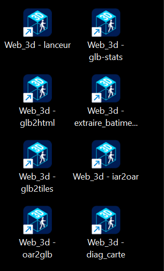

# Web_3d manual (1.10.0)

> **Summary.** This manual follows the project from end to end, theme by theme: getting started, with the vocabulary (chapter 1), the tools (2), converting an OAR (3), measuring and cutting up a big region (4), the viewer and the zones (5), building the page (6), the page from the visitor's side (7), tiled regions (8), the world map (9), the presence server (10), the JSON file reference (11), troubleshooting (12) and, as an appendix, what each version brought (13). For **every option** of the tools, with its effect and the default values of its parameters, in French and English: `docs/REFERENCE_OPTIONS.md` (generated from the tools by `gen_reference.py`). To **do a task step by step**: `PROCEDURES.md`. Language of the page and tools: § 7.49, § 7.51 and § 7.50.

## 1. Getting started

Web_3d turns an OpenSim region (a `.oar` backup) into a **3D web page** you walk around in with a browser: you can see the other visitors, chat, and cross portals to other places. Visitors install nothing.

### 1.1 A few words of vocabulary

| Word | What it is |
| --- | --- |
| **Region** | a piece of OpenSim world (terrain, buildings, objects). In the file names of this manual, `NOM` is the name of your region: `NOM.oar`, `NOM.glb`, `NOM.zones.json`… |
| **OAR** (`NOM.oar`) | the backup of an OpenSim region. |
| **GLB** (`NOM.glb`) | a 3D model file that browsers can display. `oar2glb.py` makes it from the OAR. |
| **Tiles** | a very heavy region is cut into pieces (the tiles), which the page loads as you walk. |
| **Viewer** (`glb-viewer.html`) | a page you open yourself, with your `.glb`: it is used to look at the model, to adjust how it is displayed (sea, rotation, camera…), to place the zones and to prepare the world map (chapter 5). |
| **Zone** | a place in the model to which something is attached: an **arrival point** (where the visitor appears), a **portal** (leading to another place or another region), a sign, a web link, a Home Assistant command, a picture on a wall, a private zone. Zones are saved in `NOM.zones.json`. |
| **Page** | the `.html` file visitors open. It comes in two forms (below). |
| **Standalone page** | a single `.html` file that contains everything, the model included. Simple to send, but everything has to be redone after each change. |
| **Page with a shell** | the **shell** is the generic page `index.html`: a common player that can display any region of the folder. Each region keeps its data in files next to it (`NOM.glb`, `NOM.config.json`, `NOM.zones.json`); you open it with `index.html?region=NOM`. This is the form to prefer when there are several regions. |
| **Presence** | an optional server that shows the other visitors and carries the chat. |
| **World map** | a page (`carte.html`) that presents the regions of a site and leads to each one. |

### 1.2 Three paths

| Path | For whom | Where |
| --- | --- | --- |
| **Ready-to-use package** (`galerie-photos.zip`, `region-simple.zip`) | trying it without building anything | the GitHub repository's releases page; `GUIDE.md` § 1.1 |
| **From the OAR to the page** | having your own region in a page | chapters 3 (convert), 5 (viewer and zones), 6 (page) |
| **The tools one by one** | heavy regions, a multi-region site, map, presence | chapters 2 and 4 to 10 |

`GUIDE.md` tells the path in order, task by task; `PROCEDURES.md` gives step-by-step procedures; this manual is the full description, theme by theme.

### 1.3 Where to look

To find a document or a procedure, see `INDEX.md`.

| I want to… | Chapter |
| --- | --- |
| know what each file in `dist` is for | 2 |
| convert an OAR to `.glb` | 3 |
| measure or cut up a huge region | 4 |
| adjust the model and place arrivals, portals, signs, links, images | 5 |
| build or update the page | 6 |
| know what the visitor can do (keys, flight, chat…) | 7 |
| load a tiled region in the page | 8 |
| link several regions with a map | 9 |
| see other visitors, moderate, keep a log | 10 |
| know the fields of the JSON files | `REFERENCE_JSON.md` (former chapter 11) |
| understand a failure | 12 |
| know what each version brought | 13 |

## 2. The tools and their files

The ready-to-use files are already in the repository's `dist/` folder: there is no need to build them to use them. `python build.py` is only needed if you change `src/` or `tools/`; it assembles everything into `dist/` (`dist/` is never edited by hand).

| File in `dist` | Role | Chapter |
| --- | --- | --- |
| `oar2glb.py` | converts an OAR to `.glb` and rebuilds the full terrain | 3 |
| `extraire_batiments.py` | outputs from an OAR and its `.glb` one recentred `.glb` per object group | 3 |
| `iar2oar.py` | turns an IAR (OpenSim inventory) into a minimal OAR | 3 |
| `diag_carte.py` | diagnoses why the map shows no nicknames (queries the presence server with and without the key) | 9 |
| `web3d_gui.py` | opens the tools in a window: tool list, basic-use examples, option help, run button, Windows shortcuts | 3.9 |
| `glb-stats.py` | measures a `.glb`; must stay next to `glb2tiles.py` | 4 |
| `glb2tiles.py` | cuts a huge `.glb` into tiles and makes `NOM.overview.glb` (the overview) | 4 |
| `glb-viewer.html` | the viewer: you open a `.glb` in it to adjust it and place the zones | 5 |
| `glb2html.py` | builds the page (standalone or with a shell) and keeps sites up to date: `--update`, `--register`, `--map-page`, `--scan-sites` | 6 |
| `index.html` | the shell: the generic page that displays the regions of a folder (see the vocabulary, § 1.1) | 6 |
| `carte.html` | the world map | 9 |
| `presence_server.py` | the presence and chat server (needs the Python module `websockets`) | 10 |
| `favicon.ico` | the pages' default icon | 6 |

For **every** option of each tool, with its effect and the default values of its parameters: `docs/REFERENCE_OPTIONS.md`.

## 3. Convert an OAR to GLB (`tools/oar2glb.py`)

`oar2glb.py` turns an OpenSim region backup (`.oar`) into a single `.glb` file ready for the viewer and for `glb2html.py`. It runs convoar¹, repairs its output and assembles everything. The output is written next to the OAR: `NOM.oar` gives `NOM.glb`.

¹ **Prerequisites**: **oar2glb.py** relies on the external converter **convoar.exe**
  Already supplied in this repository, in `dist/convoar/` (copy of https://github.com/Misterblue/convoar/tree/master/dist, Apache-2.0, see `THIRD-PARTY.md`)
  Copy without the `*.pdb` files and `NLog.xml`; tried by Klaatou on Windows (conversion of a small region, 10/11/2026) and on Linux with Mono (§ 3.11).
  Without convoar.exe, oar2glb.py cannot perform the OAR → GLB conversion.

**PBR materials.** convoar dates from May 2022 (.NET Framework 4.8, OpenSim libraries of that time) and does not read the OpenSim 0.9.3 PBR materials: a PBR face keeps, at best, its ordinary texture or colour. Since 1.9.12, `oar2glb.py` reads them itself from the OAR and applies them to the GLB, once convoar has run (§ 3.10; `--no-pbr` to skip).

### 3.1 The commands (PowerShell, a single line)

First go to the script's folder: `cd "P:\_OpenSim\SL&OS\Web_3d"`.

| Need                                                                       | Command                                                                                   |
| -------------------------------------------------------------------------- | ----------------------------------------------------------------------------------------- |
| Normal conversion                                                          | `python oar2glb.py "J:\...\NOM.oar"`                                                        |
| Conversion that keeps the intermediate folders (needed for `--diag`)       | `python oar2glb.py "J:\...\NOM.oar" --keep`                                                 |
| Find the animals in the viewer (a 15 m red mast on each)                   | `python oar2glb.py "J:\...\NOM.oar" --keep --markers`                                       |
| Keep invisible prims                                                       | `python oar2glb.py "J:\...\NOM.oar" --keep-invisible`                                       |
| Check what the script sees, without changing anything                      | `python oar2glb.py "J:\...\NOM.oar" --diag`                                                 |
| Same, naming the GLB or the `.gltf` to compare                             | `python oar2glb.py "J:\...\NOM.oar" --diag --glb "J:\...\NOM-GLTF\fichier.gltf"`              |
| Do not wait for "Enter" at the end                                         | add `--nopause`                                                                           |
| Without the OpenSim 0.9.3 PBR materials                                    | add `--no-pbr`                                                                   |
| Smaller PBR textures (lighter GLB, less graphics memory)                   | add `--pbr-size 256`                                                             |
| Add the complete terrain to an existing GLB, without running convoar again | `python oar2glb.py "J:\...\NOM.oar" --terrain-only "J:\...\NOM.glb"` (writes `NOM-terrain.glb`) |

Before converting again, delete the old intermediate folder: `Remove-Item -Recurse -Force "J:\...\NOM-GLTF*"`.

### 3.2 The options

| Option                    | Effect                                                                                                                                                                                                                                                                                                                                                                                                                                                                                                                            |
| ------------------------- | --------------------------------------------------------------------------------------------------------------------------------------------------------------------------------------------------------------------------------------------------------------------------------------------------------------------------------------------------------------------------------------------------------------------------------------------------------------------------------------------------------------------------------- |
| `--keep`                  | keeps the `NOM-GLTF` folder (images, buffers, `.gltf`); required to run `--diag` afterwards                                                                                                                                                                                                                                                                                                                                                                                                                                         |
| `--keep-invisible`        | keeps fully transparent prims (removed by default)                                                                                                                                                                                                                                                                                                                                                                                                                                                                                |
| `--markers`               | adds a 15 m red mast on each rigged animal placed; the node name gives the animal and its size; remove them by running again without the option                                                                                                                                                                                                                                                                                                                                                                                   |
| `--diag`                  | changes nothing and does not run convoar: lists each part of the OAR (see below)                                                                                                                                                                                                                                                                                                                                                                                                                                                  |
| `--glb CHEMIN`            | with `--diag`: GLB or `.gltf` to compare; by default the `.gltf` of the `NOM-GLTF` folder, otherwise the neighbouring `NOM.glb`                                                                                                                                                                                                                                                                                                                                                                                                       |
| `--max N`                 | maximum height (m) of a root object; above it (skybox) it is removed; default 600                                                                                                                                                                                                                                                                                                                                                                                                                                                 |
| `--convoar CHEMIN`        | path of `convoar.exe` (default: the `CONVOAR` variable, otherwise `convoar` from the PATH, otherwise `convoar/convoar.exe` or `convoar.exe` next to `oar2glb.py`); if it is not found, the message gives the download address                                                                                                                                                                                                                                                                                                                                                                                                                                                                                |
| `--reencode`              | **to be avoided**: re-encodes the textures before convoar; on Jungle_Isle it made about 150 textures out of 353 go missing (grey textures). Only use it if convoar shows many "unhandled number of components" errors or crashes in `OpenJPEG.DotNetDecode64` (return code 3221225477). Textures that Pillow cannot read are replaced by a 4x4 grey (list in `NOM-reenc-illisibles.txt`, next to the OAR) so as not to leave them to convoar's decoder; sculpt maps stay intact; at most 8 cores and batches of 512 to limit memory |
| `--nopause`               | do not wait for "Enter" at the end (the pause is also skipped when there is no console, with `--terrain-only`, and with `--help` or `-h` since 1.10.3)                                                                                                                                                                                                                                                                                                                                                                                                                |
| `--terrain auto\|yes\|no` | complete terrain from the height map (see below); `auto` by default                                                                                                                                                                                                                                                                                                                                                                                                                                                               |
| `--terrain-patch N`       | side of a terrain patch in metres, from 2 to 255; default 64                                                                                                                                                                                                                                                                                                                                                                                                                                                                      |
| `--terrain-only GLB`      | does not run convoar: adds the complete terrain to this GLB and writes `NOM-terrain.glb` next to it (the original is never modified)                                                                                                                                                                                                                                                                                                                                                                                                |
| `--output FICHIER`        | with `--terrain-only`: output file instead of `NOM-terrain.glb` (never the original)                                                                                                                                                                                                                                                                                                                                                                                                                                                |
| `--no-pbr`                | do not apply the OpenSim 0.9.3 PBR materials (convoar ignores them: the prims then keep an ordinary material); see § 3.10 |
| `--pbr-size N`            | maximum side, in pixels, of the PBR textures added to the GLB (default 512; 0 = original size); needs Pillow (`pip install pillow`); see § 3.10 |

### 3.3 Complete terrain for regions larger than 256 m (v29)

convoar produces only **one** "Terrain" node whose extent is capped (for example 257 x 267 m on a 1,024 m region: one sixteenth of the region has no ground). The complete height map is in the OAR (`terrains/*.r32`, one sample per metre). `oar2glb.py` uses it to build the ground:

- **Patches.** Squares of P x P metres (`--terrain-patch`, 64 by default), each a mesh of (P+1)² vertices. Edges are shared between neighbours (same heights, same normals, same colours: no crack, continuous lighting). The last patch of a row is smaller when n-1 is not a multiple of P. Each patch is a root object named `Terrain i,j` (i: column towards the east, j: row towards the north). World frame: X = x, height = h, Z = -y. A single "terrain" material (white, metal 0, roughness 1, single-sided), 16-bit indices, **no texture coordinates**: the look comes from the vertex colour (`COLOR_0`).
- **Normals** by central differences over the whole map (a single difference at the edges of the map).
- **Vertex colour** from the altitude `a` above the water level and the slope:

| Situation                   | Colour (red, green, blue)                                                             |
| --------------------------- | ------------------------------------------------------------------------------------- |
| `a` ≤ 0 (under water)       | wet sand (166, 150, 104)                                                              |
| 0 < `a` ≤ 1 m               | dry sand (214, 196, 142)                                                              |
| 1 to 4 m                    | gradual transition from dry sand to grass                                             |
| `a` ≥ 4 m                   | grass, light gradient from (98, 146, 66) at `a` = 4 m to (132, 140, 78) at `a` = 80 m |
| slope from 32 to 38 degrees | gradual transition towards grey rock (122, 120, 116); beyond 38 degrees: rock         |

- **Water level.** `WaterHeight` read from `settings/*.xml` in the OAR, otherwise 20 m (OpenSim's default). The log says which value is used and where it comes from.
- **When to replace.** `--terrain auto` (default): if convoar's "Terrain" node exists and covers less than 95 % of the map (boxes compared in the world frame), it is removed from the scene and the patches are added. Otherwise (256 m region, terrain already complete, no "Terrain" node) the GLB is **not modified**: it is identical to the one from `--terrain no`. `--terrain yes` always adds the patches (and removes convoar's "Terrain" if it exists); `--terrain no` does nothing. A GLB that already contains patches does not get any more. The filter of objects outside the region never removes the patches.
- **`--terrain-only GLB`** (without running convoar again, for a GLB of several GB): the GLB is **not loaded in full**. The JSON header is rewritten, the binary chunk is copied in pieces of 8 MB, the new buffers are added at the end. Output `NOM-terrain.glb` next to the original (or `--output`); the original is never overwritten, and nothing is written if convoar's terrain is already complete. The data of the old "Terrain" stay in the file, unused (a few MB). No "Enter" pause at the end.
- **Log.** Line `[terrain] map N x N samples (1 m); water level E m (origin); K patch(es) of P m; V vertices; B MB added; duration`. An OAR without a height map gives `this OAR has no height map ... nothing is modified` (return code 0, no error).
- **Not in this batch**: OpenSim terrain textures (the four textures blended according to altitude), level of detail of the terrain for the overview.

Test: `python tests/terrain.py` (synthetic OAR and GLB).

### 3.4 What the script fixes

- **Rigged animals (animesh).** The geometry convoar writes for these meshes is unusable (giant hippos, tiny or flying elephants, shapes shared between animals). The script rebuilds it from the OAR's `.llmesh` file: positions, normals, UVs, triangles, then `bind_shape_matrix`; the prim's scale is ignored. The pieces of one animal stay together. The animal is centred on the position of the object's root and its feet are placed under the root box (at the altitude of the root if it is itself rigged). The textures come from convoar (face n of the mesh = material n). No rule depends on an animal's name. An animal whose computed size falls outside 0.1 to 12 m stays as convoar produced it (the log says so).
- **Invisible prims.** Removed: prims whose faces all have alpha 0 or carry a standard invisible texture, nodes whose materials are all transparent, and the root box of an animesh (simple prim, root of an object whose other pieces are all rigged meshes). The children of a removed root stay.
- **Textures.** The script compares the images announced by the `.gltf` with the files present; if some are missing, it runs convoar again (at most 2 more attempts), keeping the images already written.
- **Positions of regions larger than 256 m** and objects outside the region: processing unchanged. The terrain of these regions is completed by the patches (see "Complete terrain").

### 3.5 Reading the log (`oar2glb.log`, next to the script)

| Line                                                                      | Meaning                                                                                             |
| ------------------------------------------------------------------------- | --------------------------------------------------------------------------------------------------- |
| `[rigged] 'Name' rebuilt from the OAR: N face(s), M vertices...`          | a piece of an animal was rebuilt; the "convoar" figures next to it show what convoar had written    |
| `[rigged] 'Name': 5 piece(s)... feet at 27.11 m (bottom of the root box)` | animal placed; size L x W x H and altitude of the feet                                              |
| `[rigged] ... GLB node not found`                                         | the piece was not found in the GLB; run `--diag`                                                    |
| `[rigged] ... obtained size ... implausible`                              | safeguard: the animal is left as convoar produced it                                                |
| `[invisible] node N 'Name' removed: ...`                                  | prim removed, with the reason                                                                       |
| `[fix] N rigged mesh(es) rescaled, M invisible prim(s) removed`           | summary                                                                                             |
| `[check] 'Name' feet at ...: inside the box of N object(s)`               | objects whose bounding box contains the centre of the animal (a clue if an animal is inside a rock) |
| `[GLB] N texture(s) missing out of M`                                     | missing images, replaced by grey                                                                    |
| `[terrain] ...`                                                           | decision (coverage of convoar's terrain) then summary of the patches added                          |
| `[OK] ...glb (taille, meshes, textures)`                                  | normal end                                                                                          |

### 3.6 Diagnostic: `--diag`

Run it after a conversion made with `--keep`. The log is `oar2glb.diag.log`. Each part of the OAR gives one line: name, UUID, root or child, rigged yes/no, prim scale, `bind_shape_matrix` scale, transparent yes/no, animesh root box yes/no, and the GLB node found with the method (prim UUID, mesh UUID, name + position). Animals and invisible prims also show the summary of the `TextureEntry`, the full matrix, the position domain and the GLB material. A "node not found" line on an animal or a transparent prim means that the fix will not apply to it.

### 3.7 Extract objects from a region: `extraire_batiments.py`

`tools/extraire_batiments.py` (built into `dist/`) outputs from an OpenSim region, starting from the OAR and the GLB made by `oar2glb.py`, **one GLB per object group**, recentred. Its name comes from the buildings of a big OAR of houses it was written for, but **it is an object extraction**: a group can be a building, a piece of furniture, a tree, a vehicle; "building" reads "object" in its messages and files. It changes neither the OAR nor the GLB: it only writes the output folder (`batiments` by default) and its cache.

| To | Command |
| --- | --- |
| See the groups of the OAR | `python extraire_batiments.py OAR GLB --list [--filter REGEX] [--min-parts N] [--box REGEX]` |
| See, for each delivery box, the neighbouring group | `python extraire_batiments.py OAR GLB --list --box RAKis --neighbor` |
| Extract groups by number | `python extraire_batiments.py OAR GLB --group 12 --group 15,18,100-150 -o DOSSIER` |
| Extract by name | `python extraire_batiments.py OAR GLB --name "Jewel Box House"` |
| Add a 5 m test floor around | `python extraire_batiments.py OAR GLB --group 12 --ground 5` |
| One file for several groups | `python extraire_batiments.py OAR GLB --group 12 --group 15 --merge "Maison et garage"` |
| Say how many groups would be extracted | `python extraire_batiments.py OAR GLB --all --min-parts 5 --box RAKis --exclude Rail --dry-run` |

- **Group number**: its rank in the OAR; it does not change while the OAR is the same. Each chosen group gives `NNNN_nom.glb` and `NNNN_nom.json`; with `--merge`, all the chosen groups give a single file named after the argument.
- **Recentring**: the middle of the object in x and z is at 0 and the ground at y = 0 (height of the OAR terrain under that middle, otherwise the lowest point). The `.json` next to it keeps the original OpenSim coordinates (x, y of the middle, ground altitude), the size and the groups.
- **Test floor** (`--ground MARGIN`): a flat slab of plain colour, 0.3 m thick, whose top is at -2 cm, sticking out of the object by `MARGIN` metres; you can walk on it. The node is named "sol d'essai" (`extras.essai`), so it can be removed afterwards.
- **Delivery boxes**: a 1.2 m cube whose name matches `--box`. `--all` skips them; `--neighbor` looks for the neighbouring group of each box, first by the building name (the box's name without its suffix, within `--name-radius` metres), otherwise by position alone (`--radius` metres, groups of at least `--neighbor-parts` parts); the three default distances (80, 25 and 5) are estimates to be calibrated; display only.
- **`--all`** refuses to take single-part groups (rails, signs...) without `--min-parts N` or `--yes`.
- **Cache**: the first time, reading the OAR and measuring the GLB are slow; the result is kept in the `extraire_batiments.cache` folder, created **in the folder where the command is run** (never next to the script, so nothing is written in `dist/`), and read again while the OAR, the GLB, `glb2tiles.py` and `oar2glb.py` have not changed (path, size, date). You can move this folder along with your command. `--no-cache` ignores it, `--clear-cache` deletes it. The cache files are pickles: do not take them from another source.
- **The two other tools**: `glb2tiles.py` and `oar2glb.py` are looked up in the folder given by `--tools`, otherwise by the `WEB3D_TOOLS` variable, otherwise next to the script.
- **Options and language**: all the options are in `docs/REFERENCE_OPTIONS.md`; `--lang` and `WEB3D_LANG`: § 7.50; the old French names are still accepted: `REFERENCE_JSON.md` § 11.11.
- **Tried**: automatic tests on an OAR and a GLB made by `tests/extraire_batiments.py`; by Klaatou, on a real region, on Windows (08/11/2026).

### 3.8 Extract objects from an IAR (inventory): `iar2oar.py`

`tools/iar2oar.py` (built into `dist/`) turns an OpenSim inventory archive (IAR) into a **minimal OAR**, which the rest handles as a region (`oar2glb.py`, then `extraire_batiments.py`). It never changes the IAR and imports nothing from `oar2glb.py` or `glb2tiles.py`.

| To | Command |
| --- | --- |
| See what the IAR contains (writes nothing) | `python iar2oar.py MON.iar --list [--filter REGEX] [--no-nested]` |
| Make the OAR | `python iar2oar.py MON.iar -o inventaire.oar [--filter REGEX] [--no-nested] [--margin 4]` |
| Then make the GLB | `python oar2glb.py inventaire.oar` |
| Then list and extract | `python extraire_batiments.py inventaire.oar inventaire.glb --list` |

- Each inventory object (`object.xml` asset) becomes one or more groups of the OAR; the group carries the name of the inventory item (the root of the object is renamed), so that `--name` and `--filter` work.
- A "coalesced" object (`CoalescedObject`) is split into its groups, which keep their relative layout.
- Objects held in the contents of another one (boxes, `TaskInventory`) are added too, up to 3 levels, once each; their name is "parent / name"; `--no-nested` ignores them.
- The original positions overlap: each group (or coalesced object) gets a cell on a grid, separated from its neighbours by `--margin` metres (4 by default), without terrain (the ground of an extract is then its lowest point). The region size grows in steps of 256 m if needed. **Estimate**: the extent of a group for its cell is computed from the positions and scales of the parts, without rotations.
- The null byte that ends the XML files of the IAR is removed; only the assets useful for 3D are copied (meshes, textures, materials).
- **Not supported**: attachments and clothing (no avatar). **Tried**: automatic tests on an IAR made by `tests/iar2oar.py`; by Klaatou, on a real IAR of 34 items (OAR produced, GLB made with convoar, opened in Blender, 06/11/2026), then with the version that entered the repository (08/11/2026). The convoar texture errors on an IAR can come from the IAR itself (missing or empty assets): the faces concerned are grey.
- Options, language, old names: as in § 3.7.

### 3.9 Graphical launcher: `web3d_gui.py`

`tools/web3d_gui.py` (built into `dist/`) opens the tools in a window, without typing a command: you choose the tool in a list, fill in the options, and it runs the tool and shows its output. It reads the options from the tool itself (nothing can be missing, no tool is modified). It needs `tkinter` (shipped with Python on Windows; on Linux, the `python3-tk` package).

| To | Command |
| --- | --- |
| Open the window | `python web3d_gui.py` |
| Open it on one tool | `python web3d_gui.py --tool oar2glb` |
| See what the shortcuts would be, writing nothing | `python web3d_gui.py --shortcuts --dry-run` |
| Create the shortcuts | `python web3d_gui.py --shortcuts` |
| Remove them | `python web3d_gui.py --remove-shortcuts` |

- **The tools**: `glb2html`, `glb2tiles`, `oar2glb`, `extraire_batiments`, `iar2oar`, `diag_carte`, `glb-stats` (`--tool NAME`). Under the tool choice, a "Function:" line says in one sentence what the chosen tool does (1.10.4). The presence server is not in it: it keeps running, it is not a one-off command.
- **The window**: at the top, the tool list and a search box, then the "Examples" list; in the middle, one line per option (check box, list of choices, number, path with the File... and Folder... buttons, "option alone" for an optional value, a multi-line box for a repeatable option such as `--group` or `--exclude`, yes/no for the `--x` and `--no-x` pairs); at the bottom, the help of the option under the pointer, the resulting command, the Run (Ctrl+Enter), Stop, Copy the command and Clear all buttons, then the tool's output.
- **The examples**: the "Examples" list offers 2 to 6 basic uses of the tool shown (for `extraire_batiments`: list the groups, extract one by its number or by its name, merge several, simulate extracting everything). Choosing an example **clears the fields, then fills them**: the equivalent command updates and the help says to replace the example names (`Atoll.glb`, `ADRESSE`, `MA_CLE`...) with your own. Nothing runs by itself; you can edit the fields before clicking Run. The list is inactive while a tool runs and goes back to its prompt when you change tool. The examples are written in the `EXEMPLES` table of `web3d_gui.py` (titles in `src/i18n`, keys `py.gui.ex.*`); an example that does not match the options of the installed tool (an older version) shows a message instead of filling the fields.
- **Fields to fix**: an unreadable number or a choice outside the list is marked with a "!" (never by colour alone), and Run refuses and says which one.
- **Default values**: shown at the right of the line. When the option's help describes the default without a figure (`--spectate`: on as soon as a `--presence-url` is given; `-o`: "<name> - Offline.html" next to the `.glb`), the line says "default: see the help".
- **Shortcuts** (Windows): `--shortcuts` creates eight `.lnk` files on the desktop: "Web_3d - launcher" and one per tool (seven tools since 1.10.3). They start `pythonw.exe` (no black console window) and carry the project icon (`favicon.ico`, next to the script). Running `--shortcuts` again replaces the existing shortcuts; `--shortcuts-folder FOLDER` picks another folder; `--dry-run` says what would be done. If Python is moved or reinstalled, run `--shortcuts` again.



- **The window icon** (1.10.3): on Windows the window takes the project icon (`favicon.ico`, next to the script, the one the shortcuts use). Elsewhere Tk does not read ICO: Pillow reads it and sets the icon, and without Pillow the default icon stays. A missing icon never stops the launcher.

- **Language and version**: `--lang` and `WEB3D_LANG` (§ 7.50), `--version`.
- **Tried**: automatic tests on Linux with a virtual display (`tests/gui.py`: the options of every tool, one by one, accepted by the tool's real parser; every example of every tool accepted by that parser and reloaded identically by the window); by Klaatou on Windows: the window, the tool list and the shortcuts with the project icon (08/11/2026), the examples list (10/11/2026). **Python 3.10 to 3.14**: the tools open (`--help`) under these versions (`tests/python_recent.py`, tried in the sandbox); `glb2html.py` did not open under Python 3.14 before 1.10.4 (`BooleanOptionalAction` refuses `metavar` there); tried by Klaatou under 3.14 and 3.12 (12/11/2026). Tried by Klaatou on Windows (screenshot of 13/11/2026): the window icon (title bar), `glb-stats` in the list, the "Function" line and the eight shortcuts. **Not tried**: macOS, Linux with a real display, the file pickers.

### 3.10 OpenSim 0.9.3 PBR materials (1.9.12 to 1.9.14)

convoar (May 2022) does not read PBR materials. `oar2glb.py` reads them itself from the OAR and, once convoar has run, gives each face concerned its real glTF material: base colour, metallic and roughness, normal, occlusion, emissive, factors, alpha mode, double sided, and the object's own overrides. It is automatic when the OAR contains PBR; `--no-pbr` prevents it.

**What is read from the OAR** (from OpenSim's code, then checked on a real OAR):

| Where | What it is |
| ----- | ---------- |
| extra parameter `0x80` (`<ExtraParams>`) of the prim | one PBR material (UUID) per face |
| `assets/UUID_prmat.dat` | the material: a binary LLSD header around a glTF 2.0 text (colour, metallic/roughness, normal, occlusion, emissive) |
| `<MatOvrd>` | per-face overrides: `bc` base colour, `mf` metallic, `rf` roughness, `ec` emissive, `am` alpha mode, `ac` alpha cutoff, `ds` double sided, `tex` replacement textures, `ti` texture transforms (written as `KHR_texture_transform`) |
| material `968cbad0-4dad-d64e-71b5-72bf13ad051a` | OpenSim's default material, never written in an OAR: taken as a blank material (white, metallic 1, roughness 1, like glTF and the Second Life viewer), to which the overrides apply |

**Rules**

- glTF primitive *j* gets the material of face *j* (convoar writes one primitive per face that has geometry, in face order).
- A whole sphere has only **one** face in OpenSim. The small cap that convoar makes a second primitive gets the material of face 0 (otherwise it showed a disc of another texture). Hollow or cut spheres, and the other shapes, do not get this rule.
- A mesh shared by prims with different materials is copied.
- In a `tex` override, a null UUID means "no override" and `ffffffff-ffff-ffff-ffff-ffffffffffff` means "remove the texture" (from the Second Life viewer's code).

**Textures.** The PBR textures (JPEG 2000 in the OAR) are read in a **second pass over the OAR**, decoded with **Pillow** (`pip install pillow`), reduced to `--pbr-size` pixels a side (512 by default; 0 keeps the original size), then stored in the GLB as JPEG (PNG if transparent). Without Pillow, the materials are applied without their textures, with a message. A region that shows about a thousand PBR materials gives a heavy GLB: `--pbr-size 256` lightens it, and also the graphics memory.

**In the log**: `[PBR] N prim(s) with a PBR material, M material(s), K texture(s), B bytes added`, then, if needed, warnings: PBR prims without a node in the GLB, materials cited but missing from the OAR, textures missing or unreadable.

**Tried**: the 1.45 GB OAR of the BloodMoon Pack grid's sandbox (794 objects, 7,240 textures; thanks to its owner, Vlad: see the README credits), converted on Windows with `--pbr-size 256` in about 2 min 12 s (11/11/2026): 359 PBR prims, 291 materials, 1,007 textures, a 73.7 MB GLB; seen in Blender, in `glb-viewer.html` and in the page: normals, metal and reflections visible, spheres grey where OpenSim shows them grey. Klaatou saw the memory rise to 61 GB during the conversion, without it falling back afterwards: the origin is not established (no per-process reading). **Not tried**: tiles mode with this GLB; hollow or cut spheres; shapes other than spheres, cubes and cylinders; an OAR of this size on Linux; a side-by-side comparison with an OpenSim viewer (only screenshots looked at by eye).

### 3.11 On Linux: convoar with Mono (1.9.11)

On Linux, `oar2glb.py` runs `convoar.exe` with `mono` (absolute path, `LC_ALL=C` for numbers as `0.5`, and `LD_LIBRARY_PATH` starting with the folder of `convoar.exe` for the supplied openjpeg library). The `dist/convoar/` folder is the Windows one and is used as it is. A program without `.exe` (a script, `convoar` from the PATH) is run as before.

Packages to install (Debian 13, Ubuntu), as `root`:

```bash
apt-get install mono-runtime libgdiplus libmono-system-drawing4.0-cil libmono-system-servicemodel4.0a-cil libmono-system-runtime-serialization4.0-cil
```

Without `mono`, `oar2glb.py` stops with this message and this list. Then: `python3 oar2glb.py ~/NOM.oar --nopause`. For the PBR textures: `pip install pillow`.

**Why not the .NET 8 port of convoar.** Tried (`net8-pbr` forks, 11/11/2026), it starts on Linux but stops at the first `System.Drawing.Bitmap` (`PlatformNotSupportedException`: .NET 8 only accepts `System.Drawing.Common` on Windows). Mono, with the original `convoar.exe`, works.

**Tried**: Debian 13 (Mono 6.12) with a small 4-object OAR: the GLB geometry is identical, byte for byte, to a conversion on Windows (only `libgdiplus`'s JPEG encoder changes the textures slightly); Ubuntu 24 (Mono 6.8) with extracts of the BloodMoon Pack sandbox, PBR included. **Your feedback is welcome** (other distributions, large regions, macOS) to validate this route completely. Known point: on a 20-object extract, convoar under Mono did not write its `.buf` file (`BAssetStorage.cs:138`, `WriteAsync` without `await` in the original code); not fixed.

## 4. Measuring and cutting up a big region

For a huge region: measure with `glb-stats.py` (through `--analyse` of `glb2tiles.py`), cut with `glb2tiles.py`, compress the tiles. To load the result in the page: chapter 8.

### 4.1 Split a huge GLB into tiles (`tools/glb2tiles.py`, v28; `--exclude` and pause in v29; invalid images and overview in v31)

`glb2tiles.py` splits a GLB that is too heavy into **standalone tiles**: each one is a valid GLB (can be opened alone in `glb-viewer.html`), with its own nodes, meshes, materials and images, at the original coordinates (no recentring). This tool **writes the tiles, their list and (v31) a light overview of the whole region**; it is the shell that loads them around the avatar (v30, see § 8). Standard Python only. The input GLB is never loaded in full: the JSON header is read, then the indices, positions and images in pieces.

`glb-stats.py` must stay **next to** `glb2tiles.py` (shared measuring functions); `python build.py` puts both in `dist/`.

#### 4.1.1 The commands (PowerShell, a single line)

| To                                                         | Command                                                                                                                                            |
| ---------------------------------------------------------- | -------------------------------------------------------------------------------------------------------------------------------------------------- |
| See the version                                            | `python glb2tiles.py --version`                                                                                                                    |
| Measure and get a recommendation, without writing anything | `python glb2tiles.py "P:\...\Region.glb" --analyse`                                                                                                |
| Split (recommendation "split")                             | `python glb2tiles.py "P:\...\Region.glb"`                                                                                                          |
| Split even if the recommendation is "no split"             | `python glb2tiles.py "P:\...\Region.glb" --force`                                                                                                  |
| Write somewhere other than next to the GLB                 | `python glb2tiles.py "P:\...\Region.glb" --output "P:\...\tuiles"`                                                                                 |
| Split without the overview                                 | `python glb2tiles.py "P:\...\Region.glb" --no-overview`                                                                                            |
| Redo **only** the overview (tiles untouched)               | `python glb2tiles.py "P:\...\Region.glb" --overview-only` with **the same split options** (`--output`, `--budget`, `--exclude`…) as the first time |
| Leave out a supplier's "delivery boxes"                    | `python glb2tiles.py "P:\...\Region.glb" --analyse --exclude "Freebies 20"` then the same command without `--analyse`                              |

Start with `--analyse`: it gives the measurements of `glb-stats.py`, the 10 heaviest meshes (compacted bytes, extent in metres), the 10 instances furthest from the median centre (outliers), the number of tiles expected with the chosen parameters, the expected duplication factor, the number of root objects kept whole or spread, and a recommendation sentence: "no split needed" or "split: budget N MB, T tiles, duplication F". A light GLB answers "no split needed" and nothing is written (even without `--analyse`, except with `--force`).

#### 4.1.2 The parameters

| Option                                 | Default         | Meaning                                                                                                                                                                                     |
| -------------------------------------- | --------------- | ------------------------------------------------------------------------------------------------------------------------------------------------------------------------------------------- |
| `--budget`                             | 32              | MB per tile (standalone weight: distinct compacted primitives + distinct images)                                                                                                            |
| `--budget-triangles`                   | 1500000         | triangles per tile (the weight in MB is not enough: a block can have 5 M triangles for 70 MB)                                                                                               |
| `--min`                                | 16              | minimum side of a cell, in m: no further subdivision below it                                                                                                                               |
| `--whole-weight`                       | 16              | MB: a root object lighter than this can stay whole                                                                                                                                          |
| `--whole-extent`                       | 256             | m: …and smaller than this (both conditions together; the extent alone does not decide)                                                                                                      |
| `--threshold`, `--threshold-triangles` | 150, 3000000    | under these two values: "no split needed"                                                                                                                                                   |
| `--outlier`                            | 1000            | m: an instance further than this from the median centre, or larger, is reported                                                                                                             |
| `--block`                              | 256             | side of the blocks of the `glb-stats` part of `--analyse`                                                                                                                                   |
| `--output`                             | next to the GLB | output folder                                                                                                                                                                               |
| `--force`                              |                 | split even under the thresholds                                                                                                                                                             |
| `--exclude REGEX`                      |                 | removes from the split the root objects whose name matches (case-insensitive, repeatable; see below)                                                                                        |
| `--exclude-max-triangles`              | 24              | at most this many triangles in the root object, all meshes included, to be excluded                                                                                                         |
| `--exclude-max-meshes`                 | 1               | at most this many meshes in the root object to be excluded                                                                                                                                  |
| `--no-refs`                            |                 | do not write `extras.ref` / `extras.box` in the nodes of the tiles (v31 format: zones linked to an object impossible in tiles mode)                                                         |
| `--no-overview`                        |                 | do not write `NOM.overview.glb`                                                                                                                                                               |
| `--overview-only`                      |                 | write only `NOM.overview.glb` and its mention in `NOM.tiles.json`; the recomputed split must find exactly the tiles of `NOM.tiles.json` (otherwise: "does not match" error, use the same options) |
| `--ov-budget`, `--ov-budget-triangles` | 25, 1500000     | MB and triangles of the whole overview                                                                                                                                                      |
| `--ov-threshold`                       | 3               | m: objects whose largest dimension is smaller are omitted (the budget can raise this threshold)                                                                                             |
| `--ov-threshold-max`                   | 24              | m: if the budget forces omitting objects larger than this, the resolution goes down                                                                                                         |
| `--ov-resolution`                      | 10              | cells on the largest dimension of a primitive for vertex clustering (larger = finer and heavier)                                                                                            |
| `--ov-terrain-step`                    | 4               | m: grid step of the terrain in the overview                                                                                                                                                 |
| `--nopause`                            |                 | do not wait for Enter at the end (the pause is also skipped when there is no console: script, scheduled task; and with `--help` or `-h` since 1.10.3)                                                                               |

#### 4.1.3 Excluding objects (`--exclude`, v29)

Some catalogues place next to each building a "delivery box" (textured cube of 12 triangles, a single mesh) whose name ends with the supplier's, for example "City Stores - Box - RAKis Freebies 2019". `--exclude "Freebies"` removes them, **provided that** the root object also has at most `--exclude-max-triangles` triangles (all meshes included) **and** at most `--exclude-max-meshes` meshes. Without these safeguards the supplier's name would also remove real buildings ("Jewel Box House V17 with Stairs - RAKis Freebies 2": 143 meshes, kept). The decision **never depends on the extent**: the bounding box of a small mesh that shares a vertex buffer with others is inflated, up to several tens of metres for a cube of 12 triangles.

- Several `--exclude` add up. An invalid expression gives a clear message (`Invalid regular expression for --exclude`) and nothing is read.
- The nodes removed are the root object and all its descendants; no other object changes. Excluded objects enter neither the tiles nor the weight, triangle and budget calculations (the "no split" recommendation also removes their bytes from the size of the GLB). The original GLB is not modified; the `glb-stats` part of `--analyse` describes the original file.
- `--analyse` and the final report give: the number of excluded objects, the triangles removed, the bytes saved (geometry and images that no kept object uses; **0** when all excluded objects share their primitives or their images with kept objects, for example a common cube: the report then says so, and counts the shared bytes not saved), the number of objects with a matching name but kept by the safeguards, and the 20 most frequent names with their count. `NOM.tiles.json` gets an `excluded` key (patterns, safeguards, `count`, `triangles`, `bytesSaved`, `bytesShared`, `names`) only when `--exclude` is used.

#### 4.1.4 Object references (v32): link a zone to an object in tiles mode

Each node copied into a tile gets in its `extras`: **`ref`**, its stable reference in the original model, and **`box`**, the box (world, 6 numbers in m) of **the whole object**, even when it is spread over several tiles (each piece carries the same box). `NOM.tiles.json` carries `"nodeRefs": 1`.

- **Reference rule** (the one of `nom#index` in single-GLB mode, computed on the whole GLB): the **name** of the node (failing that, the name of its mesh) if it is unique in the whole model; otherwise **`nom#index`**, index = rank of the node among the nodes with this name, in traversal order (pre-order, children in file order). Objects removed by `--exclude` count in the ranks (a reference does not change when something else is excluded). A node without a name has no reference; a reference longer than 200 characters is not written.
- These references are those of the **GLB names**, not those the viewer would see when opening the same whole GLB (the three.js loader renames duplicates): a linked zone written in tiles mode is used in tiles mode.
- **Measured cost** (synthetic GLB of 40,000 nodes): +0.5 s out of 8 s, +3 MB out of 230 MB of tiles.
- Tiles written **before v32** do not have these extras: linked zones are still ignored there. `glb2tiles.py --analyse` (and `--overview-only`) report it when `NOM.tiles.json` already exists without `nodeRefs`; `glb2html.py --tiles` too, if there are linked zones. You must **split again** (without `--overview-only`).

#### 4.1.5 Empty or invalid images (v31)

An embedded image **of 0 bytes**, of **another format** than PNG, JPEG or WebP, or **truncated** makes the loading of the tile fail in the browser ("THREE.GLTFLoader: Couldn't load texture"): measured in Chromium, `createImageBitmap` also fails on a cut PNG, JPEG or WebP, not only on an empty image. On the "Free House Gallery 4X4" region, 778 images out of 19,799 were in this case (all with a `bufferView` of `byteLength` 0).

- When writing, each image of this kind is replaced by **a grey PNG of 4 x 4 pixels** (grey 128, the one of the textures replaced by `oar2glb.py`), **written only once per tile** and shared by all the references of this tile (name `image-remplacee`). Materials, textures and texture coordinates do not change.
- Check without decoding: PNG = chained chunks up to `IEND`; JPEG = end marker `FFD9` last (give or take padding zeros and spaces); WebP = RIFF size contained in the file. Only the header, the end and the chunk headers are read (never the whole image). A file that Chromium would decode despite an unusual ending would be replaced wrongly: the reported number lets you notice it.
- `--analyse` and the final report give "Empty or invalid images replaced…: N distinct, M occurrence(s)" (an occurrence = an image written in a tile). `NOM.tiles.json` gets `"replacedImages": {"distinct": N, "occurrences": M, "grey": 128}` and each tile its own number.

#### 4.1.6 Overview (`NOM.overview.glb`, v31)

Purpose: in the global view, see the **whole** region; in walk mode, see **into the distance** beyond the loaded tiles. The detailed tiles remain the only source of collisions and ground.

- **Written with the tiles** (or alone with `--overview-only`), next to `NOM.tiles.json`, and referenced in `NOM.tiles.json` (`overview` key: `file`, `bytes`, `triangles`, `terrainTriangles`, `objects`, `candidates`, `omitted`, `effectiveMinExtent`, `effectiveTerrainStep`, `resolution`, `seconds`, `colors`, `params`).
- **One node per tile file**, named like the tile (`NOM.tiles/T_3_2_5.glb`, and `extras.tile`): the page hides the cell as soon as the detailed tile is **displayed** and shows it again when the tile is unloaded or has failed. The objects of a cell are exactly those of the tile: no double display, no hole during loading.
- **No image.** A single material; the colours are **vertex colours**. Each material becomes a flat colour: the **average colour of its texture** if Pillow is installed (average in linear space, weighted by opacity), otherwise its **base colour**. The vertex colours of the terrain are kept. No normals: the page shows the overview with flat shading. Translucent primitives (`alphaMode` BLEND: glass, effects) and skinned objects are omitted.
- **Each UNIQUE primitive is simplified only once**, then copied with the matrix of each of its instances (never simplified per instance). Method: vertex clustering on a grid of side (largest dimension of the primitive) / `--ov-resolution`; one vertex per cell (average), degenerate and duplicate triangles removed. Standard Python only; Pillow is optional (average colours).
- **Terrain simplified separately.** The pieces marked `extras.terrain` (patches from `oar2glb.py`) are resampled on a **common regular grid** of step `--ov-terrain-step`: height and colour interpolated in the original triangles, a cell belongs to a single piece (so to a single tile). A grid point on a shared edge gets the same height on both sides: **no gap between the patches** (tested). The terrain takes at most half of the budgets; otherwise its step grows (× 1.5) until it fits (stated in the log).
- **Omitted objects.** Those whose largest dimension is under `--ov-threshold` (3 m by default: at 600 m, the distance at which the overview makes most of the image, 3 m cover about 8 pixels on a screen 1,080 pixels high with the 38-degree field of view; at 210 m, the limit of the loading radius, 22 pixels). This choice comes from a calculation of size on screen, **not from a measurement on your region**: `--analyse` prints the number of instances and triangles above 1, 2, 3, 4, 8, 16, 32 and 64 m to decide on your data. If the budget is reached, the **largest objects are kept first** and the effective threshold rises (`effectiveMinExtent`); beyond `--ov-threshold-max` the resolution goes down and the calculation is redone.
- **Budgets**: 25 MB and 1,500,000 triangles for the whole region (`--ov-budget`, `--ov-budget-triangles`). The report gives the weight, the triangles (terrain included), the objects kept out of the candidates, the objects omitted (too small / by the budget / skinned), the translucent primitives omitted, the colours (texture averages, unreadable, Pillow missing) and the time.
- **The GLB is never loaded in full** (same reading in pieces of at most 4 MB as for the tiles), with a progress line ("[overview: primitives] …"); the terrain pieces are read one by one.
- **Duration.** Throughput measured on synthetic GLBs of increasing size (0.5; 2; 8; 24 million unique triangles): about 1.8 million unique triangles per second, linear (0.3; 1.2; 4.5; 13 s), i.e. 14 to 680 MB of GLB for 25 to 164 MB of memory; 20,000 small meshes (4 million triangles, 40,000 instances): 15 s, 377 MB; 1,024 m terrain in 256 patches of 4,225 vertices: 3.6 s, 57 MB. The estimate for the 1.3 GB region is given in `CHANGELOG.md` (v31).

#### 4.1.7 How the split is decided

- Adaptive quadtree on the X,Z plane (Y is the height), only on non-empty cells. A cell is subdivided as long as its standalone weight exceeds `--budget` **or** its triangles exceed `--budget-triangles`, and its side exceeds `--min`.
- A **root object** (first-level node of the scene) stays **whole**, in the cell of the centre of its box, if its standalone weight ≤ `--whole-weight` **and** its extent ≤ `--whole-extent`. Otherwise it is **spread instance by instance**: each instance goes into the cell of its own centre, and the parent nodes are copied (without mesh) with their original transforms.
- An object carrying a **skin** is never spread: its whole root object goes into the tile of the centre of its box, with the skin, the joint nodes (even if they are outside the object) and the `inverseBindMatrices`.
- Meshes shared between tiles are **duplicated** in each tile that uses them (standalone tiles). The actual duplication is written in the report.
- The vertices of each primitive are **compacted**: only indexed vertices are kept and renumbered, with the smallest index type (16 bits if possible). Triangles are identical.
- A **single** mesh heavier than the budget (terrain, sea) cannot be spread at this stage: its cell stays as it is, over budget, with a warning (name, extent, MB).
- A compressed GLB (Draco, meshopt) is refused with a clear message. `sparse` accessors: refused with a message.

#### 4.1.8 Files produced

`NOM.tiles/T_<niveau>_<i>_<j>.glb` (level and position of the cell in the quadtree), `NOM.tiles.json` (UTF-8 without BOM) and `NOM.overview.glb` (v31), next to the GLB `NOM.glb`:

```
{
 "version": 1,                      format version
 "generator": "glb2tiles v28 (21/10/2026)",
 "source": "NOM.glb",
 "extent": {"min": [x,y,z], "max": [x,y,z]},     overall extent of the content
 "params": {"budgetMB": 32, "budgetTriangles": 1500000, "minCell": 16, "wholeWeightMB": 16, "wholeExtent": 256,
            "thresholdMB": 150, "thresholdTriangles": 3000000, "outlier": 1000},
 "warnings": ["..."],               tiles over budget, outliers, extensions not copied
 "roots": {"whole": 1700, "split": 125},         root objects kept whole / spread
 "duplication": 1.8,                sum of geometry bytes of the tiles / unique geometry of the GLB
 "nodeRefs": 1,                     extras.ref / extras.box in the nodes of the tiles (v32; 0 with --no-refs)
 "replacedImages": {"distinct": 778, "occurrences": 1200, "grey": 128},    empty or invalid images replaced (v31)
 "overview": {"file": "NOM.overview.glb", "bytes": 23000000, "triangles": 1400000, "terrainTriangles": 131072,
              "objects": 21000, "candidates": 30000, "omitted": {"small": 9000, "skinned": 12, "translucentPrimitives": 800, "budget": 0},
              "effectiveMinExtent": 3, "effectiveTerrainStep": 4, "resolution": 10, "seconds": 95.0, "colors": {...}, "params": {...}},   (v31)
 "tiles": [{"file": "NOM.tiles/T_3_2_5.glb", "level": 3, "i": 2, "j": 5,
            "min": [x,y,z], "max": [x,y,z],   box of the actual content of the tile (an object overflowing its cell stays covered)
            "instances": 812, "triangles": 410233,
            "bytes": 21345678, "geometryBytes": 9001234, "imageBytes": 12000000, "replacedImages": 2}]
}
```

Running again rewrites the `T_*_*_*.glb` of the `NOM.tiles/` folder; **then** (v31), the `T_*_*_*.glb` of a previous run that are no longer in the new index are **deleted** and the report gives their number (the other files of the folder are not touched). `--overview-only` touches no tile.

#### 4.1.9 Reading the log (`glb2tiles.log`, next to the script)

First line: `[glb2tiles] v31 (22/10/2026)`. Progress is written every 5 % or 10 s. The final report gives: number of tiles, median / 90 % / maximum of weight and triangles, actual duplication, number of whole and spread roots, warnings, total time. `python glb2tiles.py --version` shows the version without log or pause.

In `--analyse`, the "Reading" line gives the bytes read. Positions are only read for primitives that use only part of a shared vertex buffer (the accessor's box would be too large); the other boxes come from the header.

### 4.2 Compressing the tiles: `glb2tiles.py --compress`

`--compress` compresses every `.glb` written (tiles and overview) with `gltfpack` (`-cc -kn -ke -km -vpf -vtf`, never `-tc`): files about half the size, same node names, same `extras`, same materials. `gltfpack` is looked for in the `PATH`, otherwise started by `npx` (Node required); if it is missing, nothing is modified. A file that is already compressed is skipped (never recompressed). `NOM.tiles.json` is not modified. The page reads these files with no setting (built-in `meshopt` decoder). For tiles already split, the manual command is in `PROCEDURES_SIMPLES.md` § 5.5 (in English: `SIMPLE_PROCEDURES.md`).

## 5. Placing the zones (the viewer)

The viewer (`glb-viewer.html`) is the page you open with your `.glb`. It is used to **look at** the model, to **adjust** how it is displayed (sea, rotation, camera, region card…), to **place the zones** (arrival points, portals, signs, links, images, private zones: see the vocabulary, § 1.1), to **capture the thumbnail** of the world map and to **export** the standalone page, the zones (`NOM.zones.json`) and `regions.json`. Fields of `NOM.zones.json`: `REFERENCE_JSON.md` § 11.4. For the published page to see the changes: § 6.16.

### 5.1 The rule that explains 90 % of failures

Each zone has two names:

| Field              | What it is for                              | Who reads it                            |
| ------------------ | ------------------------------------------- | --------------------------------------- |
| **Identifier**     | the technical name of the zone              | portals, the world map, `#spawn=` links |
| **Displayed name** | the text seen by the visitor ("E: Emperor") | the screen only                         |

**A portal always designates an arrival by its Identifier, never by its Displayed name.**
The identifier is automatically lowercased, and any character other than an unaccented letter, a digit, `-` or `_` becomes a hyphen (`Salle du Trône` becomes `salle-du-tr-ne`). Write it directly in lowercase, without accents or spaces, to avoid surprises.

Correct example:

- Arrival: Identifier `empereur`, Displayed name `Salle de l'Empereur`
- Portal: Arrival point `empereur`

### 5.2 Place a zone

In the viewer, section **Zones: signs, portals, links, commands**:

1. **Type to place**: choose the type (arrival, portal, web link, Home Assistant command, or **image** on a wall, § 5.11).
2. Place it, either way:
   - click **Place a zone with a click on the scene**, then click in the scene;
   - or, in walk mode, stand at the right spot and press **P** (a circle under your feet, or a sign 2 m in front of you, facing you).
3. The zone appears in the list: open its form to set it up.
4. **See this zone** reframes the view on it; **Delete** erases it.
5. **Place here (last clicked point)** copies x, y, z of the last single click on the model into the zone's position: click on the model (the coordinates are shown in "picked"), open the form, then click this button.

### 5.3 Click and double-click (global view of the viewer)

| Gesture                       | Effect                                                                                                                                                                                                                                 |
| ----------------------------- | -------------------------------------------------------------------------------------------------------------------------------------------------------------------------------------------------------------------------------------- |
| **single click** on the model | shows, in the "picked" block and the status bar, the **name of the element** and the **coordinates of the touched point** (x, y, z, 2 decimals). Nothing moves: neither the target nor the landing circle.                             |
| **double-click** on the model | chooses the **target** of the view and the **landing point** (as in the exported page). In tiles mode (§ 8), the double-click also works on the **overview**: the target is placed on the distant point and the tiles load there. |

Two circles not to be confused:

- the **small circle** (black and white, lying on the ground) is the **landing marker**: it shows where the avatar will appear when you press F. It follows the target, so it only changes on a double-click;
- the **large circle** (translucent cylinder with its name) is a **zone**: its radius is the one in the zone's form. **It only exists in the viewer** (see § 7.13).

### 5.4 Arrival point

This is the place where a visitor appears.

| Field              | Setting                                                          |
| ------------------ | ---------------------------------------------------------------- |
| Identifier         | the name the portals will use (`empereur`, `temple`, `default`…) |
| Displayed name     | free                                                             |
| Position X / Y / Z | Y is the height                                                  |
| Heading (degrees)  | the direction the visitor faces when arriving                    |

Place it in walk mode with **P**, looking in the desired direction: position and heading are taken in one go.

The arrival whose identifier is **`default`** is special: it is where a visitor arrives when nothing else is specified (portal without an arrival point, requested arrival not found, coming from the map without a setting). Put one in each region.

**`default` arrival and opening without a link (v33)**: if the region has a `default` arrival, the page opens **framed on it** (the camera target becomes its position) and **F starts at its point, with its heading** (as long as the target has not been moved, for example by a double-click). A target given explicitly on the command line (`--target`) keeps priority for the framing: see the exact rule in § 7.21.

### 5.5 Portal to another spot in the same region

| Field                      | Setting                                            |
| -------------------------- | -------------------------------------------------- |
| Destination page           | **empty** (the name of the page itself also works) |
| Arrival point in that page | the **Identifier** of the target arrival           |
| Trigger                    | see § 5.8                                            |

Effect: fade to black, then the visitor is placed on the arrival, facing like it. The page is not reloaded: they stay connected to presence and chat.

If the arrival does not exist, a message "Arrival point … not found in this region" is shown.

### 5.6 Portal to another region

| Field                      | Setting                                                                                                                                                                                                                  |
| -------------------------- | ------------------------------------------------------------------------------------------------------------------------------------------------------------------------------------------------------------------------ |
| Destination page           | the other page: `autre-region.html` if it is in the same folder, otherwise its full address `https://…/autre-region.html`. With a common shell (`REFERENCE_JSON.md` § 11.12): `index.html?region=AutreRegion` (the `#spawn=` is added after it) |
| Arrival point in that page | the **Identifier** of an arrival **of the other page** (empty = `default`)                                                                                                                                               |

Effect: fade, loading of the other page, the visitor arrives there directly in walk mode, with their nickname.

To check:

- the other page must exist at this address and have walk mode enabled;
- the target arrival must exist **in the other page**, not in this one;
- only `http` and `https` addresses and local files are accepted.

### 5.7 Signs

#### 5.7.1 Web link

| Field       | Setting     |
| ----------- | ----------- |
| Web address | `https://…` |

Walk up to it and press **E** (or click): the page opens in a new tab.

A `hop://` address (OpenSim hypergrid, Second Life) is accepted **here and in a picture's link (§ 5.11)**, not in a portal or a command. It opens in the same tab: the browser asks for confirmation, then starts the program registered for `hop://` on the visitor's computer (their viewer). **Without a registered program nothing happens**: see `PROCEDURES.md` § 13. The zone's sign then carries the subtitle "Virtual world".

Accepted formats for the address (also for the destination page of a portal):

| Format                | Example                         | Note                                                                      |
| --------------------- | ------------------------------- | ------------------------------------------------------------------------- |
| web address           | `https://monsite.fr/ile.html`   | works everywhere                                                          |
| relative `.html` file | `autre-ile.html`                | relative to the page that contains the zone                               |
| local file            | `file:///P:/web/autre-ile.html` | **without quotes**; only works if the page itself is opened from the disk |

Spaces are written `%20` (`file:///P:/mes%20pages/ile.html`). Any other form (`javascript:`, `ftp:`…) is refused.

#### 5.7.2 Home Assistant command

| Field                          | Setting                                          |
| ------------------------------ | ------------------------------------------------ |
| Home Assistant webhook address | the webhook address of your automation           |
| Ask for confirmation           | checked: the visitor must confirm before sending |

Effect: a POST request is sent to the webhook with two values, `zone` (the displayed name) and `visitor` (the nickname). The same command cannot be sent again within 3 s. The page does not receive Home Assistant's answer: "Command sent" means sent, not executed.

### 5.8 Trigger, shape and size

**Trigger** (portals):

| Choice          | Effect                                                            |
| --------------- | ----------------------------------------------------------------- |
| walking into it | the portal fires as soon as you enter the circle                  |
| on click        | you have to click on it (v35: the E key no longer triggers zones) |
| both            | one or the other                                                  |

A "walking into it" portal on which you arrive does not trigger immediately: you have to leave it and enter it again. Two portals that send to each other therefore do not play ping-pong.

**Shape**:

| Choice               | Size setting                                                 |
| -------------------- | ------------------------------------------------------------ |
| circle on the ground | Radius (m)                                                   |
| sign                 | Width, Height, and Approach range for the "click" prompt (m) |

### 5.9 Link a zone to an element of the model

To make an object of the scene act as the trigger itself (a door, a box…):

1. In the zone's form, click **Link to an element**.
2. Click on the object in the scene.
3. The form shows the linked element. The size field becomes "Trigger distance… (m, from the element)".

The visitor then triggers the zone by clicking on the object, or with E when close enough to it. **Unlink** puts the zone back at its own position.

**Only one piece is linked**: the one you clicked on. If several objects of the model have the same name (frequent in an OAR), the zone stores `nom#index` (the rank of the object among those with this name) instead of the name alone: the other objects with the same name are not affected.

**Limit: 10 m.** An element with a dimension over 10 m is refused with the message "Element too big (L × W × H m): probably merged with a building in the OAR…". Cause: an object belonging to an OpenSim **linkset** is merged with it in the GLB; it no longer exists on its own, and it cannot be linked. Two remedies:

- **unlink it in OpenSim** (Unlink) before exporting the OAR, then generate the GLB again;
- or keep the building as it is and place a **circle zone** on it (Shape: circle on the ground), with the **Place here** button to position it.

### 5.10 Private zones

**Private (absent from the public export)** checked: the zone stays in your "private" exports, but disappears from the "public" exports. The choice is made in **Export profile**:

- **private: all the zones** (called "perso" before v43)
- **public: without the private zones**

A private arrival also disappears from the public export: a public portal that targets it will land on `default`.

### 5.11 `image` zone: a picture on a wall

An `image` zone lays a picture flat against a wall of the model.

- **Placing**: in the viewer, type "Picture (on a wall)", then click a wall. The zone turns to the face hit and sits 2 cm in front of it. Floor and ceiling are refused ("Click on a wall (a vertical surface) to place a picture."). An image zone is never linked to an object (`mesh` stays empty) and always triggers on click.
- **Size**: `w` is the width in metres (1.2 by default; from 0.1 to 10) and `h` the height (from 0 to 6). **`h` = 0 (the default): the height follows the image's aspect ratio.**
- **Link (optional `link` key)**: clicking the picture, or pressing E in front of it, opens this link in a new tab, like a `url` zone; tooltip and hand cursor on hover. It is an `http(s)` address or a path **relative to the address of the open page** (not to the region folder): `galerie.html` for a file next to `index.html`, `pages/galerie.html` in a subfolder; `../` leaves the page's folder. Without `link`, the picture does not react (no prompt, no action). Only `http(s)` and `hop://` pass: `javascript:` and any other scheme are refused ("Invalid link"). A `hop://` link opens in the same tab (§ 5.7.1). A picture whose image is missing is neither clickable nor a "near zone". By hand: add `"link": "galerie.html"` to the zone in `NOM.zones.json`. In the editor: field "Link (page opened on click or E, optional)". Pages and viewers older than 1.1.1 ignore `link`, and **a `glb-viewer.html` older than 1.1.1 that saves zones loses the `link` keys**: keep the viewer and the page at the same version.
- **Readable from both sides (1.5.4)**: the picture and its caption are made of two back-to-back planes: the image and the text read the right way round from the front and from behind, never mirrored. There is no one-sided or two-sided option. The same goes for zone signs. Against a wall, the back is hidden.
- **The packages' `zhop` panel (1.6.0)**: `region-simple` and `galerie-photos` contain an image zone with the id `zhop` (added by Klaatou, commit `b3b35b6`): image `medias/hop.jpg` ("Lien vers OpenSim") and an incomplete `hop://` link, to be customised. How to: `readme.html` § 8 (simple region), `galerie.html` § 4 (gallery).
- **Placing, in global view or while walking**: click placement works in both. While walking (mouse captured) it places the zone where the centre of the screen aims; the **P key** also places a picture 2.2 m in front of you, 1.6 m above your feet, facing you. In both cases, adjust the position afterwards in the zone's fields.
- **Finding image zones (exported page)**: in "Settings", the **"Image zone numbers (to find them)"** box (unticked at every opening, never remembered) shows a big number, flat, in front of each image zone (in the image's plane, not turned towards you), even if its image is still missing: the position is what matters. The number is the one in the targeted file name (`12`, `12.jpg` and `12-Cezanne.jpg` give 12; `paintings/painting-1.jpg` gives 1), otherwise the zone's display name, then its `id`. The numbers are hidden by the scenery and are not clickable. The box only exists if the region has at least one image zone.
- **Image**: the zone's `target` field: a file name, or an `http(s):` or `data:` address.
- **Where the page looks**: with the shell (`index.html?region=dossier/NOM`), in the **region's folder** (next to the `.glb`), not next to the page; for a page stored in the region's folder or a stand-alone page, next to the page. In both cases, the **`medias` subfolder** first, then the folder itself: images already in place keep working. The name of this subfolder is the optional key `mediaDir` of `NOM.config.json` (`"medias"` by default, `""` for no subfolder, or another name; the generator always looks in `medias`).
- **Full name or bare number**: `12-Cezanne.jpg` is a full name. With `12` alone, the page tries `12.jpg`, `12.jpeg`, `12.png`, `12.webp`, `12.gif`, `12.avif` in that order and keeps the first file found (optional key `imageExts`, for example `"png,jpg"`). Missing extensions show up as 404 responses in the browser console: that is expected.
- **Caption** (small text under the image): the first non-empty line of `12.txt` (UTF-8, at most 200 characters; re-read at every page load: editing the file is enough, no need to run the generator again); otherwise the text between the first `-` of the file name and the extension (`1-Soleil_couchant.jpg` gives "Sunset glow", `_` becomes a space); otherwise no caption. A missing image has no caption either.
- **Completing names**: a name like `12-Titre.jpg` cannot be guessed by the page (a hosted site cannot list a folder). If you write `12` while only `12-Titre.jpg` exists, the editor (after "Choose the region folder", § 5.12) and the `glb2html.py` generator (at generation, with `--update` and with `--zones-only`, also for the zones of a modular page) **write the real name** and say so. If `12.jpg` (or `12` with another extension) exists, the name `12` stays as it is. Extensions looked for: jpg, jpeg, png, webp, gif, avif, bmp; `12` does not take `120-…`; if several files match, the first in alphabetical order is taken and reported. After adding or renaming an image, run only the zones again (`PROCEDURES.md` § 5.5).
- **Hosted mode only**: opened from disk (`file://`), the page cannot load the image (the browser refuses it as a WebGL texture) and shows nothing; a `data:` address works everywhere but makes the page heavier. Measured in Chromium.
- **Missing image**: nothing in the exported page. In the editor: a panel "image not found: …" and, under the field, a line "Looked up at: …".
- **Always up to date**: before each image, each caption file and each whole `.glb` of a modular page, the page sends a `HEAD` request without cache, builds a fingerprint (`ETag` or `Last-Modified`, plus the size) and reads the file at the address `file?v=fingerprint`: from the browser cache if the fingerprint is known (no re-download of an unchanged file), from the network otherwise. A replaced file, newer **or older** (an old folder put back with its old dates), is therefore picked up on reload (F5). Without a possible fingerprint (neither `ETag` nor `Last-Modified`, or `HEAD` refused), the page reloads the whole file at every opening; if `fetch` is impossible (another site without CORS, `file://`), it falls back to direct loading. Tiles, `index.html`, `lib/` and `favicon.ico` keep the browser's normal cache.
- **Animated GIFs (1.6.15)**: a GIF of at least two frames animates in the page. Browsers do not expose the current frame of an animated GIF (seen in Chromium: drawing it on a canvas always gives the first frame, even for a GIF displayed and animating on screen): the page therefore decodes the GIF itself and draws the current frame into the texture, following the durations written in the file. It changes frame only while the plane is in the camera's view, at least 8 pixels wide on screen and among the 8 largest animated planes (about 15 changes per second at most); out of sight or too small, the page does not redraw for it. A single-frame GIF stays still, and so does a GIF whose decoded frames would exceed 64 MB (a warning is written to the console). If the system asks for less animation (`prefers-reduced-motion`), the GIF stays on its first frame. "Copy diagnostics" (§ 7.53) adds an "Animated GIFs" line: how many GIFs are decoded, how many frame changes have happened, and whether the system asks for less motion. Only images read by the page itself animate (relative files, `data:` addresses, folder chosen in the editor): an image from another site, loaded without CORS, stays still. Tried: the decoder, compared pixel for pixel with PIL (`tests/gif_decode.py`); the animation in Chromium on Linux, with a 1-pixel test GIF (`tests/gif_anim.py`). By Klaatou: the animation shows on Windows and in Firefox (08/11/2026). Not tried: Safari, a large GIF in the browser; animated PNG and animated WebP are not handled.
- **Diagnostics**: "Copy diagnostics" (§ 7.53) gives one line per image zone: the zone, its target, the file actually read (`medias` folder or region folder), and the caption with its source (file name or text file), or "hidden".
- **Tests**: `tests/image_zone.py`, `image_legende.py`, `image_numero.py`, `image_medias.py`, `image_noms_gen.py`, `image_cache.py`, `image_cache_vieux.py`, `image_diag.py`, `image_dossier.py`, `lien_image.py` (picture link), `zones_numeros.py`, `pose_promenade.py`.
- **Not tried**: image zone in a tiled region, wall with a slanted face, Windows and Edge in detail (the P key while walking was only tried in Chromium).

### 5.12 Editor: region folder and image preview

Under the "Image" field of an `image` zone, the button **"Choose the region folder (image preview)"** (viewer, `glb-viewer.html`) makes the viewer read the images in the region's folder, the one of the `.glb` (subfolders accepted, `..` refused), instead of looking for them next to the viewer page. The folder is read-only; it is remembered per region, together with the one used to save zones (§ 5.15): it is the same permission. Edge and Chrome only.

- With no folder chosen, or if the image is not there, it is looked for next to `glb-viewer.html` and a line "Looked up at: …" says so.
- After the folder is chosen, all image names without an extension are completed at once ("N image name(s) completed from the folder"). Opening a zone whose name has no extension completes it if the folder is already authorised; otherwise the line under the field tells you to choose the folder.
- The label of an image zone stays whole even when the wall has reliefs in front of it.
- **Not tried**: the real folder picker on Windows and Edge (tried with a replacement folder).

### 5.13 Rotation of the region

When the OAR arrives rotated (or the island flipped north-south on the map), the **Region** section of the viewer offers **Rotation of the region**: 0, 90, 180 or 270° around the vertical axis. The model turns, and by the same angle, around the centre of the region: the zones (position and heading), the arrival points, the target and the landing circle, the sea hole. Linked zones follow their element. The status bar announces "Region rotated by N°: M zone(s) moved. Capture the thumbnail again."

The rotation is remembered like the other settings, and carried into the command (`--rotate 180`), into `.reglages.json` and into `<page>.config.json`. The generated page applies the rotation on loading; the zones of the file are already in the rotated frame: do not rotate twice.

**After a rotation**, the map thumbnail no longer matches the model:

1. **World map** section: **Capture the thumbnail (top view)**;
2. **Add / update this region in the map**;
3. **Export regions.json** (then generate again or republish the pages that embed it).

### 5.14 Place zones in a tiled region (viewer, v32)

The viewer (`glb-viewer.html`) opens a region split into tiles and shows it **in the frame of the original model** (no recentring): the coordinates of zones, arrivals, camera and sea hole that it produces are directly those `glb2html.py --tiles` expects. It shows the overview everywhere and loads the detailed tiles **around the target** (with the same loader and the same limits as the page: radius 150 m, 200 MB, 8 million triangles).

**Step by step** (recent Edge or Chrome):

1. Open `glb-viewer.html` (double-click on the file, or in a browser).
2. Click **"Open a tiled region (folder)"** and choose the **folder that contains `NOM.tiles.json`** (the one where `glb2tiles.py` wrote `NOM.tiles.json`, `NOM.overview.glb` and the `NOM.tiles` folder). Or **drag this folder** into the window. The browser may ask to confirm sending the files: nothing is sent anywhere, it reads them in place, one by one, when a tile is needed. If there are several regions in the folder, a "Region in the folder" list appears.
3. The text under the buttons says what is open (tiles, overview, object references). The whole region appears; the tiles around the target (the small black and white circle on the ground) load.
4. **Move the target**: double-click on the terrain (even on the overview: the tiles of that spot load). Wheel to zoom, drag to rotate, right click + drag to pan.
5. In the **"Zones"** section, choose the type, click **"Place a zone with a click on the scene"**, then click on the ground or an object **once the tile is displayed**. If you click outside a loaded tile (on the overview), the viewer tells you so as text ("No detailed tile loaded at this spot…"), loads the tile, and you click again a few seconds later. Everything else is as in single-GLB mode: radius and height, portals (§ 5.5, 6), arrivals (§ 5.4), signs, Home Assistant (§ 5.7, 8), P key in walk mode.
6. **Link a zone to an object** (§ 5.9): in the zone's form, **"Link to an element"**, then click on the object. The zone takes the position of the object. A linked zone is only visible when the object's tile is loaded (the text of the form says so: "tile not loaded"; **"See this zone"** loads it). If the viewer answers that the element has no reference, the tiles date from before v32: split again (§ 4.1).
7. **"Coordinates (m)"** section: the targeted point (single click on the model) and the target, as text (x, y, z, one decimal), with **"Copy the targeted point"** and **"Copy the target"**.
8. **Export the zones**: "Export zones (.json)" writes **`NOM.zones.json`** (NOM = name of the region) into your downloads folder. To **complete** a region already done: open the region, "Import zones (.json)" with the existing `NOM.zones.json`, add the new zones, export again.
9. **Generate the page again**: fill in "Path of glb2html.py" and click **"Generate the PowerShell command line"**: the viewer writes the full command (`--tiles`, `--zones`, `-o`, common shell, sea level, presence, chat…). Run it from the folder of `glb2html.py`, correcting the path of `NOM.zones.json` if it is not next to it. If the page already exists and the `index.html` shell has changed version, delete it first (an existing different shell is never overwritten: the warning says so).

Another way to open: by address, if the viewer is served over http (for example `python -m http.server` run in a folder that contains `glb-viewer.html` and, below it, the region): `http://localhost:8000/glb-viewer.html?tiles=region/NOM.tiles.json`. The path is relative to the page, without `..`, without `:`, `?` or `#`.

**What differs from single-GLB mode**: no standalone HTML export and no `.zip` (there is no single GLB; the buttons are disabled); no rotation of the region (original frame; with `glb2html.py --tiles --rotate`, the zones must already be in the rotated frame); the sea hole is relative to the **centre of the region** (as in the page); the sea is at 20 m by default (`--sea-y` to change it, the command writes it); the wireframe of walk-through elements only shows the tiles already loaded; the text of a linked zone's form ("tile not loaded") is only updated at the next change of the list (edit or add a zone, click a zone in the scene), not when the tile arrives; the zone itself appears at once in the scene.

Test: `python tests/v32.py` (synthetic region of 16 tiles: free, portal, arrival and linked zones placed in the viewer, export, then generated page).

### 5.15 Save the zones directly in the region folder (viewer)

In tiles mode, "Zones" section of the viewer: **"Save the zones in the region folder"** button.

1. **Edge or Chrome** (File System Access API): the button asks **only once** for the region folder (the one containing `NOM.tiles.json`, read-write access). It is remembered for the session (and in IndexedDB when the browser allows it, so as not to ask again; the browser may ask again to confirm access).
2. `NOM.zones.json` is written there (NOM = name of `NOM.tiles.json` without extension), **after keeping the old one as `NOM.zones.bak.json`** (a single copy, overwritten at each save).
3. The viewer shows as text the folder, the file, the date dd/mm/yyyy and the time. (The browser does not give the full path, only the folder name.) If the chosen folder does not contain `NOM.tiles.json`, nothing is written.
4. **Without the API (Firefox, Safari), or if access is refused**: the file is downloaded and the viewer says "save this file in the region folder, under the name NOM.zones.json, replacing the old one". Folder choice cancelled: nothing is written.

**The shell reads `NOM.zones.json` again at each opening**: after this save, **F5 is enough** in the browser, **without generating the page again** — unless you change the options of the page (`--zone-marker`, `--target`, `--presence-url`…), which are in `NOM.config.json`.

### 5.16 Remembered settings

The viewer remembers **everything** (zones included, but also hole, waves, camera, rotation, map, region card…) **per `.glb` file** in the browser (key: name + size of the file). It saves by itself, about every 1.5 s after a change. When the same `.glb` is reloaded, everything is restored, and the status bar shows "Settings restored from the browser's memory (N zone(s))".

Consequences:

- a zone added or deleted is found as it was when reloading; to **delete a zone**, open its form and click **Delete** (wait 2 s before closing the tab);
- the memory belongs to the browser and to the address of the viewer page: another browser or another computer sees nothing. To carry the settings: **Save to a file** (`.reglages.json`) then **Load from a file**, or `glb2html.py --settings`;
- **Forget this file's settings** (Remembered settings section) erases the memory of this `.glb`: the current values stay on screen, but are no longer protected, and they will be remembered again at the next change. To start from scratch: click this button, then reload the viewer page and open the `.glb` again.

### 5.17 Viewer language

The viewer (`glb-viewer.html`) has the same "**Language / Langue**" list as the exported pages (Auto, then each available language), the same fallback (English, then French, then the key) and the same `#lang=` parameter. All its texts are translated (settings, buttons, messages, help), including the "Keyboard" section (Auto / AZERTY / QWERTY) and the commands it builds; the zone names you type never are. The pages the viewer exports (standalone HTML, modular `.zip`) contain the same shell as `glb2html.py`: their language is set on the exported page, not in the viewer.

### 5.18 Tried and not tried (1.1.0)

- **Tried**: automatic tests in Chromium (image zone, names, caption, `medias`, revalidation, diagnostics, materials, pointer, WebGL absent, mark, console). By Klaatou: the images of a real region are displayed; choosing the region folder and the image preview work (30/10/2026); with `--solid-materials`, the low walls of a real model are no longer see-through; Edge started with the SwiftShader option opens the regions.
- **Not tried**: Windows and Edge in detail (real folder picker); image zones in a tiled region; wall with a slanted face; the pointer label in tiles mode.
- **Seen once, not reproduced**: a missing image title (cause not confirmed: if it comes back, the "Image" line of "Copy diagnostics" gives the target, the file read and the caption's source); placing an image by click on a low wall that put the image behind the visible face (the zones are then set by hand: `x` or `z` a few hundredths of a metre from the face).

## 6. Building the page (`glb2html.py`)

`glb2html.py` builds the page from the `.glb`. Two forms (see the vocabulary, § 1.1): the **standalone** page, a single `.html` that contains everything; the page **with a shell** (`--shared-shell`), where a common `index.html` displays all the regions of the folder. All the options: `docs/REFERENCE_OPTIONS.md`.

### 6.1 Single shell for several regions (`--shared-shell`, v26)

A single shell (`index.html` by default) serves all the regions of the same folder, with a single `lib/`. Each region only adds three files. The region opens at **`index.html?region=NOM`**, where NOM is the name of the files without extension (`?region=NOM.html` is accepted: the extension is removed).

```
dossier/
  index.html            the shell, identical for all regions
  lib/three-0.160.0/    shared
  region.glb   region.config.json   region.zones.json
  Jungle.glb Jungle.config.json Jungle.zones.json
```

| Need                  | Command (PowerShell, a single line)                                                                                                                             |
| --------------------- | --------------------------------------------------------------------------------------------------------------------------------------------------------------- |
| Generate a region     | `python glb2html.py "region.glb" --settings --shared-shell --register regions.json -o "region.html"`                                                                |
| Another shell name    | `--shared-shell monde.html` (address `monde.html?region=region`)                                                                                                  |
| Change a setting      | `python glb2html.py --settings "region.glb" --config-only --shared-shell --wave 2 -o "region.html"`                                                                 |
| Change only the zones | `python glb2html.py -o "region.html" --zones-only --zones zones.json`                                                                                             |
| Update a region (v34) | `python glb2html.py --update -o "region.html" --shared-shell --sea-y 12`: applies **only** the options given, keeps the rest of the config and the zones (§ 6.15) |

Rules:

- `-o` designates the **region**: its name without extension gives NOM. `region.html` is not written; written are `region.glb`, `region.config.json`, `region.zones.json`, plus `index.html` and `lib/three-0.160.0/` **if they are missing**. An existing shell is never overwritten (the other regions share it): if it differs from the one of the current version, the script warns; delete it to renew it.
- `--register` writes the address `index.html?region=NOM` into `regions.json` (unless `--region-url` or a card in `.reglages.json`). Portals and the map add `#spawn=…` after the query string: `index.html?region=NOM#spawn=default&name=…`. "● you are here" recognises the region by its room, then by the full address (query string included).
- **Without a `region` parameter**, the shell behaves as before: it deduces its files from the page's name (`index.html` loads `index.config.json`, `index.glb`, `index.zones.json`). Pages already published and their shells therefore keep working, without changing anything. Without a parameter or a matching file, the page shows "Error: … not found (HTTP 404)" with the name of the file looked for.
- **Security.** NOM must be a single file name. Refused, with an error message in the page and **no network request**: an empty name, a name containing `/` `\` `:` `?` `#` or `..` (even encoded in the address), or starting with a dot. Without this, `?region=https://autre-site/x` would load config, zones and model from a foreign site (trapped portals, Home Assistant webhooks sent elsewhere). The script refuses in the same way an `-o` whose name would be refused.
- Viewer: "Export the modular structure (.zip)" gives the same structure (`index.html`, `NOM.glb`, `NOM.config.json`, `NOM.zones.json`, `lib/`); the "Shared shell" box of the summary for the script adds `--shared-shell` instead of `--modular`. The `.zip` overwrites `index.html` when unpacked: for a folder that already has several regions, copy only the NOM files if the shell has not changed.
- Like any modular mode, the page needs http/https (no opening from the disk).

### 6.2 One shell for a whole site

Recommended layout: at the root of the site, a single `index.html` shell, the `lib` folder, `regions.json` and `default.json`; one folder per region. Address of a region: `index.html?region=dossier/NOM`. To update a region **and** the root shell, give the shell path to `--shared-shell`:

`python glb2html.py --update -o "P:\site\dossier\NOM.html" --shared-shell "P:\site\index.html"`

With `--shared-shell` and no path, the shell and a `lib` folder are written **in the region folder**, where they are of no use with this layout. Another way after `python build.py`: copy `dist\index.html` over `index.html` (the `const LIB` line stays `./lib`). `--update` compares the shell with the one it contains itself: run the `glb2html.py` of `dist`, built last (an older copy elsewhere writes its older shell). A shell edited by hand is renewed, the old one kept under a dated name (`index.avant-AAAAMMJJ-HHMMSS.html`).

### 6.3 One line for the `lib` folder

The shell (the `index.html` file shared by all the regions of a folder) starts with a `const LIB = './lib';` line: it is **the only line to edit** to put the `lib` folder elsewhere (for example `'../lib'`, or an `https://…/lib` address). The three.js import map and the path of the Draco decoders are built from that line by a small script run before any module. Accepted values: the same as `--lib-url` (§ 6.5); a refused value is ignored.

### 6.4 `--update` keeps the line

Priority of the `lib` folder: the `--lib-url` option if given; the `const LIB` line of an existing shell if it is not `./lib`; the `libUrl` key of `NOM.config.json`; otherwise `./lib`. When the shell's line wins, `--update` says so in its report and aligns `libUrl`. A shell saved with Windows line endings (CRLF) is recognised as identical. A new region created in a folder whose shell was edited by hand keeps the same `lib` folder, without any warning.

### 6.5 lib folder: `--lib-url`

`--lib-url CHEMIN`: relative path (for example `../lib`) or full `http(s)` address where three.js and its modules are found. It is written into the `const LIB = './lib';` line at the start of the shell (§ 6.3) when the shell is written, and kept in the config (`libUrl`) so that `--update` finds it again. Relative path: `lib/three-X/` is created there if it is missing; full address: nothing is copied. An existing shell is never overwritten: to change the folder of a shell already in place, edit the `const LIB` line by hand (§ 6.3) or use `--update --lib-url CHEMIN` (dated copy of the old one). Refused values: `?`, `#`, `\`, quotes, other schemes (`javascript:`), paths starting with `/`.

### 6.6 Regions in subfolders

`?region=` accepts `dossier/nom` or `a/b/nom`: segments made of letters, digits, dot (not at the start), hyphen, underscore, space and parentheses; never `..`, `:`, `\`, `?`, `#`, nor a path starting with `/`. The config, the GLB or the tiles, the zones (and `zones.json` of that folder) and the overview are resolved from the **region's folder** (the paths of the config are relative to this folder). Build: `glb2html.py NOM.glb --shared-shell P:\site\index.html -o P:\site\sous\dossier\Ile.html` (the path of the shell designates the parent folder; the region must be below it; shell, `lib/` and `default.json` are written in this parent folder; combines with `--lib-url`). The address becomes `index.html?region=sous/dossier/Ile`.

### 6.7 Default region (`default.json`)

When the address of the shell has no `region` parameter, it tries in this order: (a) `NOM.config.json` of the page's name (previous behaviour); (b) **`default.json`** of the folder, of the form `{"region": "NOM"}`; (c) the **first entry of `regions.json`** whose address is relative and whose `?region=NOM` parameter is valid; (d) otherwise a one-sentence message saying what to do. The name goes through the same security checks as `?region=`. `glb2html.py --shared-shell` writes `default.json` the **first time** it builds a region in a folder where it does not exist; **`--default`** makes the region being built the default region even if `default.json` exists. `--update` never overwrites it, except with `--default`.

### 6.8 `dist\index.html`

`python build.py` now puts the ready-made shell in `dist\index.html` (`lib` folder: `./lib`), byte for byte the same as the one `glb2html.py` writes. It can be copied into a folder of regions instead of running `--update`; if the `lib` folder is elsewhere, the `const LIB` line has to be carried over. `--update` is still needed to update a region's configuration.

### 6.9 Page icon (`favicon.ico`)

The pages (shell `index.html`, standalone page, `carte.html`, `glb-viewer.html`) carry by default an embedded icon: the Web_3d logo (a cube, "3D" and a walker, on dark blue). **To change it, put a `favicon.ico` file next to the page**: if it exists, the page adopts it, without rebuilding any page. `python build.py` writes a sample `favicon.ico` in `dist\` (four sizes: 16, 32, 48 and 64 px); copy it with `index.html`, then replace it with yours (an ICO file with several sizes renders best). **A `favicon.ico` already placed next to the page is still preferred to the embedded icon**: after replacing `index.html`, also copy the new `favicon.ico` (the logo, since 1.6.14) if you have not placed your own, otherwise the tab keeps the old icon. Browsers also keep tab icons in their cache: after a change, open the address of the `favicon.ico` file directly and reload it (Ctrl+F5), then reload the page (general browser behaviour, not tried here). Without that file, the page keeps the embedded icon, and the web server sees an unanswered `favicon.ico` request. For a shared-shell site (§ 6.2), a single `favicon.ico` next to `index.html` is enough; a standalone page kept in another folder needs its own next to it. Safari was not tried.

### 6.10 "About this region"

A text file next to `NOM.config.json` describes the region: `NOM.about.fr.txt`, `NOM.about.en.txt`, or `NOM.about.txt` for all languages. The page looks first for the file of its language, then `NOM.about.txt`; with no file, there is no panel, no key and no checkbox. The first line is the title, the rest is the text (plain text, never HTML, 20,000 characters at most). The file name must be the region's name, the same as `NOM.config.json`: a region `houses` needs `houses.about.fr.txt`.

The panel opens when entering the region. The "Don't show again" button and the "Show the about panel on entry" checkbox of the Settings window decide whether it opens on later visits; this choice is kept **per region**, in the browser (if storage is unavailable, the panel opens at every entry). To reopen it: the `?` key (recognised by the printed character, so on AZERTY as on QWERTY; no effect in an input field) or the "About this region" button of the help. Esc closes it. It does not darken the page: it stays visible and usable behind the frame (since 1.4.12). It does not exist in a standalone page (without a shell). Since 1.4.9: the `http://` and `https://` addresses of the text are links (underlined, opened in a new tab; the punctuation that follows them stays text); the "Visitors' help" button opens `aide.html` when that file is next to the shell (the packages have one); the same "Visitors' help" link is in the Help window (H key), even without an "About" file; the help button is called "About this region (? key)".

### 6.11 Displayed title: the `title` key

`NOM.config.json` accepts an optional `title` key (60 characters at most): it is the title of the browser tab. Without it, the title is the room (`room`), as before. `--title` of `glb2html.py` writes it (it was ignored in shell mode) and `--update` keeps it if it is not given again. The files and the room stay in lowercase (a hosted site tells capitals apart): the readable name goes in `title`. `--scan-sites` uses it to name a **new** card of the map.

### 6.12 `--light` option

`glb2html.py --light`: the page opens in light rendering until the visitor chooses otherwise; `--no-light` returns to normal rendering (default). The option is carried over by `--update`. In the viewer, the "Exported page opens in light rendering (--light)" box does the same for exported pages; three lines of the rendering section (resolution, frames per second, overview only) set the viewer itself.

### 6.13 Solid materials: `--solid-materials`

A glTF material in `BLEND` mode does not write to the depth buffer (`depthWrite = false` in the three.js loader): a wall made of such a material lets you see through it the transparent objects placed behind it (seen on a real model). The `--solid-materials TEXTES` option (config key `solidMaterials`, empty by default: nothing changes) makes solid the materials whose name contains one of the texts (comma-separated, case ignored; `=name`: exact name): not transparent, depth written, and texels that are half transparent or more are removed (`alphaTest` at 0.5; without this threshold, the texels of zero alpha, black underneath, would form a black plate). The setting applies to the exported page, the editor and the tiles; `--update` keeps the key. In the viewer, the **"Materials drawn solid"** field of the settings (rendering section, under the foliage threshold) sets it live, saves it with the settings and exports it as `--solid-materials`. Foliage keeps its own treatment. To find a material's name: click the wall (§ 7.61, "material: …" line). Test: `tests/solid_materiaux.py`.

### 6.14 Update a region already published

The shell (`index.html`), `core.js` and `NOM.config.json` change; **the tiles and `NOM.tiles.json` do not change** (no new split). Delete the region's `index.html` shell (an existing and different shell is never overwritten), generate the page again **without `--zones`** (the existing `NOM.zones.json` is kept), restart `presence_server.py` (§ 7.29).

### 6.15 `glb2html.py --update`: update a region without typing anything again

| Option     | Effect                                                                                                                                                                                                                                                                                                                                                                                                                                                                                                                                   |
| ---------- | ---------------------------------------------------------------------------------------------------------------------------------------------------------------------------------------------------------------------------------------------------------------------------------------------------------------------------------------------------------------------------------------------------------------------------------------------------------------------------------------------------------------------------------------- |
| `--update` | reads the existing `NOM.config.json`, **applies only the options explicitly given** (a value equal to the default value, but given, is applied), keeps everything else (unknown keys included) and `NOM.zones.json` (rewritten only with `--zones`), writes the current version, **renews the shell** if it differs from the one of this version (old copy kept as `index.avant-AAAAMMJJ-HHMMSS.html`) and writes `lib/` if it is missing. Without `NOM.config.json`, fails and suggests the command without `--update`. Excludes `--settings` |

Form: `python glb2html.py --update -o "NOM.html" [--shared-shell [COQUILLE.html]] [--tiles "NOM.tiles.json" | "NOM.glb"] [options]`. Without `--shared-shell`, the page `NOM.html` must exist. The shell is **shared by the other regions of the folder**: they keep their behaviour (old configurations are still understood; no config key is new in v34). The report lists the keys changed. The profile (`--profile`) only filters the zones when the list is written: add `--zones` to rewrite it.

### 6.16 Publish the changes

Zones are set up in the viewer, but a page already published only sees them after publication:

| Your page is…                      | What to do after changing the zones                                                                         |
| ---------------------------------- | ----------------------------------------------------------------------------------------------------------- |
| **standalone** (a single .html)    | **Export standalone HTML**, then replace the old page                                                       |
| **modular** (shell + .glb + .json) | **Export zones (.json)**, rename to `<nom de la page>.zones.json`, replace the old one, then F5 in the page |

Zones can also be saved and reloaded with **Export zones (.json)** / **Import zones (.json)**, for example to copy them from one region to another.

**After a version change** of glb2html (such as v21 → v22), existing pages keep the old behaviour: they must be generated again. In modular mode, it is the `.html` shell that changes: generate it again, simply replacing the `.json` files is not enough.

### 6.17 Tried and not tried (1.4)

- **Tried**: automatic tests in Chromium for each point above (`tuile_ici`, `apropos`, `compress`, `titre`). By Klaatou: the tile name and the three lines, the about panel and the `?` key, the title "Houses" in the tab, the renaming of the Houses region, the manual compression of its 106 tiles (1,434 MB before, about 650 MB after).
- **Not tried**: `--compress` on a real region, `gltfpack` under Windows (`npx.cmd`), Edge for the detail, the `?` key on a real AZERTY keyboard for the automatic tests (simulated).

## 7. The page, from the visitor's side

This chapter describes what the visitor sees and can do in the page: keys, walking, flight, views, mouse, touch screen, chat, help, windows, settings, language, information and diagnostic. The zones themselves are placed in the viewer (chapter 5).

### 7.1 The keys

| Key                                    | Effect                                                                                                                                                                                                                                                                                                                                                                                                                                                                                                                                                             |
| -------------------------------------- | ------------------------------------------------------------------------------------------------------------------------------------------------------------------------------------------------------------------------------------------------------------------------------------------------------------------------------------------------------------------------------------------------------------------------------------------------------------------------------------------------------------------------------------------------------------------ |
| **F** (v36)                            | **enters and leaves walk mode**, from the global view as from walk mode (like **P**); flight is toggled with **Home** (in v35, F toggled flight). **When leaving (v31)**, the small landing circle and the target of the global view are placed **on the ground, under the last place where the avatar was**; the camera comes back at the **same distance and in the same direction** from this target as before entering walk mode (it no longer returns to the exact spot you had left from). In tiles mode, the tiles around the avatar therefore stay loaded. |
| **P** (v35)                            | **enter or leave walk mode** (the "Walk (P)" button stays in the global view; there is no "Leave the walk" button any more). In the **viewer**, P places a zone in walk mode: leave with **F**, **Shift+P** or the button                                                                                                                                                                                                                                                                                                                                          |
| **E** (v36)                            | **triggers the nearby zone** (trigger "on click" or "both", as before v35; a "walking into it" portal fires when entering its radius, § 5.8). The name of the nearby zone is shown at the bottom: "click or E: …". **E does nothing else** (it no longer jumps nor goes up)                                                                                                                                                                                                                                                                                          |
| **Page Up** (v35)                      | **short press on the ground = jump** (like Space); **held more than 0.4 s on the ground = take off**; in flight, held = go up                                                                                                                                                                                                                                                                                                                                                                                                                                      |
| **Space** (v36)                        | on the ground: jump; **in flight, held: go up**                                                                                                                                                                                                                                                                                                                                                                                                                                                                                                                    |
| **T** (v36)                            | shows or hides the **portal markers** (small cones, § 7.17); the choice is remembered                                                                                                                                                                                                                                                                                                                                                                                                                                                                              |
| **Home** (v33)                         | take off or land (toggle; v36: F no longer toggles flight). In flight: **Page Up** or **Space** held goes up, **C** / **Page Down** goes down, no gravity, walls stay solid, never below the ground. Can be removed with `--no-fly` (§ 7.7)                                                                                                                                                                                                                                                                                                                       |
| **M** (v35)                            | **in walk mode: toggles first person / third person**; outside walk mode: opens the world map (as before). **Ctrl+M opens the world map everywhere**. **v36: the key is recognised by the printed letter "m"**, not by its position: on an AZERTY keyboard it is the real M key (before, it was the "," key)                                                                                                                                                                                                                                                       |
| **End**, **Alt + click** (v35)         | put the camera back **behind the avatar** (third person). **Alt + drag** orbits the camera (in third person the mouse already orbits; in first person, Alt + drag looks around like the mouse)                                                                                                                                                                                                                                                                                                                                                                     |
| **wheel** (v35)                        | in walk mode, the page does not scroll. **Third person**: sets the camera distance (1 to 30 m, 4 m by default, remembered); **free camera**: moves the camera forwards / backwards along the line of sight; first person: nothing (§ 7.9)                                                                                                                                                                                                                                                                                                                         |
| **double press** on W, S, ↑ or ↓ (v35) | **running** as long as the key stays down (two presses less than 300 ms apart); **Shift** still runs. No permanent running (Ctrl+R reloads the page)                                                                                                                                                                                                                                                                                                                                                                                                               |
| **V** (v33)                            | change view: first person → third person → free camera → first person. The current view is written as text in the status block ("View: …", v34)                                                                                                                                                                                                                                                                                                                                                                                                                    |
| **R** (v33)                            | **back to the arrival point**: in walk mode, teleports to the `default` arrival (failing that, to the starting target) while waiting for the tile; in the global view, reframes the target and the camera on this point. The "Back to the arrival point (R)" button does the same                                                                                                                                                                                                                                                                                  |
| **Enter** (v33)                        | open the chat input; **Enter sends and keeps the input open**, **Esc** closes it. The arrows stay in the text while the input is open; after Esc they move the avatar again (§ 7.25)                                                                                                                                                                                                                                                                                                                                                                                                                                       |
| **Page Up** / **Page Down** (v34)      | in flight, go up / down (in addition to **Space** held / **C**, v36); the page does not scroll. **Going down to the ground lands the avatar**: flight stops by itself. "Fly / Land" button in the bottom bar for those who have no Home key (§ 7.8)                                                                                                                                                                                                                                                                                                               |
| **Esc** (v34)                          | releases the mouse in walk mode. The mouse then stays **free** until **G** or the "Capture the mouse" button (§ 7.10); **a click never captures it** (after v52)                                                                                                                                                                                                                                                                                                                                                                                      |
| **G** (v34) | **toggles the mouse capture** (after v52): captures it if it is free, releases it if it is captured. The "Capture the mouse" button only captures (a captured pointer cannot click anything); **a click never captures it** |
| **O** (v37)                            | opens / closes the **Settings** window (toggle, like **H** and **I**); **R** is already taken by the return to the arrival point                                                                                                                                                                                                                                                                                                                                                                                                                                   |
| **I** (v34)                            | the **Information / Status** window (v36: formerly the "status block": view, mode, mouse, keyboard, position, tiles): hidden → expanded; collapsed → expanded; expanded → hidden. **H** does the same for the help alone (§ 7.38, § 7.40)                                                                                                                                                                                                                                                                                                                          |
| **K** (v46)                            | shows or hides the **movement pad** (the **on-screen arrows**; like the "Arrows (K)" button and the Settings checkbox; remembered by the browser; same place on AZERTY and QWERTY, § 7.34)                                                                                                                                                                                                                                                                                                                                                                                               |
| **L** (v40)                            | the **Arrivals** window: list of the region's teleport points; clicking a name teleports there (in walk mode) or enters walk mode there (in global view). Same cycle as **H** and **I**; absent if the region has no arrival point                                                                                                                                                                                                                                                                                                                                 |

Portals only work in walk mode.

### 7.2 Firestorm keys / keys of this page

Left column: the defaults of the official viewer according to the Second Life wiki (Quick Start Guide, "Keyboard Shortcuts"), which Firestorm takes over as far as I know; they were not compared here with an installation of Firestorm.

| Command                   | Firestorm                                             | This page                                                                                                                                                 |
| ------------------------- | ----------------------------------------------------- | --------------------------------------------------------------------------------------------------------------------------------------------------------- |
| Walk forwards / backwards | W or ↑ / S or ↓                                       | W or ↑ / S or ↓ (ZQSD on AZERTY; v36: the help shows the real letters)                                                                                    |
| Step sideways             | A / D (or Shift + arrows)                             | A / D (Q / D on AZERTY)                                                                                                                                   |
| Turn                      | ← / →                                                 | ← / → (in third person: turns the camera)                                                                                                                 |
| Run                       | double press on W / S / ↑ / ↓; Ctrl+R toggles running | **Shift**, or **double press** (less than 300 ms) on W, S, ↑ or ↓, as long as the key is held. **No permanent running** (Ctrl+R reloads the browser page) |
| Jump                      | E or Page Up (short press)                            | **Page Up** (short press) or **Space** (v36: E no longer jumps)                                                                                           |
| Fly / land                | Home                                                  | **Home** or the "Fly / Land" button (v36: F no longer toggles flight)                                                                                     |
| Take off                  | E or Page Up held                                     | **Page Up** held **more than 0.4 s** on the ground: flight + climb                                                                                        |
| Go up in flight           | E or Page Up                                          | **Page Up** or **Space** held                                                                                                                             |
| Go down in flight         | C or Page Down                                        | **C** or **Page Down** held; **automatic landing** on the ground                                                                                          |
| First-person view         | M                                                     | **M** toggles first person / third person; **V** cycles through the three views (including the free camera)                                               |
| Orbit the camera          | Alt + drag                                            | **Alt + drag** (in third person, the mouse already orbits around the avatar without turning it)                                                           |
| Camera behind the avatar  | Esc                                                   | **End** or **Alt + click** (Esc is reserved for the browser: it releases the mouse)                                                                       |
| Camera zoom               | wheel                                                 | **wheel** (3rd person: camera distance; free camera: forwards / backwards)                                                                                |
| World map                 | Ctrl+M                                                | **Ctrl+M** everywhere; **M** alone also opens it outside walk mode                                                                                        |
| Chat                      | Enter                                                 | **Enter**                                                                                                                                                 |
| Enter / leave walk mode   | (does not exist)                                      | **P** or **F** (v36)                                                                                                                                      |
| Touch an object, a zone   | click                                                 | **click** or **E** (v36); a "walking into it" portal fires when entering its radius                                                                       |
| Teleport                  | (map, double-click depending on the setting)          | **double-click**                                                                                                                                          |
| On-screen arrows          | (does not exist)                                      | **K** or the "Arrows (K)" button hides or shows them (v46, § 7.34)                                                                                          |

Kept as they are: ZQSD / WASD / arrows, Space, Enter, G, R, V, H, I, Shift.

### 7.3 Keys: F and P, E, flight

- **F** and **P** enter and leave walk mode (from the global view as from walk mode). In the **viewer**, P places a zone in walk mode; leave with **F**, **Shift+P** or the button.
- **F no longer toggles flight.** Fly / land: **Home**, the "Fly / Land" button, or **Page Up** held more than 0.4 s on the ground. Go up in flight: **Page Up** or **Space** held. Go down: **Page Down** or **C** (automatic landing on the ground). Jump on the ground: **Space**, or **Page Up** with a short press.
- **E** is again the action key of the zones (trigger "on click" or "both"): the prompt says "click or E: …". E does nothing else (it no longer jumps, no longer goes up).

### 7.4 Keyboard layout: AZERTY or QWERTY

Walking keeps the **physical** keys (those that are Z, Q, S, D on an AZERTY keyboard are W, A, S, D on a QWERTY one): nothing changes to play. The **help** and the **Information / Status** window show the **real** letters of your layout ("Z Q S D" or "W A S D", never both at once). The layout is detected with `navigator.keyboard.getLayoutMap()` when the browser has it (Chrome, Edge; only over https or on localhost), otherwise with the browser language (fr, fr-FR and fr-BE: AZERTY; the rest: QWERTY). Visitor setting **"Keyboard layout: Auto / AZERTY / QWERTY"** (Settings, remembered); same setting in the viewer. **M** (first person / third person in walk mode, world map otherwise; Ctrl+M: map everywhere) is recognised by the **printed letter "m"**, not by the position of the key: on an AZERTY keyboard it is the real M key (before v36, it was the "," key).

### 7.5 Flight and jump

- On the ground, **Page Up**: a short press **jumps** (like Space); **held more than 0.4 s**, the avatar **takes off** and climbs as long as the key is held. When released, it stays in flight, motionless in height.
- **Home** toggles flight (v36: F no longer does); the "Fly / Land" button stays. Going down to the ground (C or Page Down) lands the avatar: flight stops by itself (v34). With `--no-fly`, none of this makes you fly: Page Up only jumps.

### 7.6 Third person

- The **mouse orbits the camera** around the avatar (yaw and pitch of the camera itself) **without turning it**; when standing still, the avatar keeps its heading: you can turn around it and see its front.
- When a walking key is pressed, **the avatar turns towards its direction of movement** (smoothed rotation, a few tenths of a second); walking forwards goes **in the direction of the camera**. The camera goes through neither ground nor wall, as before.
- **Presence transmits the heading of the avatar**, not that of the camera: turning the camera by 180° without walking changes nothing for the other visitors. First person and free camera are unchanged. **M** (or V) changes view; when switching to first person the gaze keeps the direction of the camera.

### 7.7 Flight, three views, "Go to"

- **Flight** (`--fly`, default; `--no-fly` removes it from the page and the help): **Home** takes off or lands. In flight, **Page Up** (or **Space** held, v36) goes up and **C** goes down (same speed as walking, **Shift** speeds up), no gravity, walls block as on the ground, the avatar never goes below the ground of the loaded tiles. Towards a tile not yet ready, the avatar stops at the edge ("Loading the ground…"), as on foot. On landing, gravity brings it back to the ground (or onto a roof). Presence transmits the height normally. In flight, E triggers the nearby zone as on the ground (v36).
- **Views** (**V**): first person (the previous view); **third person** (the camera turns around the avatar, at 4 m, comes closer if a wall is behind it, never goes below the ground, the mouse sets the height); **free camera** (the avatar stays in place, the movement keys and the arrows move and turn the camera, **Page Up** and **C** raise and lower it, it does not go through the ground). In free camera, **V** again gives control back to the avatar (v36: **F** leaves walk mode, like **P**). The avatar is drawn with the same model as the other visitors, with the visitor's name and colour. The view is written as text in the help panel (v34: "View: third person" and "Mode: on foot" in the status block, § 7.38).
- **"Go to x, y, z"** (help panel): metres, **frame of the original model in tiles mode, frame of the page (recentred model) in single-GLB mode** (the panel says so). Formats: `68.2, 39, -823.3`; `68.2 39 -823.3`; `68,2 ; 39,0 ; -823,3` (decimal comma with semicolons). In walk mode: teleport, waiting for the tile; in the global view: the target moves.

### 7.8 Flight

**Page Up** goes up, **Page Down** goes down (in addition to **Space** held and **C**, v36), without scrolling the page. **Home** keeps the toggle. When you go down to the ground, **the avatar lands by itself** (flight stops, gravity resumes); it never goes below the ground. The **"Fly / Land"** button in the bottom bar (visible in walk mode, absent with `--no-fly`) toggles flight; its state (`aria-pressed`) and the "Mode: …" line say it as text.

### 7.9 Free camera and wheel

- **Third person**: the **wheel** sets the camera distance (from **1 to 30 m**, **4 m by default**, remembered in the browser, key `glb2html_tpsDist`), with the pull-back in front of a wall and the ground protection already in place. **End** puts the camera back behind the avatar at the default distance.
- **Free camera**: the wheel **moves the camera forwards or backwards along the line of sight**, by a step proportional to the camera-avatar distance (15 %, at least 0.5 m and at most 20 m per notch), never below the ground. The **speed of the keys** is `max(walking speed, 0.5 x camera-avatar distance)` m/s, capped at **60 m/s**; **Shift multiplies it by 3**. **Alt + drag** orbits the camera around the avatar keeping its distance (yaw and pitch), the gaze staying on it. **End** puts it back behind the avatar, at 4 m.
- **First person**: the wheel does nothing. In all cases the page does not scroll in walk mode (over the view; the help and the status keep their scrolling).

### 7.10 Free mouse after Esc

In walk mode, when the pointer is released (Esc, or loss of focus), the page remembers **"free mouse"**, writes "Mouse: free (G or the “Capture the mouse” button to grab it again)" in the status block and **no longer asks for the lock again**: a single click, a double-click (teleport to the spot under the cursor) and a click on a zone work where the cursor is; dragging with the button held still turns the view. **Capture**: **G** key (it toggles: if the mouse is already captured, it releases it) or **"Capture the mouse"** button (bottom bar; it only captures, a captured pointer cannot click it). The state is reset each time walk mode is entered, but **a click never captures the mouse** (after v52; before, the first click captured it): capturing is always on purpose, with **G** or the button. Without capture, dragging with the button held turns the view.

### 7.11 "Recenter the view" button

In the bottom bar, outside walk mode only: the **"Recenter the view"** button restores the region's opening framing (same center, same angle, same distance as at the end of loading). **R** stays the return to the arrival point: in global view, it centers the view on the arrival point while keeping the angle and distance.

### 7.12 Running indicator, compass, resizable windows, O key

- The **Mode** line of the Information / Status window shows **"on foot · running"** or **"flying · running"** as long as running is active (**Shift** key held, or fast double press in progress), then goes back to "on foot" or "flying".
- **Compass**: at the top of the page, in the centre, the heading as text, cardinal point then degrees ("NE 45°"). It is the heading of the **avatar** in walk mode, of the **camera** in the global view. OpenSim convention: north is the **-Z** direction of the model (z = -y of OpenSim); the rotation of the region (`rotate`) is taken into account. Letters: French N, NE, E, SE, S, SO, O, NO; English N, NE, E, SE, S, SW, W, NW. **"Compass"** box in the visitor Settings (checked by default, remembered). Options of `glb2html.py`: `--compass` / `--no-compass` (config `compass`, enabled by default) and `--north DEGRES` (config `northDeg`, default 0) for a GLB that does not come from OpenSim: the offset is **added** to the heading displayed (180: facing -Z, the compass shows S). `--update` applies them.
- **Help and Information windows**: a **right edge to drag** (resize cursor, double line on the edge) sets the width of each, from **260 px** to **70 %** of the browser window; the width is **remembered** in the browser. The text reflows and the **height follows the content** (the help's scroll bar only appears if the browser window is too low: at 260 px wide the help needs about 730 px of height). The two windows stay stacked at the bottom left: when the help loses height, it moves down to stay stuck to the information window. The 440 px / 45 % of v34 are the default values.
- **O** key: opens / closes the **Settings** window (R is already taken).

### 7.13 What the visitor sees: links behave as on the web

In the **viewer** (editing), each unlinked zone keeps its **translucent cylinder**, always visible, to find and position it (signs too); a zone linked to an element is outlined there. None of this is exported.

In the **exported page** (standalone or modular), there is **no cylinder** for web link, Home Assistant command and portal zones:

| Zone                     | What is added to the scene                                                                         | On hover                                                                                                              |
| ------------------------ | -------------------------------------------------------------------------------------------------- | --------------------------------------------------------------------------------------------------------------------- |
| **linked to an element** | **nothing**                                                                                        | the cursor becomes a **hand**, the element gets a light **outline**, a **tooltip** shows the name and the destination |
| **unlinked**             | a **discreet marker on the ground** (small flat disc of 0.4 m, semi-transparent, with a thin ring) | same thing: hand, tooltip, the marker brightens                                                                       |

The tooltip gives the **name** then the **destination**: the web address for a link, "Region: address (#arrival)" for a portal ("this region" if the destination is empty), "Command: name" for a Home Assistant command (the webhook address is **never** shown). A **click** follows the link. A portal set to "walking into it" has no hover (it triggers by itself).

No permanent text sign: the name only appears on hover, or when you are within range ("click: …" at the bottom of the screen).

**Always show the name** (zone form, **unchecked by default**): keeps a name permanently visible, above the element or the marker; for an unlinked zone of "sign" shape, the whole sign is displayed.

*Change since v23*: unlinked zones of "sign" shape are no longer drawn in the exported page, unless **Always show the name** is checked.

### 7.14 Zone markers in the exported page

| Option          | Value                                 | Effect                                                                                                                                                                 |
| --------------- | ------------------------------------- | ---------------------------------------------------------------------------------------------------------------------------------------------------------------------- |
| `--zone-marker` | `dot` (default; `discret` before v43) | previous behaviour: flat semi-transparent 0.4 m disc and thin ring                                                                                                     |
|                 | `range` (`portee` before v43)         | **thin sharp ring at the real radius of the zone**, without a cylinder; a one-pixel line is added to the flat ring so that it is still drawn from afar                 |
|                 | `none` (`aucun` before v43)           | no marker; the zone stays clickable and triggers as before                                                                                                             |
| `--show-spawns` | (none)                                | also draws the **arrivals**: small 0.3 m disc and thin ring on the ground. Without this option, arrivals are **never** drawn in the exported page (only in the editor) |

They concern portals and free zones (web link, command). Setting in the viewer: "Zones" section ("Marker of portals and free zones" menu, "Draw the arrivals" box); it appears in the summary of the command line. Config: `zoneMarker`, `showSpawns`.

### 7.15 Hover and click area of the markers

| Option                        | Radius of the hover / click area (invisible disc on the ground)                                                                                      |
| ----------------------------- | ---------------------------------------------------------------------------------------------------------------------------------------------------- |
| `--zone-marker range`         | **the radius of the visible ring** (real radius of the zone; at least 2 m for a sign): the tooltip appears when hovering over the ring or its inside |
| `--zone-marker dot` (default) | the radius of the zone limited between **0.6 m** (as before) and **1 m**                                                                             |
| `--zone-marker none`          | 0.6 m, as before                                                                                                                                     |

### 7.16 Zone tooltip and click: `--zone-info-dist`

| Option               | Config         | Effect                                                                                                                                                                                                                                                                                                                                                                                                                            |
| -------------------- | -------------- | --------------------------------------------------------------------------------------------------------------------------------------------------------------------------------------------------------------------------------------------------------------------------------------------------------------------------------------------------------------------------------------------------------------------------------- |
| `--zone-info-dist M` | `zoneInfoDist` | distance, **in walk mode**, up to which the tooltip, the click and the **displayed name** ("Always show the name") of the zones work. **150 m by default since v37** (40 m in v35 and v36), from **5 to 500** (out of range: brought back to the limit). Adjustable in the viewer ("Walk" section), carried into the command line. A name further away than this distance is hidden in walk mode and reappears in the global view |

`glb2html.py --update --zone-info-dist 60` is enough to apply it to a region already published (§ 9.3).

### 7.17 Portal markers (cones): `--zone-cone`, T key

Above each portal and each "walking into it" or "both" zone, the page draws a small **cone pointing downwards** (about 0.35 m wide, 0.5 m high, tip 2 m above the centre of the zone; light neutral tint, dark outline: it can be read without depending on colour). It is added to `--zone-marker` (it does not replace it). Visible up to `--zone-info-dist` (150 m by default since v37); hovering over the cone shows the same tooltip as the zone, with the **distance** to the visitor (§ 7.18). Since v37 its **apparent size is constant** (§ 7.18). **T** shows or hides all the cones (choice remembered). `--no-zone-cone` hides them at the start (config `zoneCone`); arrivals only have a cone with `--show-spawns`.

### 7.18 Portal marker (cone): constant size, distance

The cone keeps the **same apparent size**: its scale follows the distance to the camera (distance / 12, between 1 and 12), its tip stays at the same point and its shape does not change. It stays visible up to `zoneInfoDist`, **150 m by default** (range 5 to 500). Its tooltip adds the **distance to the visitor**, rounded to the metre and updated when you move: "Portal → château · 120 m" (in the global view: distance to the camera).

### 7.19 Occupied arrival

When the avatar is placed on a point (opening, `#spawn=`, `#pos=`, default arrival, **R**, internal portal or portal to another region, "Go to"), if another visitor in walk mode is less than **1 m** away (2 m in height), the **newcomer** is shifted to the nearest free point: rings of 1.2, 2.4 then 3.6 m, ground less than 1 m apart in height, no wall between the two points, no visitor closer than 1 m. **(Rule replaced in v37: see § 7.20; the rings are now around the occupant.)** If presence is not connected yet, the check is done again when the list of visitors arrives, only if the avatar has not moved more than 0.3 m (someone who is walking is never moved). Without a free place within 3.6 m, the avatar is placed at the requested spot. Visitors in the global view are invisible: ignored.

### 7.20 Occupied arrival, improved

The free point chosen is the one closest to the **occupant** (and not to the requested point): rings of **1.5, 2.0 then 3.0 m** around them (16 candidates per ring), same ground, wall and distance-to-other-visitors conditions as in v36; within the ring, the candidate closest to the requested point. The newcomer is then **turned towards the occupant** (the closest one if there are several). A line is written in the browser console: "occupied arrival: moved X m (ring R m)".

### 7.21 Default arrival and back to the arrival point

Exact rule, **without a link** (neither `#spawn=` nor `#pos=`):

| Situation                                                           | Starting framing (camera target)                                                       | F key (without having moved the target) |
| ------------------------------------------------------------------- | -------------------------------------------------------------------------------------- | --------------------------------------- |
| the region has a `default` arrival, no `--target`                   | **the position of this arrival**                                                       | **its point and its heading**           |
| the region has a `default` arrival, `--target` given                | the given target                                                                       | the target (as before)                  |
| no `default` arrival                                                | the target (the one from the configuration, or the centre of the extent in tiles mode) | the target (as before)                  |
| configuration written before v33 (without the `targetExplicit` key) | the target (as before)                                                                 | the target (as before)                  |

With a link (`#spawn=`, `#pos=`), the framing and walk mode happen at the requested arrival. In tiles mode, this point is the loading reference at the start.

The viewer writes `targetExplicit` as true when the target of its camera is not the default target (same test as the `--target` command line). A `default` arrival placed in the viewer therefore changes nothing for a page whose camera you framed by hand.

**Back to the arrival point**: "Back to the arrival point (R)" button or **R** key. In walk mode: teleport to the `default` arrival (failing that: to the starting target), with "Loading the ground…" if the tile is not ready, like an internal portal. In the global view: the target and the camera move to this point (same camera offset).

### 7.22 Copy my position, "Go to"

"**Copy my position**" (help panel) copies, depending on the list next to it (remembered): **URL** = the address of the page with `#pos=x,y,z,cap`; **xyz** = `68.2, 39.0, -823.3` (metres, decimal point, one decimal). The "**Go to**" field accepts both, as well as the earlier formats; with a full address containing `#pos=x,y,z,cap`, it also takes the heading.

### 7.23 Copy to the clipboard

All the "copy" buttons (personal link, link to my position, targeted point, target, command) use `navigator.clipboard.writeText` in a **secure context** (https, localhost), and otherwise, **over http on a public address**, a fallback: temporary off-screen field, selection, `document.execCommand('copy')`, removal. The page shows **"Copied"** for a few seconds. If everything fails, the link field stays **displayed and selected**, with "Copy failed: the text is selected, press Ctrl+C".

### 7.24 "Arrivals" window (L key)

Below the **Information / Status** window, the **Arrivals** window lists the region's arrival points (`default` first, then by name; the label replaces the identifier when there is one). On hover, a tooltip recalls its role: list of available teleport points (TP).

- **In walk mode**, clicking a name teleports to that arrival point.
- **In global view**, clicking a name enters walk mode at that arrival point.
- **L** cycles the window like **H** and **I**: hidden → expanded; collapsed → expanded; expanded → hidden. The "▾ Arrivals" title collapses or expands it. The states are remembered in the browser (keys `glb2html_spawn` and `glb2html_spawnFold`).
- A region without an arrival point has no such window; **L** says so with a message, and the help does not mention **L**.

### 7.25 Chat

- **Persistent input**: **Enter** opens the input, **Enter sends and keeps it open** (field emptied), **Esc** closes it and gives the keys back to walk mode. While it is open, letters **and arrows** stay in the text (the arrows move the cursor); after Esc the arrows move the avatar again. (Up to 1.1.8, the arrows moved the avatar while typing.) The state is written in the help. Nothing changes for those who do not use the chat.
- **Save the chat**: button under the chat. Downloads a UTF-8 text file (with byte order mark, readable in Notepad, Windows line endings): one line `jj/mm/aaaa hh:mm:ss | Nom | texte` per message received or sent **since your arrival**. Everything happens in the browser: **nothing is stored on the server side for you**. Note: the presence server keeps in memory the last messages of a room (`--history`, 20 by default) and replays them when a visitor arrives; they are displayed but **are not in the file** (they come before the arrival).
- **Mentioned nickname**: when your nickname appears in a received message **as a whole word**, ignoring case, with or without `@` in front (`@alice`, `ALICE,`, `l'alice` yes; `Alicex`, `Alicia` no), the message is shown **in bold and preceded by "@"**, the **author's bubble blinks** 6 times (visible 150 ms, hidden 150 ms) and a **short beep** is played (Web Audio, moderate volume, no file; only after a first interaction with the page, a browser rule). Three boxes in "Settings": bold, blinking (checked by default), sound (unchecked by default), remembered in the browser. No change on the server side. Everything is redundant with the text: nothing depends on colour.
- **`@` completion**: when the text ends with `@` followed by letters, a list of **at most 5 nicknames** (online visitors whose nickname starts with these letters) is shown above the input; **up and down arrows** to choose (the choice is marked by `▶`, in bold and inverted), **Tab or Enter** insert `@Pseudo ` (Enter does not send while the list is open), **Esc** closes the list without closing the input. Empty list: nothing is shown.

### 7.26 Chat counter

The number in brackets in the tab title ("(3) Region") and on the "Chat" button counts the messages from other visitors received while the chat is closed or the tab hidden (the history replayed on arrival is not counted); it goes back to zero **when the chat is opened**, even without reading the messages (intended behaviour).

### 7.27 Mentioned nickname: continuous blinking

When a message mentions my nickname, the alert blinks on **my page only**: half a second visible, half a second hidden, on the **author's name label** (which stays even when their bubble has disappeared), their **bubble** if it still exists, and the **message line** in the chat. **Without a time limit**: the blinking goes on until my first action (key, click, movement of the avatar, sending a message), then everything stays visible. Several mentions before my action all blink. The text is not just a colour: the element disappears and reappears. (Replaces the 6 blinks of 300 ms of v33.)

### 7.28 Nickname, personal link, launch page

- **`#name=PSEUDO`** in the address sets the nickname (remembered in the browser); portals and the map already add it.
- Settings → **"Copy my personal link"**: copies the address of the page with `#name=PSEUDO&key=CLE`, where CLE is the **identity key of the browser** (32 hexadecimal characters, `glb2html_uid`, the one the server associates with the reserved name). **This link is a secret: whoever opens it takes the identity** (the reserved name). When opening, a key in the right format becomes the browser's; if this browser already has a **different** one, a message on screen asks for confirmation before replacing it. The key is then **removed from the visible address**. A key in the wrong format is ignored (and removed). No change to the server.
- **Map page** (`--map-page`): **"My nickname"** field at the top, remembered in the browser; the links to the regions get `#spawn=…&name=PSEUDO`.

### 7.29 Avatar colour (client and server)

Settings → "Choose my avatar's color": the value is remembered in the browser and **sent in the `hello` message** (integer from 0 to 0xFFFFFF). `presence_server.py` accepts it if it is **an integer between 0 and 0xFFFFFF**; otherwise (out of range, float, text, boolean, null, list) it **rejects it silently** and picks a random colour, as before, then broadcasts it as the current colour. An old client (without colour) works; an old server simply ignores the field. Since v34, the change is **sent at once** (§ 7.30). **The displayed name stays the main marker** (label above the avatar); nothing is based on colour alone.

**To do on the server side: restart `presence_server.py` with the new version** (the chosen colour is only taken into account by v33 of the server). Typical command (a single line, to adapt to your options):

```
python .\presence_server.py --host 0.0.0.0 --port 8765 --log presence.log --log-days 30 --log-ip raw
```

(Since v37 the recommended launch example is `python .\presence_server.py --log presence.log --log-ip raw --log-days 0`; see § 10.21 for `--log-days 0`, the chat history and personal data.)

### 7.30 Live colour

Changing the colour in the Settings while connected sends `{"t":"color","color":N}` (at most every 300 ms, the last value is always sent). `presence_server.py` accepts an **integer from 0 to 0xFFFFFF** (otherwise silently ignored), ignores two changes less than 0.2 s apart, updates the visitor and broadcasts `{"t":"color","id":…,"color":N}` to the others; a visitor arriving afterwards gets the updated colour. The visitor's own avatar (third-person view) takes it too. Compatible: an old server ignores the message, an old client does not send it. **Restart `presence_server.py`** to benefit from it.

### 7.31 Sounds

Visitor settings: general **"Sounds"** box (checked) with a **volume** from 0 to 100 (50), then four checked boxes: "Beep when a message mentions my nickname", "Beep for every message when the page is not focused" (one note; hidden tab or another window in front; never for your own messages nor for the history reloaded on connection; at most one beep every 2 s; if the message mentions you and the "mentions" beep is checked, only that one sounds), "Sound when a visitor arrives" (two rising notes), "Sound when a visitor leaves" (two falling notes). The sounds are synthesised (Web Audio), without files; the arrival and departure sounds only concern visitors **in walk mode** in your room (never spectators, never you, never those already present when you arrive), at most one arrival sound and one departure sound every 2 s. `tests/chat_bip.py` (real presence server, fake audio context) checks the message beep. The browser only allows sound after a first action on your part on the page. The old beep settings (key `sound`) are ignored.

### 7.32 Status line

An always visible line gives, without opening the Information window: the **mode** in bold ("Walking" or "Overview"), then while walking the gait (on foot, flying, running), the view (first person, third person, free camera) and the `x y z` position; in the overview, the target. It sits at the bottom centre; on a screen narrower than 1361 px, and on a touch screen, it moves to the top, under the compass (and under the name box). No information in it is carried by a colour.

### 7.33 On-screen arrows

A pad of 3 x 3 buttons, above the status line, is clicked with the mouse or touched with a finger. **Press and hold = key held**: the movement lasts as long as the button is pressed.

While walking (the arrows reuse the keyboard keys: walking does not change):

| Row    | Left                            | Middle                                                       | Right                                    |
| ------ | ------------------------------- | ------------------------------------------------------------ | ---------------------------------------- |
| top    | turn left (←)                   | forward (Z or W, ↑)                                          | turn right (→)                           |
| middle | step left (Q or A)              | **Run**: one click turns it on, another turns it off (Shift) | step right (D)                           |
| bottom | up, while flying only (Page Up) | back (S, ↓)                                                  | down, while flying only (Page Down or C) |

In the overview:

| Row    | Left               | Middle                                  | Right               |
| ------ | ------------------ | --------------------------------------- | ------------------- |
| top    | turn the view left | move the view forward                   | turn the view right |
| middle | move the view left | **recenter the view** (opening framing) | move the view right |
| bottom | zoom out (−)       | move the view back                      | zoom in (+)         |

Moving and zooming do different things: **move** slides the camera and the target together, at constant height and distance (the landscape scrolls, tiles load around the new point); **zoom in / out** keeps the target and only changes the camera distance, like the wheel.

The middle of the pad replaces the "Recenter the view" button: that button only comes back in the bar when the arrows are hidden. While walking, a captured mouse (with **G** or the button) cannot click the arrows: **Esc** or **G** frees it, **G** or the "Capture the mouse" button takes it back.

The zone prompt and the light rendering offer move up above the pad.

### 7.34 Hiding or showing the arrows

Three ways, which do the same thing and are remembered by the browser: the **K** key (same place on AZERTY and QWERTY), the "Arrows (K)" button of the bar ("Arrows (K): hidden" when they are; on a touch screen, the "Arrows" button of the column), and the "On-screen arrows (K)" checkbox in Settings. The arrows are shown by default.

### 7.35 Touch screen (phone, tablet)

The page switches to touch mode when the browser reports a touch screen as the main pointer ("Touch controls" setting: Auto; Yes forces touch mode, No refuses it, for example on a computer with a touch screen). In touch mode:

- the button bar is replaced by a **column of buttons** at the bottom right: "Walk" ("Exit" while walking), "Jump", "Fly" ("Land" while flying), "View", "Chat" (with the number of unread messages), "Arrows", "Menu"; the active button has a thick border;
- the **menu** offers: Help, Information, Arrivals, World map, Back to arrival (while walking), Recenter the view (when the arrows are hidden) and **Full screen** when the browser allows it (not on iPhone, where Safari only grants it to videos);
- the Help, Information and Arrivals windows are **folded on opening** (without changing the remembered setting) and have a **✕** button to close them;
- the arrows are large (56 px), at the bottom left;
- while walking, **dragging a finger** on the scene looks around: you pull the scenery (finger to the right, gaze to the left); a tooltip explains it on the first walk. In the overview, the gestures are the same as before (one finger: turn; two fingers: move and zoom);
- "Chat" opens a real input field (the phone keyboard opens) with "Send" and "✕ Close"; arrows and column hide while typing;
- landscape orientation is supported: the column switches to two or three columns;
- "Capture the mouse" does not exist (nothing to capture with a finger).

On a small phone screen, the page remains busy: windows and chat can be closed to clear the view.

### 7.36 Tooltips

Every button of the bar and every arrow has a tooltip: its role and its key (the letter follows the keyboard layout). On a touch screen, **a long press** (half a second) shows the tooltip; on a single-action button, the long press does not trigger the action.

### 7.37 Not tested (v46)

A real phone, a real tablet, iPhone and iPad, Edge, Windows, real full screen.

### 7.38 Selectable help panel and status block

- The **help text** (**H** key) can be selected with the mouse and copied with **Ctrl+C**, without a "copy" button; **Ctrl+C is no longer intercepted** by walk mode (the **C** key alone still goes down in flight). The help receives the mouse: hovering over zone markers no longer works **under** the help, it works everywhere else. Its size is limited (width of at most 440 px and 45 % of the window, height of 42 % of the window with scrolling).
- New **status block**, separate from the help, below it, with selectable text too: `View: …` (first person, third person, free camera, or global in orbit), `Mode: on foot` / `Mode: flying`, `Mouse: …` (§ 7.10), `Position avatar: x … y … z … · yaw … rad` (the `yaw`, in radians with 2 decimals, is the orientation: the same value as the `yaw` of "Copy my position" and of the zones; in the global view the "Position target" line has no `yaw`), then the lines of the tiles and of the overview. The help only keeps the keys and the settings.
- **H** hides the help alone (the status stays). **I** hides or shows the status block (choice remembered in the browser, key `glb2html_state`).
- The label "View: third person · on the ground" is replaced by two lines: "View: third person" and "Mode: on foot".

### 7.39 Help in groups, collapsible panels

- The help is written in **short groups**, one line per group, without sentences: **Movement**, **Flight**, **View**, **Mouse**, **Chat**, **Zones**, **Page** (in the global view: **Global view**, **Walk**, **Zones**, **Page**). The mention "Ctrl+C copies" and the explanation of the selection are gone; the text stays selectable.
- The help and the status block each have a **title bar** ("▾ Help", "▾ Status"): a click **collapses** it ("▸ Help", only the bar stays) or expands it. The title says the state as text (arrow and `aria-expanded`), never by colour. The collapsed or expanded state is **remembered in the browser** (keys `glb2html_helpFold` and `glb2html_stateFold`). **H** and **I** still hide the help and the status completely.
- The "Leave the walk (F)" button is removed (the **P** key is enough). In the global view, the button is called "Walk (P)".

### 7.40 Help and information: three steps

The "Status" window is called **Information / Status**. **H** (help) and **I** (information) cycle the window: **hidden → shown expanded**; **collapsed → expanded**; **expanded → hidden**. A click on the title bar collapses / expands; the state (hidden, collapsed, expanded) is remembered in the browser.

### 7.41 "Full manual" link and diagnostics tooltip

The help window (**H**) ends with a **"Full manual (online)"** link to this manual on GitHub, in French if the page is in French, in English otherwise (an Internet connection is needed). The viewer has the same link under the "Copy diagnostics" button. That button now has a tooltip explaining what it copies and what it never copies.

### 7.42 Window tooltips

On hovering the title, each window gives its role and its key: **Help** (H), **Information / Status** (I), **Arrivals** (L), then how to collapse it, move it and put it back in its stack. The **Settings** button has its tooltip too (O).

### 7.43 Movable windows

The **Help**, **Information / Status** and **Arrivals** windows move by **dragging their title**. There are two stacks:

- **the left stack**, at the bottom of the screen: the original place of the three windows;
- **the right stack**, below the **Settings** button: when Settings opens, it moves down by as much; when it closes, it moves back up.

A window dropped on a stack docks to it, at the height where it is dropped. Dropped elsewhere, it stays **free**, exactly where it was put, above the view. A **double-click on the title** sends it back to the last stack it was docked to (the left one if it never knew another). If the browser window shrinks, a free window is brought back on screen; its remembered position does not change.

A **click** on the title still collapses or expands the window, but **250 ms after the click** when made with the mouse: a double-click therefore does not collapse it. The right edge keeps its v37 role (drag to change the width); the width of the Arrivals window can be set too.

### 7.44 Remembered layout and layout file

The layout (stack or position of each window, order in the stacks) is remembered by the browser (key `glb2html_layout`), together with the open / collapsed states and the widths. It depends on the browser and on the page address.

In **Settings**, **Window layout** section:

- **"Save the layout"** downloads a `disposition.json` file (Downloads folder, or the location the browser asks for);
- **"Load a layout"** opens the file picker and applies the chosen `.json` at once, without reloading the page. A file that is not a layout is refused and nothing changes;
- **"Original layout"** puts the three windows back in the left stack and clears the widths.

A web page cannot write on its own into a file chosen in advance: saving therefore goes through a download.

### 7.45 Light rendering

Without a graphics card (software rendering, for example "Microsoft Basic Render Driver" in Edge), or on a very large region, every frame is expensive and the page responds slowly. **Light rendering** makes the image lighter: fewer pixels computed, fewer frames per second and, in global view, the overview only.

In **Settings**, the **"Light rendering"** box sits below **"High resolution"**. Checking it applies the recommended values; unchecking it restores the page's normal values. The choice is remembered by this browser, for this region.

### 7.46 Fine settings

The **"Fine settings…"** button, next to the box, opens a small window to the left of Settings; it hides when Settings closes. Each setting applies at once, whether the box is checked or not:

| Setting                     | Normal                              | Recommended | Effect                                                          |
| --------------------------- | ----------------------------------- | ----------- | --------------------------------------------------------------- |
| Render resolution           | 100%                                | 50%         | fewer pixels computed; the browser enlarges the image, blurrier |
| Frames per second (at most) | no limit                            | 15          | leaves the browser time between two frames (windows, keyboard)  |
| Global view: overview only  | no                                  | yes         | outside walk mode, no detailed tile is loaded                   |
| Detailed tile radius        | the page's (`--tile-radius`, 150 m) | 80 m        | fewer tiles around the avatar                                   |
| Antialiasing                | yes                                 | no          | smoothed edges; applied on the next page load                   |

The two tile settings only appear on a region split into tiles. **"Recommended values"** restores the five values of the "Recommended" column. **"Default values"**, at the bottom of Settings, also returns light rendering to the page's values, the metal reflections to 0 % and the reflections offer (§ 7.65). The recommended values are an estimate: they have not been measured on Edge in software rendering.

With the overview only, detailed tiles load when entering walk mode and go away when leaving it. Zones linked to an object of a tile are therefore only visible in walk mode.

### 7.47 Automatic offer

When the page sees rendering without a graphics card ("Basic Render Driver", "SwiftShader", "llvmpipe"), a message at the bottom of the screen, above the buttons, offers to turn on light rendering: **Yes** applies the recommended values, **No** keeps normal rendering. The question is asked only once; you change your mind in Settings.

### 7.48 Narrower Settings window

Settings is at most 420 px wide: long labels wrap, and the window scrolls if it is taller than the screen. The note about the avatar color fits on two lines. **Window layout** becomes a real section (bold title, line above, three buttons in a row), and the note "While walking, Esc releases the mouse…" is now at the very bottom of the window.

### 7.49 Page language

The whole interface (help, settings, information, prompts, loading and error messages, chat, map, "world map" page, viewer) exists in **French** and in **English**. Visitor setting **"Language / Langue"**: **Auto** (the first language of `navigator.languages` that is available, otherwise English), then each available language. Changing the language reloads the page. The **`#lang=en`** parameter (or `#lang=fr`, `#lang=auto`) in the address takes priority and is remembered; it combines with `#spawn=`, `#pos=`, `#name=`. The texts **you** type (zone names, signs, nicknames) are never translated.

### 7.50 Language of the Python tools: `--lang`, `WEB3D_LANG`

`glb2html.py`, `glb2tiles.py`, `oar2glb.py`, `extraire_batiments.py`, `iar2oar.py`, `diag_carte.py`, `web3d_gui.py` and `presence_server.py` (and `glb-stats.py`, used by `glb2tiles.py`) show their messages, warnings, errors and help (`--help`) in French or in English. **Choice of language**: `--lang fr`, `--lang en` or `--lang auto` (default); otherwise the `WEB3D_LANG` environment variable; otherwise the system language; otherwise English. `--lang` takes precedence over `WEB3D_LANG`. The options themselves (`--budget`, `--exclude`…) and the moderation commands of the server (`list`, `kick`, `ban`, `bans`, `unban`, `help`, and their French equivalents) do not depend on the language. Output files (JSON, tool logs) keep their keys; the logs are written in the chosen language.

**Standalone files**: `build.py` embeds the texts of `src/i18n/*.json` (`py.*` keys) in each tool of `dist\` (only the texts of that tool and the common texts, since 1.4.10): a tool copied alone to another machine keeps its two languages (a build choice). From the sources (`tools\`, `src\`), the tools read `i18n_py.py` and `i18n\` next to them or in `src\`. Adding a language: § 7.51, no code to change. A new option of a tool must have its `py.*` key in **both** files (`python tests/i18n.py` checks it); `python build.py` regenerates `docs/REFERENCE_OPTIONS.md` (as does `python gen_reference.py`, by hand; French then English in each "Effect" cell), `python tests/doc_options.py` checks that no option is missing from it and that no description is empty.

### 7.51 Add a language (without touching the code)

1. Copy `src/i18n/en.json` to `src/i18n/<code>.json` (the code is that of `navigator.language`: `de`, `es`, `pt`…).
2. Translate the **values** (never the keys). `_name` = the name of the language in that language ("Deutsch"). `{0}`, `{1}`… are markers to keep as they are (they can move); keys ending in `.one` / `.other` (plural) can also have `.zero`, `.two`, `.few`, `.many` if your language needs them. A missing key is replaced by English, then French, then the key itself: a partial translation works.
3. Keys starting with `page.`, `core.`, `viewer.`, `map.` and `common.` are those of the pages and the viewer; those starting with `py.` are those of the Python tools (`--lang`, § 7.50).
4. Build with `python build.py` (the language folder is chosen with `--i18n DOSSIER`): the "Language / Langue" list offers the new language, the pages and the tools of `dist\` embed it. No code to change. `python tests/i18n.py` checks the language files (same keys, same markers, no unused key).

### 7.52 Link parameters after `#`

The separator is **`&`**; **`#` is also accepted**: `#name=Klaatou&lang=en` and `#name=Klaatou#lang=en` are equivalent (`name`, `lang`, `spawn`, `pos`, `key`). A single function (`hashParams`) reads the link in the page, the shell and the map page.

### 7.53 "Copy diagnostics" button

At the bottom of the **Information / Status** window (**I** key), the **"Copy diagnostics"** button copies to the clipboard a text to paste as is into a help conversation: it replaces readings from the F12 console. The button stays visible when the window is collapsed; it does not keep the focus (Space and Enter stay with walking and the chat). The same button is at the top of the viewer panel (`glb-viewer.html`). The **Status** window also shows the line **"Version: page X · configuration Y"**: X is the version of the page (that of `index.html` for a shared-shell site, of `glb2html.py` for a standalone page), Y the `version` key of `NOM.config.json`, written when the region was prepared: it does not change when `index.html` is replaced. (The Help window used to show this second version under the name "glb2html", which was misleading.)

The text contains: the code version (and the region configuration version if it differs), the date, the time since opening, the page address, the language, the keyboard, the browser, the window size, the graphics card as seen by WebGL, the rendering of the last frame (triangles, draw calls, geometries, textures), the JavaScript memory (Chrome and Edge only), the tiles (ready, loading, failed) and their timings (first and last ready, median and maximum per tile), the lines shown in the Information / Status window, the presence status, then **the last 10 errors and warnings** of the page (uncaught errors, rejected promises, `console.error`, `console.warn`, files that fail to load).

**Nothing private**: the host of the page and of any server is replaced by `ADRESSE`, and so are IP addresses; the `#` part of the address (nickname, key) is never copied.

Since 1.10.9, a click copies the text **and shows it in a "Diagnostic" window** in the middle of the screen: selectable read-only text, the copy message at the top, a cross or Esc to close it; another click reopens it and updates the text. Since 1.10.10 its width follows the content (820 px at most, 90 % of the screen), so does the height of the text area (80 % of the screen at most), it can be resized in both directions (bottom-right corner) and long lines wrap. If the browser refuses to copy (page over `http://` other than `localhost`), the message says so and the text is selected in the window: **Ctrl+C**. The window hides the middle of the screen: close it before looking at the page image. The text also contains the "Metal reflections" line (§ 7.65). A page built with `--no-walk` has no Information / Status window, hence no button.

### 7.54 Diagnostics (v42)

"Copy diagnostics" adds two lines: the current light rendering settings, and the number of frames rendered per second over the last 5 seconds, with what forces continuous rendering (animated sea, other visitors, walk mode, tiles loading; "nothing" when the page only redraws on demand).

### 7.55 Diagnostics (v45)

"Copy diagnostics" adds the "Presence connection" line: whether the connection opened (yes or no), last closing code and last reason. Addresses stay replaced by `ADRESSE`.

### 7.56 Diagnostics (v46)

"Copy diagnostics" adds the "Touch controls" line: touch mode yes or no, setting, touch screen detected, number of touch points.

### 7.57 The page says why presence was cut

When the connection to the presence server closes, the presence line (Information / Status window, viewer panel) no longer always says "server unreachable": it gives what the browser knows.

- **the connection never opened**: "connection never established (check address, port or firewall)";
- **the connection had opened, then the server or the network cut it**: "connection opened then closed (code N)", followed by the reason sent by the server when it gives one;
- **the browser refused to create the connection** (https page with a `ws://` address, or forbidden port): "refused by the browser".

Limit: the browser never gives the cause of a connection that does not open (code 1006, no reason). The page therefore cannot tell an unknown name, a closed port, a firewall or a browser block apart; only a server that cuts an already open connection supplies a code and a reason.

### 7.58 Presence connection attempts

When the page cannot reach the presence server, it retries at increasing intervals (1.5 s, 3 s, 4.5 s, up to 15 s). It now **stops**: after **5 attempts** if the connection never opened (wrong address, server off, firewall), after **12** if it had opened and was then lost (server restart). The name box then says "attempts stopped: reload the page to try again". Switching to walking again makes one more attempt. The numbers are the `PRES_TRIES_NEVER` and `PRES_TRIES_LOST` constants in `core.js`.

### 7.59 Browsers

Tried in Chromium (`tests/v45_lib.py`). **Firefox: Klaatou tried the display of regions and maps (12/11/2026); a third party (NightshadeCeres) also reported that the region is displayed (Firefox 159.0.1, macOS Ventura 13.7.8, `region-simple` package); the rest has not been tried in Firefox. Not tried: Safari.** The `tests/essai_importmap.html` file (open it in the browser; the result is written in plain words) checks that a browser accepts an import map built by a script; if the test fails in a browser, the shell does not start in it.

### 7.60 When WebGL is unavailable

When the browser refuses to create the WebGL context (hardware acceleration off: recent Edge and Chrome no longer fall back to software rendering), the region page and the viewer show a message with the ways out, instead of staying on "Loading…":

- open the page in Firefox;
- or start Edge with the `--enable-unsafe-swiftshader` option, preferably in a profile kept for these pages: `Start-Process msedge -ArgumentList "--enable-unsafe-swiftshader","--user-data-dir=C:\EdgeWebGL",ADRESSE` (tried on 30/10/2026: the regions open);
- or turn hardware acceleration back on.

To check: `edge://gpu` (or `chrome://gpu`), WebGL line. Test (Chromium without WebGL): `tests/webgl_absent.py`. Not tried here: Windows, graphics card.

### 7.61 Pointer: the building's name

The label of the `names` key (`--names`) and the viewer's "Targeted" panel show in bold the name of the **root object**, that is the highest named ancestor: the building's name. The sub-element is shown small ("part: …"). Before, the sub-element was in bold. Technical wrappers (model, tiles, overview) are ignored. The three.js loader replaces spaces in names with `_` and numbers duplicates; the label shows the file's original name. The names used by zones (`mesh` field) do not change. The hole guide ("Show the hole guide (not exported)") is unchecked by default; a value already saved in a settings file keeps priority. Test: `tests/pointeur_objet.py`. **Not tried**: the label in tiles mode.

### 7.62 "Made with Web_3d" icon (1.6.13)

At the very bottom right of the page (in global view as well as while walking) and of the map (`carte.html`, § 9), a small square icon (32 px, no taller than the page's buttons) carries the Web_3d logo. On hover or keyboard focus, a bubble says "Made with Web_3d: see the project on GitHub"; a click opens `https://github.com/Klaatou/Web_3d` in a new tab (`noopener`). The chat sits just above it; on a touch screen, the column of buttons moves up too and the icon hides when the chat input takes the bottom of the screen. The image is the file `src/credit.png` (a 64 px square PNG), built into the page and the map by `python build.py` (token `__CREDIT_ICON__`): **to change the logo, replace this file and rebuild**. The same PNG is the default tab icon of the pages (§ 6.9). **Removing the icon (1.10.13).** `glb2html.py --no-credit` (default `--credit`) writes `"credit": false` in the region configuration: the page does not add the icon (the key only exists in that case). For a region already published: `python glb2html.py --update -o NOM.html --shared-shell index.html --no-credit` (`--update` without option keeps the choice, `--update --credit` removes it), or `"credit": false` added by hand in `NOM.config.json`. For the map: `--map-page FILE --no-credit` (standalone map); for the hosted `carte.html`, `"credit": false` at the root of `regions.json`, which must then be the object `{"credit": false, "regions": [ ... ]}` (`REFERENCE_JSON.md` § 11.6). Only the corner icon is removed: the text link "Made with Web_3d" in the footer of the map stays. How long the icon stays visible before it is removed, when the configuration loads, is not measured. It is not in `glb-viewer.html` (the editor). Tried: Chromium on Linux (`tests/credit.py`: link, shape, place, bubble in French and English, chat above, walking, simulated touch screen, map, no icon with `credit: false`, `--update` and `--map-page`). Not tried: Windows and Edge, Firefox, Safari, a real touch screen.

### 7.63 "Walk (P)" button that blinks (1.8.5)

In global view, if the visitor does nothing for **8 seconds** (no mouse, wheel, keyboard or touch), the "Walk (P)" button blinks to show that one can enter the region on foot: background and text alternate between black on white and white on black, one cycle of 1.2 s (fewer than 3 flashes per second), without relying on colour. Any action stops the blinking; 8 seconds of inactivity start it again. Once the visitor has entered walk mode, the button no longer blinks until the page is reloaded. If the system asks for reduced motion (`prefers-reduced-motion`), it does not blink: its border becomes thick. The 8-second delay is an estimate, the `IDLE` constant of `src/template.html`; nothing can be set in the page. On a touch screen the button bar is hidden: no effect. The label stays "Walk (P)". Test: `tests/bouton_promenade.py`. **Not tried**: Edge, Windows, a real touch screen.

### 7.64 Discord link in the help window (1.8.5)

The help window (**H**) ends with the link "Discord (questions, help, news)" to the project's Discord server (new tab), after the link "Full manual (online)" and, if it exists, the link "Visitors' help". It is in every generated page; its text is the `page.help.discord` key, in French and in English. Test: `tests/bouton_promenade.py`.

### 7.65 Metal reflections (1.10.7 to 1.10.11)

A metallic material (`metalness` above 0.05: OpenSim's PBR metals, but also any material without `metallicFactor`, which glTF treats as metallic) does not receive ambient light: it only reflects its environment, which the scene did not have. Metals therefore looked darker in the page than in Blender (measured, Chromium: a grey metallic sphere of roughness 0.7, seen from above, gives 52 out of 255, the same sphere non-metallic 249). The page creates a small environment (sky, bright horizon, warm ground, one bright point, filtered only once) and gives it only to metallic materials; the rest of the scene does not change. The package GLBs (`region.glb`, `galerie.glb`) declare `metallicFactor` 0: they are not affected.

- **The slider**: "Metal reflections: N %" in Settings, from 0 to 200 % in steps of 5. 0 %: no reflection, no environment created. The choice is remembered with the other settings (`metal` key of `glb2html_opts_SALON`).
- **Default: 0 %**, everywhere. When the region contains metallic materials and the reflections are at 0 %, a bar offers: "This region contains N metallic (PBR) materials. Turn on the reflections at 60 %?", with Yes and No (when rendering without a graphics card, it adds that this may slow things down). Yes sets the slider to 60 %. The offer is made **only once per region**: Yes, No or a change of the slider count as an answer, remembered in the browser (`glb2html_metal_asked_SALON`). On a tiled region, the page looks every 2 s for 2 minutes, as the tiles arrive little by little.
- **"Default values"** (bottom of Settings) puts the reflections back to 0 %, clears the remembered answer, and the page offers the reflections again at once if the region has metals.
- **The diagnostic** (§ 7.53) adds "Metal reflections: N % ; metallic materials loaded: A of B, of which C with reflections". In tile mode, only the materials already loaded are counted. The sea is not counted (1.10.14): before, it was wrongly counted as a metal (`metalness` 0.1), and the page offered the reflections on any region that has a sea.
- **The cost**: under SwiftShader (software rendering, measured in the sandbox at 1440 x 900), a metallic surface with reflections costs about 3 times more per frame (9 then 25 ms on a ground, 27 then 85 ms on three spheres). **The cost on a real graphics card is not measured.** To measure it: untick "Light rendering" (it caps at 15 frames per second), walk while looking at metals, then compare the "Frames rendered per second" line of the diagnostic at 0 % and at 60 %. The offered **60 %** is an **estimate**, to be adjusted on real PBR OARs.
- **Tried**: automatic tests (`tests/reflets_metal.py`, Chromium on Linux); by Klaatou, the lighting effect in front of the spheres of the full sandbox. **Not tried**: the comparison with Blender or an OpenSim viewer, Windows, Edge, Firefox, Safari.

## 8. Load a tiled region in the page (`glb2html.py --tiles`, v30)

A region of several hundred MB or several GB does not fit in a browser: after `glb2tiles.py` (§ 4.1), the **shell** loads only the tiles close to the avatar and unloads the distant ones, and (v31) shows in the distance the **light overview** `NOM.overview.glb` when it exists. Without the `tiles` field in `NOM.config.json`, the page behaves exactly as before (a single `NOM.glb`).

### 8.1 The commands (PowerShell, a single line)

| To                         | Command                                                                                                                    |
| -------------------------- | -------------------------------------------------------------------------------------------------------------------------- |
| Split                      | `python glb2tiles.py "P:\regions\4X4.glb" --exclude "Freebies"` (writes `4X4.tiles.json` and `4X4.tiles\` next to the GLB) |
| Put the region in the site | `python glb2html.py --shared-shell -o "P:\site\4X4.html" --tiles "P:\regions\4X4.tiles.json"`                              |
| Open                       | `http://…/index.html?region=4X4` (the common shell, as in `REFERENCE_JSON.md` § 11.12)                                                            |
| Try another radius         | `index.html?region=4X4&radius=300`                                                                                         |
| Change a setting           | run the same command again with the option: nothing heavy is copied again                                                  |

`-o` designates the region (its name without extension). No `.glb` as input. `--tiles` alone (without `--shared-shell`) gives a shell of its own, `4X4.html`. Written: `4X4.config.json` (`tiles` field), `4X4.zones.json` (if missing or if a source of zones is given), the shell and `lib/` if they are missing. **`4X4.tiles.json` and the tiles folder are only copied if they are not already next to the page**: putting `-o` in the tiles folder avoids any copy ("already beside the page: nothing is copied"); otherwise the script copies what is missing or has another size, file by file, and says how many. There is no `4X4.glb`. Like any modular mode, the page needs http/https.

### 8.2 The parameters (in `NOM.config.json`, with their options)

| Key / option                                | Default   | Meaning                                                                                                                                                          |
| ------------------------------------------- | --------- | ---------------------------------------------------------------------------------------------------------------------------------------------------------------- |
| `tileRadius` / `--tile-radius`              | 150       | m: load the tiles whose **box** (min / max of `NOM.tiles.json`) is closer than this radius to the avatar, on the X,Z plane (distance 0 = the avatar is in the box) |
| `tileMargin` / `--tile-margin`              | 60        | m: unload beyond radius + margin (hysteresis: no back-and-forth at the limit)                                                                                    |
| `tileMaxMB` / `--tile-max-mb`               | 200       | MB of tiles loaded at the same time (weight of the `.glb` files)                                                                                                 |
| `tileMaxTriangles` / `--tile-max-triangles` | 8 000 000 | triangles of tiles loaded at the same time                                                                                                                       |
| `tileConcurrency` / `--tile-concurrency`    | 4         | simultaneous downloads                                                                                                                                           |

`?radius=NNN` in the address replaces `tileRadius` for this opening (10 to 5 000). These keys only exist in the config for a tiled region.

### 8.3 What the page does

- **Start.** The tiles around the starting point load first, the closest first: the arrival of the link (`#spawn=…`, otherwise the `default` arrival) if the page is opened by a portal, otherwise the camera target. "Loading…" stays displayed until the tiles containing this point are ready (or have failed); the others come afterwards. A partial ground is normal as long as everything is not there: a tile only contains its terrain patches and its objects.
- **During the visit.** The reference point is the avatar in walk mode, or the target (the landing circle) in the global view. Every 250 ms: unloading of the tiles beyond radius + margin, loading of those within the radius. If `tileMaxMB` or `tileMaxTriangles` would be exceeded, the **most distant loaded tiles** (more distant than the one to load) go first; a tile containing the avatar is loaded even if it alone exceeds the budget (warning in the console).
- **Memory.** An unloaded tile frees its geometries, materials, textures and decoded images. The budget counts the **weight of the files**: decoded textures weigh much more in graphics memory than their compressed file; if the page is heavy, lower `tileMaxMB` or `tileRadius`. The collision grid of each tile costs about 36 bytes per ground and wall triangle, plus the index: at 8 million triangles, count several hundred MB.
- **Walk mode and collisions.** A collision grid is built per tile, in slices so as not to freeze the image, and deleted with the tile. Ground and walls only come from ready tiles. The avatar **never moves towards a point whose tile is not ready**: it stays where it is, the text "Loading the ground…" is shown, and it moves again as soon as the tile is ready (never a fall). **F** waits for the tile under the avatar before starting walk mode (F again: cancel); an internal portal or a double-click towards a zone not loaded waits in the same way. The terrain patches have shared edges: the ground continues from one tile to the next without a step.
- **Failed tile** (missing file, HTTP 404, unreadable GLB): message at the top of the page and in the information line, warning in the console, new attempt after 3 s, 6 s, 12 s… up to 30 s. The other tiles are not delayed. An avatar does not cross the box of a failed tile (same rule as "not ready").
- **Information line** (text only), in the help panel at the bottom left (can be hidden with H), otherwise in a small frame: "Tiles: 7 loaded / 106 · 74 MB · 2.10 M triangles", with "· 2 in progress" and "· 1 failed (will retry)" when there are some, then (v31) "· Overview (counted apart): 23.1 MB · 1.40 M triangles": the overview is counted apart, outside the 200 MB / 8 M triangles of the budget.
- **Overview (v31).** If `NOM.tiles.json` mentions `overview`, the page loads it **first** (before any tile), with the same path security rules as the tiles. It shows the whole region in light geometry, without images. Each cell (one node per tile file) is **hidden as soon as the matching detailed tile is displayed** and shown again when the tile is unloaded or has failed: never both, never a hole during loading. It is used **neither for collisions, nor for the ground, nor for "Loading the ground…"** (walk mode always waits for the tile), and does not count in the `tileMaxMB` / `tileMaxTriangles` budget. A **double-click** on it in the global view places the target on the distant point; the real ground takes over when its tile is ready. If it cannot be found or read: warning in the console, "Overview unavailable" in the information line, the region works as in v30.
- **Global view.** With the overview, the camera frames **the whole region** (maximum distance, fog and far plane follow the extent). Without it (old `NOM.tiles.json` or `--no-overview`), as in v30: only the tiles loaded around the target, and the camera frames the loading radius.
- **Leaving walk mode (v31).** F to leave places the target of the global view on the ground under the avatar and keeps the camera offset from before entering walk mode; the loader follows this target, so the tiles around the avatar are not unloaded.

### 8.4 Frame, rotation, sea, zones

- **Frame.** That of the original model: **no recentring** (the tiles keep their coordinates). The coordinates of the zones, arrivals, camera target and sea hole are therefore in this frame, not in the viewer's (which recentres the whole model, something that cannot be done with tiles). `--rotate` (0, 90, 180, 270) turns the root of the tiles around the vertical axis through the origin; as in § 9.1, the stored values are in the already rotated frame, and so is the default target written by `--tiles`.
- **Default target and sea.** Without `--target`, the camera target is the centre of the extent of the tiles, at a height of 20 m; without `--sea-y`, the sea is at 20 m (OpenSim's water). The sea is centred on the centre of the extent; the hole (`--hole`, `--hole-x`, `--hole-z`) is relative to this centre. To remove the sea: `--no-sea`.
- **Free zones** (cylinders with coordinates, arrivals, portals, signs): as before. **Zones linked to an object** (`mesh` field, v32): if the tiles carry the object references (`glb2tiles.py` v32, § 4.1), the zone **appears when the tile containing the object is loaded** and disappears when it is unloaded: clickable, E key closer than `radius` m from the object, as in single-GLB mode. An object spread over several tiles: the zone follows the **box of the whole object** (stored in the tiles), as soon as **one** piece is loaded. Tiles from before v32: zone **ignored**, with "zone “id” ignored: linked to the element “…” … (tiles written without object references: split again with glb2tiles v32)" in the console, and a warning from `glb2html.py` when generating. Presence, chat, world map, portals: unchanged. The viewer now opens a tiled region (§ 5.14).
- **Displayed position (v32).** The help panel (H key, bottom left) gives as text the **position of the target** in the global view, or of the **avatar** in walk mode: "Position target (global view): x 123.5 · y 15.0 · z -77.7 m", in metres, one decimal, in the frame of the original model: that of the zones. Handy to note a spot.

### 8.5 Limits of this version

- The overview is coarse: small objects (under `--ov-threshold`), glass and skinned objects are not in it, the colours are flat, the terrain has a 4 m step; at the edge of a loaded tile, the ground height can differ by a few decimetres between the tile (1 m) and the overview (4 m).
- Meshes shared between tiles are duplicated in each tile that uses them (standalone tiles): more MB downloaded.
- A single mesh heavier than the `glb2tiles.py` budget stays in a single tile (no split by triangles).
- A tile very heavy in triangles stays costly to process: the construction of its collision grid is sliced, not removed.
- No meshopt compression of the tiles, no OpenSim terrain textures yet (vertex colours from `oar2glb.py`).

### 8.6 Starting at an arrival (`#spawn=`, `#pos=`) in a tiled region

**What used to happen (measured, 22/10/2026).** With a `#spawn=chateau` link, the loader took the arrival as its reference for **only 4 seconds**, then went back to the default camera target. If the arrival's tile was not ready at that moment (heavy tile, slow processor or network), it was **unloaded and its download abandoned**, the tiles around the target loaded instead, and the page waited 120 seconds before going on, **behind a black screen without any text**. Reproduced on a synthetic region of 16 tiles, two of them with more than a million triangles (23 MB, `tests/glbfab.py`), processor slowed down 10 times (Chromium developer tools): black screen **121.6 s**, avatar in walk mode at **125.7 s**; with v33: walk mode at **7.1 s**. Without slowdown: 2.6 s before, 1.6 s after. The measured cause is the 4 s window (the arrival's tile, unloaded, was requested again later); the construction of the collision grid was not the cause on this synthetic region (142 ms of computation for 1 million triangles without slowdown, 2 s at x10).

**What v33 does.**

- The requested arrival point (`#spawn=ID`, or `#pos=x,y,z,yaw`, or the `default` arrival when opening without a link) is the **loader's reference until walk mode starts** (or until the target of the global view is moved), never the camera target.
- The tile or tiles containing this point start **before the overview and before any other tile**; **no other tile starts** until those are ready (or have failed).
- Their collision grid goes first in the queue, with a **time budget per frame of 40 ms** (6 ms for the other tiles). During walk mode, the grid of the tile containing the avatar **always** goes before the others.
- **Never a black screen without text**: from the start, "Loading the ground… 0/1 tile ready · 3 s" (tiles ready out of tiles expected, elapsed time), on a black background with framed white text. **After 15 s**, the black screen is removed: you see the scene (overview included) with the text, and walk mode starts as soon as the tile is ready. After 60 s, the text adds "long wait (heavy tile or slow network)"; the 120 s delay no longer exists. **Since 1.8.6**, for a tiled region opened by a link with an arrival (`#spawn=` or `#pos=`), this black background is no longer put up at all: the global view, then the overview as soon as it is ready, stay visible under the text, as when coming from the global view; walk mode starts as soon as the tile is ready, with a clean change of view. A single-GLB region keeps the black fade while it loads, which is short. The loading time does not change. Test: `tests/demarrage_lien.py`.
- If loading fails, the error message is no longer hidden behind the black screen.

**`#pos=x,y,z[,yaw]`** (numbers only, decimal point, values limited to ±100 000; anything else is ignored): anonymous arrival at this point, with the same loading rules. The frame is that of the original model in tiles mode, that of the page (recentred model) in single-GLB mode. The help panel offers **"Copy the link to my position"**: address of the page (with `?region=`) followed by `#pos=x,y,z,yaw` (2 decimals), readable when opening; without a clipboard, the link is written in a field of the panel.

**One line per tile in the console** (the browser's F12 key) when it becomes ready or fails, to paste into the diagnostic chat:

```
[tile] NOM.tiles/T_3_0_1.glb ready: 14.0 MB · 1002668 triangles · wait before download 0 ms · download 278 ms · GLB parsing 28 ms · wait in the grid queue 53 ms · grid construction 142 ms of work (1004 ms elapsed) · total 1310 ms
[tile] NOM.tiles/T_3_2_4.glb: failed after 2100 ms (HTTP 404)
```

"Grid construction" = computation time actually used; "elapsed" = clock time between entering the queue and the end (includes rendering the frames). `viewer.tilesState().log` (browser console: `__viewer.tilesState().log`) gives the same values as numbers.

### 8.7 `glb2html.py --tiles --zones` with the file already in place

If `--zones FICHIER` designates **the destination `NOM.zones.json`** (same path once resolved, absolute or relative), nothing is copied, nothing is rewritten, nothing fails: the script says "zones already in place". The file is therefore not filtered by the `public` profile nor reformatted. Without `--zones`, an existing `NOM.zones.json` is kept anyway.

### 8.8 The tiles line

In a region split into tiles, the Information / State window (key I) gives, each on its own line: the loaded tiles (`Tiles: N loaded / total · MB · triangles`, with "in progress" and "failed"), the tile(s) under the avatar while walking (`Tile(s) under the avatar: T_3_0_5.glb`; two names when the boxes overlap; nothing outside walking) and the overview. The weight shown is that of the files **actually received**; the `tileMaxMB` budget keeps counting the `bytes` of `NOM.tiles.json` (weight before compression), so a compressed region loads as many tiles as before. The viewer shows the same mention. `tilesState()` gives `here` (tiles under the avatar), `got` (weight received) and `bytes` (budget).

### 8.9 Renamed tiled region

`NOM.overview.glb` keeps in each node the path of its tile as it was when the region was split (`NOM.tiles/T_3_0_0.glb`). Up to v51, renaming the folders and the index paths by hand left the overview **visible under the detailed tiles**: overlapping surfaces, moire and dark patches on the terrain and the rocks (Klaatou's case, Houses region, 25/10/2026). Since v52, the page finds the cell by the **tile's file name** when the full path does not match (unique in a region; otherwise the cell stays visible, never a hole). To rename a tiled region: rename `NOM.tiles`, `NOM.overview.glb`, `NOM.tiles.json`, `NOM.config.json` and `NOM.zones.json`, fix in the index the tiles' `file` paths and `overview.file`, fix the `tiles` field of the config, then copy the v52 `index.html` shell. There is no need to regenerate the overview.

## 9. World map

The world map (`carte.html`) presents the regions of one site from `regions.json`, which is prepared in the viewer or with `glb2html.py --scan-sites`. Format of `regions.json`: `REFERENCE_JSON.md` § 11.6. The `galerie-photos.zip` and `region-simple.zip` packages have their own map, with a single region: `site/carte.html`, `site/regions.json` (the card) and `site/vignette.jpg` (320 x 320 pixels); their renaming script keeps the card up to date. It is a presentation page which the creator can complete with other cards.

### 9.1 World map

In the **World map** section, the **Arrival point of the visitors (identifier)** field tells where someone coming from the map arrives. The viewer shows under this field:

- ✔ if this arrival exists in the region;
- ⚠ otherwise (the visitor then appears at the usual starting point of the F key).

### 9.2 Create the world map

1. **Each region is registered in the same `regions.json`**, next to the pages (a single folder of pages, a common shell). For each region already generated, a `--update --register` command, **a single PowerShell line** (name, position on the OpenSim grid, optional thumbnail of at most 140 KB next to the page):
   
   `python glb2html.py --update -o "NOM.html" --shared-shell --register regions.json --region-name "Display name" --region-xy 1000,1001 --thumb vignette.png`
   
   The card gets the address `index.html?region=NOM`, the room and the presence server of the region's config. Giving the command again updates the card (identified by the room), without duplicates.

2. **Generate the web page of the map**: `python glb2html.py --update -o "NOM.html" --shared-shell --map-page carte.html` (it reads the regions of `regions.json` registered in the config of region `NOM`). For it to contain all the regions, run it **after** the registrations, or give `--map regions.json --map-page carte.html`.

3. **Open it through the web server**, not from the disk: the folder containing `carte.html`, `index.html`, `lib/` and the regions is served over http(s) (`python -m http.server` for a test, or any web server), then open `http://ADRESSE/carte.html`. Each link of the map opens the region at its arrival point, with the nickname typed at the top of the page.

4. **The region pages** show the map with the **M** key (**Ctrl+M** in walk mode): `--map-url http://ADRESSE/regions.json` (several addresses separated by commas, merged) makes them read `regions.json` again at each opening, without generating the pages again.

**Since v47**: the map page can also be a universal `carte.html`, with no region inside, that re-reads `regions.json` at every opening (§ 9.7).

### 9.3 `--update` and the world map

`glb2html.py --update` now also accepts `--register FICHIER`, `--region-name`, `--region-xy`, `--region-url`, `--region-spawn`, `--thumb`, `--map`, `--map-url` and `--map-page FICHIER.html`: it applies what is given and keeps everything else (config and zones, as before). The room and the presence of the card come from the existing config when you do not give them again.

**With `--update`, the relative paths of `--register`, `--map`, `--map-page` and `--thumb` are relative to the page's folder (that of `-o`)**, and not to the tools folder or to the launch folder; the final message repeats it with the folder. An absolute path is respected. `--region-name`, `--region-url`, `--region-xy`, `--region-spawn` and `--thumb` without `--register` are ignored with a warning.

**Without `--update`**, the old behaviour is kept (a relative path of `--register` is looked for in the launch folder, otherwise in the tools folder, where it is created); when the file is not next to the `-o` page, a line says where `regions.json` is written and suggests `--update` or a full path.

### 9.4 The map tile

Under the name, one line of text (never colour alone): "3 visitors · 1 walker" on one line (v52; in French "3 visiteurs" then "1 promeneur" on two lines), or "no visitors". Visitors count the walkers **and** the spectators (pages open in the overview); walkers are only shown when there are some. The line only appears if the card has a room (`room`) and a presence server (`presence`, or the page's own). The word "visit →" is gone: a **tooltip** on hover says what the click does ("Click to enter the region (arrival: default)"). The region you are in keeps "● you are here". A finger has no hover, so no tooltip. Same display on the map page and in the map opened with M.

### 9.5 Optional address

The address under each tile is **hidden by default**. It is shown if `showUrl` is `true` in the header of `regions.json` (`REFERENCE_JSON.md` § 11.6), or if the visitor ticks the "Show addresses" checkbox at the top of the map page (next to the nickname). The visitor's choice is kept by their browser and wins over the file. An invalid address keeps its "(invalid address)" message. The address is shown under the card, **outside the link**: it can be selected with the mouse and copied (after v52; inside a link, a click-drag does not select the text), and the hover zoom stays on the card. The grid is only redrawn when the data changed, and never while text in the grid is selected (the counts wait for the selection to end).

### 9.6 `regions.json` with a header

Two forms, the plain list and the object `{"showUrl": ..., "regions": [...]}` (`REFERENCE_JSON.md` § 11.6). `--register` reads and rewrites the file keeping the header and the shape. An older `glb2html.py` wipes a file that is not a list: do not use it on a file with a header.

### 9.7 Two ways to make the map

- **Standalone mode**: `--map-page` writes a page with the list of regions inside. It opens from disk and is regenerated when the list changes (except with `--map-url`, which makes it re-read `regions.json`). The header's `showUrl` is taken over.
- **Hosted mode**: `python build.py` writes `dist\carte.html`, one page identical for every site, **with no region inside**. It reads the `regions.json` next to it at every opening, like `index.html` reads the `NOM.config.json` files. Copy it once next to `index.html`: `Copy-Item "P:\site\web_3d\dist\carte.html" "P:\site\carte.html"`. Nothing to regenerate when `regions.json` changes. It needs a web server: opened from disk, it says so; without `regions.json`, it says "Cannot read regions.json".

The two modes live side by side.

### 9.8 Not tested (v47)

A real phone (no tooltip with a finger), Edge, Windows, the PowerShell lines themselves.

### 9.9 The command

`cd "P:\_OpenSim\SL&OS\Web_3d\web_3d\dist"; python .\glb2html.py --scan-sites "P:\_OpenSim\SL&OS\Web_3d\Sites" --dry-run`

`--dry-run` shows what would change without writing anything; the same line without `--dry-run` writes `Sites\regions.json`. The folder given is the one of the shared shell (`index.html` at the root); without `index.html`, a warning says so.

### 9.10 What the scan does

- One card per `NOM.config.json` file found in the folder and its subfolders (the `lib` and `_bak` folders and those starting with a dot are skipped, as is a file without a `room` field).
- Card address: `index.html?region=dossier/NOM`; room and presence server: those of the config (`room`, `presenceUrl`).
- An existing card is recognised by its room, otherwise by its address. Its name, place (`x`, `y`), arrival (`spawn`) and `id` are kept: only the address, room, server and thumbnail are updated. The name of a new card is the file name: change it once in `regions.json`, it is kept afterwards.
- A new region gets the first free cell of the `y = 0` row (never a place already taken: two cards at the same place make the map fall back to a plain list).
- The creators' cards (full address in `http` or `https`) are never touched. The header (`showUrl`) and the shape of the file (object or list) are kept. Without `regions.json`, the file is created with the header.
- Nothing is deleted: a local card whose region is no longer in the folder is reported as an "orphan" and kept.

### 9.11 Thumbnails

An image `NOM.jpg` (or `.jpeg`, `.png`, `.webp`) next to `NOM.config.json` becomes the card's thumbnail, through a relative path (`houses/NOM.jpg`): `regions.json` stays light, and the path works from `carte.html` as from the map opened with M, both at the root. Without an image, the thumbnail already recorded is kept.

Recommended: a **square image of 320 x 320 pixels**, medium-quality JPEG (a few tens of KB, estimate). The tile shows it as a square about 155 pixels wide (`aspect-ratio: 1`); 320 pixels stay sharp on high-density screens. An image that is not square is cropped in the centre (`object-fit: cover`).

### 9.12 Not tested (v49)

Windows, Klaatou's paths, the PowerShell lines themselves.

### 9.13 Importing and exporting `regions.json`

"World map" section of the viewer:

- **Import regions.json** accepts the plain list as well as the object with a header (`{"showUrl": ..., "regions": [...]}`, `REFERENCE_JSON.md` § 11.6). Before v50, the object shape was refused ("array expected"): it is the one `--scan-sites` writes when it creates the file.
- **Export regions.json** gives back the imported shape: an object with the same header, or a list. The header is remembered by the browser, like the list of regions. Without an import, the export is a plain list.
- Every card keeps all its fields, including `presence` (presence server of an external region), which used to be lost on import.
- A file without regions is refused with the message "map file expected: list of regions, or object {"regions": [...]}".

### 9.14 Adding or updating this region

The **Add / update this region in the map** button updates the card of the same room in place, like `--register`: its position in the list no longer changes, an empty field (a thumbnail not captured, for instance) does not erase the old one, and the fields the viewer does not show (`presence`...) stay. The name, address, place and arrival come from the viewer's fields.

### 9.15 Not tested (v50)

Edge, Windows.

### 9.16 `carte.html`: count, total, two lines

Above the grid: "12 regions · Total: 3 visitors · 2 walkers". Each room is counted once; with an old server that does not answer `visitors`, only the walkers are counted (no invented visitors). In the cards and in the total, a number is never counted twice: "2 visitors, 1 walking" when there are spectators and walkers, "1 walker" when every visitor is walking, "1 visitor" when nobody is walking, "no visitors" otherwise. With a presence server started with `--map-names-key SECRET` (at least 8 characters; off by default), the card adds lines of nicknames, but **only for a map opened with that key**: `carte.html#pseudos=SECRET` (the same behind a region's address for the map opened with M; several parameters are separated by `&` or by `#`, as in `#name=Zoe#pseudos=SECRET`). Walkers first, the most recent first, five at most then "and 2 others"; then "global view:" with the visitors who are not walking (their nickname is the one their page sends; a walker who goes back to the global view keeps theirs). Without the key, or with a wrong key, the server's answer contains no nickname: only the numbers. The `#` part of the address stays in the browser and is not sent to the web server; the key itself is sent to the presence server, **in clear on a `ws://` address**: use `wss://` if it must stay secret. The server compares the key in constant time and stops listening after 5 wrong keys per minute and per address. Keep the address with the key to yourself: giving it away gives access to the nicknames. The old `--map-names` option (1.3.1) no longer exists: it gives no nickname and the server says so at start-up. A nickname is personal data: turn the option on only if your visitors are informed. `tests/carte_pseudos.py` (real servers, Chromium) checks the key, the order, the limit of five, both languages, the 5 attempts per minute and a booby-trapped nickname.

**The names key in the page (1.10.5 and 1.10.6).** Under the grid, before the footer, a **collapsed** "Names key" block (a click or Enter on the title opens it) holds a hidden field ("Show the key" box), a note and a status line. The key typed is **remembered in this browser, in clear** (`glb2html_map_key`); empty field: key forgotten. Priority: `#pseudos=` from the address (not remembered), otherwise the remembered key; the region map (M key) also takes the remembered key when the address gives none. The block stays collapsed at every opening, but the key is used all the same. The status line says for instance "key remembered in this browser (14 characters); accepted by the server": the key is never shown, only its length; the page knows whether it is accepted because the server adds the nicknames (`names`) to its answer only with the right key. Verdicts: waiting for the server, accepted, not accepted (wrong, too many tries, or a server without a key), accepted by only some of the servers. **A key refused by a server is no longer sent to it** until it is edited or the page is reloaded (before, the map sent it again at every poll, every 10 s, and used up the 5 tries per minute the server grants each address). The block disappears without a presence server. Check: `tests/carte_pseudos.py` (section 7b). **Not tried**: Windows, Edge, Firefox, Safari.

### 9.17 Arrival alert (sound and marker)

A checkbox at the top of `carte.html`, "Arrival alert (sound and marker)", remembered in this browser (key `glb2html_map_alert`). It only appears if at least one region has a presence server (otherwise there is nothing to watch, as in the online demo). When ticked:

- A **rise in the visitor count** of a room on the map between two polls is an arrival: two rising notes (660 then 880 Hz, like a walker arriving in the page), at most one beep every 2 s, and the **region's card is marked**: dashed outline that blinks, yellow background and the text "● arrival hh:mm" (never colour alone; no blinking if the system asks for reduced motion). The marker stays until the card is hovered; unticking the box clears it. The status line says "last arrival: region, hh:mm".
- A server's **first poll** never sounds (it is the baseline). An arrival and a departure within the same poll interval cancel out: no beep.
- The browser forbids any sound before a click or a key press on the page: after a reload, the ticked box shows "sound starts at the first click on the page". Ticking the box is already a click.
- **Delays**: at the top of the `carte.html` script (in the repository, `MAP_PAGE_TEMPLATE` of `src/gen_tpl.py`), `const POLL_MS = 10000;` (normal poll) and `const POLL_ALERT_MS = 5000;` (box ticked), in milliseconds. The delay is re-read at each round and as soon as the box changes. Each poll opens one short connection per presence server: raising these values lightens the server (load not measured).

The alert only concerns `carte.html` (and the standalone `--map-page`); the map opened with M keeps the page's sounds (§ 7.31).

### 9.18 Thumbnail enlarged on hover

Hovering a card that has a thumbnail, **with a mouse only** (not with a finger), shows the thumbnail large, 400 px at most, moved to stay inside the window. It is the same code in `carte.html` and in the map opened with M. The recommended thumbnails are 320 x 320 px (§ 9.11): the image is enlarged, not improved. A card without a thumbnail has nothing to enlarge.

### 9.19 "Show the sea" checkbox

In Settings, before "Animated sea", only if the page has a sea (not made with `--no-sea`). Unticked: the sea disappears from the scene, "Animated sea" and "Waves" are greyed out. The choice is kept with the other settings (key `glb2html_opts_SALON`); "Default values" restores the page's own. Useful for a region without water made without `--no-sea` (the sea is on by default). The sea height is only used to place the water plane: hiding the sea changes no collision. A page made with `--no-sea` ignores an old remembered choice.

**Sea height (1.9.15).** A line "Sea height: N m" (slider from -50 to 250 m) follows "Waves", with the checkbox. It is in metres in the region's own frame (OpenSim's water is at 20 m), applies live, is kept with the other settings (`seaM`, same key) and is greyed out when the sea is hidden; "Default values" restores the page's own. Why: the viewer recentres the loaded model (the mean of the mesh origins goes to y = 15) and both `--sea-y` and `seaY` are in that shifted frame; on a region where many objects are very high, the sea could end up above the terrain and hide the lower part of walls (seen on the BloodMoon Pack sandbox, 11/11/2026: terrain around -2.8 m, sea at 10 m). The slider shows the page's value converted into the region's frame. `--sea-y` and `seaY` keep their meaning. In tiles mode there is no recentring (shift 0): read in the code, not tried.

### 9.20 Not tested (v52)

The real sound (the test replaces `AudioContext`), Edge, Windows, a real phone, a tab kept in the background for a long time (the browser may slow its timers: not measured), the server load at 5 s. The renaming of § 8.9 was confirmed by Klaatou on his Houses region (25/10/2026).

### 9.21 `--scan-sites --prune-missing`

`--prune-missing` removes from `regions.json` the local cards whose region is not found in the sites folder (external cards are kept). `--dry-run` shows the list without writing anything. Without this option, nothing is deleted: these cards are only reported.

### 9.22 Diagnosing the map nicknames: `diag_carte.py`

`tools/diag_carte.py` (built into `dist/`) says why the map shows no nicknames (§ 9.16). It queries the presence server the way the map does, **with the key and then without it**, and says what is missing. It changes nothing and needs the Python module `websockets` (`pip install websockets`).

| To | Command |
| --- | --- |
| Query the server | `python diag_carte.py ws://ADRESSE:8765 CLE` |
| Public server that only accepts some sites | `python diag_carte.py wss://ADRESSE CLE https://VOTRE-SITE` |

- **The arguments**: the address of the presence server (`ws://` or `wss://`, the same as in the regions' configuration), the nicknames key (the server's `--map-names-key`) and, if the server only accepts some sites (`--origins`, `--creators`), the address of **your site**, without a path.
- **Exit codes**: 0 server fine; 1 server unreachable; 2 old server (it gives the nicknames without a key); 3 no nickname with the key; 4 origin refused. An origin refusal is recognised by the HTTP 403 response or the 4003 close, never from the text of the error message (an unreachable server whose port number contains `403` is therefore no longer taken for a refusal).
- **Language and version**: `--lang` and `WEB3D_LANG` (§ 7.50), `--version`.
- **Tried**: automatic tests with a fake presence server (six cases, `tests/diag_carte.py`); by Klaatou, against a real presence server (08/11/2026).

## 10. Presence server

The presence server (`presence_server.py`) shows the other visitors and carries the chat. This chapter covers starting it, moderation, the visit log and welcoming creators; setting up the public server is described in `PROCEDURES.md` § 11. Server files: `REFERENCE_JSON.md` § 11.10.

### 10.1 Presence server (v47)

The reply to a `rooms` request adds `visitors` (walkers and spectators, per room) to `rooms` (walkers) and `spectators` (total). With an older server, the map only shows the walkers: restart the `presence_server.py` from `dist\` after `python build.py`.

### 10.2 What it is for

The creator of a region (for example an artist showing their gallery) sees how many people visited it, when and for how long, even when they were not there. Visits are recorded by the presence server in a separate file; the creator reads them from their region's page, with a key. They only get a summary, never the file.

### 10.3 Host side: the presence server

1. Run the server with `--visits visits.jsonl` (a relative path means the script's folder, like `--log`). `--visits-days N` sets how long visits are kept (365 days by default; `0` = keep everything). `--visits-names` also records the nickname (off by default): the walkers' and, since 1.10.13, that of visitors who stayed in global view, as their page sends it. The latter is **not reserved** (any browser can send one); if the visitor starts walking, their reserved nickname replaces it. A visit is only written when it ends (disconnection): visits already written never get a nickname. The loop of `lance_presence.sh` keeps its command line in memory: after adding the option, restart the `tmux` session (procedures § 11); a simple `Ctrl+C` of the server is not enough (the console says "nicknames: no" or "nicknames: yes" at start-up):
   `python ".\presence_server.py" --log presence.log --log-ip raw --log-days 0 --history-file chat.jsonl --history-days 0 --visits visits.jsonl`
2. In the server console, type `visits-key ROOM`. The room is the `room` value of the page's config (by default, the page name). The key is shown **only once**, for example `K7QF-29MD-XR4P`; only its fingerprint is kept, in `presence_visits_keys.json` (`--visits-keys` option). Running the command again gives a new key: the old one stops working. `visits-key ROOM off` removes the key; `visits-key` alone lists the rooms that have a key. `cle-visites` is accepted instead of `visits-key`. **Case matters** in the room name, as everywhere in the server (`Houses` and `houses` are two rooms): if the typed name only exists with a different case, the console says so. The `rooms` command (alias `salons`) lists the known rooms, with their exact case: connected visitors (walkers among them), number of visits and date of the last one, key or not. A room never visited and without a key is not shown: its name is the `room` value of `NOM.config.json`, the page name by default.
3. Send the creator their page address followed by `#visits`, and the key: `https://ADRESSE/index.html?region=galerie#visits`.

### 10.4 Creator side: the "Visit log" window

They open this link, from any device, with nothing to install. The region opens with the "Visit log" window. Without `#visits`, the "Visit log…" button of the Information window (I), next to "Copy diagnostics", opens the same window; it only exists on a page that has a presence server. They type the key (upper or lower case, dashes or spaces: it does not matter), then "Show" or Enter:

- "Per day" table: Date, Visits, Distinct visitors, Total duration, Median duration, With walk;
- "Visits of the last 30 days" table: Arrival, Duration, Walk (yes or no), and Nickname if the server has `--visits-names` (1000 visits at most);
- "Download (CSV)" button: both tables for a spreadsheet, durations in seconds, separator `;` in French and `,` in English.

The accepted key is kept by the browser: next time, the summary is shown at once. "Forget the key" erases it (do it on a shared computer). Esc or "Close (Esc)" closes the window; the region stays usable behind it.

Possible messages: key refused; too many attempts (5 refused keys per minute and per IP address, then a minute's wait); server started without `--visits`; server too old (before v48); server not answering; page without a presence server.

### 10.5 What is counted

- **A visit** is a connection to the presence server: an open page (spectator, when `spectate` is on, which is the default with a presence address) or a walk. Time spent walking is recorded separately ("With walk" column).
- **Reconnections**: a page reload, a network drop or a switch between walking and overview less than 2 minutes after the end counts as the same visit (same browser, same room).
- **Distinct visitors**: counted by the browser fingerprint. The same visitor on two devices counts twice; a browser that clears its data counts as a new visitor.
- **Not counted**: pages without a presence server, visitors whose connection fails (firewall, https page with a `ws://` address), pages built with `--no-spectate` as long as nobody walks. Reading the log itself counts as a visit (the page is open). The number of pages served is read in the web server's log (Apache).
- Days follow the clock of the server machine.
- A visit is written when it ends. Clean server stop (Ctrl+C): visits in progress are written. Sudden stop of the server or the machine: they are lost.

### 10.6 Personal data

The visit file **never contains an IP address**. The browser fingerprint is pseudonymous data, the nickname (with `--visits-names`) personal data (the log is not public, but it is data to protect): inform visitors and keep a reasonable duration (`--visits-days`). The `presence.log` log does not change. On a `ws://` address, the key travels in clear: for access from outside, page and presence over https and `wss://` (procedures § 9.1).

### 10.7 Files

Format of the visit file and of `presence_visits_keys.json`: `REFERENCE_JSON.md` § 11.10. Samples: `docs/samples/visits.sample.jsonl` and `docs/samples/presence_visits_keys.sample.json` (sample key `ABCD-EFGH-JKMN`, never to be used).

### 10.8 Not tested (v48)

Windows (Ctrl+C in the Windows console), Edge, a real phone, Tailscale Funnel, the PowerShell lines themselves.

### 10.9 What it is for

The host of a presence server welcomes the regions of other creators, hosted wherever they like. Without care, any page that knows the server address can connect to it and take someone else's room, and adding an origin (`--origins`) means restarting the server. With `--creators`, the server only accepts declared pages, each in its own rooms. Without `--creators`, nothing changes.

### 10.10 The creators file

Start: add `--creators presence_creators.json` to the server line (path relative to the script's folder). The file is written by hand, from `docs/samples/presence_creators.sample.json` (fields in `REFERENCE_JSON.md` § 11.10). It is re-read without restarting the server: a change applies to the next connections (checked at most every 2 s); connections already open stay (to cut one: `ejecter`).

- **Origin**: the beginning of the page address, without a path: `https://alice.example`, with the port if it is not the usual one (`http://localhost:8000`). A page opened from the disk and the viewer have the origin `null`.
- **Prefix**: creator `alice` only opens `alice.NAME` rooms (case of the prefix ignored); the `room` value of their config must therefore start with `alice.`. Only one entry may have `"prefix": ""`: the host, who keeps every room that belongs to no creator (their current rooms keep their names).
- **Limits**: `maxWalkers` (walkers at most over all their rooms; beyond it, "room full", also when switching to walking), `maxRooms` (rooms open at the same time). The general limits (`--max-per-room`, `--max-total`, `--max-per-ip`) still apply.
- **`"off": true`** suspends the creator.
- Missing file: every connection is refused. Unreadable file (for example while it is being written): the previous list is kept. Invalid entry: reported in the console and ignored.

### 10.11 What the visitor sees

The page shows "presence refused:" followed by the reason, and does not retry (reload the page once fixed): page not declared on this server, creator suspended, room that does not belong to the creator, too many open rooms. The viewer shows the same reason. The server closes the connection with code 4003, which "Copy diagnostics" shows.

### 10.12 Console and log

- `creators` (alias `createurs`) re-reads the file and lists each creator: prefix, active or suspended, open rooms, walkers, origins.
- Each refusal is logged as "refusal" in `presence.log` with its reason; an accepted connection is recognised by the prefix of its room.
- Visit log keys remain per room: `visits-key alice.galerie`.
- `version` shows the version of `presence_server.py` followed by its mark (fingerprint, § 13.2): the same as the one listed by `python build.py` for this file, useful to check a server is up to date after an `scp`.

### 10.13 Welcoming a creator

Procedures § 5.6, item 7. Note to give to the creator: `docs/en/CREATORS.md` (in French: `docs/fr/CREATEURS.md`).

### 10.14 Limits

- The origin is announced by the browser: it stops another web page from taking a room, not a program written on purpose that would announce a false origin. Against it remain `--max-per-ip`, `ejecter` and `bannir`.
- An https page can only reach a `wss://` server (procedures § 9.1).
- The world map counters (room request) follow the same origin rule.

### 10.15 Not tested (v51)

Windows, Edge, `wss://` behind Funnel, a creator's page on another domain.

### 10.16 Empty connections

A connection opened on the presence server port then closed without sending anything (browser preconnection, port test, robot) filled the console with a long "opening handshake failed" trace with versions 14 and 15 of `websockets`. Since v51, it gives a short "empty" line in the console and in `presence.log`, with the caller's address (masked according to `--log-ip`) and the number of empty connections, at most one line per minute and per address. It is harmless; other `websockets` errors are still shown in full.

`tests/v51_vides.py`: with the installed version, then with an old version given by the `WS_OLD` variable (tried here with 13.1, 14.2 and 15.0.1). Not tested: Windows, Edge.

### 10.17 Presence address "same name as the page"

A presence address can be written with a star instead of the name: `ws://*:8765`. The page replaces the star with the name it was opened with: opened through `http://localhost:8096`, it targets `ws://localhost:8765`; opened through the network address or the public name of the machine, it targets that same address. A page opened from the disk, and the viewer, target `127.0.0.1`. The rule "presence at the same place as the page" (procedures § 9.1) is thus kept automatically.

Why: each config or card carried a single address (network address, public IP address or public name), right for only one of the access paths. A page opened through the public name that targets a local network address is cut by Edge before the request is sent: the map stays without counters and the server logs an "empty" connection at each query (every 10 s for `carte.html`, every 8 s for the Map window). This blocking is deduced from Klaatou's observations; it is not reproduced here and was not tried under Edge.

The star works everywhere: `--presence-url`, `presenceUrl` of `NOM.config.json`, `presence` field of `regions.json`, presence field of the viewer. The server recalls this form at start-up. Limit: for a visitor coming from the Internet, the presence server port must be reachable under the same name as the page (box port forwarding, or Funnel, procedures § 9.1).

`tests/v51_etoile.py` (Chromium): page opened through `127.0.0.1` then `localhost`, Map window, `carte.html`, visit log, viewer opened from the disk, `ws://0.0.0.0` still corrected, error message with the resolved address. Not tested: Windows, Edge.

### 10.18 Presence server: ordinary HTTP requests

With `websockets` 14 and 15, an ordinary HTTP request on the server port (a browser opening its address, a robot, a test) wrote a full trace ("opening handshake failed", `InvalidUpgrade`, "invalid Connection header: keep-alive"), although the client does get "426 Upgrade Required". The log now writes an `http request` line instead: address, path, host, agent and reason, at most one per minute and per address. It says who came. Any control character (terminal escape, bell) is replaced with a space, in this line and in the whole log. An unreadable request (Windows Remote Desktop probe, encrypted connection on this port, arbitrary bytes) also gives a single "unreadable request" line with the recognised kind and the start of the request, at most one per minute, per address and per kind. Other errors are still shown in full. **Restart the presence server** from `dist\`. Recent versions of `websockets` (17.3 tried) do not write this trace: nothing to filter.

### 10.19 Names: the `oublier` command

A name is reserved by the first browser that takes it (`presence_identities.json` file); another browser that asks for it gets the name followed by `#XXXX`. To **release** a name without stopping the server or touching the file, type in the server console: `oublier <pseudo>` (case, accents and spaces do not matter: "Zoé Test" and "zoetest" are the same name). The owner loses the reservation; the first browser that asks for the name afterwards gets it. If the owner is connected, the console says so: their displayed name does not change before their next connection. The operation is written to the log ("name released", with the `#XXXX` code of the former owner). An owner who changes browser gets their name back with "Copy my personal link" (Settings) from the old browser. To **see** the reserved names before releasing one: `pseudos [filtre]` (the filter keeps the names that contain that piece of text) shows the name, the `#XXXX` code of its owner, its last visit, the date when it will be released if it stays unused (`--name-ttl-days`), and "(connected)" if its owner is online.

### 10.20 IPv6 addresses: limit and bans per `/64` prefix

A subscriber usually has several IPv6 addresses, which change: counting or banning the exact address could be dodged by changing the end of the address. **`--max-per-ip` and `bannir` now count IPv6 by `/64` prefix** (the first 64 bits, the subscriber's network); IPv4 is unchanged, and an IPv4 written as IPv6 (`::ffff:1.2.3.4`) counts as the IPv4. The console and the log still show the full address (according to `--log-ip`). A ban made before this change stays valid for the exact address it targeted; a new one covers the whole prefix. A network that shares one `/64` between several people counts as a single visitor: raise `--max-per-ip` if needed.

### 10.21 Chat history

- `presence_server.py --history N`: last messages replayed to newcomers, **200 by default** (20 before), 0 = none.
- `--history-file FICHIER` (disabled by default): each message is appended to the file, one JSON line per message: `{"n":number,"t":Unix seconds,"d":"dd/mm/yyyy hh:mm:ss","room":room,"name":nickname,"text":text}`. **Never the IP address.** The file is read back at startup: the history survives restarts (up to 20,000 messages per room in memory).
- `--history-days N` (default 30; **0 = keep everything**): at startup, older messages are neither read back nor kept (the file is rewritten without them).
- **Protocol**: the client sends `{t:'history', before:N, n:50}` (N = number of the oldest message displayed); the server answers `{t:'history', msgs:[…], more:true|false}` for its room (at most 100 messages, one request every 0.2 s). Each message (welcome, broadcast, history page) also carries `n` and `t`/`ts`; old clients ignore them. An old server does not answer: the "Older messages" button hides itself after 4 s.
- **Page**: the open chat panel **scrolls**. Visitor setting **"History messages kept in the chat"** (200 by default, from 20 to 2000, remembered). **"Older messages"** button (in batches of 50, inserted at the top; hidden if `more` is false or if the server does not answer). **Tab title**: "(3) RegionName" = unread messages when the page is hidden or the chat collapsed, reset to zero when the chat is opened (intended behaviour: opening the chat counts as reading all the messages, even without scrolling through them). **"N messages mention you"** with a "Go to the first" button (these messages keep the blinking of § 7.27 until my first action).
- **Personal data.** The messages (nickname, text, time) are personal data: inform your visitors, limit the duration with `--history-days`, protect the file. Likewise **`--log-days 0` keeps the logs without limit** (the nightly rotation continues but no file is deleted any more): only use it if you take responsibility for it.
- Command to launch the server (a single line; **restart the server** to benefit from the history): `python .\presence_server.py --log presence.log --log-ip raw --log-days 0`; add `--history-file chat.jsonl` to keep the history between two restarts.

### 10.22 IP addresses in the log: `--log-ip raw`

The existing `--log-ip` option accepts `hash` (default: 8-character fingerprint), `raw` (**address in clear**) or `none`. With `raw`, the address appears **from the connection**, in the console and in the log (`--log`): `connection | room=… | Name [id 3, key a1b2c3, ip ADRESSE]`. Checked by `tests/v33.py` (default: fingerprint; `raw`: address in clear, in the console and in the file).

**Reminder: an IP address is personal data.** Tell your visitors that the log records them (and for what purpose), limit the retention period with `--log-days` (30 days by default; the log rotates every night), and never publish the log.

### 10.23 Presence test

`tests/v45.py`: absent server, server that closes with a code and a reason, constructor refused by the browser, English, viewer.

### 10.24 Presence server: console and "http request" lines

- The sequences the terminal sends into the console (replies from `tmux`, arrows, wheel, text colour) are removed from the line before it runs: before, they made the first commands after `tmux attach` answer "unknown command". `version` command (§ 10.12). Test: `tests/console.py`.
- Behind a relay (`--proxy-header`, for example Tailscale Funnel), the "http request" lines now give the visitor's address and not the relay's. The "empty connection" and "unreadable request" lines keep the relay's address (`127.0.0.1`: **never ban it**). Visible with `websockets` 14 and 15. Test: `tests/http_proxy.py`.

## 11. JSON file reference (v43)

The reference of the JSON files, field by field, is a separate document: `REFERENCE_JSON.md`. It covers `NOM.config.json`, `NOM.zones.json`, `default.json`, `regions.json`, `NOM.tiles.json`, `NOM.reglages.json`, `disposition.json`, the presence server files and the JSON files of a modular region. The samples, complete and valid, are in `docs/samples/`. **The numbering 11.1 to 11.12 is kept**: a "§ 11.x" reference written in this manual or elsewhere points to the section with the same number of `REFERENCE_JSON.md`.

## 12. Troubleshooting

| Symptom                                       | Likely cause                                                                                                       | Remedy                                                                                                                                        |
| --------------------------------------------- | ------------------------------------------------------------------------------------------------------------------ | --------------------------------------------------------------------------------------------------------------------------------------------- |
| Nothing happens when entering a portal        | not in walk mode                                                                                                   | press P (or F in the global view)                                                                                                             |
|                                               | trigger set to "on click"                                                                                          | click on the portal (v35: E no longer triggers it), or switch to "walking into it"                                                            |
|                                               | you were already in the circle when arriving                                                                       | leave the circle, then enter again                                                                                                            |
| "Arrival point … not found"                   | the portal contains the **Displayed name** instead of the **Identifier**                                           | copy the exact Identifier of the arrival (§ 5.1)                                                                                                |
| Arrival at the wrong place in another region  | the target arrival does not exist in the **other** page, or it is private and the page is public                   | create it in the other page, or uncheck Private                                                                                               |
| Black screen after an internal portal         | page generated before v22                                                                                          | generate the page again                                                                                                                       |
| "Portal without a valid destination"          | address badly written, or protocol not accepted                                                                    | `https://…` or a `.html` file name                                                                                                            |
| The zone works in the viewer, not in the page | page not republished                                                                                               | see § 6.16                                                                                                                                      |
| HA command "sent" but nothing moves           | wrong webhook, or automation disabled                                                                              | test the webhook directly from Home Assistant                                                                                                 |
| A deleted zone comes back after reloading     | the viewer restores the settings remembered for this file, or the old `.reglages.json` / `zones.json` was reloaded | delete it (**Delete**), wait 2 s (automatic saving), or **Forget this file's settings** (§ 5.16); also check `zones.json` / `<page>.zones.json` |
| The link takes a 30 m object                  | (before v23) the object is merged with a building in the OAR; the limit was 30 m                                   | v23: 10 m limit and explicit message; unlink the object in OpenSim (Unlink) or place a circle zone (§ 5.9)                                      |
| The landing circle "jumps"                    | (before v23) each single click moved the target                                                                    | v23: only the **double-click** moves it; the single click shows name and coordinates                                                          |
| The island is flipped north-south on the map  | the OAR was exported in the other orientation                                                                      | **Rotation of the region**: 180° (§ 9.1), then capture the thumbnail again, update the region in the map and export `regions.json` again       |

### 12.1 Converting an OAR

| Symptom                                   | Likely cause                                                            | Remedy                                                                       |
| ----------------------------------------- | ----------------------------------------------------------------------- | ---------------------------------------------------------------------------- |
| Many grey textures                        | `--reencode`, or images not written by convoar                          | run again without `--reencode`; read `[GLB] N texture(s) missing`            |
| An animal invisible or in the wrong place | node not found, or hidden animal                                        | `--keep --markers`, then `--diag`; send `oar2glb.log` and `oar2glb.diag.log` |
| An animal with the wrong texture          | the order of the mesh faces does not follow that of convoar's materials | report the animal with its log                                               |
| Transparent prims you wanted to keep      | removed by default                                                      | `--keep-invisible`                                                           |
| "convoar not found"                       | different path                                                          | `--convoar "P:\...\convoar.exe"`                                             |

`python oar2glb.py --version` shows the version (`oar2glb v29 (22/10/2026)`) without running anything; the first line of the log (`oar2glb.log`, `oar2glb.diag.log`) repeats it: `[oar2glb] v29 (22/10/2026)`. Attaching this log to any report therefore gives the version used. The file is built in `dist/` by `python build.py`.

Test of the script: `python tests/oar2glb.py` (synthetic OAR and fake convoar, without network).

### 12.2 Cutting into tiles

| Symptom                                                             | Likely cause                                                                             | What to do                                                                                                   |
| ------------------------------------------------------------------- | ---------------------------------------------------------------------------------------- | ------------------------------------------------------------------------------------------------------------ |
| "compressed GLB"                                                    | the GLB uses Draco or meshopt                                                            | decompress the GLB first (outside this batch)                                                                |
| "glb-stats.py not found"                                            | the script is alone in its folder                                                        | copy `glb-stats.py` next to it                                                                               |
| "Tile … over budget"                                                | a single mesh (terrain, sea) exceeds the budget, or the minimum cell is reached          | normal at this stage: see the roadmap (split by triangles)                                                   |
| Many tiles for a small GLB                                          | `--budget` too small or strong duplication                                               | run `--analyse` again with other values                                                                      |
| "THREE.GLTFLoader: Couldn't load texture" on a tile made before v31 | 0-byte or truncated image in the GLB                                                     | split again with v31 (images replaced by grey)                                                               |
| "The recomputed split … does not match NOM.tiles.json"                | `--overview-only` run with other split options                                           | use exactly the options of the original split                                                                |
| "Pillow missing" in the report                                      | the overview uses the base colour of the materials (often white for a textured material) | `pip install pillow` then `--overview-only`                                                                  |
| Overview too heavy or objects missing                               | budget reached, `effectiveMinExtent` raised                                              | larger `--ov-budget` / `--ov-budget-triangles`, or higher `--ov-threshold`; read the "objects omitted" lines |
| Instance at 3,000 m reported                                        | a giant prim or a stray object                                                           | the tool keeps it; fix it in the model if it is a mistake                                                    |

Test: `python tests/glb2tiles.py` (synthetic GLBs, without browser or network); `python tests/v31.py` (invalid images, overview, leaving walk mode).

### 12.3 Tiled region in the page

| Symptom                                   | Likely cause                                                                                                                                    | What to do                                                                                                                        |
| ----------------------------------------- | ----------------------------------------------------------------------------------------------------------------------------------------------- | --------------------------------------------------------------------------------------------------------------------------------- |
| "Loading error: … NOM.tiles.json: HTTP 404" | `NOM.tiles.json` is not next to the page, or the `tiles` field of the config is wrong                                                             | run `glb2html.py --tiles` again; check the folder                                                                                 |
| "tile address refused"                    | the `tiles` field contains `..`, `:`, `?`, `#` or starts with `/`                                                                               | a simple relative path (`NOM.tiles.json`)                                                                                           |
| Partial ground, holes                     | tiles outside the radius, or failed                                                                                                             | raise `tileRadius` (or `?radius=`), see the information line and the console                                                      |
| "Loading the ground…" that stays          | a failed tile in front of the avatar                                                                                                            | fix the file; the page retries by itself                                                                                          |
| Nothing or a hole in the distance         | no overview (region split before v31, or `--no-overview`)                                                                                       | `glb2tiles.py … --overview-only` with the original options, then run `glb2html.py --tiles` again (copies the file with the tiles) |
| "Overview unavailable"                    | `NOM.overview.glb` missing next to the page, or unreadable                                                                                        | copy it next to `NOM.tiles.json`; run `glb2html.py --tiles` again                                                                   |
| Heavy, slowed-down page                   | too many textures loaded                                                                                                                        | lower `tileMaxMB`, `tileMaxTriangles` or `tileRadius`                                                                             |
| Linked zones do not appear                | the object's tile is not loaded (they only exist while the tile is loaded), or the tiles date from before v32 (ignored, warning in the console) | get closer / `?radius=`; otherwise split again with `glb2tiles.py` v32 (§ 4.1), or use free zones with coordinates                 |
| The zones are shifted                     | they come from the viewer (recentred frame)                                                                                                     | write them in the frame of the original model                                                                                     |

Test: `python tests/tuiles.py` (synthetic region of 16 tiles, headless Chromium) and `python tests/v31.py` (overview in the shell, leaving walk mode).

## 13. Appendix: what each version brought

The detail, version by version, is in `HISTORY.md` (narrative) and `CHANGELOG.md` (full list, with the tests). The table below only says where each addition is found today in this manual.

| Version | What it brought (manual cross-references) |
| --- | --- |
| New in v33 (22/10/2026) | Starting at an arrival (`#spawn=`, `#pos=`) in a tiled region (§ 8.6); Default arrival and back to the arrival point (§ 7.21); Zone markers in the exported page (§ 7.14); Flight, three views, "Go to" (§ 7.7); Chat (§ 7.25); Avatar colour (client and server) (§ 7.29); IP addresses in the log: `--log-ip raw` (§ 10.22); Save the zones directly in the region folder (viewer) (§ 5.15); `glb2html.py --tiles --zones` with the file already in place (§ 8.7); Update a region already published (§ 6.14) |
| New in v34 (22/10/2026) | Selectable help panel and status block (§ 7.38); Hover and click area of the markers (§ 7.15); Flight (§ 7.8); Free mouse after Esc (§ 7.10); Live colour (§ 7.30); `glb2html.py --update`: update a region without typing anything again (§ 6.15); Nickname, personal link, launch page (§ 7.28) |
| New in v35 (22/10/2026) | Help in groups, collapsible panels (§ 7.39); Firestorm keys / keys of this page (§ 7.2); Flight and jump (§ 7.5); Third person (§ 7.6); Zone tooltip and click: `--zone-info-dist` (§ 7.16); Copy to the clipboard (§ 7.23); `--update` and the world map (§ 9.3); Create the world map (§ 9.2); Free camera and wheel (§ 7.9) |
| New in v36 (23/10/2026) | Keys: F and P, E, flight (§ 7.3); Keyboard layout: AZERTY or QWERTY (§ 7.4); Help and information: three steps (§ 7.40); Portal markers (cones): `--zone-cone`, T key (§ 7.17); Occupied arrival (§ 7.19); Sounds (§ 7.31); Copy my position, "Go to" (§ 7.22); Page language (§ 7.49); Add a language (without touching the code) (§ 7.51); Viewer language (§ 5.17); Language of the Python tools: `--lang`, `WEB3D_LANG` (§ 7.50) |
| New in v37 (23/10/2026) | Running indicator, compass, resizable windows, O key (§ 7.12); Portal marker (cone): constant size, distance (§ 7.18); Occupied arrival, improved (§ 7.20); Mentioned nickname: continuous blinking (§ 7.27); Link parameters after `#` (§ 7.52); Chat history (§ 10.21); Default region (`default.json`) (§ 6.7); lib folder: `--lib-url` (§ 6.5); Regions in subfolders (§ 6.6) |
| New in v39 (23/10/2026) | "Copy diagnostics" button (§ 7.53) |
| New in v40 (24/10/2026) | "Arrivals" window (L key) (§ 7.24); "Recenter the view" button (§ 7.11); "Full manual" link and diagnostics tooltip (§ 7.41) |
| New in v41 (24/10/2026) | Window tooltips (§ 7.42); Movable windows (§ 7.43); Remembered layout and layout file (§ 7.44) |
| New in v42 (24/10/2026) | Light rendering (§ 7.45); Fine settings (§ 7.46); Automatic offer (§ 7.47); `--light` option (§ 6.12); Narrower Settings window (§ 7.48); Diagnostics (§ 7.54) |
| New in v45 (24/10/2026) | The page says why presence was cut (§ 7.57); Diagnostics (§ 7.55); Presence test (§ 10.23); One line for the `lib` folder (§ 6.3); `--update` keeps the line (§ 6.4); `dist\index.html` (§ 6.8); Browsers (§ 7.59) |
| New in v46 (25/10/2026) | Status line (§ 7.32); On-screen arrows (§ 7.33); Hiding or showing the arrows (§ 7.34); Touch screen (phone, tablet) (§ 7.35); Tooltips (§ 7.36); Chat counter (§ 7.26); Diagnostics (§ 7.56); One shell for a whole site (§ 6.2); Not tested (§ 7.37) |
| New in v47 (25/10/2026) | The map tile (§ 9.4); Optional address (§ 9.5); `regions.json` with a header (§ 9.6); Two ways to make the map (§ 9.7); Presence server (§ 10.1); Not tested (§ 9.8) |
| New in v48 (25/10/2026): visit log | What it is for (§ 10.2); Host side: the presence server (§ 10.3); Creator side: the "Visit log" window (§ 10.4); What is counted (§ 10.5); Personal data (§ 10.6); Files (§ 10.7); Not tested (§ 10.8) |
| New in v49 (25/10/2026): updating `regions.json` from the sites folder | The command (§ 9.9); What the scan does (§ 9.10); Thumbnails (§ 9.11); Not tested (§ 9.12) |
| What is new in v50 (25/10/2026): the world map in the viewer | Importing and exporting `regions.json` (§ 9.13); Adding or updating this region (§ 9.14); Not tested (§ 9.15) |
| What's new in v51 (25/10/2026): creators on the presence server | What it is for (§ 10.9); The creators file (§ 10.10); What the visitor sees (§ 10.11); Console and log (§ 10.12); Welcoming a creator (§ 10.13); Limits (§ 10.14); Not tested (§ 10.15); Empty connections (§ 10.16); Presence address "same name as the page" (§ 10.17) |
| What's new in v52 (25/10/2026) | `carte.html`: count, total, two lines (§ 9.16); Arrival alert (sound and marker) (§ 9.17); Thumbnail enlarged on hover (§ 9.18); "Show the sea" checkbox (§ 9.19); Presence server: ordinary HTTP requests (§ 10.18); Renamed tiled region (§ 8.9); Not tested (§ 9.20) |
| Additions in 1.0.0 (after v52) | Page icon (`favicon.ico`) (§ 6.9); Names: the `oublier` command (§ 10.19); IPv6 addresses: limit and bans per `/64` prefix (§ 10.20); Presence connection attempts (§ 7.58); Version numbering (§ 13.1) |
| Additions in 1.1.0 (after 1.0.0) | `image` zone: a picture on a wall (§ 5.11); Editor: region folder and image preview (§ 5.12); Solid materials: `--solid-materials` (§ 6.13); Pointer: the building's name (§ 7.61); When WebGL is unavailable (§ 7.60); Versions: one number per file, mark, `version` command (§ 13.2); Presence server: console and "http request" lines (§ 10.24); Documents added or revised since 1.0.0 (§ 13.3); Tried and not tried (§ 5.18) |
| Additions of 1.4 (batches 1.4.2 to 1.4.7) | The tiles line (§ 8.8); "About this region" (§ 6.10); Compressing the tiles: `glb2tiles.py --compress` (§ 4.2); Displayed title: the `title` key (§ 6.11); `--scan-sites --prune-missing` (§ 9.21); Tried and not tried (§ 6.17) |
| Additions of 1.4 (batches 1.4.8 to 1.4.13) | "About the region": clickable links and "Visitors' help" button (§ 6.10); manual redone by theme in 13 chapters (§ 1.3); each Python tool embeds only its own texts (§ 7.50); package maps: `carte.html`, `regions.json`, `vignette.jpg` (`GUIDE.md`) |
| Additions of 1.5 (1.5.0 to 1.5.4) | Version shown by the packages: that of the release (§ 13.2); `url` and `image` zones: `hop://` links (chapter 5); pictures and captions readable from both sides (§ 5.11) |
| Additions of 1.6.0 | The packages' `zhop` "Lien vers OpenSim" panel (§ 5.11) |
| Additions of 1.7.0 (batches 1.6.1 to 1.6.19) | `extraire_batiments.py` (§ 3.7) and `iar2oar.py` (§ 3.8); JSON file reference as a separate document (`REFERENCE_JSON.md`) and `INDEX.md`; updating a package that is already published (`SIMPLE_PROCEDURES.md` § 10); "Made with Web_3d" icon (§ 7.62); logo as tab icon (§ 6.9); animated GIFs (§ 5.11); "Animated GIFs" and "Version: page …" lines of the diagnostics (§ 7.53) |
| Additions of 1.8.0 (batches 1.7.1 to 1.7.22) | `diag_carte.py`: diagnosing the map nicknames (§ 9.22); real-life tries of `extraire_batiments.py` and `iar2oar.py` (§ 3.7, § 3.8); animated GIFs checked on Windows and in Firefox (§ 5.11); README SVG diagrams (`DEVELOPMENT.md` § 6); graphical launcher `web3d_gui.py` with Windows shortcuts (§ 3.9); link to the Discord server |
| Additions of 1.9.0 (batches 1.8.1 to 1.8.18) | "Walk (P)" button that blinks (§ 7.63); Discord link in the help window (§ 7.64); no more black background when opening a tiled region by a link (§ 8.6); convoar supplied in `dist/convoar/` (§ 3); `build.py` regenerates `docs/REFERENCE_OPTIONS.md`; `deploy/` folder; basic-use examples list in the graphical launcher (§ 3.9) |
| Additions of 1.10.0 (batches 1.9.1 to 1.9.23) | OpenSim 0.9.3 PBR materials applied by `oar2glb.py`: `--no-pbr`, `--pbr-size` (§ 3.10); conversion on Linux with Mono (§ 3.11); "Sea height" slider in Settings (§ 9.19); the graphical launcher opens `oar2glb` without a console; `tests/tout.py` (the whole suite in one command, `DEVELOPMENT.md`); `CHANGELOG.fr.md` and `CHANGELOG.md` (English) |
| Additions after 1.10.0 (batches 1.10.1 to 1.10.15, unreleased) | Python 3.14: `glb2html.py` opens again, Python 3.10 to 3.14 (§ 3.9); launcher: window icon, `glb-stats`, "Function" line (§ 3.9); no more "Enter" pause after `--help` (§ 3); tool output redirected to a Windows file (cp1252): the character that cannot be written becomes `?`; map: collapsed "Names key" block (§ 9.16); metal reflections (§ 7.65); diagnostic in a window (§ 7.53); visit log: nicknames of visitors who stayed in global view (§ 10.3); `--no-credit` option (§ 7.62); the sea is no longer counted as a metal (§ 7.65) |

Everything below is in **1.1.0** (released on 31/10/2026). The detail, batch by batch, is in `CHANGELOG.md`.

### 13.1 Version numbering

From **1.0.0** on (v52 became 1.0.0), versions follow the `X.Y.Z` scheme (major.minor.patch). A release that adds a feature gives `1.1.0`, `1.2.0`...; a release of fixes only gives `1.0.1`; a change that breaks existing things (renaming without an alias, incompatible file format) gives `2.0.0`. The `VERSION` file is written `1.1.0 (31/10/2026)` and the Git tag `v1.1.0`. A release is **decided by the author**. Between two releases, `VERSION` takes a patch number with every delivered batch (`1.0.1`, `1.0.2`...): it is the batch counter, described under "Unreleased" in `CHANGELOG.md`; at the release, the minor number goes up if features were added (1.0.4 became 1.1.0). Every built file also carries **its own number** (§ 13.2). The `v14` to `v52` tags stay in the history; `tests/vNN.py` and `patch_vNNx.py` keep their names.

### 13.2 Versions: one number per file, mark, `version` command

- **`VERSION`** is the **batch counter**: one patch number per delivered patch (`1.0.1` to `1.0.4`), then `1.1.0` at the release (§ 13.1).
- **Every built file** that carries a number (`glb2html.py`, `index.html`, `carte.html`, `glb-viewer.html`, `presence_server.py`, `oar2glb.py`, `glb2tiles.py`) shows **its own number**, which changes only when the content of THAT file changes. `build.py` builds everything with a neutral number, compares each file's fingerprint with the one in `VERSIONS.json` (repository file: last fingerprint and number of the last batch that modified the file) and gives the batch number only to modified files. `python build.py` prints each file's number and marks those that changed in the batch; it updates `VERSIONS.json` (never by hand; to commit with the batch; not modified with `--out`).
- **Where to see it**: the generator's `[OK]` line, the page's help panel, the viewer title, "Copy diagnostics". The number shown is that of the file that built the page: exported page = `glb2html.py`, shell = `index.html`, viewer = `glb-viewer.html`.
- **At 1.1.0**, no built file has changed since 1.0.4: `glb2html.py` and `glb-viewer.html` show `1.0.4`, `index.html` `1.0.3`, `carte.html`, `presence_server.py`, `oar2glb.py` and `glb2tiles.py` `1.0.1`. The release number (`1.1.0`) is that of the `VERSION` file and of the Git tag.
- **Mark**: at the end of every build, `build.py` lists, for each file of `dist\`, the first 8 characters of its SHA-256. `presence_server.py`, `oar2glb.py` and `glb2tiles.py` show it ("VERSION, fingerprint XXXXXXXX") with `--version`, on the start-up line and as the first line of the log; the server also gives it with the `version` console command (§ 10.12). It changes if and only if the file changes (`tests/marque.py`); it can only be compared between builds on the same system (CRLF line ends on Windows). It replaces the `REVISION` file of 30/10/2026, now deleted.

### 13.3 Documents added or revised since 1.0.0

- `docs/en/CREATORS.md` and `docs/fr/CREATEURS.md`: note to give to a creator hosted on a presence server (§ 10.13).
- `PROCEDURES.md`: § 9.1, item 8 (black VM console screen); § 5.5 (add or replace an image); § 5.9 (WebGL, images); `web3d-presence.service` written with `UTILISATEUR`.
- `docs/samples/`: the `painting-1` zone (type `image`) in `region.zones.sample.json`.
- `README.md` and `README.fr.md`: reworked (introduction, glossary, features, two kinds of page, packages, SVG diagrams in `docs/images/`); `DEVELOPMENT.md` § 6 (README images); `diag_carte.py`: § 9.22, `PROCEDURES.md` § 7, `SIMPLE_PROCEDURES.md` § 4.
