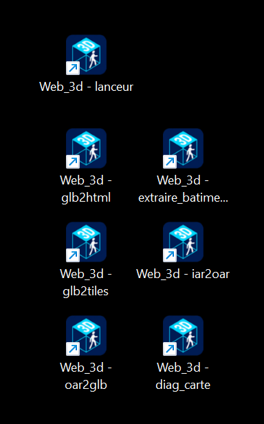

# My procedures: sites and presence server

*03/11/2026. For the host (Klaatou): his published sites and his presence server. Creating a region: `GUIDE.md`. Deliveries and versions: `DEVELOPPEMENT.md` (in English: `DEVELOPMENT.md`). In the commands, `NOM` is the name of the region, `ANCIEN` and `NOUVEAU` the old and new name, `CHEMIN` a path, `UTILISATEUR` and `ADRESSE_VM` the account and address of the VM.*

## 1. Bring a published region up to a new version

To do after a new version of the tools: the page gets the new `index.html` shell (the old one is kept under a dated name) and its configuration is updated, without retyping anything; the zones do not move. Then Ctrl+F5 in the page.

```powershell
cd "P:\_OpenSim\SL&OS\Web_3d\web_3d\dist"; python .\glb2html.py --update -o "P:\_OpenSim\SL&OS\Web_3d\Sites\houses\houses.html" --shared-shell "P:\_OpenSim\SL&OS\Web_3d\Sites\index.html"
```

## 2. Set the title shown in the tab

The same command with `--title "Houses"`, or by hand the line `"title": "Houses",` in `NOM.config.json`. The files and the room stay in lowercase.

## 3. Rename a region split into tiles

The script `renommer_region.py` (outside the repository, in `P:\_OpenSim\SL&OS\Web_3d`) renames the files and the tiles folder, and fixes the index, the configuration, `default.json`, the zone links and the card in `regions.json`. Every old file it modifies is copied to `_avant_renommage\` (one dated folder per run). The simulation first:

```powershell
python "P:\_OpenSim\SL&OS\Web_3d\renommer_region.py" "P:\_OpenSim\SL&OS\Web_3d\Sites\houses" ANCIEN NOUVEAU --dry-run
```

Then the renaming (add `--remplacer` if the new name already exists: the old file is set aside, never deleted):

```powershell
python "P:\_OpenSim\SL&OS\Web_3d\renommer_region.py" "P:\_OpenSim\SL&OS\Web_3d\Sites\houses" ANCIEN NOUVEAU
```

Finish with the map update (§ 4). The script can be run again: if the region is already renamed, it only makes the corrections.

## 4. Update the world map

```powershell
cd "P:\_OpenSim\SL&OS\Web_3d\web_3d\dist"; python .\glb2html.py --scan-sites "P:\_OpenSim\SL&OS\Web_3d\Sites"
```

To also remove the cards whose region no longer exists (external cards are kept), add `--prune-missing`, preferably with `--dry-run` the first time:

```powershell
python .\glb2html.py --scan-sites "P:\_OpenSim\SL&OS\Web_3d\Sites" --prune-missing --dry-run
```

The names key is typed in the collapsed "Names key" block at the bottom of `carte.html`: the browser keeps it (`MANUAL.md` § 9.16). If the map shows no nicknames, `diag_carte.py` queries the presence server with and without the key and says what is missing (it needs `pip install websockets`; the site address at the end is only useful if the server only accepts some sites):

```powershell
cd "P:\_OpenSim\SL&OS\Web_3d\web_3d\dist"; python .\diag_carte.py wss://ADRESSE CLE https://VOTRE-SITE
```

Exit codes: 0 server fine, 1 unreachable, 2 old server, 3 no nickname with the key, 4 origin refused (`MANUAL.md` § 9.22).

## 5. Compress a big region already split

For a new region, `--compress` of `glb2tiles.py` is enough (`GUIDE.md` § 1.3). For tiles already split and not compressed: by hand, from the folder that contains `NOM.tiles`, into a `sortie` folder (Node required; never recompress a file that is already compressed):

```powershell
New-Item -ItemType Directory -Force ".\sortie" | Out-Null; Get-ChildItem ".\NOM.tiles" -Filter *.glb | ForEach-Object { npx -y gltfpack -i $_.FullName -o ".\sortie\$($_.Name)" -cc -kn -ke -km -vpf -vtf }
```

```powershell
npx -y gltfpack -i ".\NOM.overview.glb" -o ".\sortie\NOM.overview.glb" -cc -kn -ke -km -vpf -vtf
```

Then replace the files with those in `sortie`. Keep a backup first.

## 6. Extract objects from a region (buildings, furniture...)

The script `extraire_batiments.py` (in `web_3d\dist`) outputs one GLB per object group of the OAR, recentred, with a `.json` that keeps its original position. Its name comes from the buildings of a big OAR of houses it was written for, but **it is an object extraction**: a group can be a house, a piece of furniture, a tree, a vehicle. In its messages and files, "building" reads "object". It reads the OAR and the GLB made by `oar2glb.py`; the first reading is long, later ones come from a cache.

Run the script **from the working folder** `P:\_OpenSim\SL&OS\Web_3d`, not from `dist\`: the output folder `batiments` and the cache folder `extraire_batiments.cache` are created where the command is run. List the groups of at least 5 parts:

```powershell
cd "P:\_OpenSim\SL&OS\Web_3d"; python ".\web_3d\dist\extraire_batiments.py" "CHEMIN\NOM.oar" "CHEMIN\NOM.glb" --list --min-parts 5
```

Extract by name (or `--group 12`, `--group 15,18,100-150`); `--ground 5` adds a test floor of 5 m around:

```powershell
python ".\web_3d\dist\extraire_batiments.py" "CHEMIN\NOM.oar" "CHEMIN\NOM.glb" --name "Jewel Box House" -o "CHEMIN\batiments"
```

The other options (delivery boxes, neighbours, merging, extracting everything): `--help` or `docs/REFERENCE_OPTIONS.md`. The old French option names (`--groupe`, `--nom`, `--sol`...) are still accepted. The cache moves with the command; it is read again only if the OAR, the GLB, `glb2tiles.py` and `oar2glb.py` have not changed (path, size, date). If the script is copied alone somewhere else, `--tools FOLDER` (or the `WEB3D_TOOLS` variable) says where `glb2tiles.py` and `oar2glb.py` are.

### Extract objects from an IAR (inventory)

The script `iar2oar.py` (in `web_3d\dist`, next to `oar2glb.py`) turns an inventory archive (IAR) into a minimal OAR, which the rest handles as a region: each inventory object gets a cell on a grid (the region grows in steps of 256 m if needed), combined objects are split into groups, the contents of boxes are added. See what the IAR contains (writes nothing; `--filter REGEX` and `--no-nested` narrow the list):

```powershell
cd "P:\_OpenSim\SL&OS\Web_3d"; python ".\web_3d\dist\iar2oar.py" "CHEMIN\NOM.iar" --list
```

Make the OAR:

```powershell
python ".\web_3d\dist\iar2oar.py" "CHEMIN\NOM.iar" -o "CHEMIN\NOM.oar"
```

Make the GLB (`oar2glb.py` writes it next to the OAR, named `NOM.glb`; `--keep-invisible` keeps the transparent prims; convoar is supplied in `dist/convoar/`, no need to name it):

```powershell
python ".\web_3d\dist\oar2glb.py" "CHEMIN\NOM.oar"
```

Then list and extract as above, with `NOM.oar` and `NOM.glb`. The old French option names (`--liste`, `--filtre`, `--sans-imbriques`, `--marge`, `--sortie`) are still accepted. The texture errors from convoar ("could not fetch texture asset", "unhandled number of components") can come from the IAR itself (missing or empty assets, seen on the first IAR tried): the faces concerned are grey. Attachments and clothing are not supported.

On Linux, the command is the same with `python3` and `mono` installed (manual, § 3.11). If the OAR contains PBR (OpenSim 0.9.3), `oar2glb.py` applies it; Pillow (`pip install pillow`) is needed for the textures, and `--pbr-size 256` lightens the GLB (manual, § 3.10).

## 7. Update the online demo

To do when `index.html`, `carte.html` or the icon change. `ajout_og.py` (outside the repository) puts back into `index.html` the sharing preview tags (image and title shown when the link is shared); the path given is to be confirmed:

```powershell
Copy-Item "P:\_OpenSim\SL&OS\Web_3d\web_3d\dist\index.html", "P:\_OpenSim\SL&OS\Web_3d\web_3d\dist\carte.html", "P:\_OpenSim\SL&OS\Web_3d\web_3d\dist\favicon.ico" "P:\_OpenSim\SL&OS\Web_3d\Web_3d_demo"; cd "P:\_OpenSim\SL&OS\Web_3d\Web_3d_demo"; python "P:\_OpenSim\SL&OS\Web_3d\ajout_og.py"; git add index.html carte.html favicon.ico; git commit -m "mise a jour"; git push
```

## 8. The presence server on the VM

Open the moderation console from the PC; to leave it without stopping the server: Ctrl+B then D.

```powershell
ssh -t UTILISATEUR@ADRESSE_VM "tmux attach -t presence"
```

In the console: `version` gives the version and fingerprint of the server; `liste`, `ejecter`, `bannir`, `creators`, `aide`. Update the server **only** if the fingerprint shown by `version` differs from the one `python build.py` lists for `presence_server.py`: send the file, then, on the VM as root, `systemctl restart web3d-presence`.

```powershell
scp "P:\_OpenSim\SL&OS\Web_3d\web_3d\dist\presence_server.py" UTILISATEUR@ADRESSE_VM:/home/UTILISATEUR/presence/
```

Full installation of the VM: `PROCEDURES.md` § 11.

## 9. Host a creator on my presence server

What I send them (message to copy):

```text
To connect your region to my presence server (positions, chat), send me:
1. the origin of your page: the start of its address, without a path (for example https://alice.example; also give the www version if it works);
2. a short identifier (for example alice).
I reply with the server address (wss://...) and your room prefix (alice.NOM).
On your side, in NOM.config.json, set presenceUrl = the address you received and room = alice.NOM, then reload the page.
If presence is refused, the page says why (creators note, § 5).
```

What I do next:

- On the VM, open my copy of `presence_creators.json` and add the creator's entry (model: `docs/samples/presence_creators.sample.json`), for example `{"id": "alice", "origins": ["https://alice.example"]}`. No restart: the file is re-read within 2 seconds at most.
- In the console (§ 8), type `creators`: it lists the creator, their origins and their state.
- Send them the `wss://` address of my server, their prefix (`alice.`) and the creators note (`CREATEURS.md`, in English `CREATORS.md`).
- Optional: `visits-key alice.NOM` gives the key of their visits log, to send with the address of their page followed by `#visits`.

If their region is not yet in a web page: send them `GUIDE.md`.

## 10. Update a package that is already published

**Do not unzip the new zip over your folder**: the zip contains the example configuration, zones and images, which would overwrite yours.

For a package (`galerie-photos.zip`, `region-simple.zip`) put online from an older zip: download the new zip, unzip it somewhere else, then copy into the published `site` folder **only the HTML pages that depend on the version**: `index.html` and `carte.html`. Publish, then Ctrl+F5 in the page.

- **Do not overwrite**: `NOM.config.json`, `NOM.zones.json`, `NOM.glb`, `medias\`, `regions.json`, `vignette.jpg`, `NOM.about.*.txt`, and `aide.html` if you adapted it.
- **`aide.html`**: copy it from the new zip only if you have not changed it (it carries the new help texts); otherwise keep yours.
- **`favicon.ico`**: the new zip contains one (the logo since 1.6.14). Copy it only if you have not placed your own: a `favicon.ico` already next to the page is still preferred to the embedded icon, so the tab would keep the old icon.
- **Package from before 1.5.0**: the map (`carte.html`) reads `regions.json` and `vignette.jpg`, which it did not have; without them it says "Cannot read regions.json". Copy them too from the new zip, then adapt them.
- **`lib\` folder**: only if the `lib\three-…` folder of the new zip has a different name from yours.
- **Displayed number** (Status window, I key, "Version" line): the "page" is the version of `index.html` (it follows your copy); the "configuration" is the `version` key of `NOM.config.json`, which you can change by hand (the number is in `VERSION.txt` of the zip).
- **Presence server**: if you host it, replace `presence\presence_server.py` with the one from the new zip and restart it.

Tried (07/11/2026, Chromium on Linux): the current `index.html` opens without error a package whose config, zones and `default.json` date from 1.2.3; without `regions.json`, the map shows the message above. Not tried: Windows, other browsers, an update from a version other than 1.2.3.

## 11. Open the tools in a window, with shortcuts on the desktop

To avoid typing a command: a window offers the seven tools, with the help of every option (`MANUAL.md` § 3.9). From the root of the repository:

```powershell
python .\dist\web3d_gui.py
```

Under the tool list, the "Examples" list offers basic uses of each tool: choosing one fills the fields; all that is left is to replace the example names with your own, then click Run.

For shortcuts on the desktop (one for the window, one per tool), first what would be created, writing nothing:

```powershell
python .\dist\web3d_gui.py --shortcuts --dry-run
```

then, if the paths suit you:

```powershell
python .\dist\web3d_gui.py --shortcuts
```



Running the same command again replaces the shortcuts. To remove them: `python .\dist\web3d_gui.py --remove-shortcuts`. Tried by Klaatou on Windows (08/11/2026).

## 12. Fix the sea of an already published region

Since 1.10.26, a conversion places the sea from the OAR's water level. For a region published before, or whose sea looks too high or too low, without converting it again (the command reads the water level in the OAR and writes it into the region's config; its zones do not move):

```powershell
cd "P:\_OpenSim\SL&OS\Web_3d\web_3d\dist"; python .\glb2html.py --update -o "P:\_OpenSim\SL&OS\Web_3d\Sites\houses\houses.html" --shared-shell "P:\_OpenSim\SL&OS\Web_3d\Sites\index.html" --water-from "J:\...\houses.oar"
```

Then Ctrl+F5 in the page. Without the OAR at hand, give the height yourself with `--sea-m 9` instead of `--water-from ...`: the number is the one that the Settings "Sea height" slider shows when the sea looks right (same frame). The choice made with that slider stays specific to each visitor (in his browser): only the config fixes the page for everyone.

For a whole folder of OARs, each with a region of the same name in the site (not tried):

```powershell
Get-ChildItem "J:\...\OAR" -Filter *.oar | ForEach-Object { $n = $_.BaseName; python .\glb2html.py --update -o "P:\...\Sites\$n\$n.html" --shared-shell "P:\...\Sites\index.html" --water-from $_.FullName }
```

An OAR without `WaterHeight` is refused with a message: the loop goes on, and those regions are set with `--sea-m`. Tried (14/11/2026, Chromium under Linux, `tests/mer_auto.py`): the single command.

## 13. Lighten the textures of an already converted region

To choose the value without guessing, read the size table: `oar2glb.py` prints it at the end of each conversion, and `glb-stats.py` gives it for a GLB that already exists:

```powershell
python .\glb-stats.py "J:\...\NOM.glb"
```

Then try values without doing the conversion again: each trial writes a new file beside it, the original is never modified:

```powershell
python .\oar2glb.py --tex-only "J:\...\NOM.glb" --tex-size 1024
```

Look at the result (`NOM-tex1024.glb`), then copy the chosen file over the region's GLB in the site. `--tex-quality 60` adds a stronger JPEG compression without changing the pixels; transparent textures are only reduced by `--tex-size`. Details: manual § 3.12. Tried (13/11/2026, fake convoar and hand-made GLBs): not tried on a real GLB of several hundred MB.

## 14. Put a radio in a region

**I want visitors to hear a web radio when they pass by a spot in my region.** A "Radio" zone plays an Icecast or SHOUTcast stream (the same as an OpenSim parcel "music URL") to those who come within range in walk mode (`MANUAL.md` § 5.19).

You need: the address of a radio stream, your region already online (or ready to be), Edge or Chrome for the viewer.

1. **Choose the stream.** The address must start with `https://` (a page served over `https` refuses an `http` stream). Paste it in a tab: if the sound starts, the stream is readable. Some radios refuse to be played from another site (answer 403: the page will say "stream refused or unreadable"): take a radio whose owner accepts being played on a site, and check that you are allowed to broadcast it.
2. **Open the viewer** (`glb-viewer.html`), open the region's `.glb`, then **import its current zones** ("Import zones (.json)", the region's `NOM.zones.json` file), otherwise the export of step 5 would only hold the new zone (`SIMPLE_PROCEDURES.md` § 16, steps 1 and 2).
3. **Place the zone.** In the types menu, choose "Radio (Icecast / SHOUTcast stream within range)", then click on the ground where you want it (or, while walking, the P key). The marker (cone) shows that a radio is there.
4. **Fill in its fields**: "Stream address" (paste the address), then the **"Try the stream (5 s)"** button: it must say "Stream: playing"; otherwise "Stream unreadable (cause)". A name (`label`) and the range in meters (20 by default, up to 200; the sound falls with distance).
5. **Export, replace the region's zones file, publish**: this is the procedure of **§ 16** (export, rename to `NOM.zones.json`, copy into the region folder, try at home, publish). Nothing else to copy for a radio: the sound comes from the stream.
6. **Try it online**: open the page (F5 or Ctrl+F5), switch to walk mode (F key), walk into the range. A first click or key is needed (browser rule). The "♪ Radio: NAME" line of the State block (I key) says what is happening. The volume is the "Sounds" box of Settings.
7. **The track title (optional).** On the presence server, a `presence_radios.json` file (JSON list of stream addresses) and the `--radios presence_radios.json` option (`MANUAL.md` § 10.25). A radio that does not write its titles in the stream: no title, the zone's name alone.

Several streams in the same zone (`radio`), distance display, tooltip: `MANUAL.md` § 5.19 and § 7.66.

Cover and link (optional, 1.12.26): the "Cover" and "Cover link" fields of the zone, shown in the Sound window when this radio speaks: `MANUAL.md` § 5.19.

A stream that does not play: `MANUAL.md` § 5.19, "The radio does not play?".

## 15. Put a playlist of my own sounds (mp3...) in a region

**I want visitors to hear my music (mp3, ogg, wav files...) when they pass by a spot.** A "Music" zone plays the files of a folder, in alphabetical order, in a loop (`MANUAL.md` § 5.20).

You need: your sound files (that you have the rights to), your region's folder (the one holding the `.glb`), Edge or Chrome for the viewer.

1. **Prepare the sounds folder.** In the region folder, create an `audio` sub-folder (or `medias\audio`, if the region has a `medias` folder) and put the files in it. **Number the names to fix the order**: `01-intro.mp3`, `02-vagues.mp3`, `03-finale.mp3`. Without numbers, the order is alphabetical; numbers count as numbers (`2` before `10`).
2. **Make the playlist** (`playlist.json`), with the command line, from the tools' `dist` folder: `python .\glb2html.py --audio-list "CHEMIN\NOM\audio"`, where `CHEMIN\NOM` is the region folder. It writes `playlist.json` in the `audio` folder: that is the list the page reads. Add `--dry-run` to see without writing. *Variant without the command line*: the "Update the list (playlist.json)" button of the zone's sheet (step 3) does exactly the same; no need to do both.
3. **Place the zone in the viewer.** Open `glb-viewer.html`, open the region's `.glb`, **import its current zones** ("Import zones (.json)", `NOM.zones.json`). Type "Music (sound files of a folder, played in a loop within range)", click on the ground (or P key while walking). In "Tracks folder", write only the sub-folder name: `audio`. Set the range (20 m by default, up to 200). Optional: "Try the first track (5 s)" checks that a sound plays (the viewer first asks for the region folder, once).
4. **Export, replace the region's zones file**: procedure of **§ 16**. The zone only holds `"folder": "audio"`, not the sounds.
5. **Put the sounds online**: copy the **whole** `audio` folder (the sounds **and** `playlist.json`) into the region folder on the host, next to `NOM.glb`, together with the same `NOM.zones.json` as in § 16. Without the `audio` folder online, the "♪ Music" line will say "playlist not found".
6. **Try it online**: open the page (F5 or Ctrl+F5), switch to walk mode (F key), enter the range: the "♪ Music: NAME — track" line of the State block (I key) gives the current track. A click or key is needed the first time. The volume falls as you move away, playback stops out of range and resumes at the track that was left.
7. **Later**: if you add, remove or rename a sound, **redo the list** (step 2) and copy the `audio` folder online again; the page reads the list each time the zone is entered, no page rebuild and no new zones file.

Radio, music and video never speak together: in Settings, the "Zone radio", "Zone music" and "Zone videos" boxes exclude each other, and the source nearest in metres speaks (`MANUAL.md` § 5.22). Optional cover and link (1.12.26): `MANUAL.md` § 5.20. Nothing plays? `MANUAL.md` § 5.20, "Does not play?".

## 16. Update the zones of a region already online

**I want to add, move or remove a zone (arrival, portal, sign, picture, radio, music) in an already published region.** A region's zones are in a single file, `NOM.zones.json` (NOM = name of the `.glb` without extension, in lower case). You **edit it in the viewer**, **export** it, **replace** the region's one, and **publish again**. The page does not have to be rebuilt (case A below).

**Which case is yours?** Look at the region folder:

- **A. Shared shell** (the case of the packages and of the demo): the region opens with `index.html?region=NOM` and its folder holds `NOM.glb`, `NOM.config.json` and `NOM.zones.json`. **This is the case described below.**
- **B. Tiled region**: a `NOM.tiles.json` and tiles instead of the `.glb`. The viewer has a button **"Save the zones in the region folder"** (Edge or Chrome) that writes `NOM.zones.json` for you and keeps the old one as `NOM.zones.bak.json` (`MANUAL.md` § 5.15): do steps 1 to 3, then this button instead of steps 4 and 5, and go on at step 6.
- **C. Standalone page** (a single `NOM.html` file, no `NOM.zones.json` next to it): the zones are inside the page. Rebuild the page with the same command as the first time, giving the exported zones: `--zones zones.json` (`MANUAL.md` § 6).

**The steps (case A)**

1. **Open the viewer**: the `glb-viewer.html` file (tools' `dist` folder) opens in Edge or Chrome by double-click. Open the region's `.glb`.
2. **Take the zones already placed**: **"Import zones (.json)"** button, then the region's **current** `NOM.zones.json`. **Do not skip this step**: the file exported at step 4 only holds what is in the viewer at that moment; without the import, the existing zones would vanish from the region.
3. **Edit**: add a zone (type, click on the ground or P key while walking), open its sheet to set it, or delete it (`MANUAL.md` § 5.2). For a picture: the files go in the region's `medias` sub-folder (`MANUAL.md` § 5.11); for music: the `audio` folder (§ 15); for a video screen: the videos (§ 17); a radio: nothing to copy.
4. **Export**: **"Export zones (.json)"** button. The browser downloads a file named `zones.json` into its downloads folder.
5. **Replace the region's file**: first **keep a copy** of the old `NOM.zones.json` (for example rename it `NOM.zones.avant.json`). Then rename the downloaded file to **`NOM.zones.json`** (exactly the old one's name) and copy it into the region folder, in place of the old one. Keep the exact name: the page only looks for that one.
6. **Try at home before publishing**: from the site folder, `python -m http.server 8000`, then open `http://localhost:8000/index.html?region=NOM`. The page reads `NOM.zones.json` again at each opening: **F5 is enough**, no page rebuild (unless you also change the page options, which are in `NOM.config.json`).
7. **Publish**: copy to the host, replacing, **only what changed**: `NOM.zones.json`, and depending on what you added the `audio` folder, the pictures of `medias`. With GitHub Pages, from the site folder: `git add -A`, `git commit -m "zones"`, `git push` (one command per line), then wait a minute or two.
8. **Check online**: open the public address, **Ctrl+F5** (the browser sometimes keeps the old file), switch to walk mode (F key) and go to the zone.

A mistake? Put the old file back (the copy of step 5) in place of `NOM.zones.json` and publish again.


## 17. Put a video screen in a region

**I want a screen on a wall to show a video (or a series of videos) when visitors come close.** A "Video" zone is a screen that plays within range, in a loop, muted or with sound (`MANUAL.md` § 5.21).

You need: your video files (H.264 mp4 is the most compatible; webm too; that you have the rights to), your region folder (the one with the `.glb`), Edge or Chrome for the viewer.

1. **Store the videos.** In the region folder, create a sub-folder `videos` (or `medias\videos` if the region has a `medias` folder) and put the files there. For **one single video**, put it in `medias` (or next to the `.glb`). **Number the names to set the order** of a list: `01-accueil.mp4`, `02-visite.mp4`.
2. **For a list: make `playlist.json`**, from the `dist` folder of the tools: `python .\glb2html.py --video-list "CHEMIN\NOM\videos"` (with `--dry-run`: shows without writing). *Variant without a command line*: the "Update the list (playlist.json)" button of the zone sheet (step 3). One single video: no list.
3. **Place the screen in the viewer.** Open `glb-viewer.html`, open the `.glb`, **import its current zones** ("Import zones (.json)", `NOM.zones.json`). Type "Video (screen on a wall)", click on the wall. **One single video**: write its name in "File or address of the video" (`clip` or `clip.mp4`). **A list**: leave that field empty and write `videos` in "Video folder". Set the width (height 0 follows the video), the range and, if you want sound, "Screen sound" ("with sound": only the closest screen speaks).
4. **Export, replace the zones file, put online**: procedure of **§ 16** (steps 4 to 8). Also copy the **whole** `videos` folder (the videos **and** `playlist.json`) into the region folder on the host.
5. **Try it**: open the page (F5 or Ctrl+F5), walk up to the screen: it loads then plays. **Click on the screen**: pause, then play. With a list, the **track bar** (previous, pause / play, next) shows under the screen when you hover over it. The sound needs a first click or key press in the page.
6. **Later**: adding, removing or renaming a video of a list: **redo `playlist.json`** (step 2) and copy the folder online again.

Nothing plays? The **Video** line of the diagnostic (State block, key I, "Copy the diagnostic") says why: file not found, not loaded yet, sound requested but muted. `MANUAL.md` § 5.21, "Not playing?".

**Variant: the screen opens a page, a portal or a command** (1.12.42). In the screen's form, the **"Screen action"** menu: "link" turns the video's title into a link in the bar under the screen (a click on the title opens the page); "portal" and "command" start when you walk up to the screen, at the "Trigger distance". The video is there to show what the action opens. `MANUAL.md` § 5.21, "Screen action".

## 18. Place a 3D model on its own (a small `.glb`)

**I want to place an object (a statue, a radio set, a piece of furniture) in my region without redoing its model.** A "3D model" zone loads a `.glb` file where you want it, with its size and tilt (`MANUAL.md` § 5.23).

You need: your object's `.glb` file, your region folder (the one with the region's `.glb`), Edge or Chrome for the viewer.

1. **Put the file away.** Put it in the region folder (for example `statue.glb`).
2. **Place the model in the viewer.** Open `glb-viewer.html`, open the region's `.glb`, **import its current zones** ("Import zones (.json)", `NOM.zones.json`). Type "3D model (separate .glb file)", click where you want it, file name in "Model file (.glb)".
3. **Adjust**: "Size (1 = as is)", the two tilts (in degrees) and the orientation; tick "Solid (cannot be walked through)" if visitors must not walk through it.
4. **To make it do something** (for example a radio set placed on a radio zone), do not create a "3D model" zone: fill in the "Model file" field of the link, portal, command, radio or music form. A click on the model of a radio or of music opens the Sound window.
5. **Export, replace the zones file, put online**: procedure of **§ 16** (steps 4 to 8). Also copy the model's `.glb` file to the region folder on the host.
6. **Try it**: open the page (F5 or Ctrl+F5) and walk up: the model loads within 150 m of its zone. With many models, reduce that distance without rebuilding the page: `python .\glb2html.py --update --model-lazy 60` (see `MANUAL.md` § 9.3).

Nothing shows up? The browser console (F12) says "the model … could not be read": wrong file name, file missing online, or page opened from the disk (`file://`). `MANUAL.md` § 5.23.
