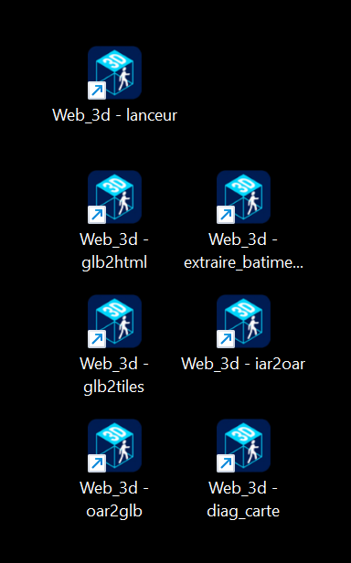

# Manuel de Web_3d (1.9.0)

> **Résumé.** Ce manuel suit le projet de bout en bout, thème par thème : pour commencer, avec le vocabulaire (chapitre 1), les outils (2), convertir un OAR (3), mesurer et découper une grosse région (4), le viewer et les zones (5), fabriquer la page (6), la page côté visiteur (7), les régions en tuiles (8), la carte des mondes (9), le serveur de présence (10), la référence des fichiers JSON (11), le dépannage (12) et, en annexe, ce que chaque version a apporté (13). Pour **toutes les options** des outils, avec leur effet et les valeurs par défaut de leurs paramètres, en français et en anglais : `docs/REFERENCE_OPTIONS.md` (générée depuis les outils par `gen_reference.py`). Pour **faire une tâche pas à pas** : `PROCEDURES.md`. Langue de la page et des outils : § 7.49, § 7.51 et § 7.50.

## 1. Pour commencer

Web_3d transforme une région OpenSim (sauvegarde `.oar`) en une **page web 3D** où l'on se promène avec un navigateur : on peut y voir les autres visiteurs, discuter, et traverser des portails vers d'autres endroits. Les visiteurs n'ont rien à installer.

### 1.1 Quelques mots du vocabulaire

| Mot | Ce que c'est |
| --- | --- |
| **Région** | un morceau de monde OpenSim (terrain, bâtiments, objets). Dans les noms de fichiers de ce manuel, `NOM` est le nom de ta région : `NOM.oar`, `NOM.glb`, `NOM.zones.json`… |
| **OAR** (`NOM.oar`) | la sauvegarde d'une région OpenSim. |
| **GLB** (`NOM.glb`) | un fichier de modèle 3D que les navigateurs savent afficher. `oar2glb.py` le fabrique à partir de l'OAR. |
| **Tuiles** | une région très lourde est découpée en morceaux (les tuiles), que la page charge au fur et à mesure de la promenade. |
| **Viewer** (`glb-viewer.html`) | une page que tu ouvres toi-même, avec ton `.glb` : elle sert à regarder le modèle, à régler son affichage (mer, rotation, caméra…), à poser les zones et à préparer la carte des mondes (chapitre 5). |
| **Zone** | un endroit du modèle auquel on attache quelque chose : un **point d'arrivée** (où apparaît le visiteur), un **portail** (qui mène à un autre endroit ou à une autre région), un panneau, un lien web, une commande Home Assistant, une image sur un mur, une zone privée. Les zones sont enregistrées dans `NOM.zones.json`. |
| **Page** | le fichier `.html` que les visiteurs ouvrent. Elle existe en deux formes (ci-dessous). |
| **Page autonome** | un seul fichier `.html` qui contient tout, le modèle compris. Simple à envoyer, mais il faut tout refaire à chaque changement. |
| **Page avec coquille** | la **coquille** est la page générique `index.html` : un lecteur commun qui sait afficher n'importe quelle région du dossier. Chaque région garde ses données dans des fichiers à côté (`NOM.glb`, `NOM.config.json`, `NOM.zones.json`) ; on l'ouvre par `index.html?region=NOM`. C'est la forme à préférer quand il y a plusieurs régions. |
| **Présence** | un serveur facultatif qui montre les autres visiteurs et porte le chat. |
| **Carte des mondes** | une page (`carte.html`) qui présente les régions d'un site et mène à chacune. |

### 1.2 Trois chemins

| Chemin | Pour qui | Où |
| --- | --- | --- |
| **Paquet prêt à l'emploi** (`galerie-photos.zip`, `region-simple.zip`) | essayer sans rien fabriquer | page des versions du dépôt GitHub ; `GUIDE.md` § 1.1 |
| **De l'OAR à la page** | avoir sa propre région dans une page | chapitres 3 (convertir), 5 (viewer et zones), 6 (page) |
| **Les outils un par un** | régions lourdes, site de plusieurs régions, carte, présence | chapitres 2 et 4 à 10 |

`GUIDE.md` raconte le chemin dans l'ordre, tâche après tâche ; `PROCEDURES.md` donne les procédures pas à pas ; ce manuel est la description complète, thème par thème.

### 1.3 Où chercher

Pour retrouver un document ou une procédure, voir `INDEX.md`.

| Je veux… | Chapitre |
| --- | --- |
| savoir à quoi sert chaque fichier de `dist` | 2 |
| convertir un OAR en `.glb` | 3 |
| mesurer ou découper une région énorme | 4 |
| régler le modèle et poser arrivées, portails, panneaux, liens, images | 5 |
| fabriquer ou mettre à jour la page | 6 |
| savoir ce que le visiteur peut faire (touches, vol, chat…) | 7 |
| charger une région en tuiles dans la page | 8 |
| relier plusieurs régions par une carte | 9 |
| voir les autres visiteurs, modérer, tenir un journal | 10 |
| connaître les champs des fichiers JSON | `REFERENCE_JSON.md` (ex-chapitre 11) |
| comprendre une panne | 12 |
| savoir ce que chaque version a apporté | 13 |

## 2. Les outils et leurs fichiers

Les fichiers prêts à l'emploi sont déjà dans le dossier `dist/` du dépôt : inutile de les fabriquer pour les utiliser. `python build.py` ne sert que si tu modifies `src/` ou `tools/` ; il assemble tout dans `dist/` (on n'édite jamais `dist/` à la main).

| Fichier de `dist` | Rôle | Chapitre |
| --- | --- | --- |
| `oar2glb.py` | convertit un OAR en `.glb` et refait le terrain complet | 3 |
| `extraire_batiments.py` | sort d'un OAR et de son `.glb` un `.glb` par groupe d'objets, recentré | 3 |
| `iar2oar.py` | transforme un IAR (inventaire OpenSim) en OAR minimal | 3 |
| `diag_carte.py` | diagnostique pourquoi la carte n'affiche pas les pseudos (interroge le serveur de présence avec et sans la clé) | 9 |
| `web3d_gui.py` | ouvre les outils dans une fenêtre : liste des outils, exemples d'usages de base, aide des options, lancement, raccourcis Windows | 3.9 |
| `glb-stats.py` | mesure un `.glb` ; doit rester à côté de `glb2tiles.py` | 4 |
| `glb2tiles.py` | découpe un `.glb` énorme en tuiles et fabrique `NOM.overview.glb` (la vue d'ensemble) | 4 |
| `glb-viewer.html` | le viewer : on y ouvre un `.glb` pour le régler et y poser les zones | 5 |
| `glb2html.py` | fabrique la page (autonome ou avec coquille) et tient à jour les sites : `--update`, `--register`, `--map-page`, `--scan-sites` | 6 |
| `index.html` | la coquille : la page générique qui affiche les régions d'un dossier (voir le vocabulaire, § 1.1) | 6 |
| `carte.html` | la carte des mondes | 9 |
| `presence_server.py` | le serveur de présence et de chat (a besoin du module Python `websockets`) | 10 |
| `favicon.ico` | l'icône par défaut des pages | 6 |

Pour **toutes** les options de chaque outil, avec leur effet et les valeurs par défaut de leurs paramètres : `docs/REFERENCE_OPTIONS.md`.

## 3. Convertir un OAR en GLB (`tools/oar2glb.py`)

`oar2glb.py` transforme une sauvegarde de région OpenSim (`.oar`) en un seul fichier `.glb` prêt pour le viewer et pour `glb2html.py`. Il lance convoar¹, répare sa sortie et assemble le tout. La sortie est écrite à côté de l'OAR : `NOM.oar` donne `NOM.glb`.

¹ **Prérequis** :  **oar2glb.py** s'appuie sur le convertisseur externe **convoar.exe**
  Déjà fourni dans ce dépôt, dans `dist/convoar/` (copie de https://github.com/Misterblue/convoar/tree/master/dist, Apache-2.0, voir `THIRD-PARTY.md`)
  Copie sans les fichiers `*.pdb` ni `NLog.xml` ; essayée par Klaatou sous Windows (conversion d'une petite région, 10/11/2026) et sous Linux avec Mono (§ 3.11).
  Sans convoar.exe, oar2glb.py ne peut pas effectuer la conversion OAR → GLB.

**Matériaux PBR.** convoar date de mai 2022 (.NET Framework 4.8, bibliothèques OpenSim du dépôt de cette époque) et ne lit pas les matériaux PBR d'OpenSim 0.9.3 : une face en PBR ne garde, au mieux, que sa texture ou sa couleur classique. Depuis la 1.9.12, `oar2glb.py` les lit lui-même dans l'OAR et les applique au GLB, une fois convoar passé (§ 3.10 ; `--no-pbr` pour s'en passer).

### 3.1 Les commandes (PowerShell, une seule ligne)

Se placer d'abord dans le dossier du script : `cd "P:\_OpenSim\SL&OS\Web_3d"`.

| Besoin                                                                      | Commande                                                                                 |
| --------------------------------------------------------------------------- | ---------------------------------------------------------------------------------------- |
| Conversion normale                                                          | `python oar2glb.py "J:\...\NOM.oar"`                                                       |
| Conversion qui garde les dossiers intermédiaires (nécessaire pour `--diag`) | `python oar2glb.py "J:\...\NOM.oar" --keep`                                                |
| Retrouver les animaux dans le viewer (mât rouge de 15 m à chacun)           | `python oar2glb.py "J:\...\NOM.oar" --keep --markers`                                      |
| Garder les prims invisibles                                                 | `python oar2glb.py "J:\...\NOM.oar" --keep-invisible`                                      |
| Vérifier ce que le script voit, sans rien modifier                          | `python oar2glb.py "J:\...\NOM.oar" --diag`                                                |
| Idem, en désignant le GLB ou le `.gltf` à comparer                          | `python oar2glb.py "J:\...\NOM.oar" --diag --glb "J:\...\NOM-GLTF\fichier.gltf"`             |
| Ne pas attendre « Entrée » à la fin                                         | ajouter `--nopause`                                                                      |
| Sans les matériaux PBR d'OpenSim 0.9.3                                      | ajouter `--no-pbr`                                                                       |
| Textures PBR plus petites (GLB plus léger, moins de mémoire graphique)      | ajouter `--pbr-size 256`                                                                 |
| Ajouter le terrain complet à un GLB existant, sans relancer convoar         | `python oar2glb.py "J:\...\NOM.oar" --terrain-only "J:\...\NOM.glb"` (écrit `NOM-terrain.glb`) |

Avant de refaire une conversion, supprimer l'ancien dossier intermédiaire : `Remove-Item -Recurse -Force "J:\...\NOM-GLTF*"`.

### 3.2 Les options

| Option                    | Effet                                                                                                                                                                                                                                                                                                                                                                                                                                                                                                                                                                                     |
| ------------------------- | ----------------------------------------------------------------------------------------------------------------------------------------------------------------------------------------------------------------------------------------------------------------------------------------------------------------------------------------------------------------------------------------------------------------------------------------------------------------------------------------------------------------------------------------------------------------------------------------- |
| `--keep`                  | garde le dossier `NOM-GLTF` (images, tampons, `.gltf`) ; indispensable pour lancer ensuite `--diag`                                                                                                                                                                                                                                                                                                                                                                                                                                                                                         |
| `--keep-invisible`        | garde les prims entièrement transparents (retirés par défaut)                                                                                                                                                                                                                                                                                                                                                                                                                                                                                                                             |
| `--markers`               | ajoute un mât rouge de 15 m à chaque animal riggé posé ; le nom du nœud donne l'animal et sa taille ; à retirer en relançant sans l'option                                                                                                                                                                                                                                                                                                                                                                                                                                                |
| `--diag`                  | ne modifie rien et ne lance pas convoar : liste chaque partie de l'OAR (voir plus bas)                                                                                                                                                                                                                                                                                                                                                                                                                                                                                                    |
| `--glb CHEMIN`            | avec `--diag` : GLB ou `.gltf` à comparer ; par défaut le `.gltf` du dossier `NOM-GLTF`, sinon le `NOM.glb` voisin                                                                                                                                                                                                                                                                                                                                                                                                                                                                            |
| `--max N`                 | hauteur maximale (m) d'un objet racine ; au-delà (skybox) il est retiré ; défaut 600                                                                                                                                                                                                                                                                                                                                                                                                                                                                                                      |
| `--convoar CHEMIN`        | chemin de `convoar.exe` (défaut : variable `CONVOAR`, sinon `convoar` du PATH, sinon `convoar/convoar.exe` ou `convoar.exe` à côté de `oar2glb.py`) ; s'il est introuvable, le message donne l'adresse de téléchargement                                                                                                                                                                                                                                                                                                                                                                                                                                                                                                                                  |
| `--reencode`              | **à éviter** : réencode les textures avant convoar ; sur Jungle_Isle il faisait manquer environ 150 textures sur 353 (textures grises). À n'utiliser que si convoar affiche beaucoup d'erreurs « unhandled number of components » ou plante dans `OpenJPEG.DotNetDecode64` (code retour 3221225477). Les textures que Pillow ne sait pas lire sont remplacées par un gris 4x4 (liste dans `NOM-reenc-illisibles.txt`, à côté de l'OAR) pour ne pas les laisser au décodeur de convoar ; les sculpt maps restent intactes ; 8 cœurs au plus et envoi par lots de 512 pour limiter la mémoire |
| `--nopause`               | ne pas attendre « Entrée » à la fin (la pause est aussi supprimée quand il n'y a pas de console, et avec `--terrain-only`)                                                                                                                                                                                                                                                                                                                                                                                                                                                                |
| `--terrain auto\|yes\|no` | terrain complet depuis la carte de hauteurs (voir plus bas) ; `auto` par défaut                                                                                                                                                                                                                                                                                                                                                                                                                                                                                                           |
| `--terrain-patch N`       | côté d'un patch de terrain en mètres, de 2 à 255 ; défaut 64                                                                                                                                                                                                                                                                                                                                                                                                                                                                                                                              |
| `--terrain-only GLB`      | ne lance pas convoar : ajoute le terrain complet à ce GLB et écrit `NOM-terrain.glb` à côté (l'original n'est jamais modifié)                                                                                                                                                                                                                                                                                                                                                                                                                                                               |
| `--output FICHIER`        | avec `--terrain-only` : fichier de sortie à la place de `NOM-terrain.glb` (jamais l'original)                                                                                                                                                                                                                                                                                                                                                                                                                                                                                               |
| `--no-pbr`                | ne pas appliquer les matériaux PBR d'OpenSim 0.9.3 (convoar les ignore : les prims gardent alors un matériau ordinaire) ; voir § 3.10 |
| `--pbr-size N`            | côté maximal, en pixels, des textures PBR ajoutées au GLB (défaut 512 ; 0 = taille d'origine) ; demande Pillow (`pip install pillow`) ; voir § 3.10 |

### 3.3 Terrain complet des régions de plus de 256 m (v29)

convoar ne produit qu'**un** nœud « Terrain » dont l'étendue plafonne (par exemple 257 x 267 m sur une région de 1 024 m : un seizième de la région n'a pas de sol). La carte de hauteurs complète est dans l'OAR (`terrains/*.r32`, un échantillon par mètre). `oar2glb.py` s'en sert pour construire le sol :

- **Patches.** Des carrés de P x P mètres (`--terrain-patch`, 64 par défaut), chacun un mesh de (P+1)² sommets. Les bords sont partagés entre voisins (mêmes hauteurs, mêmes normales, mêmes couleurs : pas de fissure, éclairage continu). Le dernier patch d'une rangée est plus petit quand n-1 n'est pas un multiple de P. Chaque patch est un objet racine nommé `Terrain i,j` (i : colonne vers l'est, j : rangée vers le nord). Repère monde : X = x, hauteur = h, Z = -y. Un seul matériau « terrain » (blanc, métal 0, rugosité 1, simple face), indices 16 bits, **pas de coordonnées de texture** : l'aspect vient de la couleur par sommet (`COLOR_0`).
- **Normales** par différences centrées sur toute la carte (une seule différence aux bords de la carte).
- **Couleur par sommet** d'après l'altitude `a` au-dessus du niveau d'eau et la pente :

| Situation               | Couleur (rouge, vert, bleu)                                                           |
| ----------------------- | ------------------------------------------------------------------------------------- |
| `a` ≤ 0 (sous l'eau)    | sable humide (166, 150, 104)                                                          |
| 0 < `a` ≤ 1 m           | sable sec (214, 196, 142)                                                             |
| 1 à 4 m                 | passage progressif du sable sec à l'herbe                                             |
| `a` ≥ 4 m               | herbe, dégradé léger de (98, 146, 66) à `a` = 4 m vers (132, 140, 78) à `a` = 80 m    |
| pente de 32 à 38 degrés | passage progressif vers la roche grise (122, 120, 116) ; au-delà de 38 degrés : roche |

- **Niveau d'eau.** `WaterHeight` lu dans `settings/*.xml` de l'OAR, sinon 20 m (défaut d'OpenSim). Le journal dit quelle valeur est utilisée et d'où elle vient.
- **Quand remplacer.** `--terrain auto` (défaut) : si le nœud « Terrain » de convoar existe et couvre moins de 95 % de la carte (boîtes comparées en repère monde), il est retiré de la scène et les patches sont ajoutés. Sinon (région de 256 m, terrain déjà complet, pas de nœud « Terrain ») le GLB n'est **pas modifié** : il est identique à celui de `--terrain no`. `--terrain yes` ajoute toujours les patches (et retire le « Terrain » de convoar s'il existe) ; `--terrain no` ne fait rien. Un GLB qui contient déjà des patches n'en reçoit pas d'autres. Le filtre des objets hors région ne retire jamais les patches.
- **`--terrain-only GLB`** (sans relancer convoar, pour un GLB de plusieurs Go) : le GLB n'est **pas chargé en entier**. L'en-tête JSON est réécrit, le chunk binaire est recopié par morceaux de 8 Mo, les nouveaux tampons sont ajoutés à la fin. Sortie `NOM-terrain.glb` à côté de l'original (ou `--output`) ; l'original n'est jamais écrasé, et rien n'est écrit si le terrain de convoar est déjà complet. Les données de l'ancien « Terrain » restent dans le fichier, inutilisées (quelques Mo). Aucune pause « Entrée » à la fin.
- **Journal.** Ligne `[terrain] carte N x N échantillons (1 m) ; niveau d'eau E m (origine) ; K patch(es) de P m ; V sommets ; B Mo ajoutés ; durée`. Un OAR sans carte de hauteurs donne `cet OAR n'a pas de carte de hauteurs ... rien n'est modifié` (code de retour 0, aucune erreur).
- **Hors lot** : textures de terrain d'OpenSim (les quatre textures mélangées selon l'altitude), niveau de détail du terrain pour la vue d'ensemble.

Test : `python tests/terrain.py` (OAR et GLB synthétiques).

### 3.4 Ce que le script corrige

- **Animaux riggés (animesh).** La géométrie que convoar écrit pour ces meshes est inutilisable (hippopotames géants, éléphants minuscules ou envolés, formes partagées entre animaux). Le script la reconstruit depuis le fichier `.llmesh` de l'OAR : positions, normales, UV, triangles, puis `bind_shape_matrix` ; l'échelle du prim est ignorée. Les morceaux d'un même animal restent ensemble. L'animal est centré sur la position de la racine de l'objet et ses pieds sont posés sous la boîte racine (à l'altitude de la racine si elle est elle-même riggée). Les textures viennent de convoar (face n du mesh = matériau n). Aucune règle ne dépend du nom d'un animal. Un animal dont la taille calculée sort de 0,1 à 12 m reste tel que convoar l'a produit (le journal le dit).
- **Prims invisibles.** Sont retirés : les prims dont toutes les faces sont à alpha 0 ou portent une texture invisible standard, les nœuds dont tous les matériaux sont transparents, et la boîte racine d'un animesh (prim simple, racine d'un objet dont tous les autres morceaux sont des meshes riggés). Les enfants d'une racine retirée restent.
- **Textures.** Le script compare les images annoncées par le `.gltf` aux fichiers présents ; s'il en manque, il relance convoar (2 essais de plus au maximum) en gardant les images déjà écrites.
- **Positions des régions plus grandes que 256 m** et objets hors région : traitement inchangé. Le terrain de ces régions est complété par les patches (voir « Terrain complet »).

### 3.5 Lire le journal (`oar2glb.log`, à côté du script)

| Ligne                                                                                 | Sens                                                                                                        |
| ------------------------------------------------------------------------------------- | ----------------------------------------------------------------------------------------------------------- |
| `[riggé] 'Nom' reconstruit depuis l'OAR : N face(s), M sommets...`                    | un morceau d'animal a été reconstruit ; les chiffres « convoar » à côté montrent ce que convoar avait écrit |
| `[riggé] 'Nom' : 5 morceau(x)... pieds à 27.11 m (dessous de la boîte racine)`        | animal posé ; taille L x l x h et altitude des pieds                                                        |
| `[riggé] ... nœud GLB introuvable`                                                    | le morceau n'a pas été retrouvé dans le GLB ; lancer `--diag`                                               |
| `[riggé] ... taille obtenue ... implausible`                                          | garde-fou : l'animal est laissé tel que convoar l'a produit                                                 |
| `[invisible] node N 'Nom' retiré : ...`                                               | prim retiré, avec la raison                                                                                 |
| `[correctif] N mesh(es) riggé(s) remis à l'échelle, M prim(s) invisible(s) retiré(s)` | récapitulatif                                                                                               |
| `[contrôle] 'Nom' pieds à ... : dans la boîte de N objet(s)`                          | objets dont la boîte englobante contient le centre de l'animal (indice si un animal est dans un rocher)     |
| `[GLB] N texture(s) absente(s) sur M`                                                 | images manquantes, remplacées par du gris                                                                   |
| `[terrain] ...`                                                                       | décision (couverture du terrain de convoar) puis résumé des patches ajoutés                                 |
| `[OK] ...glb (taille, meshes, textures)`                                              | fin normale                                                                                                 |

### 3.6 Diagnostic : `--diag`

À lancer après une conversion faite avec `--keep`. Le journal est `oar2glb.diag.log`. Chaque partie de l'OAR donne une ligne : nom, UUID, racine ou enfant, riggé oui/non, échelle du prim, échelle de `bind_shape_matrix`, transparent oui/non, boîte racine d'animesh oui/non, et le nœud GLB trouvé avec la méthode (UUID du prim, UUID du mesh, nom + position). Les animaux et prims invisibles affichent en plus le résumé du `TextureEntry`, la matrice complète, le domaine de position et le matériau GLB. Une ligne « nœud introuvable » sur un animal ou un prim transparent signifie que le correctif ne s'appliquera pas à lui.

### 3.7 Extraire des objets d'une région : `extraire_batiments.py`

`tools/extraire_batiments.py` (fabriqué dans `dist/`) sort d'une région OpenSim, à partir de l'OAR et du GLB fabriqué par `oar2glb.py`, **un GLB par groupe d'objets**, recentré. Son nom vient des bâtiments d'un gros OAR de maisons pour lequel il a été écrit, mais **c'est une extraction d'objets** : un groupe peut être un bâtiment, un meuble, un arbre, un véhicule ; « bâtiment » se lit « objet » dans ses messages et ses fichiers. Il ne modifie ni l'OAR ni le GLB : il écrit seulement le dossier de sortie (`batiments` par défaut) et son cache.

| Pour | Commande |
| --- | --- |
| Voir les groupes de l'OAR | `python extraire_batiments.py OAR GLB --list [--filter REGEX] [--min-parts N] [--box REGEX]` |
| Voir, pour chaque boîte de livraison, le groupe voisin | `python extraire_batiments.py OAR GLB --list --box RAKis --neighbor` |
| Extraire des groupes par leur numéro | `python extraire_batiments.py OAR GLB --group 12 --group 15,18,100-150 -o DOSSIER` |
| Extraire par le nom | `python extraire_batiments.py OAR GLB --name "Jewel Box House"` |
| Ajouter un sol d'essai de 5 m autour | `python extraire_batiments.py OAR GLB --group 12 --ground 5` |
| Un seul fichier pour plusieurs groupes | `python extraire_batiments.py OAR GLB --group 12 --group 15 --merge "Maison et garage"` |
| Dire combien de groupes seraient extraits | `python extraire_batiments.py OAR GLB --all --min-parts 5 --box RAKis --exclude Rail --dry-run` |

- **Numéro d'un groupe** : son rang dans l'OAR ; il ne change pas tant que l'OAR est le même. Chaque groupe choisi donne `NNNN_nom.glb` et `NNNN_nom.json` ; avec `--merge`, tous les groupes choisis donnent un seul fichier nommé d'après l'argument.
- **Recentrage** : le milieu de l'objet en x et z est à 0 et le sol à y = 0 (hauteur du terrain de l'OAR sous ce milieu, sinon le point le plus bas). Le `.json` voisin garde les coordonnées d'origine OpenSim (x, y du milieu, altitude du sol), la taille et les groupes.
- **Sol d'essai** (`--ground MARGIN`) : une dalle plane de couleur unie, de 0,3 m d'épaisseur, dont le dessus est à -2 cm, qui dépasse de l'objet de `MARGIN` mètres ; on peut marcher dessus. Le nœud s'appelle « sol d'essai » (`extras.essai`), pour le retirer ensuite.
- **Boîtes de livraison** : un cube de 1,2 m dont le nom correspond à `--box`. `--all` les saute ; `--neighbor` cherche le groupe voisin de chaque boîte, d'abord par le nom du bâtiment (celui de la boîte sans son suffixe, à moins de `--name-radius` mètres), sinon par la position seule (`--radius` mètres, groupes d'au moins `--neighbor-parts` parties) ; les trois distances par défaut (80, 25 et 5) sont des estimations à calibrer ; affichage seulement.
- **`--all`** refuse de prendre les groupes d'une seule partie (rails, panneaux...) sans `--min-parts N` ou `--yes`.
- **Cache** : la première fois, la lecture de l'OAR et la mesure du GLB sont longues ; leur résultat est gardé dans le dossier `extraire_batiments.cache`, créé **dans le dossier où la commande est lancée** (jamais à côté du script, pour ne rien écrire dans `dist/`), et relu tant que l'OAR, le GLB, `glb2tiles.py` et `oar2glb.py` n'ont pas changé (chemin, taille, date). On peut déplacer ce dossier avec sa commande. `--no-cache` l'ignore, `--clear-cache` le supprime. Les fichiers du cache sont des « pickle » : ne pas les récupérer d'une autre source.
- **Les deux autres outils** : `glb2tiles.py` et `oar2glb.py` sont cherchés dans le dossier de `--tools`, sinon de la variable `WEB3D_TOOLS`, sinon à côté du script.
- **Options et langue** : toutes les options sont dans `docs/REFERENCE_OPTIONS.md` ; `--lang` et `WEB3D_LANG` : § 7.50 ; les anciens noms français restent acceptés : `REFERENCE_JSON.md` § 11.11.
- **Essayé** : tests automatiques sur un OAR et un GLB fabriqués par `tests/extraire_batiments.py` ; par Klaatou, sur une vraie région, sous Windows (08/11/2026).

### 3.8 Extraire des objets d'un IAR (inventaire) : `iar2oar.py`

`tools/iar2oar.py` (fabriqué dans `dist/`) transforme une archive d'inventaire OpenSim (IAR) en **OAR minimal**, que la suite traite comme une région (`oar2glb.py`, puis `extraire_batiments.py`). Il ne modifie jamais l'IAR et n'importe rien d'`oar2glb.py` ni de `glb2tiles.py`.

| Pour | Commande |
| --- | --- |
| Voir ce que contient l'IAR (n'écrit rien) | `python iar2oar.py MON.iar --list [--filter REGEX] [--no-nested]` |
| Fabriquer l'OAR | `python iar2oar.py MON.iar -o inventaire.oar [--filter REGEX] [--no-nested] [--margin 4]` |
| Puis fabriquer le GLB | `python oar2glb.py inventaire.oar` |
| Puis lister et extraire | `python extraire_batiments.py inventaire.oar inventaire.glb --list` |

- Chaque objet d'inventaire (asset `object.xml`) devient un ou plusieurs groupes de l'OAR ; le groupe porte le nom de l'élément d'inventaire (la racine de l'objet est renommée), pour que `--name` et `--filter` fonctionnent.
- Un objet « combiné » (`CoalescedObject`) est séparé en ses groupes, qui gardent leur disposition relative.
- Les objets contenus dans le contenu d'un autre (boîtes, `TaskInventory`) sont ajoutés aussi, jusqu'à 3 niveaux, une seule fois chacun ; leur nom est « parent / nom » ; `--no-nested` les ignore.
- Les positions d'origine se chevauchent : chaque groupe (ou objet combiné) reçoit une case sur une grille, séparée de ses voisines par `--margin` mètres (4 par défaut), sans terrain (le sol d'un extrait est alors son point le plus bas). La taille de la région grandit par pas de 256 m si besoin. **Estimation** : l'étendue d'un groupe pour sa case est calculée avec les positions et les échelles des parties, sans les rotations.
- L'octet nul qui termine les XML de l'IAR est retiré ; seuls les assets utiles à la 3D sont copiés (meshes, textures, matériaux).
- **Non pris en charge** : attachements et vêtements (pas d'avatar). **Essayé** : tests automatiques sur un IAR fabriqué par `tests/iar2oar.py` ; par Klaatou, sur un vrai IAR de 34 éléments (OAR produit, GLB fait avec convoar, ouvert dans Blender, 06/11/2026), puis avec la version entrée dans le dépôt (08/11/2026). Les erreurs de texture de convoar sur un IAR peuvent venir de l'IAR lui-même (assets absents ou vides) : les faces concernées sont grises.
- Options, langue, anciens noms : comme au § 3.7.

### 3.9 Lanceur graphique : `web3d_gui.py`

`tools/web3d_gui.py` (fabriqué dans `dist/`) ouvre les outils dans une fenêtre, sans taper de commande : on choisit l'outil dans une liste, on remplit les options, il lance l'outil et montre sa sortie. Il lit les options dans l'outil lui-même (rien ne peut manquer, aucun outil n'est modifié). Il demande `tkinter` (livré avec Python sous Windows ; sous Linux, le paquet `python3-tk`).

| Pour | Commande |
| --- | --- |
| Ouvrir la fenêtre | `python web3d_gui.py` |
| L'ouvrir sur un outil | `python web3d_gui.py --tool oar2glb` |
| Voir ce que créeraient les raccourcis, sans rien écrire | `python web3d_gui.py --shortcuts --dry-run` |
| Créer les raccourcis | `python web3d_gui.py --shortcuts` |
| Les supprimer | `python web3d_gui.py --remove-shortcuts` |

- **Les outils** : `glb2html`, `glb2tiles`, `oar2glb`, `extraire_batiments`, `iar2oar`, `diag_carte` (`--tool NAME`). Le serveur de présence n'y est pas : il reste lancé, ce n'est pas une commande d'un instant.
- **La fenêtre** : en haut, la liste des outils et un champ de recherche, puis la liste « Exemples » ; au milieu, une ligne par option (case à cocher, liste de choix, nombre, chemin avec les boutons Fichier… et Dossier…, « option seule » pour une valeur facultative, champ de plusieurs lignes pour une option répétable comme `--group` ou `--exclude`, oui/non pour les paires `--x` et `--no-x`) ; en bas, l'aide de l'option sous le curseur, la commande qui en résulte, les boutons Lancer (Ctrl+Entrée), Arrêter, Copier la commande et Tout effacer, puis la sortie de l'outil.
- **Les exemples** : la liste « Exemples » propose 2 à 6 usages de base de l'outil affiché (pour `extraire_batiments` : lister les groupes, en extraire un par son numéro ou par son nom, en réunir plusieurs, simuler l'extraction de tout). Choisir un exemple **efface les champs puis les remplit** : la commande équivalente se met à jour et l'aide dit de remplacer les noms d'exemple (`Atoll.glb`, `ADRESSE`, `MA_CLE`…) par les siens. Rien ne se lance tout seul ; on peut modifier les champs avant de cliquer sur Lancer. La liste est inactive pendant un lancement et revient à son invite quand on change d'outil. Les exemples sont écrits dans la table `EXEMPLES` de `web3d_gui.py` (titres dans `src/i18n`, clés `py.gui.ex.*`) ; un exemple qui ne correspond pas aux options de l'outil installé (version plus ancienne) affiche un message au lieu de remplir les champs.
- **Les champs à corriger** : un nombre illisible ou un choix hors de la liste est marqué d'un « ! » (jamais par la couleur seule), et Lancer le refuse en disant lequel.
- **Les valeurs par défaut** : affichées à droite de la ligne. Quand l'aide de l'option décrit le défaut sans le chiffrer (`--spectate` : actif dès qu'une `--presence-url` est donnée ; `-o` : « <nom> - Offline.html » à côté du `.glb`), la ligne dit « défaut : voir l'aide ».
- **Les raccourcis** (Windows) : `--shortcuts` crée sept fichiers `.lnk` sur le bureau, « Web_3d - lanceur » et un par outil. Ils lancent `pythonw.exe` (pas de fenêtre console noire) et portent l'icône du projet (`favicon.ico`, à côté du script). Relancer `--shortcuts` remplace les raccourcis existants ; `--shortcuts-folder FOLDER` choisit un autre dossier ; `--dry-run` dit ce qui serait fait. Si Python est déplacé ou réinstallé, relancer `--shortcuts`.



- **Langue et version** : `--lang` et `WEB3D_LANG` (§ 7.50), `--version`.
- **Essayé** : tests automatiques sous Linux avec un écran virtuel (`tests/gui.py` : les options de chaque outil, une par une, acceptées par le vrai parseur de l'outil ; chaque exemple de chaque outil accepté par ce parseur et rechargé à l'identique par la fenêtre) ; par Klaatou sous Windows : la fenêtre, la liste des outils et les raccourcis avec l'icône du projet (08/11/2026), la liste d'exemples (10/11/2026). **Non essayé** : macOS, Linux avec un vrai écran, les sélecteurs de fichier.

### 3.10 Matériaux PBR d'OpenSim 0.9.3 (1.9.12 à 1.9.14)

convoar (mai 2022) ne lit pas les matériaux PBR. `oar2glb.py` les lit lui-même dans l'OAR et, une fois convoar passé, donne à chaque face concernée son vrai matériau glTF : couleur de base, métal et rugosité, normale, occlusion, émissif, facteurs, mode alpha, double face, et les surcharges propres à l'objet. C'est automatique quand l'OAR contient du PBR ; `--no-pbr` l'empêche.

**Ce qui est lu dans l'OAR** (d'après le code d'OpenSim, puis vérifié sur un OAR réel) :

| Où | Ce que c'est |
| -- | ------------ |
| paramètre supplémentaire `0x80` (`<ExtraParams>`) de la prim | un matériau PBR (UUID) par face |
| `assets/UUID_prmat.dat` | le matériau : un en-tête LLSD binaire autour d'un glTF 2.0 en texte (couleur, métal/rugosité, normale, occlusion, émissif) |
| `<MatOvrd>` | surcharges par face : `bc` couleur de base, `mf` métal, `rf` rugosité, `ec` émissif, `am` mode alpha, `ac` seuil alpha, `ds` double face, `tex` textures de remplacement, `ti` transformations de texture (écrites en `KHR_texture_transform`) |
| matériau `968cbad0-4dad-d64e-71b5-72bf13ad051a` | le matériau par défaut d'OpenSim, jamais écrit dans un OAR : pris pour un matériau vierge (blanc, métal 1, rugosité 1, comme le glTF et le viewer Second Life), auquel les surcharges s'appliquent |

**Règles d'application**

- La primitive glTF *j* reçoit le matériau de la face *j* (convoar écrit une primitive par face qui a de la géométrie, dans l'ordre des faces).
- Une sphère entière n'a qu'**une** face dans OpenSim. La petite calotte que convoar en fait une seconde primitive prend le matériau de la face 0 (sinon elle montrait un disque d'une autre texture). Les sphères creuses ou coupées, et les autres formes, ne reçoivent pas cette règle.
- Un maillage partagé par des prims de matériaux différents est copié.
- Dans une surcharge `tex`, un UUID nul veut dire « pas de surcharge » et `ffffffff-ffff-ffff-ffff-ffffffffffff` « retire la texture » (d'après le code du viewer Second Life).

**Textures.** Les textures PBR (JPEG 2000 dans l'OAR) sont lues dans une **seconde lecture de l'OAR**, décodées avec **Pillow** (`pip install pillow`), réduites à `--pbr-size` pixels de côté (512 par défaut ; 0 garde la taille d'origine), puis rangées dans le GLB en JPEG (PNG si elles sont transparentes). Sans Pillow, les matériaux sont appliqués sans leurs textures, avec un message. Une région qui montre un millier de matériaux PBR donne un GLB lourd : `--pbr-size 256` l'allège, et allège aussi la mémoire de la carte graphique.

**Dans le journal** : `[PBR] N prim(s) avec matériau PBR, M matériau(x), K texture(s), B octets ajoutés`, puis, s'il y a lieu, des avertissements : prims PBR sans nœud dans le GLB, matériaux cités mais absents de l'OAR, textures absentes ou illisibles.

**Essayé** : un OAR de bac à sable de 1,45 Go (794 objets, 7 240 textures ; le bac à sable de la grille BloodMoon Pack, avec l'accord de son propriétaire : voir les crédits du README), converti sous Windows avec `--pbr-size 256` en environ 2 min 12 s (11/11/2026) : 359 prims PBR, 291 matériaux, 1 007 textures, GLB de 73,7 Mo ; vu dans Blender, dans `glb-viewer.html` et dans la page : normales, métal et reflets visibles, billes grises là où OpenSim les montre grises. Klaatou a vu la mémoire monter à 61 Go pendant la conversion, sans qu'elle redescende ensuite : l'origine n'est pas établie (pas de relevé par processus). **Non essayé** : le mode tuiles avec ce GLB ; les sphères creuses ou coupées ; les formes autres que sphères, cubes et cylindres ; un OAR de cette taille sous Linux ; une comparaison côte à côte avec un viewer OpenSim (seulement des captures regardées à l'œil).

### 3.11 Sous Linux : convoar avec Mono (1.9.11)

Sous Linux, `oar2glb.py` lance `convoar.exe` avec `mono` (chemin absolu, `LC_ALL=C` pour des nombres en `0.5`, et `LD_LIBRARY_PATH` qui commence par le dossier de `convoar.exe` pour la bibliothèque openjpeg fournie). Le dossier `dist/convoar/` est celui de Windows et sert tel quel. Un programme sans `.exe` (script, `convoar` du PATH) est lancé comme avant.

Paquets à installer (Debian 13, Ubuntu), en `root` :

```bash
apt-get install mono-runtime libgdiplus libmono-system-drawing4.0-cil libmono-system-servicemodel4.0a-cil libmono-system-runtime-serialization4.0-cil
```

Sans `mono`, `oar2glb.py` s'arrête avec ce message et cette liste. Ensuite : `python3 oar2glb.py ~/NOM.oar --nopause`. Pour les textures PBR : `pip install pillow`.

**Pourquoi pas le port .NET 8 de convoar.** Essayé (forks `net8-pbr`, 11/11/2026), il démarre sous Linux mais s'arrête au premier `System.Drawing.Bitmap` (`PlatformNotSupportedException` : .NET 8 n'accepte `System.Drawing.Common` que sous Windows). Mono, avec le `convoar.exe` d'origine, fonctionne.

**Essayé** : Debian 13 (Mono 6.12), petit OAR de 4 objets : la géométrie du GLB est identique, octet pour octet, à celle d'une conversion sous Windows ; les textures ne diffèrent que par l'encodeur JPEG de `libgdiplus` (écart moyen d'environ 3 sur 255). Ubuntu 24 (Mono 6.8), extraits d'un bac à sable avec PBR. **Limite connue** : sur un extrait de 20 objets, convoar sous Mono n'a pas écrit son fichier `.buf` (`BAssetStorage.cs:138` : `WriteAsync` sans `await` dans le code d'origine) ; non corrigé. **Non essayé** : une grosse région sous Linux ; macOS (le `dllmap` de `OpenMetaverse.dll.config` attend un `.dylib` qui n'est pas fourni) ; les lanceurs `lancer-*.sh`.

## 4. Mesurer et découper une grosse région

Pour une région énorme : mesurer avec `glb-stats.py` (par `--analyse` de `glb2tiles.py`), découper avec `glb2tiles.py`, compresser les tuiles. Pour charger le résultat dans la page : chapitre 8.

### 4.1 Découper un GLB énorme en tuiles (`tools/glb2tiles.py`, v28 ; `--exclude` et pause en v29 ; images invalides et vue d'ensemble en v31)

`glb2tiles.py` découpe un GLB trop lourd en **tuiles autonomes** : chacune est un GLB valide (ouvrable seul dans `glb-viewer.html`), avec ses propres nœuds, meshes, matériaux et images, aux coordonnées d'origine (aucun recentrage). Cet outil **écrit les tuiles, leur liste et (v31) une vue d'ensemble légère de toute la région** ; c'est la coquille qui les charge autour de l'avatar (v30, voir § 8). Python standard seulement. Le GLB d'entrée n'est jamais chargé en entier : l'en-tête JSON est lu, puis les indices, positions et images par morceaux.

`glb-stats.py` doit rester **à côté** de `glb2tiles.py` (fonctions de mesure communes) ; `python build.py` met les deux dans `dist/`.

#### 4.1.1 Les commandes (PowerShell, une seule ligne)

| Pour                                                        | Commande                                                                                                                                                      |
| ----------------------------------------------------------- | ------------------------------------------------------------------------------------------------------------------------------------------------------------- |
| Voir la version                                             | `python glb2tiles.py --version`                                                                                                                               |
| Mesurer et obtenir une recommandation, sans rien écrire     | `python glb2tiles.py "P:\...\Region.glb" --analyse`                                                                                                           |
| Découper (recommandation « découper »)                      | `python glb2tiles.py "P:\...\Region.glb"`                                                                                                                     |
| Découper même si la recommandation est « pas de découpage » | `python glb2tiles.py "P:\...\Region.glb" --force`                                                                                                             |
| Écrire ailleurs qu'à côté du GLB                            | `python glb2tiles.py "P:\...\Region.glb" --output "P:\...\tuiles"`                                                                                            |
| Découper sans la vue d'ensemble                             | `python glb2tiles.py "P:\...\Region.glb" --no-overview`                                                                                                       |
| Refaire **seulement** la vue d'ensemble (tuiles intactes)   | `python glb2tiles.py "P:\...\Region.glb" --overview-only` avec **les mêmes options de découpage** (`--output`, `--budget`, `--exclude`…) que la première fois |
| Écarter les « boîtes de livraison » d'un fournisseur        | `python glb2tiles.py "P:\...\Region.glb" --analyse --exclude "Freebies 20"` puis la même commande sans `--analyse`                                            |

Commencer par `--analyse` : elle donne les mesures de `glb-stats.py`, les 10 meshes les plus lourds (octets compactés, étendue en mètres), les 10 instances les plus éloignées du centre médian (valeurs aberrantes), le nombre de tuiles prévu avec les paramètres choisis, le facteur de duplication prévu, le nombre d'objets racine gardés entiers ou répartis, et une phrase de recommandation : « pas de découpage nécessaire » ou « découper : budget N Mo, T tuiles, duplication F ». Un GLB léger répond « pas de découpage nécessaire » et rien n'est écrit (même sans `--analyse`, sauf avec `--force`).

#### 4.1.2 Les paramètres

| Option                                 | Défaut        | Sens                                                                                                                                                                                                               |
| -------------------------------------- | ------------- | ------------------------------------------------------------------------------------------------------------------------------------------------------------------------------------------------------------------ |
| `--budget`                             | 32            | Mo par tuile (poids autonome : primitives distinctes compactées + images distinctes)                                                                                                                               |
| `--budget-triangles`                   | 1500000       | triangles par tuile (le poids en Mo ne suffit pas : un bloc peut avoir 5 M de triangles pour 70 Mo)                                                                                                                |
| `--min`                                | 16            | côté minimal d'une cellule, en m : on ne subdivise plus en dessous                                                                                                                                                 |
| `--whole-weight`                       | 16            | Mo : un objet racine plus léger que cela peut rester entier                                                                                                                                                        |
| `--whole-extent`                       | 256           | m : …et plus petit que cela (les deux conditions ensemble ; l'étendue seule ne décide pas)                                                                                                                         |
| `--threshold`, `--threshold-triangles` | 150, 3000000  | sous ces deux valeurs : « pas de découpage nécessaire »                                                                                                                                                            |
| `--outlier`                            | 1000          | m : une instance plus loin que cela du centre médian, ou plus grande, est signalée                                                                                                                                 |
| `--block`                              | 256           | côté des blocs de la partie `glb-stats` de `--analyse`                                                                                                                                                             |
| `--output`                             | à côté du GLB | dossier de sortie                                                                                                                                                                                                  |
| `--force`                              |               | découper même sous les seuils                                                                                                                                                                                      |
| `--exclude REGEX`                      |               | retire du découpage les objets racine dont le nom correspond (insensible à la casse, répétable ; voir ci-dessous)                                                                                                  |
| `--exclude-max-triangles`              | 24            | triangles au plus dans l'objet racine, tous meshes compris, pour être exclu                                                                                                                                        |
| `--exclude-max-meshes`                 | 1             | meshes au plus dans l'objet racine pour être exclu                                                                                                                                                                 |
| `--no-refs`                            |               | ne pas écrire `extras.ref` / `extras.box` dans les nœuds des tuiles (format de la v31 : zones liées à un objet impossibles en mode tuiles)                                                                         |
| `--no-overview`                        |               | ne pas écrire `NOM.overview.glb`                                                                                                                                                                                     |
| `--overview-only`                      |               | n'écrire que `NOM.overview.glb` et sa mention dans `NOM.tiles.json` ; le découpage recalculé doit retrouver exactement les tuiles de `NOM.tiles.json` (sinon : erreur « ne correspond pas », utiliser les mêmes options) |
| `--ov-budget`, `--ov-budget-triangles` | 25, 1500000   | Mo et triangles de toute la vue d'ensemble                                                                                                                                                                         |
| `--ov-threshold`                       | 3             | m : les objets dont la plus grande dimension est plus petite sont omis (le budget peut relever ce seuil)                                                                                                           |
| `--ov-threshold-max`                   | 24            | m : si le budget oblige à omettre des objets plus grands que cela, la résolution baisse                                                                                                                            |
| `--ov-resolution`                      | 10            | cellules sur la plus grande dimension d'une primitive pour le regroupement de sommets (plus grand = plus fin et plus lourd)                                                                                        |
| `--ov-terrain-step`                    | 4             | m : pas du réseau du terrain dans la vue d'ensemble                                                                                                                                                                |
| `--nopause`                            |               | ne pas attendre Entrée à la fin (la pause est aussi supprimée quand il n'y a pas de console : script, tâche planifiée)                                                                                             |

#### 4.1.3 Exclure des objets (`--exclude`, v29)

Certains catalogues posent à côté de chaque bâtiment une « boîte de livraison » (cube texturé de 12 triangles, un seul mesh) dont le nom se termine par celui du fournisseur, par exemple « City Stores - Box - RAKis Freebies 2019 ». `--exclude "Freebies"` les retire, **à condition** que l'objet racine ait aussi au plus `--exclude-max-triangles` triangles (tous meshes compris) **et** au plus `--exclude-max-meshes` meshes. Sans ces garde-fous le nom du fournisseur retirerait aussi de vrais bâtiments (« Jewel Box House V17 with Stairs - RAKis Freebies 2 » : 143 meshes, conservé). La décision ne dépend **jamais de l'étendue** : la boîte englobante d'un petit mesh qui partage un tampon de sommets avec d'autres est gonflée, jusqu'à plusieurs dizaines de mètres pour un cube de 12 triangles.

- Plusieurs `--exclude` s'additionnent. Une expression invalide donne un message clair (`Expression régulière invalide pour --exclude`) et rien n'est lu.
- Les nœuds retirés sont l'objet racine et tous ses descendants ; aucun autre objet ne change. Les exclus n'entrent ni dans les tuiles ni dans les calculs de poids, de triangles et de budget (la recommandation « pas de découpage » retire aussi leurs octets de la taille du GLB). Le GLB d'origine n'est pas modifié ; la partie `glb-stats` de `--analyse` décrit le fichier d'origine.
- `--analyse` et le rapport final donnent : le nombre d'objets exclus, les triangles retirés, les octets gagnés (géométrie et images qu'aucun objet conservé n'utilise ; **0** quand tous les exclus partagent leurs primitives ou leurs images avec des objets conservés, par exemple un cube commun : le rapport le dit alors, et chiffre les octets partagés non gagnés), le nombre d'objets au nom correspondant mais conservés par les garde-fous, et les 20 noms les plus fréquents avec leur nombre. `NOM.tiles.json` reçoit une clé `excluded` (motifs, garde-fous, `count`, `triangles`, `bytesSaved`, `bytesShared`, `names`) seulement quand `--exclude` est utilisé.

#### 4.1.4 Références d'objets (v32) : lier une zone à un objet en mode tuiles

Chaque nœud copié dans une tuile reçoit dans ses `extras` : **`ref`**, sa référence stable dans le modèle d'origine, et **`box`**, la boîte (monde, 6 nombres en m) de **l'objet entier**, même quand il est réparti sur plusieurs tuiles (chaque morceau porte la même boîte). `NOM.tiles.json` porte `"nodeRefs": 1`.

- **Règle de la référence** (celle de `nom#index` du mode GLB unique, calculée sur le GLB entier) : le **nom** du nœud (à défaut le nom de son mesh) s'il est unique dans tout le modèle ; sinon **`nom#index`**, index = rang du nœud parmi les nœuds de ce nom, dans l'ordre de parcours (pré-ordre, enfants dans l'ordre du fichier). Les objets retirés par `--exclude` comptent dans les rangs (une référence ne change pas quand on exclut autre chose). Un nœud sans nom n'a pas de référence ; une référence de plus de 200 caractères n'est pas écrite.
- Ces références sont celles des **noms du GLB**, pas celles que verrait le viewer en ouvrant le même GLB entier (le chargeur de three.js renomme les doublons) : une zone liée écrite en mode tuiles s'utilise en mode tuiles.
- **Coût mesuré** (GLB synthétique de 40 000 nœuds) : +0,5 s sur 8 s, +3 Mo sur 230 Mo de tuiles.
- Des tuiles écrites **avant la v32** n'ont pas ces extras : les zones liées y restent ignorées. `glb2tiles.py --analyse` (et `--overview-only`) le signalent quand `NOM.tiles.json` existe déjà sans `nodeRefs` ; `glb2html.py --tiles` aussi, s'il y a des zones liées. Il faut **refaire le découpage** (sans `--overview-only`).

#### 4.1.5 Images vides ou invalides (v31)

Une image embarquée **de 0 octet**, d'un **autre format** que PNG, JPEG ou WebP, ou **tronquée** fait échouer le chargement de la tuile dans le navigateur (« THREE.GLTFLoader: Couldn't load texture ») : mesuré dans Chromium, `createImageBitmap` échoue aussi sur un PNG, un JPEG ou un WebP coupé, pas seulement sur une image vide. Sur la région « Free House Gallery 4X4 », 778 images sur 19 799 étaient dans ce cas (toutes avec un `bufferView` de `byteLength` 0).

- À l'écriture, chaque image de ce genre est remplacée par **un PNG gris de 4 x 4 pixels** (gris 128, celui des textures remplacées par `oar2glb.py`), **écrit une seule fois par tuile** et partagé par toutes les références de cette tuile (nom `image-remplacee`). Les matériaux, les textures et les coordonnées de texture ne changent pas.
- Vérification sans décoder : PNG = blocs chaînés jusqu'à `IEND` ; JPEG = marqueur de fin `FFD9` en dernier (aux zéros et espaces de bourrage près) ; WebP = taille RIFF contenue dans le fichier. Seuls l'en-tête, la fin et les en-têtes de blocs sont lus (jamais l'image entière). Un fichier qui serait décodé par Chromium malgré une fin inhabituelle serait remplacé à tort : le nombre rapporté permet de s'en apercevoir.
- `--analyse` et le rapport final donnent « Images vides ou invalides remplacées… : N distincte(s), M occurrence(s) » (une occurrence = une image écrite dans une tuile). `NOM.tiles.json` reçoit `"replacedImages": {"distinct": N, "occurrences": M, "grey": 128}` et chaque tuile son propre nombre.

#### 4.1.6 Vue d'ensemble (`NOM.overview.glb`, v31)

But : en vue globale, voir **toute** la région ; en promenade, voir **au loin** au-delà des tuiles chargées. Les tuiles détaillées restent la seule source des collisions et du sol.

- **Écrite avec les tuiles** (ou seule avec `--overview-only`), à côté de `NOM.tiles.json`, et référencée dans `NOM.tiles.json` (clé `overview` : `file`, `bytes`, `triangles`, `terrainTriangles`, `objects`, `candidates`, `omitted`, `effectiveMinExtent`, `effectiveTerrainStep`, `resolution`, `seconds`, `colors`, `params`).
- **Un nœud par fichier de tuile**, nommé comme la tuile (`NOM.tiles/T_3_2_5.glb`, et `extras.tile`) : la page masque la cellule dès que la tuile détaillée est **affichée** et la réaffiche quand la tuile est déchargée ou en échec. Les objets d'une cellule sont exactement ceux de la tuile : pas de double affichage, pas de trou pendant le chargement.
- **Aucune image.** Un seul matériau ; les couleurs sont des **couleurs de sommets**. Chaque matériau devient une couleur unie : la **couleur moyenne de sa texture** si Pillow est installé (moyenne en espace linéaire, pondérée par l'opacité), sinon sa **couleur de base**. Les couleurs de sommets du terrain sont conservées. Sans normales : la page affiche la vue d'ensemble en ombrage plat. Les primitives translucides (`alphaMode` BLEND : verre, effets) et les objets à squelette sont omis.
- **Chaque primitive UNIQUE est simplifiée une seule fois**, puis recopiée avec la matrice de chacune de ses instances (jamais simplifiée par instance). Méthode : regroupement de sommets sur une grille de côté (plus grande dimension de la primitive) / `--ov-resolution` ; un sommet par cellule (moyenne), triangles dégénérés et doublons retirés. Python standard seulement ; Pillow est facultatif (couleurs moyennes).
- **Terrain simplifié à part.** Les pièces marquées `extras.terrain` (patches d'`oar2glb.py`) sont rééchantillonnées sur un **réseau régulier commun** de pas `--ov-terrain-step` : hauteur et couleur interpolées dans les triangles d'origine, une case appartient à une seule pièce (donc à une seule tuile). Un point du réseau sur un bord commun reçoit la même hauteur des deux côtés : **aucune fente entre les patches** (testé). Le terrain prend au plus la moitié des budgets ; sinon son pas grossit (× 1,5) jusqu'à ce qu'il tienne (dit dans le journal).
- **Objets omis.** Ceux dont la plus grande dimension est sous `--ov-threshold` (3 m par défaut : à 600 m, distance à laquelle la vue d'ensemble fait l'essentiel de l'image, 3 m couvrent environ 8 pixels sur un écran de 1 080 pixels de haut avec le champ de vision de 38 degrés ; à 210 m, limite du rayon de chargement, 22 pixels). Ce choix vient d'un calcul de taille à l'écran, **pas d'une mesure sur ta région** : `--analyse` imprime le nombre d'instances et de triangles au-dessus de 1, 2, 3, 4, 8, 16, 32 et 64 m pour décider sur tes données. Si le budget est atteint, les **plus grands objets sont gardés d'abord** et le seuil effectif monte (`effectiveMinExtent`) ; au-delà de `--ov-threshold-max` la résolution baisse et le calcul est refait.
- **Budgets** : 25 Mo et 1 500 000 triangles pour toute la région (`--ov-budget`, `--ov-budget-triangles`). Le rapport donne le poids, les triangles (dont le terrain), les objets gardés sur candidats, les objets omis (trop petits / par le budget / à squelette), les primitives translucides omises, les couleurs (moyennes de texture, illisibles, Pillow absent) et le temps.
- **Le GLB n'est jamais chargé en entier** (même lecture par morceaux de 4 Mo au plus que pour les tuiles), avec une progression (« [vue d'ensemble : primitives] … ») ; les pièces de terrain sont lues une à une.
- **Durée.** Débit mesuré sur des GLB synthétiques de taille croissante (0,5 ; 2 ; 8 ; 24 millions de triangles uniques) : environ 1,8 million de triangles uniques par seconde, linéaire (0,3 ; 1,2 ; 4,5 ; 13 s), soit 14 à 680 Mo de GLB pour 25 à 164 Mo de mémoire ; 20 000 petits meshes (4 millions de triangles, 40 000 instances) : 15 s, 377 Mo ; terrain de 1 024 m en 256 patches de 4 225 sommets : 3,6 s, 57 Mo. L'estimation pour la région de 1,3 Go est donnée dans `CHANGELOG.fr.md` (v31).

#### 4.1.7 Comment le découpage se décide

- Quadtree adaptatif sur le plan X,Z (Y est la hauteur), uniquement sur les cellules non vides. Une cellule est subdivisée tant que son poids autonome dépasse `--budget` **ou** ses triangles dépassent `--budget-triangles`, et que son côté dépasse `--min`.
- Un **objet racine** (nœud de premier niveau de la scène) reste **entier**, dans la cellule du centre de sa boîte, si son poids autonome ≤ `--whole-weight` **et** son étendue ≤ `--whole-extent`. Sinon il est **réparti instance par instance** : chaque instance va dans la cellule de son propre centre, et les nœuds parents sont recopiés (sans mesh) avec leurs transformations d'origine.
- Un objet qui porte un **skin** n'est jamais réparti : son objet racine entier va dans la tuile du centre de sa boîte, avec le skin, les nœuds de joints (même s'ils sont hors de l'objet) et les `inverseBindMatrices`.
- Les meshes partagés entre tuiles sont **dupliqués** dans chaque tuile qui les utilise (tuiles autonomes). La duplication réelle est écrite dans le rapport.
- Les sommets de chaque primitive sont **compactés** : seuls les sommets indexés sont gardés et renumérotés, avec le plus petit type d'indices (16 bits si possible). Les triangles sont identiques.
- Un mesh **unique** plus lourd que le budget (terrain, mer) ne peut pas être réparti à ce stade : sa cellule reste telle quelle, hors budget, avec un avertissement (nom, étendue, Mo).
- Un GLB compressé (Draco, meshopt) est refusé avec un message clair. Accessors `sparse` : refusés avec un message.

#### 4.1.8 Fichiers produits

`NOM.tiles/T_<niveau>_<i>_<j>.glb` (niveau et position de la cellule dans le quadtree), `NOM.tiles.json` (UTF-8 sans BOM) et `NOM.overview.glb` (v31), à côté du GLB `NOM.glb` :

```
{
 "version": 1,                      version du format
 "generator": "glb2tiles v28 (21/10/2026)",
 "source": "NOM.glb",
 "extent": {"min": [x,y,z], "max": [x,y,z]},     étendue globale du contenu
 "params": {"budgetMB": 32, "budgetTriangles": 1500000, "minCell": 16, "wholeWeightMB": 16, "wholeExtent": 256,
            "thresholdMB": 150, "thresholdTriangles": 3000000, "outlier": 1000},
 "warnings": ["..."],               tuiles hors budget, valeurs aberrantes, extensions non recopiées
 "roots": {"whole": 1700, "split": 125},         objets racine gardés entiers / répartis
 "duplication": 1.8,                somme des octets de géométrie des tuiles / géométrie unique du GLB
 "nodeRefs": 1,                     extras.ref / extras.box dans les nœuds des tuiles (v32 ; 0 avec --no-refs)
 "replacedImages": {"distinct": 778, "occurrences": 1200, "grey": 128},    images vides ou invalides remplacées (v31)
 "overview": {"file": "NOM.overview.glb", "bytes": 23000000, "triangles": 1400000, "terrainTriangles": 131072,
              "objects": 21000, "candidates": 30000, "omitted": {"small": 9000, "skinned": 12, "translucentPrimitives": 800, "budget": 0},
              "effectiveMinExtent": 3, "effectiveTerrainStep": 4, "resolution": 10, "seconds": 95.0, "colors": {...}, "params": {...}},   (v31)
 "tiles": [{"file": "NOM.tiles/T_3_2_5.glb", "level": 3, "i": 2, "j": 5,
            "min": [x,y,z], "max": [x,y,z],   boîte du contenu réel de la tuile (un objet qui déborde de sa cellule reste couvert)
            "instances": 812, "triangles": 410233,
            "bytes": 21345678, "geometryBytes": 9001234, "imageBytes": 12000000, "replacedImages": 2}]
}
```

Relancer réécrit les `T_*_*_*.glb` du dossier `NOM.tiles/` ; **ensuite** (v31), les `T_*_*_*.glb` d'une exécution précédente qui ne figurent plus dans le nouvel index sont **supprimés** et le rapport en donne le nombre (les autres fichiers du dossier ne sont pas touchés). `--overview-only` ne touche à aucune tuile.

#### 4.1.9 Lire le journal (`glb2tiles.log`, à côté du script)

Première ligne : `[glb2tiles] v31 (22/10/2026)`. L'avancement est écrit toutes les 5 % ou 10 s. Le rapport final donne : nombre de tuiles, médiane / 90 % / maximum du poids et des triangles, duplication réelle, nombre de racines entières et réparties, avertissements, temps total. `python glb2tiles.py --version` affiche la version sans journal ni pause.

Dans `--analyse`, la ligne « Lecture » indique les octets lus. Les positions ne sont lues que pour les primitives qui n'utilisent qu'une partie d'un tampon de sommets partagé (la boîte de l'accessor serait trop grande) ; les autres boîtes viennent de l'en-tête.

### 4.2 Compresser les tuiles : `glb2tiles.py --compress`

`--compress` compresse chaque `.glb` écrit (tuiles et vue d'ensemble) avec `gltfpack` (`-cc -kn -ke -km -vpf -vtf`, jamais `-tc`) : fichiers environ deux fois plus petits, mêmes noms de nœuds, mêmes `extras`, mêmes matériaux. `gltfpack` est cherché dans le `PATH`, sinon lancé par `npx` (Node requis) ; s'il manque, rien n'est modifié. Un fichier déjà compressé est sauté (jamais recompressé). `NOM.tiles.json` n'est pas modifié. La page lit ces fichiers sans réglage (décodeur `meshopt` intégré). Pour des tuiles déjà découpées, la commande à la main est dans `PROCEDURES_SIMPLES.md` § 5.5 (en anglais : `SIMPLE_PROCEDURES.md`).

## 5. Poser les zones (le viewer)

Le viewer (`glb-viewer.html`) est la page que tu ouvres avec ton `.glb`. Elle sert à **regarder** le modèle, à **régler** son affichage (mer, rotation, caméra, fiche de la région…), à **poser les zones** (points d'arrivée, portails, panneaux, liens, images, zones privées : voir le vocabulaire, § 1.1), à **capturer la vignette** de la carte des mondes et à **exporter** la page autonome, les zones (`NOM.zones.json`) et `regions.json`. Champs de `NOM.zones.json` : `REFERENCE_JSON.md` § 11.4. Pour que la page publiée voie les changements : § 6.16.

### 5.1 La règle qui explique 90 % des pannes

Chaque zone a deux noms :

| Champ           | À quoi il sert                                 | Qui le lit                                             |
| --------------- | ---------------------------------------------- | ------------------------------------------------------ |
| **Identifiant** | le nom technique de la zone                    | les portails, la carte des mondes, les liens `#spawn=` |
| **Nom affiché** | le texte vu par le visiteur (« E : Empereur ») | uniquement l'écran                                     |

**Un portail désigne toujours une arrivée par son Identifiant, jamais par son Nom affiché.**
L'identifiant est automatiquement mis en minuscules, et tout caractère autre que lettre non accentuée, chiffre, `-` ou `_` y devient un tiret (`Salle du Trône` devient `salle-du-tr-ne`). Écris-le directement en minuscules, sans accent ni espace, pour éviter les surprises.

Exemple juste :

- Arrivée : Identifiant `empereur`, Nom affiché `Salle de l'Empereur`
- Portail : Point d'arrivée `empereur`

### 5.2 Poser une zone

Dans le viewer, section **Zones : panneaux, portails, liens, commandes** :

1. **Type à poser** : choisis le type (arrivée, portail, lien web, commande Home Assistant, ou **image** sur un mur, § 5.11).
2. Pose-la, au choix :
   - clique sur **Poser une zone par un clic sur la scène**, puis clique dans la scène ;
   - ou, en promenade, place-toi au bon endroit et appuie sur **P** (un cercle sous tes pieds, ou un panneau 2 m devant toi, tourné vers toi).
3. La zone apparaît dans la liste : ouvre sa fiche pour la régler.
4. **Voir cette zone** recadre la vue dessus ; **Supprimer** l'efface.
5. **Placer ici (dernier point cliqué)** copie x, y, z du dernier clic simple sur le modèle dans la position de la zone : clique sur le modèle (les coordonnées s'affichent dans « picked »), ouvre la fiche, puis clique sur ce bouton.

### 5.3 Clic et double-clic (vue globale du viewer)

| Geste                         | Effet                                                                                                                                                                                                                                                   |
| ----------------------------- | ------------------------------------------------------------------------------------------------------------------------------------------------------------------------------------------------------------------------------------------------------- |
| **clic simple** sur le modèle | affiche, dans le bloc « picked » et la barre d'état, le **nom de l'élément** et les **coordonnées du point touché** (x, y, z, 2 décimales). Rien ne bouge : ni la cible, ni le cercle d'atterrissage.                                                   |
| **double-clic** sur le modèle | choisit la **cible** de la vue et le **point d'atterrissage** (comme dans la page exportée). En mode tuiles (§ 8), le double-clic fonctionne aussi sur la **vue d'ensemble** : la cible se place sur le point lointain et les tuiles s'y chargent. |

Deux cercles à ne pas confondre :

- le **petit cercle** (noir et blanc, posé sur le sol) est le **repère d'atterrissage** : il montre où l'avatar apparaîtra en appuyant sur F. Il suit la cible, donc il ne change qu'au double-clic ;
- le **grand cercle** (cylindre translucide avec son nom) est une **zone** : son rayon est celui de la fiche de la zone. **Il n'existe que dans le viewer** (voir § 7.13).

### 5.4 Point d'arrivée

C'est l'endroit où un visiteur apparaît.

| Champ                | Réglage                                                                |
| -------------------- | ---------------------------------------------------------------------- |
| Identifiant          | le nom que les portails utiliseront (`empereur`, `temple`, `default`…) |
| Nom affiché          | libre                                                                  |
| Position X / Y / Z   | Y est la hauteur                                                       |
| Orientation (degrés) | la direction dans laquelle le visiteur regarde en arrivant             |

Pose-le en promenade avec **P**, en regardant dans la direction voulue : position et orientation sont prises d'un coup.

L'arrivée d'identifiant **`default`** est spéciale : c'est là qu'arrive un visiteur quand rien d'autre n'est précisé (portail sans point d'arrivée, arrivée demandée introuvable, venue depuis la carte sans réglage). Mets-en une dans chaque région.

**Arrivée `default` et ouverture sans lien (v33)** : si la région a une arrivée `default`, la page s'ouvre **cadrée sur elle** (la cible de la caméra devient sa position) et **F démarre à son point, avec son orientation** (tant que la cible n'a pas été déplacée, par exemple au double-clic). Une cible donnée explicitement sur la ligne de commande (`--target`) garde la priorité pour le cadrage : voir la règle exacte au § 7.21.

### 5.5 Portail vers un autre endroit de la même région

| Champ                           | Réglage                                             |
| ------------------------------- | --------------------------------------------------- |
| Page de destination             | **vide** (le nom de la page elle-même marche aussi) |
| Point d'arrivée dans cette page | l'**Identifiant** de l'arrivée visée                |
| Déclenchement                   | voir § 5.8                                            |

Effet : fondu au noir, puis le visiteur est posé sur l'arrivée, orienté comme elle. La page n'est pas rechargée : il reste connecté à la présence et au chat.

Si l'arrivée n'existe pas, un message « Point d'arrivée … introuvable dans cette région » s'affiche.

### 5.6 Portail vers une autre région

| Champ                           | Réglage                                                                                                                                                                                                                         |
| ------------------------------- | ------------------------------------------------------------------------------------------------------------------------------------------------------------------------------------------------------------------------------- |
| Page de destination             | l'autre page : `autre-region.html` si elle est dans le même dossier, sinon son adresse complète `https://…/autre-region.html`. Avec une coquille commune (`REFERENCE_JSON.md` § 11.12) : `index.html?region=AutreRegion` (le `#spawn=` s'ajoute après) |
| Point d'arrivée dans cette page | l'**Identifiant** d'une arrivée **de l'autre page** (vide = `default`)                                                                                                                                                          |

Effet : fondu, chargement de l'autre page, le visiteur y arrive directement en promenade, avec son pseudo.

À vérifier :

- l'autre page doit exister à cette adresse et avoir la promenade activée ;
- l'arrivée visée doit exister **dans l'autre page**, pas dans celle-ci ;
- seules les adresses `http`, `https` et les fichiers locaux sont acceptés.

### 5.7 Panneaux

#### 5.7.1 Lien web

| Champ       | Réglage     |
| ----------- | ----------- |
| Adresse web | `https://…` |

Approche-toi et appuie sur **E** (ou clique) : la page s'ouvre dans un nouvel onglet.

Une adresse `hop://` (hypergrid OpenSim, Second Life) est acceptée **ici et dans le lien d'un tableau (§ 5.11)**, pas dans un portail ni dans une commande. Elle s'ouvre dans le même onglet : le navigateur demande confirmation, puis lance le programme enregistré pour `hop://` sur l'ordinateur du visiteur (son viewer). **Sans programme enregistré, rien ne se passe** : voir `PROCEDURES.md` § 13. Le panneau de la zone porte alors le sous-titre « Monde virtuel ».

Formats acceptés pour l'adresse (aussi pour la page de destination d'un portail) :

| Format                  | Exemple                         | Remarque                                                                              |
| ----------------------- | ------------------------------- | ------------------------------------------------------------------------------------- |
| adresse web             | `https://monsite.fr/ile.html`   | marche partout                                                                        |
| fichier `.html` relatif | `autre-ile.html`                | relatif à la page qui contient la zone                                                |
| fichier local           | `file:///P:/web/autre-ile.html` | **sans guillemets** ; ne marche que si la page elle-même est ouverte depuis le disque |

Les espaces s'écrivent `%20` (`file:///P:/mes%20pages/ile.html`). Toute autre forme (`javascript:`, `ftp:`…) est refusée.

#### 5.7.2 Commande Home Assistant

| Champ                             | Réglage                                        |
| --------------------------------- | ---------------------------------------------- |
| Adresse du webhook Home Assistant | l'adresse du webhook de ton automatisation     |
| Demander confirmation             | coché : le visiteur doit valider avant l'envoi |

Effet : envoi d'une requête POST au webhook avec deux valeurs, `zone` (le nom affiché) et `visitor` (le pseudo). Une même commande ne peut pas repartir avant 3 s. La page ne reçoit pas la réponse de Home Assistant : « Commande envoyée » veut dire envoyée, pas exécutée.

### 5.8 Déclenchement, forme et taille

**Déclenchement** (portails) :

| Choix              | Effet                                                                  |
| ------------------ | ---------------------------------------------------------------------- |
| en marchant dedans | le portail part dès qu'on entre dans le cercle                         |
| au clic            | il faut cliquer dessus (v35 : la touche E ne déclenche plus les zones) |
| les deux           | l'un ou l'autre                                                        |

Un portail « en marchant dedans » sur lequel on arrive ne se déclenche pas tout de suite : il faut en sortir puis y rentrer. Deux portails qui se renvoient l'un vers l'autre ne font donc pas de ping-pong.

**Forme** :

| Choix         | Réglage de taille                                                 |
| ------------- | ----------------------------------------------------------------- |
| cercle au sol | Rayon (m)                                                         |
| panneau       | Largeur, Hauteur, et Portée d'approche pour l'invite « clic » (m) |

### 5.9 Lier une zone à un élément du modèle

Pour qu'un objet de la scène serve lui-même de déclencheur (une porte, une boîte…) :

1. Dans la fiche de la zone, clique sur **Lier à un élément**.
2. Clique sur l'objet dans la scène.
3. La fiche indique l'élément lié. Le champ de taille devient « Distance de déclenchement… (m, depuis l'élément) ».

Le visiteur déclenche alors la zone en cliquant sur l'objet, ou avec E quand il en est assez près. **Délier** remet la zone à sa position propre.

**Un seul morceau est lié** : celui sur lequel tu as cliqué. Si plusieurs objets du modèle portent le même nom (fréquent dans un OAR), la zone mémorise `nom#index` (le rang de l'objet parmi ceux de ce nom) au lieu du nom seul : les autres objets de même nom ne sont pas touchés.

**Limite : 10 m.** Un élément dont une dimension dépasse 10 m est refusé avec le message « Élément trop grand (L × l × h m) : probablement fusionné avec un bâtiment dans l'OAR… ». Cause : un objet appartenant à un **linkset** OpenSim est fusionné avec lui dans le GLB ; il n'existe plus seul, et on ne peut pas le lier. Deux remèdes :

- le **délier dans OpenSim** (Unlink) avant d'exporter l'OAR, puis régénérer le GLB ;
- ou garder le bâtiment tel quel et poser dessus une **zone cercle** (Forme : cercle au sol), avec le bouton **Placer ici** pour la positionner.

### 5.10 Zones privées

**Privé (absent de l'export public)** coché : la zone reste dans tes exports « private », mais disparaît des exports « public ». Le choix se fait dans **Profil d'export** :

- **private : toutes les zones** (appelé « perso » avant la v43)
- **public : sans les zones privées**

Une arrivée privée disparaît aussi de l'export public : un portail public qui la vise tombera sur `default`.

### 5.11 Zone `image` : un tableau sur un mur

Une zone de type `image` plaque une image contre un mur du modèle.

- **Poser** : dans le viewer, type « Image (tableau sur un mur) », puis clic sur un mur. La zone se tourne vers la face touchée et se place 2 cm devant. Le sol et le plafond sont refusés (« Clique sur un mur (une surface verticale) pour poser une image. »). Une zone image n'est jamais liée à un objet (`mesh` reste vide) et se déclenche toujours au clic.
- **Taille** : `w` est la largeur en mètres (1,2 par défaut ; de 0,1 à 10) et `h` la hauteur (de 0 à 6). **`h` = 0 (valeur par défaut) : la hauteur suit le rapport de l'image.**
- **Lien (clé `link`, facultative)** : un clic sur le tableau, ou la touche E devant lui, ouvre ce lien dans un nouvel onglet, comme une zone `url` ; infobulle et curseur main au survol. C'est une adresse `http(s)` ou un chemin **relatif à l'adresse de la page ouverte** (pas au dossier de la région) : `galerie.html` pour un fichier à côté de `index.html`, `pages/galerie.html` dans un sous-dossier ; `../` sort du dossier de la page. Sans `link`, le tableau ne réagit pas (ni invite, ni action). Seuls `http(s)` et `hop://` passent : `javascript:` et tout autre schéma sont refusés (« Lien invalide »). Un lien `hop://` s'ouvre dans le même onglet (§ 5.7.1). Un tableau dont l'image est introuvable n'est ni cliquable ni « zone proche ». À la main : ajouter `"link": "galerie.html"` à la zone dans `NOM.zones.json`. Dans l'éditeur : champ « Lien (page ouverte au clic ou à E, facultatif) ». Les pages et le viewer d'avant la 1.1.1 ignorent `link`, et **un `glb-viewer.html` d'avant la 1.1.1 qui enregistre des zones perd les `link`** : garder le viewer et la page à la même version.
- **Lisible des deux côtés (1.5.4)** : le tableau et sa légende sont faits de deux plans dos à dos : l'image et le texte se lisent à l'endroit devant comme derrière, jamais en miroir. Il n'y a pas d'option mono ou bi-face. Il en va de même des panneaux des zones. Contre un mur, le verso est caché.
- **Panneau `zhop` des paquets (1.6.0)** : `region-simple` et `galerie-photos` contiennent une zone image d'identifiant `zhop` (ajoutée par Klaatou, commit `b3b35b6`) : image `medias/hop.jpg` (« Lien vers OpenSim ») et lien `hop://` incomplet, à personnaliser. Mode d'emploi : `readme.html` § 8 (région simple), `galerie.html` § 4 (galerie).
- **Poser, en vue globale ou en promenade** : le clic de pose marche dans les deux cas. En promenade (souris capturée), il pose la zone là où vise le centre de l'écran ; la **touche P** pose en plus un tableau 2,2 m devant toi, à 1,6 m au-dessus des pieds, face à toi. Dans les deux cas, ajuster ensuite la position dans les champs de la zone.
- **Repérer les zones image (page exportée)** : dans « Réglages », la case **« Numéros des zones image (repérage) »** (décochée à chaque ouverture, jamais mémorisée) affiche un gros numéro à plat devant chaque zone image (dans le plan de l'image, pas tourné vers toi), même si son image manque encore : c'est l'emplacement qui compte. Le numéro est celui du nom de fichier visé (`12`, `12.jpg` et `12-Cezanne.jpg` donnent 12 ; `paintings/painting-1.jpg` donne 1), à défaut le nom affiché de la zone, puis son `id`. Les numéros sont masqués par le décor et ne sont pas cliquables. La case n'existe que si la région a au moins une zone image.
- **Image** : champ `target` de la zone : un nom de fichier, ou une adresse `http(s):` ou `data:`.
- **Où la page cherche** : avec la coquille (`index.html?region=dossier/NOM`), dans le **dossier de la région** (à côté du `.glb`), et non à côté de la page ; pour une page rangée dans le dossier de la région ou une page autonome, à côté de la page. Dans les deux cas, le **sous-dossier `medias`** d'abord, puis le dossier lui-même : les images déjà en place continuent de marcher. Le nom de ce sous-dossier est la clé facultative `mediaDir` de `NOM.config.json` (`"medias"` par défaut, `""` pour aucun sous-dossier, ou un autre nom ; le générateur, lui, cherche toujours `medias`).
- **Nom complet ou numéro seul** : `12-Cezanne.jpg` est un nom complet. Avec `12` seul, la page essaie `12.jpg`, `12.jpeg`, `12.png`, `12.webp`, `12.gif`, `12.avif` dans cet ordre et garde le premier fichier trouvé (clé facultative `imageExts`, par exemple `"png,jpg"`). Les extensions absentes donnent des réponses 404 dans la console du navigateur : c'est normal.
- **Légende** (petit texte sous l'image) : la première ligne non vide de `12.txt` (UTF-8, 200 caractères au plus ; relu à chaque chargement de la page : modifier le fichier suffit, sans relancer le générateur) ; sinon le texte entre le premier `-` du nom de fichier et l'extension (`1-Soleil_couchant.jpg` donne « Soleil couchant », `_` devient espace) ; sinon pas de légende. Une image introuvable n'a pas de légende non plus.
- **Compléter les noms** : un nom du type `12-Titre.jpg` ne peut pas être deviné par la page (un site hébergé ne peut pas lister un dossier). Si tu écris `12` alors que seul `12-Titre.jpg` existe, l'éditeur (après « Choisir le dossier de la région », § 5.12) et le générateur `glb2html.py` (à la génération, avec `--update` et avec `--zones-only`, aussi pour les zones d'une page modulaire) **écrivent le vrai nom** et l'annoncent. Si `12.jpg` (ou `12` avec une autre extension) existe, le nom `12` reste tel quel. Extensions cherchées : jpg, jpeg, png, webp, gif, avif, bmp ; `12` ne prend pas `120-…` ; si plusieurs fichiers correspondent, le premier par ordre alphabétique est pris et signalé. Après avoir ajouté ou renommé une image, relance seulement les zones (`PROCEDURES.md` § 5.5).
- **Mode hébergé seulement** : ouverte du disque (`file://`), la page ne peut pas charger l'image (le navigateur la refuse comme texture WebGL) et n'affiche rien ; une adresse `data:` marche partout mais alourdit la page. Mesuré en Chromium.
- **Image introuvable** : rien dans la page exportée. Dans l'éditeur : un panneau « image introuvable : … » et, sous le champ, une ligne « Cherchée à : … ».
- **Toujours à jour** : avant chaque image, chaque fichier de légende et chaque `.glb` entier d'une page modulaire, la page envoie une requête `HEAD` sans cache, compose une empreinte (`ETag` ou `Last-Modified`, plus la taille) et lit le fichier à l'adresse `fichier?v=empreinte` : dans le cache du navigateur si l'empreinte est connue (aucun retéléchargement d'un fichier inchangé), sur le réseau sinon. Un fichier remplacé, plus récent **ou plus vieux** (un ancien dossier remis en place avec ses anciennes dates), est donc repris au rechargement (F5). Sans empreinte possible (ni `ETag` ni `Last-Modified`, ou `HEAD` refusé), la page recharge le fichier en entier à chaque ouverture ; si `fetch` est impossible (autre site sans CORS, `file://`), elle revient au chargement direct. Les tuiles, `index.html`, `lib/` et `favicon.ico` gardent le cache normal du navigateur.
- **GIF animés (1.6.15)** : un GIF d'au moins deux images s'anime dans la page. Les navigateurs n'exposent pas l'image en cours d'un GIF animé (constaté sous Chromium : le dessin sur un canevas donne toujours la première image, même pour un GIF affiché et animé à l'écran) : la page décode donc le GIF elle-même et dessine l'image courante dans la texture, selon les durées écrites dans le fichier. Elle ne change d'image que tant que le plan est dans le champ de la caméra, mesure au moins 8 pixels de large à l'écran et fait partie des 8 plus grands plans animés (environ 15 changements par seconde au plus) ; hors de vue ou trop petit, la page ne se redessine pas pour lui. Un GIF d'une seule image reste fixe, ainsi qu'un GIF dont les images décodées dépasseraient 64 Mo (un avertissement est écrit dans la console). Si le système demande moins d'animations (`prefers-reduced-motion`), le GIF reste sur sa première image. « Copier le diagnostic » (§ 7.53) ajoute une ligne « Animations GIF » : combien de GIF sont décodés, combien de changements d'image ont eu lieu, et si le système demande moins de mouvement. Seules les images lues par la page elle-même s'animent (fichiers relatifs, adresses `data:`, dossier choisi dans l'éditeur) : une image d'un autre site, chargée sans CORS, reste fixe. Essayé : le décodeur, comparé pixel pour pixel à PIL (`tests/gif_decode.py`) ; l'animation sous Chromium et Linux, avec un GIF d'essai de 1 pixel (`tests/gif_anim.py`). Par Klaatou : l'animation s'affiche sous Windows et sous Firefox (08/11/2026). Non essayé : Safari, un GIF de grande taille dans le navigateur ; les PNG animés et les WebP animés ne sont pas traités.
- **Diagnostic** : « Copier le diagnostic » (§ 7.53) donne une ligne par zone image : la zone, sa cible, le fichier effectivement lu (dossier `medias` ou dossier de la région), et la légende avec sa source (nom du fichier ou fichier texte), ou « masquée ».
- **Tests** : `tests/image_zone.py`, `image_legende.py`, `image_numero.py`, `image_medias.py`, `image_noms_gen.py`, `image_cache.py`, `image_cache_vieux.py`, `image_diag.py`, `image_dossier.py`, `lien_image.py` (lien d'un tableau), `zones_numeros.py`, `pose_promenade.py`.
- **Non essayé** : zone image en région en tuiles, mur à face inclinée, Windows et Edge pour le détail (la touche P en promenade n'a été essayée qu'en Chromium).

### 5.12 Éditeur : dossier de la région et aperçu des images

Sous le champ « Image » d'une zone `image`, le bouton **« Choisir le dossier de la région (aperçu des images) »** (viewer, `glb-viewer.html`) fait lire les images dans le dossier de la région, celui du `.glb` (sous-dossiers acceptés, `..` refusé), au lieu de les chercher à côté de la page du viewer. Le dossier est lu en lecture seule ; il est mémorisé par région, avec celui de l'enregistrement des zones (§ 5.15) : c'est la même autorisation. Edge et Chrome seulement.

- Sans dossier choisi, ou si l'image n'y est pas, elle est cherchée à côté de `glb-viewer.html` et une ligne « Cherchée à : … » le dit.
- Après le choix du dossier, tous les noms d'image sans extension sont complétés d'un coup (« N nom(s) d'image complété(s) d'après le dossier »). En ouvrant une zone dont le nom n'a pas d'extension, il est complété si le dossier est déjà autorisé ; sinon la ligne sous le champ dit de choisir le dossier.
- L'étiquette d'une zone image reste entière même quand le mur a des reliefs devant elle.
- **Non essayé** : le vrai sélecteur de dossier sous Windows et Edge (essayé avec un dossier de remplacement).

### 5.13 Rotation de la région

Quand l'OAR arrive tourné (ou l'île inversée nord-sud sur la carte), la section **Région** du viewer propose **Rotation de la région** : 0, 90, 180 ou 270° autour de l'axe vertical. Le modèle tourne, et du même angle, autour du centre de la région : les zones (position et orientation), les points d'arrivée, la cible et le cercle d'atterrissage, le trou de la mer. Les zones liées suivent leur élément. La barre d'état annonce « Région tournée de N° : M zone(s) déplacée(s). Recapture la vignette. »

La rotation est mémorisée comme les autres réglages, et reprise dans la commande (`--rotate 180`), dans `.reglages.json` et dans `<page>.config.json`. La page générée applique la rotation au chargement ; les zones du fichier sont déjà dans le repère tourné : ne tourne pas deux fois.

**Après une rotation**, la vignette de la carte ne correspond plus au modèle :

1. section **Carte des mondes** : **Capturer la vignette (vue du dessus)** ;
2. **Ajouter / mettre à jour cette région dans la carte** ;
3. **Exporter regions.json** (puis régénérer ou republier les pages qui l'embarquent).

### 5.14 Poser des zones dans une région en tuiles (viewer, v32)

Le viewer (`glb-viewer.html`) ouvre une région découpée en tuiles et la montre **dans le repère du modèle d'origine** (aucun recentrage) : les coordonnées de zones, d'arrivées, de caméra et du trou de la mer qu'il produit sont directement celles que `glb2html.py --tiles` attend. Il affiche la vue d'ensemble partout et charge les tuiles détaillées **autour de la cible** (avec le même chargeur et les mêmes limites que la page : rayon 150 m, 200 Mo, 8 millions de triangles).

**Pas à pas** (Edge ou Chrome récents) :

1. Ouvre `glb-viewer.html` (double-clic sur le fichier, ou dans un navigateur).
2. Clique sur **« Ouvrir une région en tuiles (dossier) »** et choisis le **dossier qui contient `NOM.tiles.json`** (celui où `glb2tiles.py` a écrit `NOM.tiles.json`, `NOM.overview.glb` et le dossier `NOM.tiles`). Ou **glisse ce dossier** dans la fenêtre. Le navigateur peut demander de confirmer l'envoi des fichiers : rien n'est envoyé nulle part, il les lit sur place, un par un, quand une tuile est nécessaire. S'il y a plusieurs régions dans le dossier, une liste « Région du dossier » apparaît.
3. Le texte sous les boutons dit ce qui est ouvert (tuiles, vue d'ensemble, références d'objets). La région apparaît en entier ; les tuiles autour de la cible (le petit cercle noir et blanc au sol) se chargent.
4. **Déplace la cible** : double-clic sur le terrain (même sur la vue d'ensemble : les tuiles de cet endroit se chargent). Molette pour zoomer, glisser pour tourner, clic droit + glisser pour déplacer.
5. Dans la section **« Zones »**, choisis le type, clique **« Poser une zone par un clic sur la scène »**, puis clique sur le sol ou un objet **une fois la tuile affichée**. Si tu cliques hors d'une tuile chargée (sur la vue d'ensemble), le viewer te le dit en texte (« Pas de tuile détaillée chargée à cet endroit… »), charge la tuile, et tu cliques de nouveau quelques secondes plus tard. Tout le reste est comme en mode GLB unique : rayon et hauteur, portails (§ 5.5, 6), arrivées (§ 5.4), panneaux, Home Assistant (§ 5.7, 8), touche P en promenade.
6. **Lier une zone à un objet** (§ 5.9) : dans la fiche de la zone, **« Lier à un élément »**, puis clic sur l'objet. La zone prend la position de l'objet. Une zone liée n'est visible que lorsque la tuile de l'objet est chargée (le texte de la fiche le dit : « tuile non chargée » ; **« Voir cette zone »** la charge). Si le viewer répond que l'élément n'a pas de référence, les tuiles datent d'avant la v32 : refaire le découpage (§ 4.1).
7. Section **« Coordonnées (m) »** : le point visé (clic simple sur le modèle) et la cible, en texte (x, y, z, une décimale), avec **« Copier le point visé »** et **« Copier la cible »**.
8. **Exporter les zones** : « Exporter zones (.json) » écrit **`NOM.zones.json`** (NOM = nom de la région) dans ton dossier de téléchargements. Pour **compléter** une région déjà faite : ouvre la région, « Importer zones (.json) » avec le `NOM.zones.json` existant, ajoute les nouvelles zones, exporte de nouveau.
9. **Régénérer la page** : renseigne « Chemin de glb2html.py » et clique sur **« Générer la ligne de commande PowerShell »** : le viewer écrit la commande complète (`--tiles`, `--zones`, `-o`, coquille commune, hauteur de la mer, présence, chat…). Lance-la depuis le dossier de `glb2html.py`, en corrigeant le chemin de `NOM.zones.json` s'il n'est pas à côté. Si la page existe déjà et que la coquille `index.html` a changé de version, supprime-la d'abord (une coquille existante différente n'est jamais écrasée : l'avertissement le dit).

Autre façon d'ouvrir : par adresse, si le viewer est servi en http (par exemple `python -m http.server` lancé dans un dossier qui contient `glb-viewer.html` et, en dessous, la région) : `http://localhost:8000/glb-viewer.html?tiles=region/NOM.tiles.json`. Le chemin est relatif à la page, sans `..`, sans `:`, `?` ni `#`.

**Ce qui est différent du mode GLB unique** : pas d'export HTML autonome ni de `.zip` (il n'y a pas de GLB unique ; les boutons sont désactivés) ; pas de rotation de la région (repère d'origine ; avec `glb2html.py --tiles --rotate`, les zones doivent déjà être dans le repère tourné) ; le trou de la mer est relatif au **centre de la région** (comme dans la page) ; la mer est à 20 m par défaut (`--sea-y` pour la changer, la commande l'écrit) ; le filaire des éléments traversables ne montre que les tuiles déjà chargées ; le texte d'une fiche de zone liée (« tuile non chargée ») ne se met à jour qu'au prochain changement de la liste (modifier ou ajouter une zone, cliquer une zone dans la scène), pas au moment où la tuile arrive ; la zone, elle, apparaît aussitôt dans la scène.

Test : `python tests/v32.py` (région synthétique de 16 tuiles : zones libre, portail, arrivée et liées posées dans le viewer, export, puis page générée).

### 5.15 Enregistrer les zones directement dans le dossier de la région (viewer)

En mode tuiles, section « Zones » du viewer : bouton **« Enregistrer les zones dans le dossier de la région »**.

1. **Edge ou Chrome** (API File System Access) : le bouton demande **une seule fois** le dossier de la région (celui qui contient `NOM.tiles.json`, accès en lecture-écriture). Il est mémorisé pour la session (et dans IndexedDB quand le navigateur l'accepte, pour ne pas le redemander ; une confirmation d'accès peut être redemandée par le navigateur).
2. `NOM.zones.json` y est écrit (NOM = nom de `NOM.tiles.json` sans extension), **après avoir gardé l'ancien sous `NOM.zones.bak.json`** (une seule copie, écrasée à chaque enregistrement).
3. Le viewer affiche en texte le dossier, le fichier, la date jj/mm/aaaa et l'heure. (Le navigateur ne donne pas le chemin complet, seulement le nom du dossier.) Si le dossier choisi ne contient pas `NOM.tiles.json`, rien n'est écrit.
4. **Sans l'API (Firefox, Safari), ou si l'accès est refusé** : le fichier est téléchargé et le viewer dit « enregistre ce fichier dans le dossier de la région, sous le nom NOM.zones.json, en remplaçant l'ancien ». Choix du dossier annulé : rien n'est écrit.

**La coquille relit `NOM.zones.json` à chaque ouverture** : après cet enregistrement, **F5 suffit** dans le navigateur, **sans régénérer la page** — sauf si tu changes les options de la page (`--zone-marker`, `--target`, `--presence-url`…), qui sont dans `NOM.config.json`.

### 5.16 Réglages mémorisés

Le viewer mémorise **tout** (zones comprises, mais aussi trou, vagues, caméra, rotation, carte, fiche de région…) **par fichier `.glb`** dans le navigateur (clé : nom + taille du fichier). Il enregistre seul, environ toutes les 1,5 s après une modification. Au rechargement du même `.glb`, tout est restauré, et la barre d'état indique « Réglages restaurés depuis la mémoire du navigateur (N zone(s)) ».

Conséquences :

- une zone ajoutée ou supprimée est retrouvée telle quelle au rechargement ; pour **supprimer une zone**, ouvre sa fiche et clique sur **Supprimer** (attends 2 s avant de fermer l'onglet) ;
- la mémoire est propre au navigateur et à l'adresse de la page du viewer : un autre navigateur ou un autre ordinateur ne voit rien. Pour transporter les réglages : **Enregistrer dans un fichier** (`.reglages.json`) puis **Charger depuis un fichier**, ou `glb2html.py --settings` ;
- **Oublier les réglages de ce fichier** (section Réglages mémorisés) efface la mémoire de ce `.glb` : les valeurs actuelles restent à l'écran, mais ne sont plus protégées, et elles seront mémorisées de nouveau à la prochaine modification. Pour repartir de zéro : cliquer ce bouton puis recharger la page du viewer et rouvrir le `.glb`.

### 5.17 Langue du viewer

Le viewer (`glb-viewer.html`) a la même liste « **Langue / Language** » que les pages exportées (Auto, puis chaque langue disponible), le même repli (anglais, puis français, puis la clé) et le même paramètre `#lang=`. Tous ses textes sont traduits (réglages, boutons, messages, aide), y compris la section « Clavier » (Auto / AZERTY / QWERTY) et les commandes qu'il fabrique ; les noms de zones que tu saisis ne le sont jamais. Les pages que le viewer exporte (HTML autonome, `.zip` modulaire) contiennent la même coquille que `glb2html.py` : leur langue se règle sur la page exportée, pas dans le viewer.

### 5.18 Essayé et non essayé (1.1.0)

- **Essayé** : tests automatiques en Chromium (zone image, noms, légende, `medias`, revalidation, diagnostic, matériaux, pointeur, WebGL absent, marque, console). Par Klaatou : les images d'une vraie région s'affichent ; la sélection du dossier de la région et l'aperçu des images marchent (30/10/2026) ; avec `--solid-materials`, on ne voit plus à travers les murets d'un vrai modèle ; Edge lancé avec l'option SwiftShader ouvre les régions.
- **Non essayé** : Windows et Edge pour le détail (vrai sélecteur de dossier) ; zones image en région en tuiles ; mur à face inclinée ; étiquette du pointeur en mode tuiles.
- **Constaté une fois, non reproduit** : un titre d'image manquant (cause non confirmée : en cas de retour, la ligne « Image » de « Copier le diagnostic » donne la cible, le fichier lu et la source de la légende) ; une pose d'image par clic sur un muret qui plaçait l'image derrière la face visible (les zones se règlent alors à la main : `x` ou `z` à quelques centièmes de mètre de la face).

## 6. Fabriquer la page (`glb2html.py`)

`glb2html.py` fabrique la page à partir du `.glb`. Deux formes (voir le vocabulaire, § 1.1) : la page **autonome**, un seul `.html` qui contient tout ; la page **avec coquille** (`--shared-shell`), où une `index.html` commune affiche toutes les régions du dossier. Toutes les options : `docs/REFERENCE_OPTIONS.md`.

### 6.1 Coquille unique pour plusieurs régions (`--shared-shell`, v26)

Une seule coquille (par défaut `index.html`) sert toutes les régions d'un même dossier, avec un seul `lib/`. Chaque région n'ajoute que trois fichiers. La région s'ouvre à **`index.html?region=NOM`**, où NOM est le nom des fichiers sans extension (`?region=NOM.html` est accepté : l'extension est retirée).

```
dossier/
  index.html            la coquille, identique pour toutes les régions
  lib/three-0.160.0/    partagé
  region.glb   region.config.json   region.zones.json
  Jungle.glb Jungle.config.json Jungle.zones.json
```

| Besoin                         | Commande (PowerShell, une seule ligne)                                                                                                                                 |
| ------------------------------ | ---------------------------------------------------------------------------------------------------------------------------------------------------------------------- |
| Générer une région             | `python glb2html.py "region.glb" --settings --shared-shell --register regions.json -o "region.html"`                                                                       |
| Autre nom de coquille          | `--shared-shell monde.html` (adresse `monde.html?region=region`)                                                                                                         |
| Changer un réglage             | `python glb2html.py --settings "region.glb" --config-only --shared-shell --wave 2 -o "region.html"`                                                                        |
| Changer les zones seules       | `python glb2html.py -o "region.html" --zones-only --zones zones.json`                                                                                                    |
| Mettre à jour une région (v34) | `python glb2html.py --update -o "region.html" --shared-shell --sea-y 12` : applique **seulement** les options données, garde le reste de la config et les zones (§ 6.15) |

Règles :

- `-o` désigne la **région** : son nom sans extension donne NOM. `region.html` n'est pas écrit ; sont écrits `region.glb`, `region.config.json`, `region.zones.json`, plus `index.html` et `lib/three-0.160.0/` **s'ils sont absents**. Une coquille existante n'est jamais écrasée (les autres régions la partagent) : si elle diffère de celle de la version courante, le script avertit ; la supprimer pour la renouveler.
- `--register` écrit l'adresse `index.html?region=NOM` dans `regions.json` (sauf `--region-url` ou fiche du `.reglages.json`). Les portails et la carte ajoutent `#spawn=…` après la query string : `index.html?region=NOM#spawn=default&name=…`. « ● vous êtes ici » reconnaît la région par son salon, puis par l'adresse complète (query string comprise).
- **Sans paramètre `region`**, la coquille se comporte comme avant : elle déduit ses fichiers du nom de la page (`index.html` charge `index.config.json`, `index.glb`, `index.zones.json`). Les pages déjà publiées et leurs coquilles continuent donc de marcher, sans rien changer. Sans paramètre ni fichier correspondant, la page affiche « Erreur : … introuvable (HTTP 404) » avec le nom du fichier cherché.
- **Sécurité.** NOM doit être un seul nom de fichier. Sont refusés, avec un message d'erreur dans la page et **aucune requête réseau** : un nom vide, contenant `/` `\` `:` `?` `#` ou `..` (même encodés dans l'adresse), ou commençant par un point. Sans cela, `?region=https://autre-site/x` ferait charger config, zones et modèle depuis un site étranger (portails piégés, webhooks Home Assistant envoyés ailleurs). Le script refuse de la même façon un `-o` dont le nom serait refusé.
- Viewer : « Exporter la structure modulaire (.zip) » donne la même structure (`index.html`, `NOM.glb`, `NOM.config.json`, `NOM.zones.json`, `lib/`) ; la case « Coquille commune » du récapitulatif pour le script ajoute `--shared-shell` à la place de `--modular`. Le `.zip` écrase `index.html` à la décompression : pour un dossier qui a déjà plusieurs régions, ne copier que les fichiers de NOM si la coquille n'a pas changé.
- Comme tout mode modulaire, la page demande http/https (pas d'ouverture depuis le disque).

### 6.2 Une coquille pour tout un site

Organisation conseillée : à la racine du site, une seule coquille `index.html`, le dossier `lib`, `regions.json` et `default.json` ; un dossier par région. Adresse d'une région : `index.html?region=dossier/NOM`. Pour mettre une région à jour **et** la coquille de la racine, donner le chemin de la coquille à `--shared-shell` :

`python glb2html.py --update -o "P:\site\dossier\NOM.html" --shared-shell "P:\site\index.html"`

Avec `--shared-shell` sans chemin, la coquille et un dossier `lib` sont écrits **dans le dossier de la région**, où ils ne servent pas avec cette organisation. Autre moyen après `python build.py` : copier `dist\index.html` à la place de `index.html` (la ligne `const LIB` reste `./lib`). `--update` compare la coquille au contenu de celle qu'il contient lui-même : il faut lancer le `glb2html.py` de `dist`, fabriqué en dernier (une copie plus ancienne ailleurs écrit son ancienne coquille). Une coquille modifiée à la main est renouvelée, l'ancienne gardée sous un nom daté (`index.avant-AAAAMMJJ-HHMMSS.html`).

### 6.3 Une seule ligne pour le dossier `lib`

La coquille (le fichier `index.html` commun à toutes les régions d'un dossier) commence par une ligne `const LIB = './lib';` : c'est **la seule ligne à modifier** pour mettre le dossier `lib` ailleurs (par exemple `'../lib'`, ou une adresse `https://…/lib`). La table d'import de three.js et le chemin des décodeurs Draco sont construits à partir de cette ligne par un petit script exécuté avant tout module. Valeurs acceptées : les mêmes que `--lib-url` (§ 6.5) ; une valeur refusée est ignorée.

### 6.4 `--update` garde la ligne

Ordre de priorité du dossier `lib` : l'option `--lib-url` si elle est donnée ; la ligne `const LIB` d'une coquille existante si elle n'est pas `./lib` ; la clé `libUrl` de `NOM.config.json` ; sinon `./lib`. Quand la ligne de la coquille l'emporte, `--update` l'écrit dans son compte rendu et aligne `libUrl`. Une coquille enregistrée avec des fins de ligne Windows (CRLF) est reconnue identique. Une nouvelle région créée dans un dossier dont la coquille a été modifiée à la main garde le même dossier `lib`, sans avertissement.

### 6.5 Dossier lib : `--lib-url`

`--lib-url CHEMIN` : chemin relatif (par exemple `../lib`) ou adresse `http(s)` complète où trouver three.js et ses modules. Il est écrit dans la ligne `const LIB = './lib';` au début de la coquille (§ 6.3) quand la coquille est écrite, et retenu dans la config (`libUrl`) pour que `--update` le retrouve. Chemin relatif : `lib/three-X/` est créé à cet endroit s'il est absent ; adresse complète : rien n'est copié. Une coquille existante n'est jamais écrasée : pour changer le dossier d'une coquille déjà en place, modifie à la main la ligne `const LIB` (§ 6.3) ou utilise `--update --lib-url CHEMIN` (copie datée de l'ancienne). Valeurs refusées : `?`, `#`, `\`, guillemets, autres schémas (`javascript:`), chemins commençant par `/`.

### 6.6 Régions dans des sous-dossiers

`?region=` accepte `dossier/nom` ou `a/b/nom` : segments faits de lettres, chiffres, point (pas au début), tiret, souligné, espace et parenthèses ; jamais `..`, `:`, `\`, `?`, `#`, ni chemin commençant par `/`. La config, le GLB ou les tuiles, les zones (et `zones.json` de ce dossier) et la vue d'ensemble se résolvent à partir du **dossier de la région** (les chemins de la config sont relatifs à ce dossier). Fabriquer : `glb2html.py NOM.glb --shared-shell P:\site\index.html -o P:\site\sous\dossier\Ile.html` (le chemin de la coquille désigne le dossier parent ; la région doit être dessous ; coquille, `lib/` et `default.json` sont écrits dans ce dossier parent ; combine avec `--lib-url`). L'adresse devient `index.html?region=sous/dossier/Ile`.

### 6.7 Région par défaut (`default.json`)

Quand l'adresse de la coquille n'a pas de paramètre `region`, elle essaie dans l'ordre : (a) `NOM.config.json` du nom de la page (comportement d'avant) ; (b) **`default.json`** du dossier, de la forme `{"region": "NOM"}` ; (c) la **première entrée de `regions.json`** dont l'adresse est relative et dont le paramètre `?region=NOM` est valide ; (d) sinon un message d'une phrase qui dit quoi faire. Le nom suit les mêmes contrôles de sécurité que `?region=`. `glb2html.py --shared-shell` écrit `default.json` la **première fois** qu'il fabrique une région dans un dossier où il n'existe pas ; **`--default`** fait de la région fabriquée la région par défaut même si `default.json` existe. `--update` ne l'écrase jamais, sauf avec `--default`.

### 6.8 `dist\index.html`

`python build.py` dépose maintenant la coquille prête dans `dist\index.html` (dossier `lib` : `./lib`), identique octet pour octet à celle que `glb2html.py` écrit. Elle peut être copiée dans un dossier de régions à la place de `--update` ; si le dossier `lib` est ailleurs, il faut reporter la ligne `const LIB`. `--update` reste nécessaire pour mettre à jour la configuration d'une région.

### 6.9 Icône des pages (`favicon.ico`)

Les pages (coquille `index.html`, page autonome, `carte.html`, `glb-viewer.html`) portent par défaut une icône incorporée : le logo de Web_3d (un cube, « 3D » et un promeneur, sur fond bleu foncé). **Pour la changer, place un fichier `favicon.ico` à côté de la page** : s'il existe, la page l'adopte, sans refaire aucune page. `python build.py` écrit un `favicon.ico` d'exemple dans `dist\` (quatre tailles : 16, 32, 48 et 64 px) ; copie-le avec `index.html`, puis remplace-le par le tien (un fichier ICO à plusieurs tailles donne le meilleur rendu). **Un `favicon.ico` déjà posé à côté de la page reste préféré à l'icône incorporée** : après avoir remplacé `index.html`, recopie aussi le nouveau `favicon.ico` (le logo, depuis la 1.6.14) si tu n'as pas posé le tien, sinon l'onglet garde l'ancienne icône. Les navigateurs gardent aussi les icônes d'onglet en cache : après un changement, ouvre l'adresse du fichier `favicon.ico` directement et recharge-la (Ctrl+F5), puis recharge la page (comportement général des navigateurs, non essayé ici). Sans ce fichier, la page garde l'icône incorporée, et le serveur web voit une demande `favicon.ico` sans réponse. Pour un site à coquille partagée (§ 6.2), un seul `favicon.ico` à côté de `index.html` suffit ; une page autonome rangée dans un autre dossier a besoin du sien à côté d'elle. Safari n'a pas été essayé.

### 6.10 « À propos de la région »

Un fichier texte à côté de `NOM.config.json` décrit la région : `NOM.about.fr.txt`, `NOM.about.en.txt`, ou `NOM.about.txt` pour toutes les langues. La page cherche d'abord le fichier de sa langue, puis `NOM.about.txt` ; sans fichier, il n'y a ni panneau, ni touche, ni case. La première ligne est le titre, le reste le texte (texte brut, jamais de HTML, 20 000 caractères au plus). Le nom de fichier doit être celui de la région, le même que `NOM.config.json` : une région `houses` demande `houses.about.fr.txt`.

Le panneau s'ouvre à l'entrée dans la région. Le bouton « Ne plus afficher » et la case « Afficher l'à propos à l'entrée » de la fenêtre Réglages décident s'il s'ouvre aux visites suivantes ; ce choix est gardé **par région**, dans le navigateur (si le stockage est indisponible, le panneau s'ouvre à chaque entrée). Pour le rouvrir : la touche `?` (reconnue par le caractère imprimé, donc sur AZERTY comme sur QWERTY ; sans effet dans une zone de saisie) ou le bouton « À propos de la région » de l'aide. Échap le ferme. Il ne grise pas la page : elle reste visible et utilisable derrière le cadre (depuis la 1.4.12). Il n'existe pas dans une page autonome (sans coquille). Depuis la 1.4.9 : les adresses `http://` et `https://` du texte sont des liens (soulignés, ouverts dans un nouvel onglet ; la ponctuation qui les suit reste du texte) ; le bouton « Aide des visiteurs » ouvre `aide.html` quand ce fichier est à côté de la coquille (les paquets en ont un) ; le même lien « Aide des visiteurs » est dans la fenêtre Aide (touche H), même sans fichier « À propos » ; le bouton de l'aide s'appelle « À propos de la région (touche ?) ».

### 6.11 Titre affiché : la clé `title`

`NOM.config.json` accepte une clé facultative `title` (60 caractères au plus) : c'est le titre de l'onglet du navigateur. Sans elle, le titre est le salon (`room`), comme avant. `--title` de `glb2html.py` l'écrit (il était ignoré en mode coquille) et `--update` la garde s'il n'est pas redonné. Les fichiers et le salon restent en minuscules (un site hébergé distingue les majuscules) : on met le nom lisible dans `title`. `--scan-sites` s'en sert pour nommer une **nouvelle** fiche de la carte.

### 6.12 Option `--light`

`glb2html.py --light` : la page s'ouvre en rendu léger tant que le visiteur n'a rien choisi ; `--no-light` revient au rendu normal (par défaut). L'option est reprise par `--update`. Dans le viewer, la case « Page exportée ouverte en rendu léger (--light) » fait de même pour les pages exportées ; trois lignes de la rubrique du rendu (résolution, images par seconde, vue d'ensemble seule) règlent le viewer lui-même.

### 6.13 Matériaux rendus pleins : `--solid-materials`

Un matériau glTF en mode `BLEND` n'écrit pas dans le tampon de profondeur (`depthWrite = false` dans le chargeur three.js) : un mur fait de ce matériau laisse voir à travers lui les objets transparents placés derrière (constaté sur un vrai modèle). L'option `--solid-materials TEXTES` (clé `solidMaterials` de la config, vide par défaut : rien ne change) rend pleins les matériaux dont le nom contient un des textes (séparés par des virgules, casse ignorée ; `=nom` : nom exact) : non transparents, profondeur écrite, et les texels à moitié transparents ou plus sont retirés (`alphaTest` à 0,5 ; sans ce seuil, les texels d'alpha nul, noirs en dessous, formeraient une plaque noire). Le réglage vaut pour la page exportée, l'éditeur et les tuiles ; `--update` garde la clé. Dans le viewer, le champ **« Matériaux rendus pleins »** des réglages (section du rendu, sous le seuil des feuillages) la règle à chaud, l'enregistre avec les réglages et l'exporte en `--solid-materials`. Le feuillage garde son traitement. Pour connaître le nom d'un matériau : clique sur le mur (§ 7.61, ligne « matériau : … »). Test : `tests/solid_materiaux.py`.

### 6.14 Mettre à jour une région déjà publiée

La coquille (`index.html`), `core.js` et `NOM.config.json` changent ; **les tuiles et `NOM.tiles.json` ne changent pas** (aucun redécoupage). Supprimer la coquille `index.html` de la région (une coquille existante et différente n'est jamais écrasée), régénérer la page **sans `--zones`** (le `NOM.zones.json` existant est conservé), relancer `presence_server.py` (§ 7.29).

### 6.15 `glb2html.py --update` : mettre à jour une région sans rien ressaisir

| Option     | Effet                                                                                                                                                                                                                                                                                                                                                                                                                                                                                                                                                  |
| ---------- | ------------------------------------------------------------------------------------------------------------------------------------------------------------------------------------------------------------------------------------------------------------------------------------------------------------------------------------------------------------------------------------------------------------------------------------------------------------------------------------------------------------------------------------------------------ |
| `--update` | lit `NOM.config.json` existant, **n'applique que les options explicitement données** (une valeur égale à la valeur par défaut, mais donnée, est appliquée), garde tout le reste (clés inconnues comprises) et `NOM.zones.json` (réécrit seulement avec `--zones`), écrit la version courante, **renouvelle la coquille** si elle diffère de celle de cette version (ancienne copie gardée sous `index.avant-AAAAMMJJ-HHMMSS.html`) et écrit `lib/` s'il manque. Sans `NOM.config.json`, échoue en proposant la commande sans `--update`. Exclut `--settings` |

Forme : `python glb2html.py --update -o "NOM.html" [--shared-shell [COQUILLE.html]] [--tiles "NOM.tiles.json" | "NOM.glb"] [options]`. Sans `--shared-shell`, la page `NOM.html` doit exister. La coquille est **partagée par les autres régions du dossier** : elles gardent leur comportement (les anciennes configurations restent comprises ; aucune clé de config n'est nouvelle en v34). Le compte rendu liste les clés changées. Le profil (`--profile`) ne filtre les zones qu'à l'écriture de la liste : ajouter `--zones` pour la réécrire.

### 6.16 Publier les changements

Les zones se règlent dans le viewer, mais une page déjà publiée ne les voit qu'après publication :

| Ta page est…                            | Que faire après avoir modifié les zones                                                                         |
| --------------------------------------- | --------------------------------------------------------------------------------------------------------------- |
| **autonome** (un seul .html)            | **Exporter HTML autonome**, puis remplacer l'ancienne page                                                      |
| **modulaire** (coquille + .glb + .json) | **Exporter zones (.json)**, renommer en `<nom de la page>.zones.json`, remplacer l'ancien, puis F5 dans la page |

Les zones peuvent aussi être sauvées et rechargées avec **Exporter zones (.json)** / **Importer zones (.json)**, par exemple pour les copier d'une région à l'autre.

**Après un changement de version** de glb2html (comme v21 → v22), les pages existantes gardent l'ancien comportement : il faut les régénérer. En modulaire, c'est la coquille `.html` qui change : régénère-la, un simple remplacement des `.json` ne suffit pas.

### 6.17 Essayé et non essayé (1.4)

- **Essayé** : tests automatiques en Chromium pour chaque point ci-dessus (`tuile_ici`, `apropos`, `compress`, `titre`). Par Klaatou : le nom de la tuile et les trois lignes, le panneau à propos et la touche `?`, le titre « Houses » dans l'onglet, le renommage de la région Houses, la compression à la main de ses 106 tuiles (1 434 Mo avant, environ 650 Mo après).
- **Non essayé** : `--compress` sur une vraie région, `gltfpack` sous Windows (`npx.cmd`), Edge pour le détail, la touche `?` sur un clavier AZERTY réel pour les tests automatiques (simulée).

## 7. La page côté visiteur

Ce chapitre décrit ce que voit le visiteur et ce qu'il peut faire dans la page : touches, promenade, vol, vues, souris, écran tactile, chat, aide, fenêtres, réglages, langue, informations et diagnostic. Les zones elles-mêmes se posent dans le viewer (chapitre 5).

### 7.1 Les touches

| Touche                                  | Effet                                                                                                                                                                                                                                                                                                                                                                                                                                                                                                                                                               |
| --------------------------------------- | ------------------------------------------------------------------------------------------------------------------------------------------------------------------------------------------------------------------------------------------------------------------------------------------------------------------------------------------------------------------------------------------------------------------------------------------------------------------------------------------------------------------------------------------------------------------- |
| **F** (v36)                             | **entre en promenade et en sort**, en vue globale comme en promenade (comme **P**) ; le vol se bascule avec **Début** (en v35, F basculait le vol). **À la sortie (v31)**, le petit cercle d'atterrissage et la cible de la vue globale se posent **au sol, sous le dernier endroit où se trouvait l'avatar** ; la caméra revient à la **même distance et dans la même direction** de cette cible qu'avant l'entrée en promenade (elle ne revient plus à l'endroit exact d'où tu étais parti). En mode tuiles, les tuiles autour de l'avatar restent donc chargées. |
| **P** (v35)                             | **entrer dans la promenade / en sortir** (le bouton « Promenade (P) » reste en vue globale ; il n'y a plus de bouton « Quitter la promenade »). Dans le **viewer**, P pose une zone en promenade : on en sort avec **F**, **Maj+P** ou le bouton                                                                                                                                                                                                                                                                                                                    |
| **E** (v36)                             | **déclenche la zone proche** (déclenchement « au clic » ou « les deux », comme avant la v35 ; un portail « en marchant dedans » part à l'entrée de son rayon, § 5.8). Le nom de la zone proche s'affiche en bas : « clic ou E : … ». **E ne fait rien d'autre** (il ne saute plus et ne monte plus)                                                                                                                                                                                                                                                                   |
| **Page Haut** (v35)                     | **appui bref au sol = saut** (comme Espace) ; **maintenu plus de 0,4 s au sol = décoller** ; en vol, maintenu = monter                                                                                                                                                                                                                                                                                                                                                                                                                                              |
| **Espace** (v36)                        | au sol : saut ; **en vol, maintenu : monter**                                                                                                                                                                                                                                                                                                                                                                                                                                                                                                                       |
| **T** (v36)                             | affiche ou masque les **repères de portail** (petits cônes, § 7.17) ; le choix est mémorisé                                                                                                                                                                                                                                                                                                                                                                                                                                                                         |
| **Début** (v33)                         | décoller ou atterrir (bascule ; v36 : F ne bascule plus le vol). En vol : **Page Haut** ou **Espace** maintenu monte, **C** / **Page Bas** descend, pas de gravité, les murs restent solides, jamais sous le sol. Retirable avec `--no-fly` (§ 7.7)                                                                                                                                                                                                                                                                                                                |
| **M** (v35)                             | **en promenade : bascule vue subjective / troisième personne** ; hors promenade : ouvre la carte des mondes (comme avant). **Ctrl+M ouvre la carte des mondes partout**. **v36 : la touche est reconnue par la lettre imprimée « m »**, pas par sa place : sur un clavier AZERTY c'est la vraie touche M (avant, c'était la touche « , »)                                                                                                                                                                                                                           |
| **Fin**, **Alt + clic** (v35)           | remettre la caméra **derrière l'avatar** (troisième personne). **Alt + glisser** orbite la caméra (à la troisième personne la souris orbite déjà ; en vue subjective, Alt + glisser regarde autour comme la souris)                                                                                                                                                                                                                                                                                                                                                 |
| **molette** (v35)                       | en promenade, la page ne défile pas. **Troisième personne** : règle la distance de la caméra (1 à 30 m, 4 m par défaut, mémorisée) ; **caméra libre** : avance / recule la caméra le long du regard ; vue subjective : rien (§ 7.9)                                                                                                                                                                                                                                                                                                                                |
| **double appui** sur W, S, ↑ ou ↓ (v35) | **course** tant que la touche reste enfoncée (deux appuis à moins de 300 ms) ; **Maj** reste une course. Pas de course permanente (Ctrl+R recharge la page)                                                                                                                                                                                                                                                                                                                                                                                                         |
| **V** (v33)                             | changer de vue : subjective → troisième personne → caméra libre → subjective. La vue courante est écrite en texte dans le bloc d'état (« Vue : … », v34)                                                                                                                                                                                                                                                                                                                                                                                                            |
| **R** (v33)                             | **retour à l'arrivée** : en promenade, téléporte à l'arrivée `default` (à défaut, à la cible de départ) en attendant la tuile ; en vue globale, recadre la cible et la caméra sur ce point. Le bouton « Retour à l'arrivée (R) » fait la même chose                                                                                                                                                                                                                                                                                                                 |
| **Entrée** (v33)                        | ouvrir la saisie du chat ; **Entrée envoie et garde la saisie ouverte**, **Échap** la ferme. Les flèches restent dans le texte tant que la saisie est ouverte ; après Échap, elles déplacent de nouveau l'avatar (§ 7.25)                                                                                                                                                                                                                                                                                                                                                                                                                    |
| **Page Haut** / **Page Bas** (v34)      | en vol, monter / descendre (en plus de **Espace** maintenu / **C**, v36) ; la page ne défile pas. **Descendre jusqu'au sol pose l'avatar** : le vol s'arrête tout seul. Bouton « Voler / Atterrir » dans la barre du bas pour qui n'a pas de touche Début (§ 7.8)                                                                                                                                                                                                                                                                                                  |
| **Échap** (v34)                         | libère la souris en promenade. La souris reste alors **libre** jusqu'à **G** ou au bouton « Capturer la souris » (§ 7.10) ; **un clic ne la capture jamais** (après la v52)                                                                                                                                                                                                                                                                                                                                                                                     |
| **G** (v34) | **bascule la capture de la souris** (après la v52) : capture si elle est libre, la libère si elle est capturée. Le bouton « Capturer la souris » ne fait que capturer (un pointeur capturé ne peut rien cliquer) ; **un clic ne la capture jamais** |
| **O** (v37)                             | ouvre / ferme la fenêtre **Réglages** (bascule, comme **H** et **I**) ; **R** est déjà pris par le retour à l'arrivée                                                                                                                                                                                                                                                                                                                                                                                                                                               |
| **I** (v34)                             | la fenêtre **Informations / État** (v36 : ancien « bloc d'état » : vue, mode, souris, clavier, position, tuiles) : masquée → déployée ; réduite → déployée ; déployée → masquée. **H** fait de même pour l'aide seule (§ 7.38, § 7.40)                                                                                                                                                                                                                                                                                                                              |
| **K** (v46)                             | affiche ou masque le **pavé de déplacement** (les **flèches à l'écran** ; comme le bouton « Flèches (K) » et la case des Réglages ; choix retenu par le navigateur ; même place en AZERTY et en QWERTY, § 7.34)                                                                                                                                                                                                                                                                                                                                                                                  |
| **L** (v40)                             | la fenêtre **Arrivées** : liste des points de téléportation de la région ; un clic sur un nom y téléporte (en promenade) ou y fait entrer en promenade (en vue globale). Même cycle que **H** et **I** ; absente si la région n'a aucune arrivée                                                                                                                                                                                                                                                                                                                    |

Les portails ne fonctionnent qu'en promenade.

### 7.2 Touches Firestorm / touches de cette page

Colonne de gauche : les défauts du visualiseur officiel d'après le wiki de Second Life (Quick Start Guide, « Keyboard Shortcuts »), que Firestorm reprend à ma connaissance ; ils n'ont pas été comparés ici à une installation de Firestorm.

| Commande                        | Firestorm                                                 | Cette page                                                                                                                                                              |
| ------------------------------- | --------------------------------------------------------- | ----------------------------------------------------------------------------------------------------------------------------------------------------------------------- |
| Marcher avant / arrière         | W ou ↑ / S ou ↓                                           | W ou ↑ / S ou ↓ (ZQSD en AZERTY ; v36 : l'aide affiche les lettres réelles)                                                                                             |
| Pas de côté                     | A / D (ou Maj + flèches)                                  | A / D (Q / D en AZERTY)                                                                                                                                                 |
| Tourner                         | ← / →                                                     | ← / → (à la troisième personne : tourne la caméra)                                                                                                                      |
| Courir                          | double appui sur W / S / ↑ / ↓ ; Ctrl+R bascule la course | **Maj**, ou **double appui** (moins de 300 ms) sur W, S, ↑ ou ↓, tant que la touche est maintenue. **Pas de course permanente** (Ctrl+R recharge la page du navigateur) |
| Sauter                          | E ou Page Haut (appui bref)                               | **Page Haut** (appui bref) ou **Espace** (v36 : E ne saute plus)                                                                                                        |
| Voler / atterrir                | Début                                                     | **Début** ou le bouton « Voler / Atterrir » (v36 : F ne bascule plus le vol)                                                                                            |
| Décoller                        | E ou Page Haut maintenu                                   | **Page Haut** maintenu **plus de 0,4 s** au sol : vol + montée                                                                                                          |
| Monter en vol                   | E ou Page Haut                                            | **Page Haut** ou **Espace** maintenu                                                                                                                                    |
| Descendre en vol                | C ou Page Bas                                             | **C** ou **Page Bas** maintenu ; **atterrissage automatique** au sol                                                                                                    |
| Vue subjective                  | M                                                         | **M** bascule vue subjective / troisième personne ; **V** fait tourner les trois vues (dont la caméra libre)                                                            |
| Orbiter la caméra               | Alt + glisser                                             | **Alt + glisser** (à la troisième personne, la souris orbite déjà autour de l'avatar sans le tourner)                                                                   |
| Caméra derrière l'avatar        | Échap                                                     | **Fin** ou **Alt + clic** (Échap est réservé au navigateur : il libère la souris)                                                                                       |
| Zoom caméra                     | molette                                                   | **molette** (3e personne : distance de la caméra ; caméra libre : avance / recule)                                                                                      |
| Carte du monde                  | Ctrl+M                                                    | **Ctrl+M** partout ; **M** seul l'ouvre aussi hors promenade                                                                                                            |
| Chat                            | Entrée                                                    | **Entrée**                                                                                                                                                              |
| Entrer / sortir de la promenade | (n'existe pas)                                            | **P** ou **F** (v36)                                                                                                                                                    |
| Toucher un objet, une zone      | clic                                                      | **clic** ou **E** (v36) ; un portail « en marchant dedans » part à l'entrée de son rayon                                                                                |
| Se téléporter                   | (carte, double-clic selon le réglage)                     | **double-clic**                                                                                                                                                         |
| Flèches à l'écran               | (n'existe pas)                                            | **K** ou le bouton « Flèches (K) » les cache ou les montre (v46, § 7.34)                                                                                                  |

Gardées telles quelles : ZQSD / WASD / flèches, Espace, Entrée, G, R, V, H, I, Maj.

### 7.3 Touches : F et P, E, vol

- **F** et **P** entrent en promenade et en sortent (vue globale comme promenade). Dans le **viewer**, P pose une zone en promenade ; on en sort avec **F**, **Maj+P** ou le bouton.
- **F ne fait plus basculer le vol.** Voler / atterrir : **Début**, le bouton « Voler / Atterrir », ou **Page Haut** maintenu plus de 0,4 s au sol. Monter en vol : **Page Haut** ou **Espace** maintenu. Descendre : **Page Bas** ou **C** (atterrissage automatique au sol). Sauter au sol : **Espace**, ou **Page Haut** en appui bref.
- **E** redevient la touche d'action des zones (déclenchement « au clic » ou « les deux ») : l'invite dit « clic ou E : … ». E ne fait rien d'autre (il ne saute plus, ne monte plus).

### 7.4 Disposition du clavier : AZERTY ou QWERTY

La marche garde les touches **physiques** (celles qui sont Z, Q, S, D sur un clavier AZERTY sont W, A, S, D sur un QWERTY) : rien ne change pour jouer. L'**aide** et la fenêtre **Informations / État** affichent les lettres **réelles** de ta disposition (« Z Q S D » ou « W A S D », jamais les deux à la fois). La disposition est détectée avec `navigator.keyboard.getLayoutMap()` quand le navigateur l'a (Chrome, Edge ; seulement en https ou sur localhost), sinon avec la langue du navigateur (fr, fr-FR et fr-BE : AZERTY ; le reste : QWERTY). Réglage visiteur **« Disposition du clavier : Auto / AZERTY / QWERTY »** (Réglages, mémorisé) ; même réglage dans le viewer. **M** (vue subjective / troisième personne en promenade, carte des mondes sinon ; Ctrl+M : carte partout) se reconnaît à la **lettre imprimée « m »**, pas à la place de la touche : sur un clavier AZERTY c'est la vraie touche M (avant la v36, c'était la touche « , »).

### 7.5 Vol et saut

- Au sol, **Page Haut** : un appui bref fait **sauter** (comme Espace) ; **maintenu plus de 0,4 s**, l'avatar **décolle** et monte tant que la touche est tenue. Relâchée, il reste en vol, immobile en hauteur.
- **Début** bascule le vol (v36 : F ne le fait plus) ; le bouton « Voler / Atterrir » reste. Descendre jusqu'au sol (C ou Page Bas) pose l'avatar : le vol s'arrête tout seul (v34). Avec `--no-fly`, rien de tout cela ne fait voler : Page Haut saute seulement.

### 7.6 Troisième personne

- La **souris orbite la caméra** autour de l'avatar (lacet et tangage propres à la caméra) **sans le tourner** ; à l'arrêt l'avatar garde son orientation : on peut tourner autour de lui et voir son devant.
- Quand une touche de marche est pressée, **l'avatar se tourne vers sa direction de déplacement** (rotation lissée, quelques dixièmes de seconde) ; la marche avant va **dans la direction de la caméra**. La caméra ne traverse ni sol ni mur, comme avant.
- **La présence transmet l'orientation de l'avatar**, pas celle de la caméra : tourner la caméra de 180° sans marcher ne change rien pour les autres visiteurs. Vue subjective et caméra libre sont inchangées. **M** (ou V) change de vue ; en passant à la vue subjective le regard garde la direction de la caméra.

### 7.7 Vol, trois vues, « Aller à »

- **Vol** (`--fly`, défaut ; `--no-fly` le retire de la page et de l'aide) : **Début** décolle ou atterrit. En vol, **Page Haut** (ou **Espace** maintenu, v36) monte et **C** descend (même vitesse que la marche, **Maj** accélère), pas de gravité, les murs bloquent comme au sol, l'avatar ne descend jamais sous le sol des tuiles chargées. Vers une tuile pas encore prête, l'avatar s'arrête au bord (« Chargement du sol… »), comme à pied. À l'atterrissage la gravité le ramène sur le sol (ou sur un toit). La présence transmet la hauteur normalement. En vol, E déclenche la zone proche comme au sol (v36).
- **Vues** (**V**) : subjective (la vue d'avant) ; **troisième personne** (la caméra tourne autour de l'avatar, à 4 m, se rapproche si un mur est derrière lui, ne passe jamais sous le sol, la souris règle la hauteur) ; **caméra libre** (l'avatar reste sur place, les touches de déplacement et les flèches déplacent et tournent la caméra, **Page Haut** et **C** la montent et la descendent, elle ne traverse pas le sol). En caméra libre, **V** de nouveau rend la main à l'avatar (v36 : **F** quitte la promenade, comme **P**). L'avatar est dessiné avec le même modèle que les autres visiteurs, avec le nom et la couleur du visiteur. La vue est écrite en texte dans le panneau d'aide (v34 : « Vue : troisième personne » et « Mode : à pied » dans le bloc d'état, § 7.38).
- **« Aller à x, y, z »** (panneau d'aide) : mètres, **repère du modèle d'origine en mode tuiles, repère de la page (modèle recentré) en mode GLB unique** (le panneau le dit). Formats : `68.2, 39, -823.3` ; `68.2 39 -823.3` ; `68,2 ; 39,0 ; -823,3` (virgule décimale avec points-virgules). En promenade : téléportation, avec l'attente de la tuile ; en vue globale : la cible se déplace.

### 7.8 Vol

**Page Haut** monte, **Page Bas** descend (en plus de **Espace** maintenu et **C**, v36), sans défilement de la page. **Début** garde la bascule. Quand on descend jusqu'au sol, **l'avatar atterrit tout seul** (le vol s'arrête, la gravité reprend) ; il ne passe jamais sous le sol. Le bouton **« Voler / Atterrir »** de la barre du bas (visible en promenade, absent avec `--no-fly`) bascule le vol ; son état (`aria-pressed`) et la ligne « Mode : … » le disent en texte.

### 7.9 Caméra libre et molette

- **Troisième personne** : la **molette** règle la distance de la caméra (de **1 à 30 m**, **4 m par défaut**, mémorisée dans le navigateur, clé `glb2html_tpsDist`), avec le recul devant un mur et la protection du sol déjà en place. **Fin** remet la caméra derrière l'avatar à la distance par défaut.
- **Caméra libre** : la molette **avance ou recule la caméra le long du regard**, d'un pas proportionnel à la distance caméra-avatar (15 %, au moins 0,5 m et au plus 20 m par cran), jamais sous le sol. La **vitesse des touches** est `max(vitesse de marche, 0,5 x distance caméra-avatar)` m/s, plafonnée à **60 m/s** ; **Maj la multiplie par 3**. **Alt + glisser** fait orbiter la caméra autour de l'avatar en gardant sa distance (lacet et tangage), le regard restant sur lui. **Fin** la remet derrière l'avatar, à 4 m.
- **Vue subjective** : la molette ne fait rien. Dans tous les cas la page ne défile pas en promenade (sur la vue ; l'aide et l'état gardent leur défilement).

### 7.10 Souris libre après Échap

En promenade, quand le pointeur est libéré (Échap, ou perte du focus), la page mémorise **« souris libre »**, écrit « Souris : libre (G ou bouton « Capturer la souris » pour la reprendre) » dans le bloc d'état et **ne redemande plus le verrouillage** : un clic simple, un double-clic (téléportation à l'endroit du curseur) et un clic sur une zone fonctionnent à l'endroit du curseur ; glisser avec le bouton enfoncé tourne toujours la vue. **Capturer** : touche **G** (elle bascule : si la souris est déjà capturée, elle la libère) ou bouton **« Capturer la souris »** (barre du bas ; il ne fait que capturer, un pointeur capturé ne peut pas le cliquer). L'état est remis à zéro à chaque entrée en promenade, mais **un clic ne capture jamais la souris** (après la v52 ; avant, le premier clic la capturait) : la capture est toujours volontaire, par **G** ou par le bouton. Sans capture, glisser avec le bouton enfoncé tourne la vue.

### 7.11 Bouton « Recentrer la vue »

Dans la barre du bas, hors promenade seulement : le bouton **« Recentrer la vue »** remet le cadrage d'ouverture de la région (même centre, même angle, même distance qu'à la fin du chargement). **R** reste le retour à l'arrivée : en vue globale, il centre la vue sur l'arrivée en gardant l'angle et la distance.

### 7.12 Indicateur de course, boussole, fenêtres redimensionnables, touche O

- La ligne **Mode** de la fenêtre Informations / État affiche **« à pied · course »** ou **« en vol · course »** tant que la course est active (touche **Maj** tenue, ou double appui rapide en cours), puis revient à « à pied » ou « en vol ».
- **Boussole** : en haut de la page, au centre, le cap en texte, point cardinal puis degrés (« NE 45° »). C'est l'orientation de l'**avatar** en promenade, de la **caméra** en vue globale. Convention OpenSim : le nord est la direction **-Z** du modèle (z = -y d'OpenSim) ; la rotation de la région (`rotate`) est prise en compte. Lettres : français N, NE, E, SE, S, SO, O, NO ; anglais N, NE, E, SE, S, SW, W, NW. Case **« Boussole »** dans les Réglages visiteur (cochée par défaut, mémorisée). Options de `glb2html.py` : `--compass` / `--no-compass` (config `compass`, défaut activée) et `--north DEGRES` (config `northDeg`, défaut 0) pour un GLB qui ne vient pas d'OpenSim : le décalage est **ajouté** au cap affiché (180 : face à -Z, la boussole indique S). `--update` les applique.
- **Fenêtres Aide et Informations** : un **bord droit à tirer** (curseur de redimensionnement, double trait sur le bord) règle la largeur de chacune, de **260 px** à **70 %** de la fenêtre du navigateur ; la largeur est **mémorisée** dans le navigateur. Le texte se reflue et la **hauteur suit le contenu** (la barre de défilement de l'aide n'apparaît que si la fenêtre du navigateur est trop basse : à 260 px de large l'aide demande environ 730 px de hauteur). Les deux fenêtres restent empilées en bas à gauche : quand l'aide perd de la hauteur, elle descend pour rester collée aux informations. Les 440 px / 45 % de la v34 sont les valeurs par défaut.
- Touche **O** : ouvre / ferme la fenêtre **Réglages** (R est déjà pris).

### 7.13 Ce que voit le visiteur : les liens se comportent comme sur le web

Dans le **viewer** (édition), chaque zone non liée garde son **cylindre translucide**, toujours visible, pour la repérer et la positionner (les panneaux aussi) ; une zone liée à un élément y est entourée d'un contour. Rien de tout cela n'est exporté.

Dans la **page exportée** (autonome ou modulaire), il n'y a **aucun cylindre** pour les zones lien web, commande Home Assistant et portail :

| Zone                  | Ce qui est ajouté dans la scène                                                                   | Au survol                                                                                                                  |
| --------------------- | ------------------------------------------------------------------------------------------------- | -------------------------------------------------------------------------------------------------------------------------- |
| **liée à un élément** | **rien**                                                                                          | le curseur devient une **main**, l'élément reçoit un léger **contour**, une **infobulle** affiche le nom et la destination |
| **non liée**          | un **marqueur discret au sol** (petit disque plat de 0,4 m, semi-transparent, avec un anneau fin) | même chose : main, infobulle, le marqueur s'éclaircit                                                                      |

L'infobulle donne le **nom** puis la **destination** : l'adresse web pour un lien, « Région : adresse (#arrivée) » pour un portail (« cette région » si la destination est vide), « Commande : nom » pour une commande Home Assistant (l'adresse du webhook n'est **jamais** affichée). Un **clic** suit le lien. Un portail réglé « en marchant dedans » reste sans survol (il se déclenche seul).

Aucun panneau de texte permanent : le nom ne s'affiche qu'au survol, ou quand on est à portée (« clic : … » en bas de l'écran).

**Toujours afficher le nom** (fiche de la zone, **décochée par défaut**) : garde un nom visible en permanence, au-dessus de l'élément ou du marqueur ; pour une zone non liée de forme « panneau », c'est le panneau complet qui est affiché.

*Changement depuis la v23* : les zones non liées de forme « panneau » ne sont plus dessinées dans la page exportée, sauf si **Toujours afficher le nom** est coché.

### 7.14 Marqueurs de zones dans la page exportée

| Option          | Valeur                                  | Effet                                                                                                                                                                                      |
| --------------- | --------------------------------------- | ------------------------------------------------------------------------------------------------------------------------------------------------------------------------------------------ |
| `--zone-marker` | `dot` (défaut ; `discret` avant la v43) | comportement d'avant : disque plat de 0,4 m semi-transparent et anneau fin                                                                                                                 |
|                 | `range` (`portee` avant la v43)         | **anneau fin et net au rayon réel de la zone**, sans cylindre ; un trait d'un pixel est ajouté à l'anneau plat pour qu'il reste tracé de loin                                              |
|                 | `none` (`aucun` avant la v43)           | aucun marqueur ; la zone reste cliquable et se déclenche comme avant                                                                                                                       |
| `--show-spawns` | (aucune)                                | dessine aussi les **arrivées** : petit disque de 0,3 m et anneau fin au sol. Sans cette option, les arrivées ne sont **jamais** dessinées dans la page exportée (seulement dans l'éditeur) |

Ils concernent les portails et les zones libres (lien web, commande). Réglage dans le viewer : section « Zones » (menu « Marqueur des portails et zones libres », case « Dessiner les arrivées ») ; il figure dans le récapitulatif de la ligne de commande. Config : `zoneMarker`, `showSpawns`.

### 7.15 Zone de survol et de clic des marqueurs

| Option                       | Rayon de la zone de survol / de clic (disque invisible au sol)                                                                                        |
| ---------------------------- | ----------------------------------------------------------------------------------------------------------------------------------------------------- |
| `--zone-marker range`        | **le rayon de l'anneau visible** (rayon réel de la zone ; 2 m au moins pour un panneau) : l'infobulle apparaît en survolant l'anneau ou son intérieur |
| `--zone-marker dot` (défaut) | le rayon de la zone borné entre **0,6 m** (comme avant) et **1 m**                                                                                    |
| `--zone-marker none`         | 0,6 m, comme avant                                                                                                                                    |

### 7.16 Infobulle et clic des zones : `--zone-info-dist`

| Option               | Config         | Effet                                                                                                                                                                                                                                                                                                                                                                                                                                 |
| -------------------- | -------------- | ------------------------------------------------------------------------------------------------------------------------------------------------------------------------------------------------------------------------------------------------------------------------------------------------------------------------------------------------------------------------------------------------------------------------------------- |
| `--zone-info-dist M` | `zoneInfoDist` | distance, **en promenade**, jusqu'à laquelle l'infobulle, le clic et le **nom affiché** (« Toujours afficher le nom ») des zones fonctionnent. **150 m par défaut depuis la v37** (40 m en v35 et v36), de **5 à 500** (hors bornes : ramené à la borne). Réglable dans le viewer (section « Promenade »), repris dans la ligne de commande. Un nom plus loin que cette distance est masqué en promenade et réapparaît en vue globale |

`glb2html.py --update --zone-info-dist 60` suffit à l'appliquer à une région déjà publiée (§ 9.3).

### 7.17 Repères de portail (cônes) : `--zone-cone`, touche T

Au-dessus de chaque portail et de chaque zone « en marchant dedans » ou « les deux », la page dessine un petit **cône pointé vers le bas** (environ 0,35 m de large, 0,5 m de haut, sommet à 2 m au-dessus du centre de la zone ; teinte claire neutre, contour sombre : il se lit sans dépendre de la couleur). Il s'ajoute à `--zone-marker` (il ne le remplace pas). Visible jusqu'à `--zone-info-dist` (150 m par défaut depuis la v37) ; survoler le cône affiche la même infobulle que la zone, avec la **distance** au visiteur (§ 7.18). Depuis la v37 sa **taille apparente est constante** (§ 7.18). **T** affiche ou masque tous les cônes (choix mémorisé). `--no-zone-cone` les masque au départ (config `zoneCone`) ; les arrivées n'ont de cône qu'avec `--show-spawns`.

### 7.18 Repère de portail (cône) : taille constante, distance

Le cône garde la **même taille apparente** : son échelle suit la distance à la caméra (distance / 12, entre 1 et 12), sa pointe reste au même point et sa forme ne change pas. Il reste visible jusqu'à `zoneInfoDist`, **150 m par défaut** (plage de 5 à 500). Son infobulle ajoute la **distance au visiteur**, arrondie au mètre et mise à jour quand on bouge : « Portail → château · 120 m » (en vue globale : distance à la caméra).

### 7.19 Arrivée occupée

Quand l'avatar est posé sur un point (ouverture, `#spawn=`, `#pos=`, arrivée par défaut, **R**, portail interne ou vers une autre région, « Aller à »), si un autre visiteur en promenade se trouve à moins de **1 m** (2 m en hauteur), le **nouvel arrivant** est décalé sur le point libre le plus proche : anneaux de 1,2, 2,4 puis 3,6 m, sol à moins de 1 m d'écart de hauteur, aucun mur entre les deux points, aucun visiteur à moins de 1 m. **(Règle remplacée en v37 : voir § 7.20 ; les anneaux sont maintenant autour de l'occupant.)** Si la présence n'est pas encore connectée, le contrôle est refait à la réception de la liste des visiteurs, seulement si l'avatar n'a pas bougé de plus de 0,3 m (on ne déplace jamais quelqu'un qui marche). Sans place libre à moins de 3,6 m, l'avatar est posé à l'endroit demandé. Les visiteurs en vue globale sont invisibles : ignorés.

### 7.20 Arrivée occupée, améliorée

Le point libre choisi est le plus proche de l'**occupant** (et non du point demandé) : anneaux de **1,5, 2,0 puis 3,0 m** autour de lui (16 candidats par anneau), mêmes conditions de sol, de mur et de distance aux autres visiteurs qu'en v36 ; dans l'anneau, le candidat le plus proche du point demandé. L'arrivant est ensuite **tourné vers l'occupant** (le plus proche s'il y en a plusieurs). Une ligne est écrite dans la console du navigateur : « arrivée occupée : décalé de X m (anneau R m) ».

### 7.21 Arrivée par défaut et retour à l'arrivée

Règle exacte, **sans lien** (ni `#spawn=` ni `#pos=`) :

| Situation                                                        | Cadrage de départ (cible de la caméra)                                         | Touche F (sans avoir déplacé la cible) |
| ---------------------------------------------------------------- | ------------------------------------------------------------------------------ | -------------------------------------- |
| la région a une arrivée `default`, pas de `--target`             | **la position de cette arrivée**                                               | **son point et son orientation**       |
| la région a une arrivée `default`, `--target` donné              | la cible donnée                                                                | la cible (comme avant)                 |
| pas d'arrivée `default`                                          | la cible (celle de la configuration, ou le centre de l'étendue en mode tuiles) | la cible (comme avant)                 |
| configuration écrite avant la v33 (sans la clé `targetExplicit`) | la cible (comme avant)                                                         | la cible (comme avant)                 |

Avec un lien (`#spawn=`, `#pos=`), le cadrage et la promenade se font à l'arrivée demandée. En mode tuiles, c'est ce point qui sert de référence de chargement au départ.

Le viewer écrit `targetExplicit` à vrai quand la cible de sa caméra n'est pas la cible par défaut (même test que la ligne de commande `--target`). Une arrivée `default` placée dans le viewer ne change donc rien à une page dont tu as cadré la caméra à la main.

**Retour à l'arrivée** : bouton « Retour à l'arrivée (R) » ou touche **R**. En promenade : téléportation à l'arrivée `default` (à défaut : à la cible de départ), avec « Chargement du sol… » si la tuile n'est pas prête, comme un portail interne. En vue globale : la cible et la caméra se déplacent sur ce point (même décalage de caméra).

### 7.22 Copier ma position, « Aller à »

« **Copier ma position** » (panneau d'aide) copie, selon la liste à côté (mémorisée) : **URL** = l'adresse de la page avec `#pos=x,y,z,cap` ; **xyz** = `68.2, 39.0, -823.3` (mètres, point décimal, une décimale). Le champ « **Aller à** » accepte les deux, ainsi que les formats d'avant ; avec une adresse complète contenant `#pos=x,y,z,cap`, il reprend aussi l'orientation.

### 7.23 Copier dans le presse-papiers

Tous les boutons « copier » (lien personnel, lien de ma position, point visé, cible, commande) utilisent `navigator.clipboard.writeText` dans un **contexte sécurisé** (https, localhost), et sinon, **en http sur une adresse publique**, un repli : champ temporaire hors écran, sélection, `document.execCommand('copy')`, suppression. La page affiche **« Copié »** quelques secondes. Si tout échoue, le champ du lien reste **affiché et sélectionné**, avec « Copie impossible : le texte est sélectionné, fais Ctrl+C ».

### 7.24 Fenêtre « Arrivées » (touche L)

Sous la fenêtre **Informations / État**, la fenêtre **Arrivées** liste les points d'arrivée de la région (`default` d'abord, puis par nom ; l'étiquette remplace l'identifiant quand elle existe). Au survol, une bulle rappelle son rôle : liste des points de téléportation disponibles (TP).

- **En promenade**, un clic sur un nom téléporte à cette arrivée.
- **En vue globale**, un clic sur un nom fait entrer en promenade à cette arrivée.
- **L** fait tourner la fenêtre comme **H** et **I** : masquée → déployée ; réduite → déployée ; déployée → masquée. Le titre « ▾ Arrivées » la réduit ou la déplie. Les états sont mémorisés dans le navigateur (clés `glb2html_spawn` et `glb2html_spawnFold`).
- Une région sans arrivée n'a pas cette fenêtre ; **L** le dit par un message, et l'aide ne cite pas **L**.

### 7.25 Chat

- **Saisie persistante** : **Entrée** ouvre la saisie, **Entrée envoie et la garde ouverte** (champ vidé), **Échap** la ferme et rend les touches à la promenade. Tant qu'elle est ouverte, les lettres **et les flèches** restent dans le texte (les flèches déplacent le curseur) ; après Échap, les flèches déplacent de nouveau l'avatar. (Jusqu'à la 1.1.8, les flèches déplaçaient l'avatar pendant la saisie.) L'état est écrit dans l'aide. Rien ne change pour qui n'utilise pas le chat.
- **Enregistrer le chat** : bouton sous le chat. Télécharge un fichier texte UTF-8 (avec marque d'ordre des octets, lisible dans le Bloc-notes, fins de ligne Windows) : une ligne `jj/mm/aaaa hh:mm:ss | Nom | texte` par message reçu ou envoyé **depuis ton arrivée**. Tout se passe dans le navigateur : **rien n'est stocké côté serveur pour toi**. Précision : le serveur de présence garde en mémoire les derniers messages d'un salon (`--history`, 20 par défaut) et les rejoue à l'arrivée d'un visiteur ; ils s'affichent mais **ne sont pas dans le fichier** (ils précèdent l'arrivée).
- **Pseudo cité** : quand ton pseudo figure dans un message reçu **en mot entier**, sans tenir compte des majuscules, avec ou sans `@` devant (`@alice`, `ALICE,`, `l'alice` oui ; `Alicex`, `Alicia` non), le message est affiché **en gras et précédé de « @ »**, la **bulle de l'auteur clignote** 6 fois (visible 150 ms, cachée 150 ms) et un **bip court** est joué (Web Audio, volume modéré, sans fichier ; seulement après une première interaction avec la page, règle des navigateurs). Trois cases dans « Réglages » : gras, clignotement (cochées par défaut), son (décochée par défaut), mémorisées dans le navigateur. Aucun changement côté serveur. Tout est redondant avec le texte : rien ne dépend de la couleur.
- **Complétion `@`** : quand le texte se termine par `@` suivi de lettres, une liste de **5 pseudos au plus** (visiteurs en ligne dont le pseudo commence par ces lettres) s'affiche au-dessus de la saisie ; **flèches haut et bas** pour choisir (le choix est marqué par `▶`, en gras et en inversé), **Tab ou Entrée** insèrent `@Pseudo ` (Entrée n'envoie pas tant que la liste est ouverte), **Échap** ferme la liste sans fermer la saisie. Liste vide : rien n'est affiché.

### 7.26 Compteur du chat

Le nombre entre parenthèses du titre de l'onglet (« (3) Région ») et du bouton « Chat » compte les messages des autres visiteurs reçus pendant que le chat est fermé ou l'onglet caché (l'historique rejoué à l'arrivée n'est pas compté) ; il revient à zéro **à l'ouverture du chat**, même sans lire les messages (comportement voulu).

### 7.27 Pseudo cité : clignotement continu

Quand un message cite mon pseudo, l'alerte clignote sur **ma page seulement** : une demi-seconde visible, une demi-seconde cachée, sur l'**étiquette du nom de l'auteur** (qui reste même quand sa bulle a disparu), sa **bulle** si elle existe encore, et la **ligne du message** dans le chat. **Sans limite de durée** : le clignotement continue jusqu'à ma première action (touche, clic, mouvement de l'avatar, envoi d'un message), puis tout reste visible. Plusieurs citations avant mon action clignotent toutes. Le texte n'est pas seulement une couleur : l'élément disparaît et réapparaît. (Remplace les 6 clignotements de 300 ms de la v33.)

### 7.28 Pseudo, lien personnel, page de lancement

- **`#name=PSEUDO`** dans l'adresse règle le pseudo (mémorisé dans le navigateur) ; les portails et la carte l'ajoutent déjà.
- Réglages → **« Copier mon lien personnel »** : copie l'adresse de la page avec `#name=PSEUDO&key=CLE`, où CLE est la **clé d'identité du navigateur** (32 caractères hexadécimaux, `glb2html_uid`, celle que le serveur associe au nom réservé). **Ce lien est un secret : quiconque l'ouvre prend l'identité** (le nom réservé). À l'ouverture, une clé au bon format devient celle du navigateur ; si ce navigateur en a déjà une **différente**, un message à l'écran demande confirmation avant de la remplacer. La clé est ensuite **retirée de l'adresse visible**. Une clé au mauvais format est ignorée (et retirée). Aucune modification du serveur.
- **Page carte** (`--map-page`) : champ **« Mon pseudo »** en haut, mémorisé dans le navigateur ; les liens vers les régions reçoivent `#spawn=…&name=PSEUDO`.

### 7.29 Couleur de l'avatar (client et serveur)

Réglages → « Choisir la couleur de mon avatar » : la valeur est mémorisée dans le navigateur et **envoyée dans le message `hello`** (entier de 0 à 0xFFFFFF). `presence_server.py` l'accepte si c'est **un entier entre 0 et 0xFFFFFF** ; sinon (hors bornes, flottant, texte, booléen, null, liste) il la **rejette sans rien dire** et tire une couleur au hasard, comme avant, puis la diffuse comme couleur actuelle. Un ancien client (sans couleur) fonctionne ; un ancien serveur ignore simplement le champ. Depuis la v34, le changement est **envoyé aussitôt** (§ 7.30). **Le nom affiché reste le repère principal** (étiquette au-dessus de l'avatar) ; rien n'est basé sur la couleur seule.

**À faire côté serveur : relancer `presence_server.py` avec la nouvelle version** (la couleur choisie n'est prise en compte que par la v33 du serveur). Commande type (une seule ligne, à adapter à tes options) :

```
python .\presence_server.py --host 0.0.0.0 --port 8765 --log presence.log --log-days 30 --log-ip raw
```

(Depuis la v37 l'exemple de lancement recommandé est `python .\presence_server.py --log presence.log --log-ip raw --log-days 0` ; voir § 10.21 pour `--log-days 0`, l'historique du chat et les données personnelles.)

### 7.30 Couleur en direct

Changer la couleur dans les Réglages pendant la connexion envoie `{"t":"color","color":N}` (au plus toutes les 300 ms, la dernière valeur part toujours). `presence_server.py` accepte un **entier de 0 à 0xFFFFFF** (sinon ignoré sans rien dire), ignore deux changements à moins de 0,2 s, met le visiteur à jour et diffuse `{"t":"color","id":…,"color":N}` aux autres ; un visiteur qui arrive ensuite reçoit la couleur à jour. L'avatar du visiteur lui-même (vue à la troisième personne) la prend aussi. Compatible : un ancien serveur ignore le message, un ancien client n'en envoie pas. **Relancer `presence_server.py`** pour en profiter.

### 7.31 Sons

Réglages visiteur : case générale **« Sons »** (cochée) avec un **volume** de 0 à 100 (50), puis quatre cases cochées : « Bip quand un message cite mon pseudo », « Bip à chaque message quand la page n'a pas le focus » (une note ; onglet caché ou autre fenêtre au premier plan ; jamais pour tes propres messages ni pour l'historique rechargé à la connexion ; au plus un bip toutes les 2 s ; si le message te cite et que le bip « cite » est coché, seul celui-là sonne), « Son à l'arrivée d'un visiteur » (deux notes montantes), « Son au départ d'un visiteur » (deux notes descendantes). Les sons sont synthétisés (Web Audio), sans fichier ; les sons d'arrivée et de départ ne concernent que les visiteurs **en promenade** de ton salon (jamais les spectateurs, jamais toi, jamais ceux déjà présents quand tu arrives), au plus un son d'arrivée et un de départ toutes les 2 s. `tests/chat_bip.py` (vrai serveur de présence, faux contexte audio) vérifie le bip des messages. Le navigateur n'autorise le son qu'après une première action de ta part sur la page. Les anciens réglages du bip (clé `sound`) sont ignorés.

### 7.32 Ligne d'état

Une ligne toujours visible donne, sans ouvrir la fenêtre Informations : le **mode** écrit en gras (« Promenade » ou « Vue globale »), puis en promenade l'allure (à pied, en vol, course), la vue (subjective, troisième personne, caméra libre) et la position `x y z` ; en vue globale, la cible. Elle est en bas au centre ; sur un écran de moins de 1361 px de large, et sur un écran tactile, elle passe en haut, sous la boussole (et sous le bloc du pseudo). Aucune information n'y est portée par une couleur.

### 7.33 Flèches à l'écran

Un pavé de 3 x 3 boutons, au-dessus de la ligne d'état, se clique à la souris ou se touche du doigt. **Appui maintenu = touche tenue** : le mouvement dure tant que le bouton est enfoncé.

En promenade (les flèches reprennent les touches du clavier : la marche ne change pas) :

| Rangée | Gauche                               | Milieu                                                | Droite                                      |
| ------ | ------------------------------------ | ----------------------------------------------------- | ------------------------------------------- |
| haut   | tourner à gauche (←)                 | avancer (Z ou W, ↑)                                   | tourner à droite (→)                        |
| milieu | pas de côté à gauche (Q ou A)        | **Courir** : un clic l'allume, un clic l'éteint (Maj) | pas de côté à droite (D)                    |
| bas    | monter, en vol seulement (Page Haut) | reculer (S, ↓)                                        | descendre, en vol seulement (Page Bas ou C) |

En vue globale :

| Rangée | Gauche                   | Milieu                                     | Droite                   |
| ------ | ------------------------ | ------------------------------------------ | ------------------------ |
| haut   | tourner la vue à gauche  | déplacer la vue en avant                   | tourner la vue à droite  |
| milieu | déplacer la vue à gauche | **recentrer la vue** (cadrage d'ouverture) | déplacer la vue à droite |
| bas    | éloigner (−)             | déplacer la vue en arrière                 | rapprocher (+)           |

Déplacer et rapprocher ne font pas la même chose : **déplacer** fait glisser la caméra et le point visé ensemble, à hauteur et distance constantes (le paysage défile, les tuiles se chargent autour du nouveau point) ; **rapprocher / éloigner** garde le point visé et change seulement la distance de la caméra, comme la molette.

Le centre du pavé remplace le bouton « Recentrer la vue » : ce bouton ne revient dans la barre que si les flèches sont cachées. En promenade, la souris capturée (par **G** ou le bouton) ne peut pas cliquer les flèches : **Échap** ou **G** la libère, **G** ou le bouton « Capturer la souris » la reprend.

L'invite de zone et la proposition de rendu léger remontent au-dessus du pavé.

### 7.34 Cacher ou montrer les flèches

Trois moyens, qui font la même chose et sont retenus par le navigateur : la touche **K** (même place en AZERTY et en QWERTY), le bouton « Flèches (K) » de la barre (« Flèches (K) : cachées » quand elles le sont ; sur écran tactile, le bouton « Flèches » de la colonne), et la case « Flèches à l'écran (K) » des Réglages. Les flèches sont affichées par défaut.

### 7.35 Écran tactile (téléphone, tablette)

La page passe en mode tactile quand le navigateur annonce un écran tactile comme pointeur principal (réglage « Commandes tactiles » : Auto ; Oui force le mode tactile, Non le refuse, par exemple sur un ordinateur à écran tactile). En mode tactile :

- la barre de boutons est remplacée par une **colonne de boutons** en bas à droite : « Promenade » (« Sortir » en promenade), « Sauter », « Voler » (« Atterrir » en vol), « Vue », « Chat » (avec le nombre de messages non lus), « Flèches », « Menu » ; le bouton actif a un bord épais ;
- le **menu** donne : Aide, Informations, Arrivées, Carte des mondes, Retour à l'arrivée (en promenade), Recentrer la vue (quand les flèches sont cachées) et **Plein écran** quand le navigateur le permet (pas sur iPhone, où Safari ne l'accorde qu'aux vidéos) ;
- les fenêtres Aide, Informations et Arrivées sont **réduites à l'ouverture** (sans changer le réglage retenu) et ont un bouton **✕** pour les fermer ;
- les flèches sont grandes (56 px), en bas à gauche ;
- en promenade, **glisser le doigt** sur la scène fait regarder autour de soi : on tire le décor (doigt vers la droite, regard vers la gauche) ; une bulle l'explique à la première promenade. En vue globale, les gestes restent ceux d'avant (un doigt : tourner ; deux doigts : déplacer et zoomer) ;
- « Chat » ouvre un vrai champ de saisie (le clavier du téléphone s'ouvre) avec « Envoyer » et « ✕ Fermer » ; flèches et colonne se cachent pendant la saisie ;
- l'écran tourné à l'horizontale est pris en charge : la colonne passe sur deux ou trois colonnes ;
- « Capturer la souris » n'existe pas (rien à capturer au doigt).

Sur un petit écran de téléphone, la page reste chargée : fenêtres et chat peuvent se refermer pour dégager la vue.

### 7.36 Bulles

Chaque bouton de la barre et chaque flèche a une bulle : son rôle et sa touche (la lettre suit la disposition du clavier). Sur écran tactile, **un appui long** (une demi-seconde) montre la bulle ; sur un bouton à action unique, l'appui long ne déclenche pas l'action.

### 7.37 Non testé (v46)

Un vrai téléphone, une vraie tablette, iPhone et iPad, Edge, Windows, le plein écran réel.

### 7.38 Panneau d'aide sélectionnable et bloc d'état

- Le **texte de l'aide** (touche **H**) se sélectionne à la souris et se copie avec **Ctrl+C**, sans bouton « copier » ; **Ctrl+C n'est plus intercepté** par la promenade (la touche **C** seule continue de descendre en vol). L'aide reçoit la souris : le survol des marqueurs de zones ne marche plus **sous** l'aide, il marche partout ailleurs. Son encombrement est borné (largeur de 440 px au plus et 45 % de la fenêtre, hauteur de 42 % de la fenêtre avec défilement).
- Nouveau **bloc d'état**, séparé de l'aide, en dessous d'elle, avec le texte sélectionnable aussi : `Vue : …` (subjective, troisième personne, caméra libre, ou globale en orbite), `Mode : à pied` / `Mode : en vol`, `Souris : …` (§ 7.10), `Position avatar : x … y … z … · yaw … rad` (le `yaw`, en radians avec 2 décimales, est l'orientation : la même valeur que celle du `yaw` de « Copier ma position » et des zones ; en vue globale, la ligne « Position cible » n'a pas de `yaw`), puis les lignes des tuiles et de la vue d'ensemble. L'aide ne garde que les touches et les réglages.
- **H** masque l'aide seule (l'état reste). **I** masque ou affiche le bloc d'état (choix mémorisé dans le navigateur, clé `glb2html_state`).
- L'étiquette « Vue : troisième personne · au sol » est remplacée par deux lignes : « Vue : troisième personne » et « Mode : à pied ».

### 7.39 Aide en groupes, panneaux repliables

- L'aide est écrite en **groupes courts**, une ligne par groupe, sans phrases : **Déplacement**, **Vol**, **Vue**, **Souris**, **Chat**, **Zones**, **Page** (en vue globale : **Vue globale**, **Promenade**, **Zones**, **Page**). La mention « Ctrl+C copie » et l'explication de la sélection ont disparu ; le texte reste sélectionnable.
- L'aide et le bloc d'état ont chacun une **barre de titre** (« ▾ Aide », « ▾ État ») : un clic la **replie** (« ▸ Aide », seule la barre reste) ou la déplie. Le titre dit l'état en texte (flèche et `aria-expanded`), jamais par la couleur. L'état replié ou déplié est **mémorisé dans le navigateur** (clés `glb2html_helpFold` et `glb2html_stateFold`). **H** et **I** continuent de masquer entièrement l'aide et l'état.
- Le bouton « Quitter la promenade (F) » est supprimé (la touche **P** suffit). En vue globale, le bouton s'appelle « Promenade (P) ».

### 7.40 Aide et informations : trois temps

La fenêtre « État » s'appelle **Informations / État**. **H** (aide) et **I** (informations) font tourner la fenêtre : **masquée → affichée déployée** ; **réduite → déployée** ; **déployée → masquée**. Le clic sur la barre de titre réduit / déploie ; l'état (masqué, réduit, déployé) est mémorisé dans le navigateur.

### 7.41 Lien « Manuel complet » et bulle du diagnostic

La fenêtre d'aide (**H**) se termine par un lien **« Manuel complet (en ligne) »** vers ce manuel sur GitHub, en français si la page est en français, en anglais sinon (il faut une connexion Internet). Le viewer a le même lien sous le bouton « Copier le diagnostic ». Ce bouton a maintenant une bulle qui explique ce qu'il copie et ce qu'il ne copie jamais.

### 7.42 Bulles des fenêtres

Au survol du titre, chaque fenêtre dit son rôle et sa touche : **Aide** (H), **Informations / État** (I), **Arrivées** (L), puis comment la réduire, la déplacer et la remettre dans sa pile. Le bouton **Réglages** a aussi sa bulle (O).

### 7.43 Fenêtres déplaçables

Les fenêtres **Aide**, **Informations / État** et **Arrivées** se déplacent en **glissant leur titre**. Il y a deux piles :

- **la pile de gauche**, en bas de l'écran : la place d'origine des trois fenêtres ;
- **la pile de droite**, sous le bouton **Réglages** : quand Réglages s'ouvre, elle descend d'autant ; quand il se ferme, elle remonte.

Une fenêtre lâchée sur une pile s'y accroche, à la hauteur où on la lâche. Lâchée ailleurs, elle reste **libre**, exactement où on l'a posée, au-dessus de la vue. Un **double-clic sur le titre** la renvoie à la dernière pile où elle était accrochée (la gauche si elle n'en a jamais connu d'autre). Si la fenêtre du navigateur rétrécit, une fenêtre libre est ramenée dans l'écran ; sa position retenue ne change pas.

Un **clic** sur le titre réduit ou déplie toujours la fenêtre, mais **250 ms après le clic** quand il est fait à la souris : un double-clic ne la replie donc pas. Le bord droit garde son rôle de la v37 (tirer pour changer la largeur) ; la largeur de la fenêtre Arrivées se règle aussi.

### 7.44 Disposition retenue et fichier de disposition

La disposition (pile ou position de chaque fenêtre, ordre dans les piles) est retenue par le navigateur (clé `glb2html_layout`), avec les états ouvert / réduit et les largeurs. Elle dépend du navigateur et de l'adresse de la page.

Dans **Réglages**, rubrique **Disposition des fenêtres** :

- **« Enregistrer la disposition »** télécharge un fichier `disposition.json` (dossier Téléchargements, ou l'emplacement que le navigateur demande) ;
- **« Charger une disposition »** ouvre le choix de fichier et applique le `.json` choisi aussitôt, sans recharger la page. Un fichier qui n'est pas une disposition est refusé et rien ne change ;
- **« Disposition d'origine »** remet les trois fenêtres dans la pile de gauche et efface les largeurs.

Une page web ne peut pas écrire d'elle-même dans un fichier choisi à l'avance : l'enregistrement passe donc par un téléchargement.

### 7.45 Rendu léger

Sans carte graphique (rendu logiciel, par exemple « Microsoft Basic Render Driver » dans Edge), ou sur une très grosse région, chaque image coûte cher et la page répond lentement. Le **rendu léger** allège l'image : moins de pixels calculés, moins d'images par seconde et, en vue globale, la vue d'ensemble seule.

Dans **Réglages**, la case **« Rendu léger »** se trouve sous **« Haute résolution »**. La cocher applique les valeurs préconisées ; la décocher rend les valeurs normales de la page. Le choix est retenu par ce navigateur, pour cette région.

### 7.46 Réglages fins

Le bouton **« Réglages fins… »**, à côté de la case, ouvre une petite fenêtre à gauche de Réglages ; elle se cache quand Réglages se ferme. Chaque réglage s'applique aussitôt, que la case soit cochée ou non :

| Réglage                            | Normal                                    | Préconisé | Effet                                                                 |
| ---------------------------------- | ----------------------------------------- | --------- | --------------------------------------------------------------------- |
| Résolution du rendu                | 100 %                                     | 50 %      | moins de pixels calculés ; le navigateur agrandit l'image, plus floue |
| Images par seconde (au plus)       | sans limite                               | 15        | laisse du temps au navigateur entre deux images (fenêtres, clavier)   |
| Vue globale : vue d'ensemble seule | non                                       | oui       | hors de la promenade, aucune tuile détaillée n'est chargée            |
| Rayon des tuiles détaillées        | celui de la page (`--tile-radius`, 150 m) | 80 m      | moins de tuiles autour de l'avatar                                    |
| Anticrénelage                      | oui                                       | non       | bords lissés ; pris au prochain chargement de la page                 |

Les deux réglages de tuiles n'apparaissent que sur une région en tuiles. **« Valeurs préconisées »** remet les cinq valeurs de la colonne « Préconisé ». **« Valeurs d'origine »**, en bas de Réglages, remet aussi le rendu léger aux valeurs de la page. Les valeurs préconisées sont une estimation : elles n'ont pas été mesurées sur Edge en rendu logiciel.

Avec la vue d'ensemble seule, les tuiles détaillées se chargent quand on entre en promenade et repartent quand on en sort. Les zones liées à un objet d'une tuile ne sont donc visibles qu'en promenade.

### 7.47 Proposition automatique

Quand la page voit un rendu sans carte graphique (« Basic Render Driver », « SwiftShader », « llvmpipe »), un message en bas de l'écran, au-dessus des boutons, propose d'activer le rendu léger : **Oui** applique les valeurs préconisées, **Non** garde le rendu normal. La question n'est posée qu'une fois ; on change d'avis dans Réglages.

### 7.48 Fenêtre Réglages plus étroite

Réglages fait au plus 420 px de large : les longs libellés passent à la ligne, et la fenêtre défile si elle dépasse la hauteur de l'écran. La note sur la couleur de l'avatar tient sur deux lignes. **Disposition des fenêtres** devient une vraie section (titre en gras, filet au-dessus, trois boutons alignés), et la note « En promenade, Échap libère la souris… » est désormais tout en bas de la fenêtre.

### 7.49 Langue de la page

Toute l'interface (aide, réglages, informations, invites, messages de chargement et d'erreur, chat, carte, page « carte des mondes », viewer) existe en **français** et en **anglais**. Réglage visiteur **« Langue / Language »** : **Auto** (la première langue de `navigator.languages` qui est disponible, sinon l'anglais), puis chaque langue disponible. Changer la langue recharge la page. Le paramètre **`#lang=en`** (ou `#lang=fr`, `#lang=auto`) dans l'adresse est prioritaire et mémorisé ; il se combine avec `#spawn=`, `#pos=`, `#name=`. Les textes que **tu** saisis (noms de zones, panneaux, pseudos) ne sont jamais traduits.

### 7.50 Langue des outils Python : `--lang`, `WEB3D_LANG`

`glb2html.py`, `glb2tiles.py`, `oar2glb.py`, `extraire_batiments.py`, `iar2oar.py`, `diag_carte.py`, `web3d_gui.py` et `presence_server.py` (et `glb-stats.py`, utilisé par `glb2tiles.py`) affichent leurs messages, leurs avertissements, leurs erreurs et leur aide (`--help`) en français ou en anglais. **Choix de la langue** : `--lang fr`, `--lang en` ou `--lang auto` (par défaut) ; sinon la variable d'environnement `WEB3D_LANG` ; sinon la langue du système ; sinon l'anglais. `--lang` l'emporte sur `WEB3D_LANG`. Les options elles-mêmes (`--budget`, `--exclude`…) et les commandes de modération du serveur (`liste`, `ejecter`, `bannir`, `bans`, `debannir`, `aide`) ne changent pas de langue. Les fichiers de sortie (JSON, journaux des outils) gardent leurs clés ; les journaux sont écrits dans la langue choisie.

**Fichiers autonomes** : `build.py` intègre les textes de `src/i18n/*.json` (clés `py.*`) dans chaque outil de `dist\` (seulement les textes de cet outil et les textes communs, depuis la 1.4.10) : un outil copié seul sur une autre machine garde ses deux langues (c'est un choix de fabrication). Depuis les sources (`tools\`, `src\`), les outils lisent `i18n_py.py` et `i18n\` à côté d'eux ou dans `src\`. Ajouter une langue : § 7.51, aucun code à modifier. Une nouvelle option d'un outil doit avoir sa clé `py.*` dans **les deux** fichiers (`python tests/i18n.py` le vérifie) ; `python build.py` refait `docs/REFERENCE_OPTIONS.md` (comme `python gen_reference.py`, à la main ; français puis anglais dans chaque case « Effet »), `python tests/doc_options.py` vérifie qu'aucune option n'y manque et qu'aucune description n'est vide.

### 7.51 Ajouter une langue (sans toucher au code)

1. Copie `src/i18n/en.json` en `src/i18n/<code>.json` (le code est celui de `navigator.language` : `de`, `es`, `pt`…).
2. Traduis les **valeurs** (jamais les clés). `_name` = le nom de la langue dans cette langue (« Deutsch »). `{0}`, `{1}`… sont des marqueurs à garder tels quels (ils peuvent changer de place) ; les clés qui finissent par `.one` / `.other` (pluriel) peuvent aussi avoir `.zero`, `.two`, `.few`, `.many` si ta langue le demande. Une clé absente est remplacée par l'anglais, puis le français, puis la clé elle-même : une traduction partielle fonctionne.
3. Les clés commençant par `page.`, `core.`, `viewer.`, `map.` et `common.` sont celles des pages et du viewer ; celles qui commencent par `py.` sont celles des outils Python (`--lang`, § 7.50).
4. Fabrique avec `python build.py` (le dossier de langue se choisit avec `--i18n DOSSIER`) : la liste « Langue / Language » propose la nouvelle langue, les pages et les outils de `dist\` l'embarquent. Aucun code à modifier. `python tests/i18n.py` vérifie les fichiers de langue (mêmes clés, mêmes marqueurs, aucune clé inutilisée).

### 7.52 Paramètres du lien après `#`

Le séparateur est **`&`** ; **`#` est aussi accepté** : `#name=Klaatou&lang=en` et `#name=Klaatou#lang=en` sont équivalents (`name`, `lang`, `spawn`, `pos`, `key`). Une seule fonction (`hashParams`) lit le lien dans la page, la coquille et la page carte.

### 7.53 Bouton « Copier le diagnostic »

En bas de la fenêtre **Informations / État** (touche **I**), le bouton **« Copier le diagnostic »** copie dans le presse-papiers un texte à coller tel quel dans une conversation d'aide : il remplace les relevés de la console F12. Le bouton reste visible quand la fenêtre est réduite ; il ne garde pas le focus (Espace et Entrée restent à la promenade et au chat). Le même bouton est en haut du panneau du viewer (`glb-viewer.html`). La fenêtre **État** affiche aussi la ligne **« Version : page X · configuration Y »** : X est la version de la page (celle d'`index.html` pour un site à coquille, de `glb2html.py` pour une page autonome), Y la clé `version` de `NOM.config.json`, écrite à la préparation de la région : elle ne change pas quand on remplace `index.html`. (La fenêtre Aide affichait avant cette seconde version sous le nom « glb2html », ce qui trompait.)

Le texte contient : la version du code (et celle de la configuration de la région si elle diffère), la date, la durée depuis l'ouverture, l'adresse de la page, la langue, le clavier, le navigateur, la taille de la fenêtre, la carte graphique vue par WebGL, le rendu de la dernière image (triangles, appels de dessin, géométries, textures), la mémoire JavaScript (Chrome et Edge seulement), les tuiles (prêtes, en cours, en échec) et leurs durées (première et dernière prêtes, médiane et maximum par tuile), les lignes affichées dans la fenêtre Informations / État, l'état de la présence, puis **les 10 dernières erreurs et avertissements** de la page (erreurs non attrapées, promesses rejetées, `console.error`, `console.warn`, fichiers qui ne se chargent pas).

**Rien de privé** : l'hôte de la page et de tout serveur est remplacé par `ADRESSE`, les adresses IP aussi ; la partie `#` de l'adresse (pseudo, clé) n'est jamais copiée.

Si le navigateur refuse la copie (page en `http://` hors `localhost`), le texte s'affiche **déjà sélectionné** sous le bouton : **Ctrl+C**. Une page fabriquée avec `--no-walk` n'a pas de fenêtre Informations / État, donc pas de bouton.

### 7.54 Diagnostic (v42)

« Copier le diagnostic » ajoute deux lignes : les réglages du rendu léger en cours, et le nombre d'images rendues par seconde sur les 5 dernières secondes, avec ce qui force le rendu continu (mer animée, autres visiteurs, promenade, tuiles en chargement ; « rien » quand la page ne redessine qu'à la demande).

### 7.55 Diagnostic (v45)

« Copier le diagnostic » ajoute la ligne « Connexion de présence » : la connexion s'est-elle ouverte (oui ou non), dernier code de fermeture et dernière raison. Les adresses restent remplacées par `ADRESSE`.

### 7.56 Diagnostic (v46)

« Copier le diagnostic » ajoute la ligne « Commandes tactiles » : mode tactile oui ou non, réglage, écran tactile détecté, nombre de points de contact.

### 7.57 La page dit pourquoi la présence s'est coupée

Quand la connexion au serveur de présence se ferme, la ligne de présence (fenêtre Informations / État, panneau du viewer) ne dit plus toujours « serveur injoignable » : elle donne ce que le navigateur sait.

- **la connexion ne s'est jamais ouverte** : « connexion jamais établie (adresse, port ou pare-feu à vérifier) » ;
- **la connexion s'était ouverte, puis le serveur ou le réseau l'a coupée** : « connexion ouverte puis fermée (code N) », suivi de la raison envoyée par le serveur quand il en donne une ;
- **le navigateur a refusé de créer la connexion** (page en https avec une adresse `ws://`, ou port interdit) : « refusé par le navigateur ».

Limite : le navigateur ne donne jamais la cause d'une connexion qui ne s'ouvre pas (code 1006, sans raison). La page ne peut donc pas distinguer un nom introuvable, un port fermé, un pare-feu ou un blocage du navigateur ; seul un serveur qui coupe une connexion déjà ouverte fournit un code et une raison.

### 7.58 Essais de connexion à la présence

Quand la page n'arrive pas à joindre le serveur de présence, elle réessaie à intervalles croissants (1,5 s, 3 s, 4,5 s, jusqu'à 15 s). Elle **s'arrête maintenant** : après **5 essais** si la connexion ne s'est jamais ouverte (adresse fausse, serveur éteint, pare-feu), après **12** si elle s'était ouverte puis a été perdue (redémarrage du serveur). La cartouche du pseudo dit alors « essais arrêtés : recharge la page pour réessayer ». Un nouveau passage en promenade refait un essai. Les nombres sont les constantes `PRES_TRIES_NEVER` et `PRES_TRIES_LOST` de `core.js`.

### 7.59 Navigateurs

Essayé dans Chromium (`tests/v45_lib.py`). **Firefox : un tiers (NightshadeCeres) a rapporté que la région s'affiche (Firefox 159.0.1, macOS Ventura 13.7.8, paquet `region-simple`) ; le reste n'a pas été essayé dans Firefox. Non essayé : Safari.** Le fichier `tests/essai_importmap.html` (à ouvrir dans le navigateur ; résultat écrit en toutes lettres) vérifie qu'un navigateur accepte une table d'import construite par un script ; si l'essai échoue dans un navigateur, la coquille ne démarre pas dedans.

### 7.60 Quand WebGL est indisponible

Quand le navigateur refuse de créer le contexte WebGL (accélération matérielle coupée : Edge et Chrome récents ne se replient plus sur le rendu logiciel), la page de région et le viewer affichent un message avec les pistes, au lieu de rester sur « Chargement… » :

- ouvrir la page dans Firefox ;
- ou lancer Edge avec l'option `--enable-unsafe-swiftshader`, de préférence dans un profil réservé à ces pages : `Start-Process msedge -ArgumentList "--enable-unsafe-swiftshader","--user-data-dir=C:\EdgeWebGL",ADRESSE` (essayé le 30/10/2026 : les régions s'ouvrent) ;
- ou réactiver l'accélération matérielle.

Pour vérifier : `edge://gpu` (ou `chrome://gpu`), ligne WebGL. Test (Chromium sans WebGL) : `tests/webgl_absent.py`. Non essayé ici : Windows, carte graphique.

### 7.61 Pointeur : le nom du bâtiment

L'étiquette de la clé `names` (`--names`) et le panneau « Visé » du viewer donnent en gras le nom de l'**objet racine**, c'est-à-dire le plus haut ancêtre nommé : le nom du bâtiment. Le sous-élément est en petit (« élément : … »). Avant, le sous-élément était en gras. Les enveloppes techniques (modèle, tuiles, vue d'ensemble) sont ignorées. Le chargeur three.js remplace les espaces des noms par `_` et numérote les doublons ; l'étiquette montre le nom d'origine du fichier. Les noms utilisés par les zones (champ `mesh`) ne changent pas. Le guide du trou (« Afficher le guide du trou (non exporté) ») est décoché par défaut ; une valeur déjà enregistrée dans un fichier de réglages garde la priorité. Test : `tests/pointeur_objet.py`. **Non essayé** : l'étiquette en mode tuiles.

### 7.62 Icône « Réalisé avec Web_3d » (1.6.13)

Tout en bas à droite de la page (en vue globale comme en promenade) et de la carte (`carte.html`, § 9), une petite icône carrée (32 px, pas plus haute que les boutons de la page) porte le logo de Web_3d. Au survol ou au focus clavier, une bulle dit « Réalisé avec Web_3d : voir le projet sur GitHub » ; un clic ouvre `https://github.com/Klaatou/Web_3d` dans un nouvel onglet (`noopener`). Le chat est placé juste au-dessus ; sur écran tactile, la colonne de boutons remonte aussi et l'icône se cache quand la saisie du chat occupe le bas de l'écran. L'image est le fichier `src/credit.png` (PNG carré de 64 px), intégré à la page et à la carte par `python build.py` (jeton `__CREDIT_ICON__`) : **pour changer le logo, remplace ce fichier et refais le build**. Le même PNG sert d'icône d'onglet par défaut des pages (§ 6.9). Il n'y a pas encore de réglage pour retirer l'icône (une clé de configuration est prévue). Elle n'est pas dans `glb-viewer.html` (l'éditeur). Essayé : Chromium sous Linux (`tests/credit.py` : lien, forme, place, bulle en français et en anglais, chat au-dessus, promenade, écran tactile simulé, carte). Non essayé : Windows et Edge, Firefox, Safari, un vrai écran tactile.

### 7.63 Bouton « Promenade (P) » qui clignote (1.8.5)

En vue globale, si le visiteur ne fait rien pendant **8 secondes** (ni souris, ni molette, ni clavier, ni toucher), le bouton « Promenade (P) » clignote pour montrer qu'on peut entrer dans la région à pied : fond et texte alternent entre noir sur blanc et blanc sur noir, un cycle de 1,2 s (moins de 3 éclats par seconde), sans dépendre de la couleur. La moindre action arrête le clignotement ; 8 secondes d'inactivité le relancent. Une fois entré en promenade, le bouton ne clignote plus jusqu'au rechargement de la page. Si le système demande un mouvement réduit (`prefers-reduced-motion`), il ne clignote pas : sa bordure devient épaisse. Le délai de 8 secondes est une estimation, la constante `IDLE` de `src/template.html` ; rien ne se règle dans la page. Sur écran tactile la barre de boutons est masquée : aucun effet. Le libellé reste « Promenade (P) ». Test : `tests/bouton_promenade.py`. **Non essayé** : Edge, Windows, écran tactile réel.

### 7.64 Lien Discord dans la fenêtre d'aide (1.8.5)

La fenêtre d'aide (**H**) se termine par le lien « Discord (questions, aide, nouveautés) » vers le serveur Discord du projet (nouvel onglet), après le lien « Manuel complet (en ligne) » et, s'il existe, le lien « Aide des visiteurs ». Il est dans toutes les pages générées ; son texte est la clé `page.help.discord`, en français et en anglais. Test : `tests/bouton_promenade.py`.

## 8. Charger une région en tuiles dans la page (`glb2html.py --tiles`, v30)

Une région de plusieurs centaines de Mo ou de plusieurs Go ne tient pas dans un navigateur : après `glb2tiles.py` (§ 4.1), la **coquille** charge seulement les tuiles proches de l'avatar et décharge les lointaines, et (v31) affiche au loin la **vue d'ensemble légère** `NOM.overview.glb` quand elle existe. Sans le champ `tiles` dans `NOM.config.json`, la page se comporte exactement comme avant (un seul `NOM.glb`).

### 8.1 Les commandes (PowerShell, une seule ligne)

| Pour                          | Commande                                                                                                               |
| ----------------------------- | ---------------------------------------------------------------------------------------------------------------------- |
| Découper                      | `python glb2tiles.py "P:\regions\4X4.glb" --exclude "Freebies"` (écrit `4X4.tiles.json` et `4X4.tiles\` à côté du GLB) |
| Mettre la région dans le site | `python glb2html.py --shared-shell -o "P:\site\4X4.html" --tiles "P:\regions\4X4.tiles.json"`                          |
| Ouvrir                        | `http://…/index.html?region=4X4` (la coquille commune, comme `REFERENCE_JSON.md` § 11.12)                                                     |
| Essayer un autre rayon        | `index.html?region=4X4&radius=300`                                                                                     |
| Changer un réglage            | relancer la même commande avec l'option : rien de lourd n'est recopié                                                  |

`-o` désigne la région (son nom sans extension). Pas de `.glb` en entrée. `--tiles` seul (sans `--shared-shell`) donne une coquille propre `4X4.html`. Sont écrits : `4X4.config.json` (champ `tiles`), `4X4.zones.json` (si absent ou si une source de zones est donnée), la coquille et `lib/` s'ils manquent. **`4X4.tiles.json` et le dossier des tuiles ne sont copiés que s'ils ne sont pas déjà à côté de la page** : mettre `-o` dans le dossier des tuiles évite toute copie (« tuiles déjà à côté de la page : rien n'est copié ») ; sinon le script copie ce qui manque ou a une autre taille, fichier par fichier, et dit combien. Il n'y a pas de `4X4.glb`. Comme tout mode modulaire, la page demande http/https.

### 8.2 Les paramètres (dans `NOM.config.json`, avec leurs options)

| Clé / option                                | Défaut    | Sens                                                                                                                                                              |
| ------------------------------------------- | --------- | ----------------------------------------------------------------------------------------------------------------------------------------------------------------- |
| `tileRadius` / `--tile-radius`              | 150       | m : charger les tuiles dont la **boîte** (min / max de `NOM.tiles.json`) est à moins de ce rayon de l'avatar, en plan X,Z (distance 0 = l'avatar est dans la boîte) |
| `tileMargin` / `--tile-margin`              | 60        | m : décharger au-delà de rayon + marge (hystérésis : pas de va-et-vient à la limite)                                                                              |
| `tileMaxMB` / `--tile-max-mb`               | 200       | Mo de tuiles chargées en même temps (poids des fichiers `.glb`)                                                                                                   |
| `tileMaxTriangles` / `--tile-max-triangles` | 8 000 000 | triangles de tuiles chargées en même temps                                                                                                                        |
| `tileConcurrency` / `--tile-concurrency`    | 4         | téléchargements simultanés                                                                                                                                        |

`?radius=NNN` dans l'adresse remplace `tileRadius` pour cette ouverture (10 à 5 000). Ces clés n'existent dans la config que pour une région en tuiles.

### 8.3 Ce que fait la page

- **Départ.** Les tuiles autour du point de départ se chargent d'abord, les plus proches en premier : l'arrivée du lien (`#spawn=…`, sinon l'arrivée `default`) si la page est ouverte par un portail, sinon la cible de la caméra. « Chargement… » reste affiché jusqu'à ce que les tuiles qui contiennent ce point soient prêtes (ou en échec) ; les autres arrivent ensuite. Un sol partiel est normal tant que tout n'est pas là : une tuile ne contient que ses patches de terrain et ses objets.
- **Pendant la visite.** Le point de référence est l'avatar en promenade, ou la cible (le cercle d'atterrissage) en vue globale. Toutes les 250 ms : déchargement des tuiles au-delà de rayon + marge, chargement de celles du rayon. Si `tileMaxMB` ou `tileMaxTriangles` serait dépassé, les tuiles **chargées les plus lointaines** (plus lointaines que celle à charger) partent d'abord ; une tuile qui contient l'avatar est chargée même si elle dépasse seule le budget (avertissement en console).
- **Mémoire.** Une tuile déchargée libère ses géométries, matériaux, textures et images décodées. Le budget compte le **poids des fichiers** : des textures décodées pèsent bien plus en mémoire graphique que leur fichier compressé ; en cas de page lourde, baisser `tileMaxMB` ou `tileRadius`. La grille de collision de chaque tuile coûte environ 36 octets par triangle de sol et de mur, plus l'index : à 8 millions de triangles, compter plusieurs centaines de Mo.
- **Promenade et collisions.** Une grille de collision est construite par tuile, par tranches pour ne pas figer l'image, et supprimée avec la tuile. Sol et murs ne viennent que des tuiles prêtes. L'avatar **n'avance jamais vers un point dont une tuile n'est pas prête** : il reste sur place, le texte « Chargement du sol… » s'affiche, et il repart dès que la tuile est prête (jamais de chute). **F** attend la tuile sous l'avatar avant de démarrer la promenade (F de nouveau : annuler) ; un portail interne ou un double-clic vers une zone non chargée attend de même. Les patches de terrain ont des bords communs : le sol se prolonge d'une tuile à l'autre sans marche.
- **Tuile en échec** (fichier absent, HTTP 404, GLB illisible) : message en haut de la page et dans la ligne d'information, avertissement en console, nouvelle tentative 3 s, 6 s, 12 s… jusqu'à 30 s après. Les autres tuiles ne sont pas retardées. Un avatar ne traverse pas la boîte d'une tuile en échec (même règle que « pas prête »).
- **Ligne d'information** (texte seul), dans le panneau d'aide en bas à gauche (masquable avec H), sinon dans un petit cadre : « Tuiles : 7 chargées / 106 · 74 Mo · 2,10 M triangles », avec « · 2 en cours » et « · 1 en échec (nouvelle tentative) » quand il y en a, puis (v31) « · Vue d'ensemble (à part) : 23,1 Mo · 1,40 M triangles » : la vue d'ensemble est comptée à part, hors des 200 Mo / 8 M triangles du budget.
- **Vue d'ensemble (v31).** Si `NOM.tiles.json` mentionne `overview`, la page la charge **en premier** (avant toute tuile), avec les mêmes règles de sécurité de chemin que les tuiles. Elle montre toute la région en géométrie légère, sans image. Chaque cellule (un nœud par fichier de tuile) est **masquée dès que la tuile détaillée correspondante est affichée** et réaffichée quand la tuile est déchargée ou en échec : jamais les deux, jamais de trou pendant un chargement. Elle ne sert **ni aux collisions, ni au sol, ni à « Chargement du sol… »** (la promenade attend toujours la tuile), et n'entre pas dans le budget `tileMaxMB` / `tileMaxTriangles`. Un **double-clic** dessus en vue globale place la cible sur le point lointain ; le sol réel est repris quand sa tuile est prête. Si elle est introuvable ou illisible : avertissement en console, « Vue d'ensemble indisponible » dans la ligne d'information, la région fonctionne comme en v30.
- **Vue globale.** Avec la vue d'ensemble, la caméra se cadre sur **toute la région** (distance maximale, brouillard et plan lointain suivent l'étendue). Sans elle (ancien `NOM.tiles.json` ou `--no-overview`), comme en v30 : seules les tuiles chargées autour de la cible, et la caméra se cadre sur le rayon de chargement.
- **Sortie de promenade (v31).** F pour sortir place la cible de la vue globale au sol sous l'avatar et garde le décalage de caméra d'avant l'entrée en promenade ; le chargeur suit cette cible, donc les tuiles autour de l'avatar ne sont pas déchargées.

### 8.4 Repère, rotation, mer, zones

- **Repère.** Celui du modèle d'origine : **aucun recentrage** (les tuiles gardent leurs coordonnées). Les coordonnées des zones, arrivées, cible de caméra et trou de la mer sont donc dans ce repère, pas dans celui du viewer (qui recentre le modèle entier, ce qu'on ne peut pas faire avec des tuiles). `--rotate` (0, 90, 180, 270) tourne la racine des tuiles autour de l'axe vertical passant par l'origine ; comme au § 9.1, les valeurs stockées sont dans le repère déjà tourné, et la cible par défaut écrite par `--tiles` l'est aussi.
- **Cible et mer par défaut.** Sans `--target`, la cible de caméra est le centre de l'étendue des tuiles, à 20 m de hauteur ; sans `--sea-y`, la mer est à 20 m (l'eau d'OpenSim). La mer est centrée sur le centre de l'étendue ; le trou (`--hole`, `--hole-x`, `--hole-z`) est relatif à ce centre. Pour retirer la mer : `--no-sea`.
- **Zones libres** (cylindres à coordonnées, arrivées, portails, panneaux) : comme avant. **Zones liées à un objet** (champ `mesh`, v32) : si les tuiles portent les références d'objets (`glb2tiles.py` v32, § 4.1), la zone **apparaît quand la tuile qui contient l'objet est chargée** et disparaît quand elle est déchargée : cliquable, touche E à moins de `radius` m de l'objet, comme en mode GLB unique. Un objet réparti sur plusieurs tuiles : la zone suit la **boîte de l'objet entier** (stockée dans les tuiles), dès qu'**un** morceau est chargé. Tuiles d'avant la v32 : zone **ignorée**, avec « zone « id » ignorée : liée à l'élément « … » … (tuiles écrites sans références d'objets : redécouper avec glb2tiles v32) » en console, et un avertissement de `glb2html.py` à la génération. Présence, chat, carte des mondes, portails : inchangés. Le viewer ouvre maintenant une région en tuiles (§ 5.14).
- **Position affichée (v32).** Le panneau d'aide (touche H, en bas à gauche) donne en texte la **position de la cible** en vue globale, ou de l'**avatar** en promenade : « Position cible (vue globale) : x 123.5 · y 15.0 · z -77.7 m », en mètres, une décimale, dans le repère du modèle d'origine : celui des zones. Pratique pour noter un endroit.

### 8.5 Limites de cette version

- La vue d'ensemble est grossière : les petits objets (sous `--ov-threshold`), le verre et les objets à squelette n'y figurent pas, les couleurs sont unies, le terrain est au pas de 4 m ; à la limite d'une tuile chargée, la hauteur du sol peut différer de quelques décimètres entre la tuile (1 m) et la vue d'ensemble (4 m).
- Les meshes partagés entre tuiles sont dupliqués dans chaque tuile qui les utilise (tuiles autonomes) : plus de Mo téléchargés.
- Un mesh unique plus lourd que le budget de `glb2tiles.py` reste dans une seule tuile (pas de découpage par triangles).
- Une tuile très lourde en triangles reste coûteuse à analyser : la construction de sa grille de collision est découpée, pas supprimée.
- Pas de compression meshopt des tuiles, pas encore de textures de terrain d'OpenSim (couleurs par sommet de `oar2glb.py`).

### 8.6 Démarrage avec une arrivée (`#spawn=`, `#pos=`) dans une région en tuiles

**Ce qui se passait (mesuré, 22/10/2026).** Avec un lien `#spawn=chateau`, le chargeur prenait l'arrivée pour référence pendant **4 secondes seulement**, puis revenait à la cible de caméra par défaut. Si la tuile de l'arrivée n'était pas prête à ce moment-là (tuile lourde, processeur ou réseau lents), elle était **déchargée et son téléchargement abandonné**, les tuiles autour de la cible se chargeaient à sa place, et la page attendait 120 secondes avant de continuer, **derrière un écran noir sans aucun texte**. Reproduit sur une région synthétique de 16 tuiles dont deux de plus d'un million de triangles (23 Mo, `tests/glbfab.py`), processeur ralenti 10 fois (outils de développement de Chromium) : écran noir **121,6 s**, avatar en promenade à **125,7 s** ; avec la v33 : promenade à **7,1 s**. Sans ralentissement : 2,6 s avant, 1,6 s après. La cause mesurée est la fenêtre de 4 s (la tuile de l'arrivée, déchargée, était redemandée plus tard) ; la construction de la grille de collision n'en était pas la cause sur cette région synthétique (142 ms de calcul pour 1 million de triangles sans ralentissement, 2 s à x10).

**Ce que fait la v33.**

- Le point d'arrivée demandé (`#spawn=ID`, ou `#pos=x,y,z,yaw`, ou l'arrivée `default` à l'ouverture sans lien) est la **référence du chargeur jusqu'à ce que la promenade démarre** (ou que la cible de la vue globale soit déplacée), jamais la cible de caméra.
- La ou les tuiles qui contiennent ce point démarrent **avant la vue d'ensemble et avant toute autre tuile** ; **aucune autre tuile ne démarre** tant que celles-là ne sont pas prêtes (ou en échec).
- Leur grille de collision passe en premier dans la file, avec un **budget de temps par image de 40 ms** (6 ms pour les autres tuiles). Pendant une promenade, la grille de la tuile qui contient l'avatar passe **toujours** avant les autres.
- **Jamais d'écran noir sans texte** : dès le début, « Chargement du sol… 0/1 tuile prête · 3 s » (tuiles prêtes sur tuiles attendues, temps écoulé), sur fond noir et texte blanc encadré. **Après 15 s**, l'écran noir est retiré : on voit la scène (vue d'ensemble comprise) avec le texte, et la promenade démarre dès que la tuile est prête. Après 60 s, le texte ajoute « attente longue (tuile lourde ou réseau lent) » ; le délai de 120 s n'existe plus. **Depuis la 1.8.6**, pour une région en tuiles ouverte par un lien avec une arrivée (`#spawn=` ou `#pos=`), ce fond noir n'est plus posé du tout : la vue globale, puis la vue d'ensemble dès qu'elle est prête, restent visibles sous le texte, comme quand on vient de la vue globale ; la promenade démarre dès que la tuile est prête, par un changement net de vue. Une région en GLB unique garde le fondu noir pendant son chargement, court. La durée du chargement ne change pas. Test : `tests/demarrage_lien.py`.
- Si le chargement échoue, le message d'erreur n'est plus caché derrière l'écran noir.

**`#pos=x,y,z[,yaw]`** (nombres seulement, point décimal, valeurs bornées à ±100 000 ; autre chose est ignoré) : arrivée anonyme à ce point, avec les mêmes règles de chargement. Le repère est celui du modèle d'origine en mode tuiles, celui de la page (modèle recentré) en mode GLB unique. Le panneau d'aide propose **« Copier le lien de ma position »** : adresse de la page (avec `?region=`) suivie de `#pos=x,y,z,yaw` (2 décimales), lisible à l'ouverture ; sans clipboard, le lien est écrit dans un champ du panneau.

**Une ligne par tuile dans la console** (touche F12 du navigateur) quand elle devient prête ou échoue, à coller dans le chat de diagnostic :

```
[tuile] NOM.tiles/T_3_0_1.glb prête : 14.0 Mo · 1002668 triangles · attente avant téléchargement 0 ms · téléchargement 278 ms · analyse du GLB 28 ms · attente en file de grille 53 ms · construction de la grille 142 ms de travail (1004 ms écoulées) · total 1310 ms
[tuile] NOM.tiles/T_3_2_4.glb : échec après 2100 ms (HTTP 404)
```

« Construction de la grille » = temps de calcul réellement consommé ; « écoulées » = temps d'horloge entre l'entrée dans la file et la fin (comprend le rendu des images). `viewer.tilesState().log` (console du navigateur : `__viewer.tilesState().log`) donne les mêmes valeurs en nombres.

### 8.7 `glb2html.py --tiles --zones` avec le fichier déjà en place

Si `--zones FICHIER` désigne **le `NOM.zones.json` de destination** (même chemin une fois résolu, absolu ou relatif), rien n'est copié, rien n'est réécrit, rien n'échoue : le script dit « zones déjà en place ». Le fichier n'est donc pas filtré par le profil `public` ni reformaté. Sans `--zones`, un `NOM.zones.json` existant est de toute façon conservé.

### 8.8 La ligne des tuiles

En région en tuiles, la fenêtre Informations / État (touche I) donne, chacun sur sa ligne : les tuiles chargées (`Tuiles : N chargées / total · Mo · triangles`, avec « en cours » et « en échec »), la ou les tuiles sous l'avatar en promenade (`Tuile(s) sous l'avatar : T_3_0_5.glb` ; deux noms quand les boîtes se chevauchent ; rien hors promenade) et la vue d'ensemble. Le poids affiché est celui des fichiers **réellement reçus** ; le budget `tileMaxMB` continue de compter les `bytes` de `NOM.tiles.json` (poids d'avant compression), donc une région compressée charge autant de tuiles qu'avant. Le viewer affiche la même mention. `tilesState()` donne `here` (tuiles sous l'avatar), `got` (poids reçu) et `bytes` (budget).

### 8.9 Région en tuiles renommée

`NOM.overview.glb` garde dans chaque nœud le chemin de sa tuile tel qu'il était au découpage (`NOM.tiles/T_3_0_0.glb`). Jusqu'à la v51, renommer à la main les dossiers et les chemins de l'index laissait la vue d'ensemble **visible sous les tuiles détaillées** : surfaces superposées, moirures et plaques sombres sur le terrain et les rochers (cas de Klaatou, région Houses, 25/10/2026). Depuis la v52, la page retrouve la cellule par le **nom du fichier de la tuile** quand le chemin complet ne correspond pas (nom unique dans une région ; sinon la cellule reste visible, jamais de trou). Pour renommer une région en tuiles : renommer `NOM.tiles`, `NOM.overview.glb`, `NOM.tiles.json`, `NOM.config.json` et `NOM.zones.json`, corriger dans l'index les chemins `file` des tuiles et `overview.file`, corriger le champ `tiles` de la config, puis copier la coquille `index.html` de la v52. Il n'y a pas à régénérer la vue d'ensemble.

## 9. Carte des mondes

La carte des mondes (`carte.html`) présente les régions d'un même site à partir de `regions.json`, qui se prépare dans le viewer ou avec `glb2html.py --scan-sites`. Format de `regions.json` : `REFERENCE_JSON.md` § 11.6. Les paquets `galerie-photos.zip` et `region-simple.zip` ont leur propre carte, avec une seule région : `site/carte.html`, `site/regions.json` (la fiche) et `site/vignette.jpg` (320 x 320 pixels) ; leur script de renommage tient la fiche à jour. C'est une page de présentation que le créateur peut compléter d'autres fiches.

### 9.1 Carte des mondes

Dans la section **Carte des mondes**, le champ **Point d'arrivée des visiteurs (identifiant)** dit où arrive quelqu'un qui vient de la carte. Le viewer indique sous ce champ :

- ✔ si cette arrivée existe dans la région ;
- ⚠ sinon (le visiteur apparaît alors au point de départ habituel de la touche F).

### 9.2 Créer la carte des mondes

1. **Chaque région est enregistrée dans un même `regions.json`**, à côté des pages (un seul dossier de pages, une coquille commune). Pour chaque région déjà générée, une commande `--update --register`, **une seule ligne PowerShell** (nom, position sur la grille OpenSim, vignette facultative de 140 Ko au plus à côté de la page) :
   
   `python glb2html.py --update -o "NOM.html" --shared-shell --register regions.json --region-name "Nom affiché" --region-xy 1000,1001 --thumb vignette.png`
   
   La fiche reçoit l'adresse `index.html?region=NOM`, le salon et le serveur de présence de la config de la région. Redonner la commande met la fiche à jour (identifiée par le salon), sans doublon.

2. **Générer la page web de la carte** : `python glb2html.py --update -o "NOM.html" --shared-shell --map-page carte.html` (elle lit les régions de `regions.json` enregistrées dans la config de la région `NOM`). Pour qu'elle contienne toutes les régions, exécute-la **après** les enregistrements, ou donne `--map regions.json --map-page carte.html`.

3. **L'ouvrir par le serveur web**, pas depuis le disque : le dossier contenant `carte.html`, `index.html`, `lib/` et les régions est servi en http(s) (`python -m http.server` pour un essai, ou n'importe quel serveur web), puis ouvre `http://ADRESSE/carte.html`. Chaque lien de la carte ouvre la région à son point d'arrivée, avec le pseudo saisi en haut de la page.

4. **Les pages des régions** affichent la carte avec la touche **M** (**Ctrl+M** en promenade) : `--map-url http://ADRESSE/regions.json` (plusieurs adresses séparées par des virgules, fusionnées) les fait relire `regions.json` à chaque ouverture, sans régénérer les pages.

**Depuis la v47** : la page carte peut aussi être une `carte.html` universelle, sans région dedans, qui relit `regions.json` à chaque ouverture (§ 9.7).

### 9.3 `--update` et la carte des mondes

`glb2html.py --update` accepte maintenant aussi `--register FICHIER`, `--region-name`, `--region-xy`, `--region-url`, `--region-spawn`, `--thumb`, `--map`, `--map-url` et `--map-page FICHIER.html` : il applique ce qui est donné et garde tout le reste (config et zones, comme avant). Le salon et la présence de la fiche viennent de la config existante quand tu ne les redonnes pas.

**Avec `--update`, les chemins relatifs de `--register`, `--map`, `--map-page` et `--thumb` sont relatifs au dossier de la page (celui de `-o`)**, et non au dossier des outils ni au dossier de lancement ; le message de fin le rappelle avec le dossier. Un chemin absolu est respecté. `--region-name`, `--region-url`, `--region-xy`, `--region-spawn` et `--thumb` sans `--register` sont ignorés avec un avertissement.

**Sans `--update`**, l'ancien comportement est conservé (un chemin relatif de `--register` est cherché dans le dossier de lancement, sinon dans le dossier des outils, où il est créé) ; quand le fichier n'est pas à côté de la page `-o`, une ligne dit où `regions.json` est écrit et propose `--update` ou un chemin complet.

### 9.4 La tuile de la carte

Sous le nom, une ligne de texte (jamais de couleur seule) : « 3 visiteurs » puis « 1 promeneur » sur deux lignes (v52 ; en anglais « 3 visitors · 1 walker » sur une ligne), ou « aucun visiteur ». Les visiteurs comptent les promeneurs **et** les spectateurs (pages ouvertes en vue globale) ; les promeneurs ne sont indiqués que s'il y en a. La ligne n'apparaît que si la fiche a un salon (`room`) et un serveur de présence (`presence`, ou celui de la page). Le mot « visiter → » a disparu : une **bulle** au survol dit ce que fait le clic (« Cliquer pour entrer dans la région (arrivée : default) »). La région où l'on se trouve garde « ● vous êtes ici ». Au doigt, il n'y a pas de survol, donc pas de bulle. Même affichage sur la page carte et dans la carte ouverte par M.

### 9.5 Adresse facultative

L'adresse sous chaque tuile est **masquée par défaut**. Elle s'affiche si `showUrl` vaut `true` dans l'en-tête de `regions.json` (`REFERENCE_JSON.md` § 11.6), ou si le visiteur coche la case « Afficher les adresses » en haut de la page carte (à côté du pseudo). Le choix du visiteur est retenu par son navigateur et l'emporte sur le fichier. Une adresse invalide garde son message « (adresse invalide) ». L'adresse s'affiche sous la vignette, **hors du lien** : on peut la sélectionner à la souris et la copier (après la v52 ; dans un lien, un clic-glissé ne sélectionne pas le texte), et le zoom au survol reste sur la vignette. La grille n'est redessinée que si les données ont changé, et jamais tant qu'un texte de la grille est sélectionné (les compteurs attendent la fin de la sélection).

### 9.6 `regions.json` avec en-tête

Deux formes, la liste simple et l'objet `{"showUrl": ..., "regions": [...]}` (`REFERENCE_JSON.md` § 11.6). `--register` lit et réécrit le fichier en gardant l'en-tête et la forme. Un ancien `glb2html.py` efface une liste qui n'en est pas une : ne pas l'utiliser sur un fichier avec en-tête.

### 9.7 Deux façons de faire la carte

- **Mode autonome** : `--map-page` écrit une page avec la liste des régions dedans. Elle s'ouvre depuis le disque et se régénère quand la liste change (sauf avec `--map-url`, qui la fait relire `regions.json`). Le `showUrl` de l'en-tête y est repris.
- **Mode hébergé** : `python build.py` écrit `dist\carte.html`, une page identique pour tous les sites, **sans région dedans**. Elle lit `regions.json` à côté d'elle à chaque ouverture, comme `index.html` lit les `NOM.config.json`. On la copie une seule fois à côté de `index.html` : `Copy-Item "P:\site\web_3d\dist\carte.html" "P:\site\carte.html"`. Plus rien à régénérer quand `regions.json` change. Elle demande un serveur web : ouverte depuis le disque, elle le dit ; sans `regions.json`, elle dit « Impossible de lire regions.json ».

Les deux modes cohabitent.

### 9.8 Non testé (v47)

Un vrai téléphone (pas de bulle au doigt), Edge, Windows, les lignes PowerShell elles-mêmes.

### 9.9 La commande

`cd "P:\_OpenSim\SL&OS\Web_3d\web_3d\dist"; python .\glb2html.py --scan-sites "P:\_OpenSim\SL&OS\Web_3d\Sites" --dry-run`

`--dry-run` affiche ce qui changerait sans rien écrire ; la même ligne sans `--dry-run` écrit `Sites\regions.json`. Le dossier donné est celui de la coquille commune (`index.html` à la racine) ; sans `index.html`, un avertissement le signale.

### 9.10 Ce que fait le parcours

- Une fiche par fichier `NOM.config.json` trouvé dans le dossier et ses sous-dossiers (les dossiers `lib`, `_bak` et ceux qui commencent par un point sont ignorés, ainsi qu'un fichier sans champ `room`).
- Adresse de la fiche : `index.html?region=dossier/NOM` ; salon et serveur de présence : ceux de la config (`room`, `presenceUrl`).
- Une fiche existante est reconnue par son salon, sinon par son adresse. Son nom, sa place (`x`, `y`), son arrivée (`spawn`) et son `id` sont gardés : seuls l'adresse, le salon, le serveur et la vignette sont mis à jour. Le nom d'une nouvelle fiche est celui du fichier : à changer une fois dans `regions.json`, il est gardé ensuite.
- Une nouvelle région reçoit la première case libre de la ligne `y = 0` (jamais une place déjà prise : deux fiches à la même place font passer la carte en simple liste).
- Les fiches des créateurs (adresse complète en `http` ou `https`) ne sont jamais touchées. L'en-tête (`showUrl`) et la forme du fichier (objet ou liste) sont gardés. Sans `regions.json`, le fichier est créé avec l'en-tête.
- Rien n'est supprimé : une fiche locale dont la région n'est plus dans le dossier est signalée « orpheline » et gardée.

### 9.11 Les vignettes

Une image `NOM.jpg` (ou `.jpeg`, `.png`, `.webp`) à côté de `NOM.config.json` devient la vignette de la fiche, par un chemin relatif (`houses/NOM.jpg`) : `regions.json` reste léger, et le chemin marche depuis `carte.html` comme depuis la carte ouverte par M, toutes deux à la racine. Sans image, la vignette déjà notée est gardée.

Caractéristiques conseillées : **image carrée de 320 x 320 pixels**, JPEG de qualité moyenne (quelques dizaines de Ko, estimation). La tuile l'affiche en carré d'environ 155 pixels de côté (`aspect-ratio: 1`) ; 320 pixels restent nets sur les écrans à haute densité. Une image qui n'est pas carrée est recadrée au centre (`object-fit: cover`).

### 9.12 Non testé (v49)

Windows, les chemins de Klaatou, les lignes PowerShell elles-mêmes.

### 9.13 Importer et exporter `regions.json`

Section « Carte des mondes » du viewer :

- **Importer regions.json** accepte la liste simple comme l'objet avec en-tête (`{"showUrl": ..., "regions": [...]}`, `REFERENCE_JSON.md` § 11.6). Avant la v50, la forme objet était refusée (« tableau attendu ») : c'est celle qu'écrit `--scan-sites` quand il crée le fichier.
- **Exporter regions.json** rend la forme importée : objet avec le même en-tête, ou liste. L'en-tête est retenu par le navigateur, comme la liste des régions. Sans import, l'export est une liste simple.
- Chaque fiche garde tous ses champs, dont `presence` (serveur de présence d'une région externe), qui était perdu à l'import.
- Un fichier sans régions est refusé avec le message « fichier de carte attendu : liste de régions, ou objet {"regions": [...]} ».

### 9.14 Ajouter ou mettre à jour cette région

Le bouton **Ajouter / mettre à jour cette région dans la carte** met à jour sur place la fiche du même salon, comme `--register` : sa place dans la liste ne change plus, un champ vide (la vignette non capturée, par exemple) n'efface pas l'ancien, et les champs que le viewer n'affiche pas (`presence`...) restent. Le nom, l'adresse, la place et l'arrivée viennent des champs du viewer.

### 9.15 Non testé (v50)

Edge, Windows.

### 9.16 `carte.html` : décompte, total, deux lignes

Au-dessus de la grille : « 12 régions · Total : 3 visiteurs · 2 promeneurs ». Chaque salon est compté une fois ; avec un ancien serveur qui ne répond pas `visitors`, seuls les promeneurs sont comptés (pas de visiteurs inventés). Dans les tuiles et dans le total, un nombre n'est jamais compté deux fois : « 2 visiteurs, dont 1 en promenade » quand il y a des spectateurs et des promeneurs, « 1 promeneur » quand tous les visiteurs marchent, « 1 visiteur » quand personne ne marche, « aucun visiteur » sinon. Avec un serveur de présence lancé avec `--map-names-key SECRET` (8 caractères au moins ; éteint par défaut), la tuile ajoute des lignes de pseudos, mais **seulement pour une carte ouverte avec cette clé** : `carte.html#pseudos=SECRET` (la même chose derrière l'adresse d'une région pour la carte ouverte par M ; plusieurs paramètres se séparent par `&` ou par `#`, comme `#name=Zoe#pseudos=SECRET`). D'abord les promeneurs, le plus récent en premier, cinq au plus puis « et 2 autres » ; puis « en vue globale : » avec les visiteurs qui ne marchent pas (leur pseudo est celui que leur page envoie ; un promeneur qui repasse en vue globale garde le sien). Sans la clé, ou avec une mauvaise clé, la réponse du serveur ne contient aucun pseudo : seulement les nombres. La partie `#` de l'adresse reste dans le navigateur et n'est pas envoyée au serveur web ; la clé, elle, est envoyée au serveur de présence, **en clair sur une adresse `ws://`** : utilisez `wss://` si elle doit rester secrète. Le serveur compare la clé à temps constant et n'écoute plus après 5 clés fausses par minute et par adresse. Gardez l'adresse avec la clé pour vous : la donner, c'est donner accès aux pseudos. L'ancienne option `--map-names` (1.3.1) n'existe plus : elle ne donne aucun pseudo et le serveur le dit au démarrage. Le pseudo est une donnée personnelle : n'activez l'option que si vos visiteurs en sont informés. `tests/carte_pseudos.py` (vrais serveurs, Chromium) vérifie la clé, l'ordre, la limite de cinq, les deux langues, les 5 essais par minute et un pseudo piégé.

### 9.17 Surveillance des arrivées (son et repère)

Une case en haut de `carte.html`, « Surveillance des arrivées (son et repère) », mémorisée dans ce navigateur (clé `glb2html_map_alert`). Elle n'apparaît que si au moins une région a un serveur de présence (sinon il n'y a rien à surveiller, comme dans la démo en ligne). Cochée :

- Une **hausse du nombre de visiteurs** d'un salon de la carte entre deux relevés est une arrivée : deux notes montantes (660 puis 880 Hz, comme l'arrivée d'un promeneur dans la page), au plus un bip toutes les 2 s, et la **tuile de la région est marquée** : contour en pointillés qui clignote, fond jaune et texte « ● arrivée hh:mm » (jamais la couleur seule ; pas de clignotement si le système demande de réduire les animations). Le repère reste jusqu'au survol de la tuile ; décocher la case l'efface. La ligne d'état dit « dernière arrivée : région, hh:mm ».
- Le **premier relevé** d'un serveur ne sonne jamais (il sert de base). Une arrivée et un départ dans le même intervalle de relevé s'annulent : pas de bip.
- Le navigateur interdit tout son avant un clic ou une touche dans la page : après un rechargement, la case cochée affiche « le son démarre au premier clic dans la page ». Cocher la case est déjà un clic.
- **Délais** : en tête du script de `carte.html` (dans le dépôt, `MAP_PAGE_TEMPLATE` de `src/gen_tpl.py`), `const POLL_MS = 10000;` (relevé normal) et `const POLL_ALERT_MS = 5000;` (case cochée), en millisecondes. Le délai est relu à chaque tour et dès que la case change. Chaque relevé ouvre une connexion brève par serveur de présence : augmenter ces valeurs allège le serveur (charge non mesurée).

La surveillance ne concerne que `carte.html` (et la carte autonome `--map-page`) ; la carte ouverte par M garde les sons de la page (§ 7.31).

### 9.18 Vignette agrandie au survol

Au survol d'une tuile qui a une vignette, **à la souris seulement** (pas au doigt), la vignette s'affiche en grand, 400 px au plus, replacée pour rester dans la fenêtre. C'est le même code dans `carte.html` et dans la carte ouverte par M. Les vignettes conseillées font 320 x 320 px (§ 9.11) : l'image est agrandie, pas améliorée. Une tuile sans vignette n'a rien à agrandir.

### 9.19 Case « Afficher la mer »

Dans Réglages, avant « Mer animée », seulement si la page a une mer (pas faite avec `--no-sea`). Décochée : la mer disparaît de la scène, « Mer animée » et « Vagues » sont grisés. Le choix est retenu avec les autres réglages (clé `glb2html_opts_SALON`) ; « Valeurs d'origine » remet celui de la page. Utile pour une région sans eau faite sans `--no-sea` (la mer est active par défaut). La hauteur de la mer ne sert qu'à poser le plan d'eau : masquer la mer ne change aucune collision. Une page faite avec `--no-sea` ignore un ancien choix retenu.

**Hauteur de la mer (1.9.15).** Une ligne « Hauteur de la mer : N m » (curseur de -50 à 250 m) suit « Vagues », avec la case. Elle est en mètres dans le repère de la région (l'eau d'OpenSim est à 20 m), s'applique en direct, est retenue avec les autres réglages (`seaM`, même clé) et grisée quand la mer est masquée ; « Valeurs d'origine » remet celle de la page. Pourquoi : le viewer recentre le modèle chargé (la moyenne des origines de meshes passe à y = 15) et `--sea-y` comme `seaY` sont dans ce repère décalé ; sur une région dont beaucoup d'objets sont très hauts, la mer pouvait se retrouver au-dessus du terrain et cacher le bas des murs (constaté sur un bac à sable, 11/11/2026 : terrain vers -2,8 m, mer à 10 m). Le curseur affiche la valeur de la page convertie dans le repère de la région. `--sea-y` et `seaY` gardent leur sens. En mode tuiles il n'y a pas de recentrage (décalage 0) : lu dans le code, non essayé.

### 9.20 Non testé (v52)

Le son réel (le test remplace `AudioContext`), Edge, Windows, un vrai téléphone, un onglet gardé longtemps en arrière-plan (le navigateur peut ralentir ses minuteries : non mesuré), la charge du serveur à 5 s. Le renommage de § 8.9 a été confirmé par Klaatou sur sa région Houses (25/10/2026).

### 9.21 `--scan-sites --prune-missing`

`--prune-missing` retire de `regions.json` les fiches locales dont la région est introuvable dans le dossier des sites (les fiches externes sont gardées). `--dry-run` montre la liste sans rien écrire. Sans cette option, rien n'est supprimé : ces fiches sont seulement signalées.

### 9.22 Diagnostiquer les pseudos de la carte : `diag_carte.py`

`tools/diag_carte.py` (fabriqué dans `dist/`) dit pourquoi la carte n'affiche pas les pseudos (§ 9.16). Il interroge le serveur de présence comme le fait la carte, **avec la clé puis sans**, et dit ce qui manque. Il ne modifie rien et demande le module Python `websockets` (`pip install websockets`).

| Pour | Commande |
| --- | --- |
| Interroger le serveur | `python diag_carte.py ws://ADRESSE:8765 CLE` |
| Serveur public qui n'accepte que certains sites | `python diag_carte.py wss://ADRESSE CLE https://VOTRE-SITE` |

- **Les arguments** : l'adresse du serveur de présence (`ws://` ou `wss://`, la même que dans la configuration des régions), la clé des pseudos (`--map-names-key` du serveur) et, si le serveur n'accepte que certains sites (`--origins`, `--creators`), l'adresse de **ton site**, sans chemin.
- **Codes de sortie** : 0 serveur bon ; 1 serveur injoignable ; 2 ancien serveur (il donne les pseudos sans clé) ; 3 aucun pseudo avec la clé ; 4 origine refusée. Le refus d'origine est reconnu par la réponse HTTP 403 ou la fermeture 4003, jamais d'après le texte du message d'erreur (un serveur injoignable dont le numéro de port contient `403` n'est donc plus pris pour un refus).
- **Langue et version** : `--lang` et `WEB3D_LANG` (§ 7.50), `--version`.
- **Essayé** : tests automatiques avec un faux serveur de présence (six cas, `tests/diag_carte.py`) ; par Klaatou, contre un vrai serveur de présence (08/11/2026).

## 10. Serveur de présence

Le serveur de présence (`presence_server.py`) fait voir les autres visiteurs et porte le chat. Ce chapitre couvre le lancement, la modération, le journal des visites et l'accueil des créateurs ; l'installation du serveur public est décrite dans `PROCEDURES.md` § 11. Fichiers du serveur : `REFERENCE_JSON.md` § 11.10.

### 10.1 Serveur de présence (v47)

La réponse à une demande `rooms` ajoute `visitors` (promeneurs et spectateurs, par salon) à `rooms` (promeneurs) et `spectators` (total). Avec un ancien serveur, la carte n'affiche que les promeneurs : relancer le `presence_server.py` de `dist\` après `python build.py`.

### 10.2 À quoi il sert

Le créateur d'une région (par exemple un artiste qui présente sa galerie) voit combien de personnes l'ont visitée, quand et combien de temps, même s'il n'était pas là. Les visites sont notées par le serveur de présence dans un fichier à part ; le créateur les consulte depuis la page de sa région, avec une clé. Il ne reçoit qu'un résumé, jamais le fichier.

### 10.3 Côté hôte : le serveur de présence

1. Lancer le serveur avec `--visits visits.jsonl` (un chemin relatif désigne le dossier du script, comme `--log`). `--visits-days N` règle la conservation (365 jours par défaut ; `0` = tout garder). `--visits-names` note aussi le pseudo des promeneurs (désactivé par défaut) :
   `python ".\presence_server.py" --log presence.log --log-ip raw --log-days 0 --history-file chat.jsonl --history-days 0 --visits visits.jsonl`
2. Dans la console du serveur, taper `visits-key ROOM`, où ROOM est le salon : la valeur `room` de la config de la page (par défaut, le nom de la page). La clé s'affiche **une seule fois**, par exemple `K7QF-29MD-XR4P` ; seule son empreinte est gardée, dans `presence_visits_keys.json` (option `--visits-keys`). Refaire la commande donne une nouvelle clé : l'ancienne ne marche plus. `visits-key ROOM off` retire la clé ; `visits-key` seul liste les salons qui ont une clé. `cle-visites` est accepté à la place de `visits-key`. **La casse compte** dans le nom du salon, comme partout dans le serveur (`Houses` et `houses` sont deux salons) : si le nom tapé n'existe qu'avec une autre casse, la console le signale. La commande `rooms` (alias `salons`) liste les salons connus, avec leur casse exacte : visiteurs connectés (dont promeneurs), nombre de visites et date de la dernière, clé ou non. Un salon jamais visité et sans clé n'y figure pas : son nom est la valeur `room` de `NOM.config.json`, par défaut le nom de la page.
3. Envoyer au créateur l'adresse de sa page suivie de `#visits`, et la clé : `https://ADRESSE/index.html?region=galerie#visits`.

### 10.4 Côté créateur : la fenêtre « Journal des visites »

Il ouvre ce lien, depuis n'importe quel appareil, sans rien installer. La région s'ouvre avec la fenêtre « Journal des visites ». Sans `#visits`, le bouton « Journal des visites… » de la fenêtre Informations (I), à côté de « Copier le diagnostic », ouvre la même fenêtre ; il n'existe que sur une page qui a un serveur de présence. Il tape la clé (majuscules ou minuscules, tirets ou espaces : peu importe), puis « Afficher » ou Entrée :

- tableau « Par jour » : Date, Visites, Visiteurs distincts, Durée totale, Durée médiane, Avec promenade ;
- tableau « Visites des 30 derniers jours » : Arrivée, Durée, Promenade (oui ou non), et Pseudo si le serveur a `--visits-names` (1000 visites au plus) ;
- bouton « Télécharger (CSV) » : les deux tableaux pour un tableur, durées en secondes, séparateur `;` en français et `,` en anglais.

La clé acceptée est retenue par le navigateur : la fois suivante, le résumé s'affiche directement. « Oublier la clé » l'efface (à faire sur un ordinateur partagé). Échap ou « Fermer (Échap) » ferme la fenêtre ; la région reste utilisable derrière.

Messages possibles : clé refusée ; trop d'essais (5 clés refusées par minute et par adresse IP, puis une minute d'attente) ; serveur lancé sans `--visits` ; serveur trop ancien (avant la v48) ; serveur qui ne répond pas ; page sans serveur de présence.

### 10.5 Ce qui est compté

- **Une visite** est une connexion au serveur de présence : une page ouverte (spectateur, quand `spectate` est actif, ce qui est le cas par défaut avec une adresse de présence) ou une promenade. Le temps passé en promenade est noté à part (colonne « Avec promenade »).
- **Reconnexions** : un rechargement de page, une coupure du réseau ou un passage entre promenade et vue globale moins de 2 minutes après la fin compte comme la même visite (même navigateur, même salon).
- **Visiteurs distincts** : comptés par l'empreinte du navigateur. Un même visiteur sur deux appareils compte deux fois ; un navigateur qui efface ses données compte comme un nouveau visiteur.
- **Ne sont pas comptés** : les pages sans serveur de présence, les visiteurs dont la connexion échoue (pare-feu, page https avec une adresse `ws://`), les pages fabriquées avec `--no-spectate` tant qu'on ne se promène pas. La consultation du journal compte elle-même comme une visite (la page est ouverte). Le nombre de pages servies se lit dans le journal du serveur web (Apache).
- Les jours suivent l'horloge de la machine du serveur.
- Une visite est écrite quand elle se termine. Arrêt propre du serveur (Ctrl+C) : les visites en cours sont écrites. Arrêt brutal du serveur ou de la machine : elles sont perdues.

### 10.6 Données personnelles

Le fichier des visites ne contient **jamais d'adresse IP**. L'empreinte du navigateur est une donnée pseudonyme, le pseudo (avec `--visits-names`) une donnée personnelle : informer les visiteurs et garder une durée raisonnable (`--visits-days`). Le journal `presence.log` ne change pas. Sur une adresse `ws://`, la clé circule en clair : pour un accès depuis l'extérieur, page et présence en https et `wss://` (procédures § 9.1).

### 10.7 Fichiers

Format du fichier des visites et de `presence_visits_keys.json` : `REFERENCE_JSON.md` § 11.10. Exemples : `docs/samples/visits.sample.jsonl` et `docs/samples/presence_visits_keys.sample.json` (clé d'exemple `ABCD-EFGH-JKMN`, à ne jamais utiliser).

### 10.8 Non testé (v48)

Windows (Ctrl+C dans la console Windows), Edge, un vrai téléphone, Tailscale Funnel, les lignes PowerShell elles-mêmes.

### 10.9 À quoi ça sert

L'hôte d'un serveur de présence accueille les régions d'autres créateurs, hébergées où ils veulent. Sans précaution, toute page qui connaît l'adresse du serveur peut s'y brancher et prendre le salon d'un autre, et ajouter une origine (`--origins`) demande de relancer le serveur. Avec `--creators`, le serveur n'accepte que les pages déclarées, chacune dans ses propres salons. Sans `--creators`, rien ne change.

### 10.10 Le fichier des créateurs

Lancement : ajouter `--creators presence_creators.json` à la ligne du serveur (chemin relatif au dossier du script). Le fichier s'écrit à la main, à partir de `docs/samples/presence_creators.sample.json` (champs au `REFERENCE_JSON.md` § 11.10). Il est relu sans relancer le serveur : une modification compte pour les connexions suivantes (vérification au plus toutes les 2 s) ; les connexions déjà ouvertes restent (pour en couper une : `ejecter`).

- **Origine** : le début de l'adresse de la page, sans chemin : `https://alice.example`, avec le port s'il n'est pas le port habituel (`http://localhost:8000`). Une page ouverte depuis le disque et le viewer ont l'origine `null`.
- **Préfixe** : le créateur `alice` n'ouvre que des salons `alice.NAME` (casse du préfixe ignorée) ; la valeur `room` de sa config doit donc commencer par `alice.`. Une seule entrée peut avoir `"prefix": ""` : l'hôte, qui garde tous les salons n'appartenant à aucun créateur (ses salons actuels ne changent pas de nom).
- **Limites** : `maxWalkers` (promeneurs au plus sur tous ses salons ; au-delà, « salon complet », aussi au passage en promenade), `maxRooms` (salons ouverts en même temps). Les limites générales (`--max-per-room`, `--max-total`, `--max-per-ip`) s'appliquent toujours.
- **`"off": true`** suspend le créateur.
- Fichier absent : toute connexion est refusée. Fichier illisible (par exemple pendant qu'on l'écrit) : la liste précédente est gardée. Entrée invalide : signalée dans la console et ignorée.

### 10.11 Ce que voit le visiteur

La page affiche « présence refusée : » suivi de la raison, et ne réessaie pas (recharger la page une fois corrigé) : page non déclarée sur ce serveur, créateur suspendu, salon qui n'appartient pas au créateur, trop de salons ouverts. Le viewer affiche la même raison. Le serveur ferme la connexion avec le code 4003, que montre « Copier le diagnostic ».

### 10.12 Console et journal

- `creators` (alias `createurs`) relit le fichier et liste chaque créateur : préfixe, actif ou suspendu, salons ouverts, promeneurs, origines.
- Chaque refus est noté « refus » dans `presence.log` avec sa raison ; une connexion acceptée se reconnaît au préfixe de son salon.
- Les clés du journal des visites restent par salon : `visits-key alice.galerie`.
- `version` affiche la version de `presence_server.py` suivie de sa marque (empreinte, § 13.2) : la même que celle listée par `python build.py` pour ce fichier, utile pour vérifier qu'un serveur est à jour après un `scp`.

### 10.13 Accueillir un créateur

Procédures § 5.6, point 7. Note à remettre au créateur : `docs/fr/CREATEURS.md` (en anglais : `docs/en/CREATORS.md`).

### 10.14 Limites

- L'origine est annoncée par le navigateur : elle empêche une autre page web de prendre un salon, pas un programme écrit exprès qui annoncerait une fausse origine. Contre lui restent `--max-per-ip`, `ejecter` et `bannir`.
- Une page en https ne peut joindre qu'un serveur en `wss://` (procédures § 9.1).
- Les compteurs de la carte des mondes (requête des salons) suivent la même règle d'origine.

### 10.15 Non testé (v51)

Windows, Edge, `wss://` derrière Funnel, page d'un créateur sur un autre domaine.

### 10.16 Connexions vides

Une connexion ouverte sur le port du serveur de présence puis refermée sans rien envoyer (préconnexion d'un navigateur, test de port, robot) remplissait la console d'une longue trace « opening handshake failed » avec les versions 14 et 15 de `websockets`. Depuis la v51, elle donne une ligne courte « vide » dans la console et dans `presence.log`, avec l'adresse de l'appelant (masquée selon `--log-ip`) et le nombre de connexions vides, au plus une ligne par minute et par adresse. C'est sans danger ; les autres erreurs de `websockets` restent affichées en entier.

`tests/v51_vides.py` : avec la version installée, puis avec une ancienne version donnée par la variable `WS_OLD` (essayé ici avec 13.1, 14.2 et 15.0.1). Non testé : Windows, Edge.

### 10.17 Adresse de présence « même nom que la page »

Une adresse de présence peut s'écrire avec une étoile à la place du nom : `ws://*:8765`. La page remplace l'étoile par le nom avec lequel elle a été ouverte : ouverte par `http://localhost:8096`, elle vise `ws://localhost:8765` ; ouverte par l'adresse réseau ou le nom public de la machine, elle vise cette même adresse. Une page ouverte depuis le disque, et le viewer, visent `127.0.0.1`. La règle « la présence au même endroit que la page » (procédures § 9.1) est ainsi tenue d'office.

Pourquoi : chaque config ou fiche portait une seule adresse (adresse réseau, adresse IP publique ou nom public), juste pour un seul des chemins d'accès. Une page ouverte par le nom public qui vise une adresse du réseau local est coupée par Edge avant l'envoi de la requête : la carte reste sans compteur et le serveur note une connexion « vide » à chaque interrogation (toutes les 10 s pour `carte.html`, toutes les 8 s pour la fenêtre Carte). Ce blocage est déduit des constats de Klaatou ; il n'est pas reproduit ici et n'a pas été essayé sous Edge.

L'étoile vaut partout : `--presence-url`, `presenceUrl` de `NOM.config.json`, champ `presence` de `regions.json`, champ de présence du viewer. Le serveur rappelle cette forme au démarrage. Limite : pour un visiteur venu d'Internet, le port du serveur de présence doit être joignable sous le même nom que la page (redirection de la box, ou Funnel, procédures § 9.1).

`tests/v51_etoile.py` (Chromium) : page ouverte par `127.0.0.1` puis par `localhost`, fenêtre Carte, `carte.html`, journal des visites, viewer ouvert depuis le disque, `ws://0.0.0.0` toujours corrigé, message d'erreur avec l'adresse résolue. Non testé : Windows, Edge.

### 10.18 Serveur de présence : requêtes HTTP ordinaires

Avec `websockets` 14 et 15, une requête HTTP ordinaire sur le port du serveur (navigateur qui ouvre son adresse, robot, test) écrivait une trace complète (« opening handshake failed », `InvalidUpgrade`, « invalid Connection header: keep-alive »), alors que le client reçoit bien « 426 Upgrade Required ». Le journal écrit à la place une ligne `requête http` : adresse, chemin, hôte, agent et raison, au plus une par minute et par adresse. Elle dit qui est venu. Tout caractère de contrôle (échappement de terminal, sonnerie) est remplacé par une espace, dans cette ligne comme dans tout le journal. Une requête illisible (sondage du Bureau à distance Windows, connexion chiffrée sur ce port, octets quelconques) donne aussi une seule ligne « requête illisible » avec la sorte reconnue et le début de la requête, au plus une par minute, par adresse et par sorte. Les autres erreurs restent affichées en entier. **Relancer le serveur de présence** depuis `dist\`. Les versions récentes de `websockets` (17.3 essayée) n'écrivent pas cette trace : rien à filtrer.

### 10.19 Pseudos : la commande `oublier`

Un pseudo est réservé par le premier navigateur qui le prend (fichier `presence_identities.json`) ; un autre navigateur qui le demande reçoit le pseudo suivi de `#XXXX`. Pour **libérer** un pseudo sans arrêter le serveur ni toucher au fichier, tape dans la console du serveur : `oublier <pseudo>` (casse, accents et espaces sans importance : « Zoé Test » et « zoetest » désignent le même pseudo). Le propriétaire perd la réservation ; le premier navigateur qui demande ensuite ce pseudo l'obtient. S'il est connecté, la console le signale : son nom affiché ne change pas avant sa prochaine connexion. L'opération est inscrite au journal (« pseudo libéré », avec le code `#XXXX` de l'ancien propriétaire). Un propriétaire qui change de navigateur retrouve son pseudo avec « Copier mon lien personnel » (Réglages) depuis l'ancien navigateur. Pour **voir** les pseudos réservés avant d'en libérer un : `pseudos [filtre]` (le filtre garde ceux qui contiennent ce morceau de texte) affiche le pseudo, le code `#XXXX` de son propriétaire, sa dernière venue, la date où il sera libéré s'il reste inutilisé (`--name-ttl-days`), et « (connecté) » si son propriétaire est en ligne.

### 10.20 Adresses IPv6 : limite et bannissements par préfixe `/64`

Un abonné a en général plusieurs adresses IPv6, qui changent : compter ou bannir l'adresse exacte se contournait en changeant la fin de l'adresse. **`--max-per-ip` et `bannir` comptent maintenant l'IPv6 par préfixe `/64`** (les 64 premiers bits, le réseau de l'abonné) ; l'IPv4 est inchangée, et une IPv4 écrite en IPv6 (`::ffff:1.2.3.4`) compte comme l'IPv4. La console et le journal montrent toujours l'adresse complète (selon `--log-ip`). Un bannissement fait avant ce changement reste valable pour l'adresse exacte visée ; un nouveau couvre tout le préfixe. Un réseau qui partage un même `/64` entre plusieurs personnes compte pour un seul visiteur : relève `--max-per-ip` si besoin.

### 10.21 Historique du chat

- `presence_server.py --history N` : derniers messages rejoués aux nouveaux arrivants, **200 par défaut** (20 avant), 0 = aucun.
- `--history-file FICHIER` (désactivé par défaut) : chaque message est ajouté au fichier, une ligne JSON par message : `{"n":numéro,"t":secondes Unix,"d":"jj/mm/aaaa hh:mm:ss","room":salon,"name":pseudo,"text":texte}`. **Jamais l'adresse IP.** Le fichier est relu au démarrage : l'historique survit aux relances (jusqu'à 20 000 messages par salon en mémoire).
- `--history-days N` (défaut 30 ; **0 = tout conserver**) : au démarrage, les messages plus anciens ne sont ni relus ni conservés (le fichier est réécrit sans eux).
- **Protocole** : le client envoie `{t:'history', before:N, n:50}` (N = numéro du plus ancien message affiché) ; le serveur répond `{t:'history', msgs:[…], more:true|false}` pour son salon (au plus 100 messages, une demande toutes les 0,2 s). Chaque message (accueil, diffusion, page d'historique) porte en plus `n` et `t`/`ts` ; les anciens clients les ignorent. Un ancien serveur ne répond pas : le bouton « Messages plus anciens » se masque après 4 s.
- **Page** : le panneau de chat ouvert est **défilable**. Réglage visiteur **« Messages d'historique affichés »** (200 par défaut, de 20 à 2000, mémorisé). Bouton **« Messages plus anciens »** (par paquets de 50, insérés en haut ; masqué si `more` vaut false ou si le serveur ne répond pas). **Titre de l'onglet** : « (3) NomDeLaRégion » = messages non lus quand la page est cachée ou le chat réduit, remis à zéro à l'ouverture du chat (comportement voulu : ouvrir le chat vaut lecture de tous les messages, même sans les avoir fait défiler). **« N messages vous citent »** avec un bouton « Aller au premier » (ces messages gardent le clignotement du § 7.27 jusqu'à ma première action).
- **Données personnelles.** Les messages (pseudo, texte, heure) sont des données personnelles : informe tes visiteurs, limite la durée avec `--history-days`, protège le fichier. De même **`--log-days 0` conserve les journaux sans limite** (la rotation nocturne continue mais plus aucun fichier n'est supprimé) : à n'utiliser que si tu l'assumes.
- Commande de lancement du serveur (une seule ligne ; **relancer le serveur** pour profiter de l'historique) : `python .\presence_server.py --log presence.log --log-ip raw --log-days 0` ; ajoute `--history-file chat.jsonl` pour garder l'historique entre deux relances.

### 10.22 Adresses IP dans le journal : `--log-ip raw`

L'option existante `--log-ip` accepte `hash` (défaut : empreinte de 8 caractères), `raw` (**adresse en clair**) ou `none`. Avec `raw`, l'adresse figure **dès la connexion**, dans la console et dans le journal (`--log`) : `connexion | salon=… | Nom [id 3, clé a1b2c3, ip ADRESSE]`. Vérifié par `tests/v33.py` (défaut : empreinte ; `raw` : adresse en clair, dans la console et dans le fichier).

**Rappel : une adresse IP est une donnée personnelle.** Informe tes visiteurs que le journal les enregistre (et à quelle fin), limite la durée de conservation avec `--log-days` (30 jours par défaut ; le journal tourne chaque nuit), et ne publie jamais le journal.

### 10.23 Test de la présence

`tests/v45.py` : serveur absent, serveur qui ferme avec un code et une raison, constructeur refusé par le navigateur, anglais, viewer.

### 10.24 Serveur de présence : console et lignes « requête http »

- Les séquences que le terminal envoie dans la console (réponses de `tmux`, flèches, molette, couleur du texte) sont retirées de la ligne avant l'exécution : avant, elles faisaient répondre « commande inconnue » aux premières commandes après `tmux attach`. Commande `version` (§ 10.12). Test : `tests/console.py`.
- Derrière un relais (`--proxy-header`, par exemple Tailscale Funnel), les lignes « requête http » donnent maintenant l'adresse du visiteur et non celle du relais. Les lignes « connexion vide » et « requête illisible » gardent l'adresse du relais (`127.0.0.1` : **ne jamais la bannir**). Visible avec `websockets` 14 et 15. Test : `tests/http_proxy.py`.

## 11. Référence des fichiers JSON (v43)

La référence des fichiers JSON, champ par champ, est un document à part : `REFERENCE_JSON.md`. Elle couvre `NOM.config.json`, `NOM.zones.json`, `default.json`, `regions.json`, `NOM.tiles.json`, `NOM.reglages.json`, `disposition.json`, les fichiers du serveur de présence et les fichiers JSON d'une région modulaire. Les exemples, complets et valides, sont dans `docs/samples/`. **La numérotation 11.1 à 11.12 est conservée** : un renvoi « § 11.x » écrit dans ce manuel ou ailleurs désigne la section du même numéro de `REFERENCE_JSON.md`.

## 12. Dépannage

| Symptôme                                         | Cause probable                                                                                                        | Remède                                                                                                                                                                   |
| ------------------------------------------------ | --------------------------------------------------------------------------------------------------------------------- | ------------------------------------------------------------------------------------------------------------------------------------------------------------------------ |
| Rien ne se passe en entrant dans un portail      | pas en promenade                                                                                                      | appuie sur P (ou F en vue globale)                                                                                                                                       |
|                                                  | déclenchement réglé « au clic »                                                                                       | clique sur le portail (v35 : E ne le déclenche plus), ou passe en « en marchant dedans »                                                                                 |
|                                                  | tu étais déjà dans le cercle en arrivant                                                                              | sors du cercle puis rentre                                                                                                                                               |
| « Point d'arrivée … introuvable »                | le portail contient le **Nom affiché** au lieu de l'**Identifiant**                                                   | recopie l'Identifiant exact de l'arrivée (§ 5.1)                                                                                                                           |
| Arrivée au mauvais endroit dans une autre région | l'arrivée visée n'existe pas dans l'**autre** page, ou elle est privée et la page est publique                        | crée-la dans l'autre page, ou décoche Privé                                                                                                                              |
| Écran noir après un portail interne              | page générée avant la v22                                                                                             | régénère la page                                                                                                                                                         |
| « Portail sans destination valide »              | adresse mal écrite, ou protocole non accepté                                                                          | `https://…` ou nom de fichier `.html`                                                                                                                                    |
| La zone marche dans le viewer, pas dans la page  | page pas republiée                                                                                                    | voir § 6.16                                                                                                                                                                |
| Commande HA « envoyée » mais rien ne bouge       | webhook faux, ou automatisation désactivée                                                                            | teste le webhook directement depuis Home Assistant                                                                                                                       |
| Une zone supprimée revient après rechargement    | le viewer restaure les réglages mémorisés pour ce fichier, ou l'ancien `.reglages.json` / `zones.json` a été rechargé | supprime-la (**Supprimer**), attends 2 s (mémorisation automatique), ou **Oublier les réglages de ce fichier** (§ 5.16) ; vérifie aussi `zones.json` / `<page>.zones.json` |
| La liaison prend un objet de 30 m                | (avant v23) l'objet est fusionné avec un bâtiment dans l'OAR ; la limite était de 30 m                                | v23 : limite de 10 m et message explicite ; délie l'objet dans OpenSim (Unlink) ou pose une zone cercle (§ 5.9)                                                            |
| Le cercle d'atterrissage « saute »               | (avant v23) chaque clic simple déplaçait la cible                                                                     | v23 : seul le **double-clic** le déplace ; le clic simple affiche nom et coordonnées                                                                                     |
| L'île est inversée nord-sud sur la carte         | l'OAR est exporté dans l'autre orientation                                                                            | **Rotation de la région** : 180° (§ 9.1), puis recapturer la vignette, mettre à jour la région dans la carte et réexporter `regions.json`                                 |

### 12.1 Convertir un OAR

| Symptôme                                    | Cause probable                                                       | Remède                                                                          |
| ------------------------------------------- | -------------------------------------------------------------------- | ------------------------------------------------------------------------------- |
| Beaucoup de textures grises                 | `--reencode`, ou images non écrites par convoar                      | relancer sans `--reencode` ; lire `[GLB] N texture(s) absente(s)`               |
| Un animal invisible ou à la mauvaise place  | nœud non retrouvé, ou animal caché                                   | `--keep --markers`, puis `--diag` ; envoyer `oar2glb.log` et `oar2glb.diag.log` |
| Un animal avec la mauvaise texture          | l'ordre des faces du mesh ne suit pas celui des matériaux de convoar | signaler l'animal avec son journal                                              |
| Des prims transparents qu'on voulait garder | retirés par défaut                                                   | `--keep-invisible`                                                              |
| « convoar introuvable »                     | chemin différent                                                     | `--convoar "P:\...\convoar.exe"`                                                |

`python oar2glb.py --version` affiche la version (`oar2glb v29 (22/10/2026)`) sans rien lancer ; la première ligne du journal (`oar2glb.log`, `oar2glb.diag.log`) la rappelle : `[oar2glb] v29 (22/10/2026)`. Joindre ce journal à tout signalement donne donc la version utilisée. Le fichier est fabriqué dans `dist/` par `python build.py`.

Test du script : `python tests/oar2glb.py` (OAR synthétique et faux convoar, sans réseau).

### 12.2 Découper en tuiles

| Symptôme                                                                     | Cause probable                                                                                        | Que faire                                                                                                            |
| ---------------------------------------------------------------------------- | ----------------------------------------------------------------------------------------------------- | -------------------------------------------------------------------------------------------------------------------- |
| « GLB compressé »                                                            | le GLB utilise Draco ou meshopt                                                                       | décompresser le GLB d'abord (hors de ce lot)                                                                         |
| « glb-stats.py introuvable »                                                 | le script est seul dans son dossier                                                                   | copier `glb-stats.py` à côté                                                                                         |
| « Tuile … hors budget »                                                      | un mesh unique (terrain, mer) dépasse le budget, ou la cellule minimale est atteinte                  | normal à ce stade : voir la feuille de route (découpage par triangles)                                               |
| Beaucoup de tuiles pour un petit GLB                                         | `--budget` trop petit ou duplication forte                                                            | relancer `--analyse` avec d'autres valeurs                                                                           |
| « THREE.GLTFLoader: Couldn't load texture » sur une tuile faite avant la v31 | image de 0 octet ou tronquée dans le GLB                                                              | refaire le découpage avec la v31 (images remplacées par un gris)                                                     |
| « Le découpage recalculé … ne correspond pas à NOM.tiles.json »                | `--overview-only` lancé avec d'autres options de découpage                                            | reprendre exactement les options du découpage d'origine                                                              |
| « Pillow absent » dans le rapport                                            | la vue d'ensemble utilise la couleur de base des matériaux (souvent blanche pour un matériau texturé) | `pip install pillow` puis `--overview-only`                                                                          |
| Vue d'ensemble trop lourde ou objets manquants                               | budget atteint, `effectiveMinExtent` monté                                                            | `--ov-budget` / `--ov-budget-triangles` plus grands, ou `--ov-threshold` plus haut ; lire les lignes « objets omis » |
| Instance à 3 000 m signalée                                                  | un prim géant ou un objet égaré                                                                       | l'outil la garde ; la corriger dans le modèle si c'est une erreur                                                    |

Test : `python tests/glb2tiles.py` (GLB synthétiques, sans navigateur ni réseau) ; `python tests/v31.py` (images invalides, vue d'ensemble, sortie de promenade).

### 12.3 Région en tuiles dans la page

| Symptôme                                             | Cause probable                                                                                                                                       | Que faire                                                                                                                           |
| ---------------------------------------------------- | ---------------------------------------------------------------------------------------------------------------------------------------------------- | ----------------------------------------------------------------------------------------------------------------------------------- |
| « Erreur de chargement : … NOM.tiles.json : HTTP 404 » | `NOM.tiles.json` n'est pas à côté de la page, ou le champ `tiles` de la config est faux                                                                | relancer `glb2html.py --tiles` ; vérifier le dossier                                                                                |
| « adresse de tuiles refusée »                        | le champ `tiles` contient `..`, `:`, `?`, `#` ou commence par `/`                                                                                    | un chemin relatif simple (`NOM.tiles.json`)                                                                                           |
| Sol partiel, trous                                   | tuiles hors du rayon, ou en échec                                                                                                                    | monter `tileRadius` (ou `?radius=`), voir la ligne d'information et la console                                                      |
| « Chargement du sol… » qui reste                     | une tuile en échec devant l'avatar                                                                                                                   | corriger le fichier ; la page réessaie seule                                                                                        |
| Au loin, rien ou un trou                             | pas de vue d'ensemble (région découpée avant la v31, ou `--no-overview`)                                                                             | `glb2tiles.py … --overview-only` avec les options d'origine, puis relancer `glb2html.py --tiles` (copie le fichier avec les tuiles) |
| « Vue d'ensemble indisponible »                      | `NOM.overview.glb` absent à côté de la page, ou illisible                                                                                              | le copier à côté de `NOM.tiles.json` ; relancer `glb2html.py --tiles`                                                                 |
| Page lourde, ralentie                                | trop de textures chargées                                                                                                                            | baisser `tileMaxMB`, `tileMaxTriangles` ou `tileRadius`                                                                             |
| Les zones liées n'apparaissent pas                   | la tuile de l'objet n'est pas chargée (elles n'existent que tuile chargée), ou les tuiles datent d'avant la v32 (ignorées, avertissement en console) | s'approcher / `?radius=` ; sinon refaire le découpage avec `glb2tiles.py` v32 (§ 4.1), ou utiliser des zones libres à coordonnées    |
| Les zones sont décalées                              | elles viennent du viewer (repère recentré)                                                                                                           | les écrire dans le repère du modèle d'origine                                                                                       |

Test : `python tests/tuiles.py` (région synthétique de 16 tuiles, Chromium sans tête) et `python tests/v31.py` (vue d'ensemble dans la coquille, sortie de promenade).

## 13. Annexe : ce que chaque version a apporté

Le détail, version par version, est dans `HISTORIQUE.md` (récit) et `CHANGELOG.fr.md` (liste complète, avec les tests). Le tableau ci-dessous dit seulement où chaque ajout se trouve aujourd'hui dans ce manuel.

| Version | Ce qu'elle a apporté (renvois au manuel) |
| --- | --- |
| Nouveautés de la v33 (22/10/2026) | Démarrage avec une arrivée (`#spawn=`, `#pos=`) dans une région en tuiles (§ 8.6); Arrivée par défaut et retour à l'arrivée (§ 7.21); Marqueurs de zones dans la page exportée (§ 7.14); Vol, trois vues, « Aller à » (§ 7.7); Chat (§ 7.25); Couleur de l'avatar (client et serveur) (§ 7.29); Adresses IP dans le journal : `--log-ip raw` (§ 10.22); Enregistrer les zones directement dans le dossier de la région (viewer) (§ 5.15); `glb2html.py --tiles --zones` avec le fichier déjà en place (§ 8.7); Mettre à jour une région déjà publiée (§ 6.14) |
| Nouveautés de la v34 (22/10/2026) | Panneau d'aide sélectionnable et bloc d'état (§ 7.38); Zone de survol et de clic des marqueurs (§ 7.15); Vol (§ 7.8); Souris libre après Échap (§ 7.10); Couleur en direct (§ 7.30); `glb2html.py --update` : mettre à jour une région sans rien ressaisir (§ 6.15); Pseudo, lien personnel, page de lancement (§ 7.28) |
| Nouveautés de la v35 (22/10/2026) | Aide en groupes, panneaux repliables (§ 7.39); Touches Firestorm / touches de cette page (§ 7.2); Vol et saut (§ 7.5); Troisième personne (§ 7.6); Infobulle et clic des zones : `--zone-info-dist` (§ 7.16); Copier dans le presse-papiers (§ 7.23); `--update` et la carte des mondes (§ 9.3); Créer la carte des mondes (§ 9.2); Caméra libre et molette (§ 7.9) |
| Nouveautés de la v36 (23/10/2026) | Touches : F et P, E, vol (§ 7.3); Disposition du clavier : AZERTY ou QWERTY (§ 7.4); Aide et informations : trois temps (§ 7.40); Repères de portail (cônes) : `--zone-cone`, touche T (§ 7.17); Arrivée occupée (§ 7.19); Sons (§ 7.31); Copier ma position, « Aller à » (§ 7.22); Langue de la page (§ 7.49); Ajouter une langue (sans toucher au code) (§ 7.51); Langue du viewer (§ 5.17); Langue des outils Python : `--lang`, `WEB3D_LANG` (§ 7.50) |
| Nouveautés de la v37 (23/10/2026) | Indicateur de course, boussole, fenêtres redimensionnables, touche O (§ 7.12); Repère de portail (cône) : taille constante, distance (§ 7.18); Arrivée occupée, améliorée (§ 7.20); Pseudo cité : clignotement continu (§ 7.27); Paramètres du lien après `#` (§ 7.52); Historique du chat (§ 10.21); Région par défaut (`default.json`) (§ 6.7); Dossier lib : `--lib-url` (§ 6.5); Régions dans des sous-dossiers (§ 6.6) |
| Nouveautés de la v39 (23/10/2026) | Bouton « Copier le diagnostic » (§ 7.53) |
| Nouveautés de la v40 (24/10/2026) | Fenêtre « Arrivées » (touche L) (§ 7.24); Bouton « Recentrer la vue » (§ 7.11); Lien « Manuel complet » et bulle du diagnostic (§ 7.41) |
| Nouveautés de la v41 (24/10/2026) | Bulles des fenêtres (§ 7.42); Fenêtres déplaçables (§ 7.43); Disposition retenue et fichier de disposition (§ 7.44) |
| Nouveautés de la v42 (24/10/2026) | Rendu léger (§ 7.45); Réglages fins (§ 7.46); Proposition automatique (§ 7.47); Option `--light` (§ 6.12); Fenêtre Réglages plus étroite (§ 7.48); Diagnostic (§ 7.54) |
| Nouveautés de la v45 (24/10/2026) | La page dit pourquoi la présence s'est coupée (§ 7.57); Diagnostic (§ 7.55); Test de la présence (§ 10.23); Une seule ligne pour le dossier `lib` (§ 6.3); `--update` garde la ligne (§ 6.4); `dist\index.html` (§ 6.8); Navigateurs (§ 7.59) |
| Nouveautés de la v46 (25/10/2026) | Ligne d'état (§ 7.32); Flèches à l'écran (§ 7.33); Cacher ou montrer les flèches (§ 7.34); Écran tactile (téléphone, tablette) (§ 7.35); Bulles (§ 7.36); Compteur du chat (§ 7.26); Diagnostic (§ 7.56); Une coquille pour tout un site (§ 6.2); Non testé (§ 7.37) |
| Nouveautés de la v47 (25/10/2026) | La tuile de la carte (§ 9.4); Adresse facultative (§ 9.5); `regions.json` avec en-tête (§ 9.6); Deux façons de faire la carte (§ 9.7); Serveur de présence (§ 10.1); Non testé (§ 9.8) |
| Nouveautés de la v48 (25/10/2026) : journal des visites | À quoi il sert (§ 10.2); Côté hôte : le serveur de présence (§ 10.3); Côté créateur : la fenêtre « Journal des visites » (§ 10.4); Ce qui est compté (§ 10.5); Données personnelles (§ 10.6); Fichiers (§ 10.7); Non testé (§ 10.8) |
| Nouveautés de la v49 (25/10/2026) : mise à jour de `regions.json` depuis le dossier des sites | La commande (§ 9.9); Ce que fait le parcours (§ 9.10); Les vignettes (§ 9.11); Non testé (§ 9.12) |
| Nouveautés de la v50 (25/10/2026) : la carte des mondes dans le viewer | Importer et exporter `regions.json` (§ 9.13); Ajouter ou mettre à jour cette région (§ 9.14); Non testé (§ 9.15) |
| Nouveautés de la v51 (25/10/2026) : créateurs sur le serveur de présence | À quoi ça sert (§ 10.9); Le fichier des créateurs (§ 10.10); Ce que voit le visiteur (§ 10.11); Console et journal (§ 10.12); Accueillir un créateur (§ 10.13); Limites (§ 10.14); Non testé (§ 10.15); Connexions vides (§ 10.16); Adresse de présence « même nom que la page » (§ 10.17) |
| Nouveautés de la v52 (25/10/2026) | `carte.html` : décompte, total, deux lignes (§ 9.16); Surveillance des arrivées (son et repère) (§ 9.17); Vignette agrandie au survol (§ 9.18); Case « Afficher la mer » (§ 9.19); Serveur de présence : requêtes HTTP ordinaires (§ 10.18); Région en tuiles renommée (§ 8.9); Non testé (§ 9.20) |
| Ajouts de la 1.0.0 (après la v52) | Icône des pages (`favicon.ico`) (§ 6.9); Pseudos : la commande `oublier` (§ 10.19); Adresses IPv6 : limite et bannissements par préfixe `/64` (§ 10.20); Essais de connexion à la présence (§ 7.58); Numérotation des versions (§ 13.1) |
| Ajouts de la 1.1.0 (après la 1.0.0) | Zone `image` : un tableau sur un mur (§ 5.11); Éditeur : dossier de la région et aperçu des images (§ 5.12); Matériaux rendus pleins : `--solid-materials` (§ 6.13); Pointeur : le nom du bâtiment (§ 7.61); Quand WebGL est indisponible (§ 7.60); Versions : un numéro par fichier, marque, commande `version` (§ 13.2); Serveur de présence : console et lignes « requête http » (§ 10.24); Documents ajoutés ou revus depuis la 1.0.0 (§ 13.3); Essayé et non essayé (§ 5.18) |
| Ajouts de la 1.4 (lots 1.4.2 à 1.4.7) | La ligne des tuiles (§ 8.8); « À propos de la région » (§ 6.10); Compresser les tuiles : `glb2tiles.py --compress` (§ 4.2); Titre affiché : la clé `title` (§ 6.11); `--scan-sites --prune-missing` (§ 9.21); Essayé et non essayé (§ 6.17) |
| Ajouts de la 1.4 (lots 1.4.8 à 1.4.13) | « À propos de la région » : liens cliquables et bouton « Aide des visiteurs » (§ 6.10); manuel refait par thèmes en 13 chapitres (§ 1.3); chaque outil Python n'embarque que ses propres textes (§ 7.50); cartes des paquets : `carte.html`, `regions.json`, `vignette.jpg` (`GUIDE.md`) |
| Ajouts de la 1.5 (1.5.0 à 1.5.4) | Version affichée par les paquets : celle de la release (§ 13.2); zones `url` et `image` : liens `hop://` (chapitre 5); tableaux et légendes lisibles des deux côtés (§ 5.11) |
| Ajouts de la 1.6.0 | Panneau `zhop` « Lien vers OpenSim » des paquets (§ 5.11) |
| Ajouts de la 1.7.0 (lots 1.6.1 à 1.6.19) | `extraire_batiments.py` (§ 3.7) et `iar2oar.py` (§ 3.8); référence des fichiers JSON à part (`REFERENCE_JSON.md`) et `INDEX.md`; mise à jour d'un paquet déjà publié (`PROCEDURES_SIMPLES.md` § 10); icône « Réalisé avec Web_3d » (§ 7.62); logo en icône d'onglet (§ 6.9); GIF animés (§ 5.11); lignes « Animations GIF » et « Version : page … » du diagnostic (§ 7.53) |
| Ajouts de la 1.8.0 (lots 1.7.1 à 1.7.22) | `diag_carte.py` : diagnostic des pseudos de la carte (§ 9.22) ; essais réels de `extraire_batiments.py` et d'`iar2oar.py` (§ 3.7, § 3.8) ; GIF animés vérifiés sous Windows et Firefox (§ 5.11) ; schémas SVG du README (`DEVELOPPEMENT.md` § 6) ; lanceur graphique `web3d_gui.py` avec raccourcis Windows (§ 3.9) ; lien vers le serveur Discord |
| Ajouts de la 1.9.0 (lots 1.8.1 à 1.8.18) | Bouton « Promenade (P) » qui clignote (§ 7.63) ; lien Discord dans la fenêtre d'aide (§ 7.64) ; plus de fond noir à l'ouverture par lien sur une région en tuiles (§ 8.6) ; convoar fourni dans `dist/convoar/` (§ 3) ; `build.py` refait `docs/REFERENCE_OPTIONS.md` ; dossier `deploy/` ; liste d'exemples d'usages de base dans le lanceur graphique (§ 3.9) |

Tout ce qui suit est dans la **1.1.0** (publiée le 31/10/2026). Le détail, lot par lot, est dans `CHANGELOG.fr.md`.

### 13.1 Numérotation des versions

À partir de la **1.0.0** (la v52 est devenue la 1.0.0), les versions suivent le schéma `X.Y.Z` (majeur.mineur.correctif). Une publication qui ajoute une fonction donne `1.1.0`, `1.2.0`... ; une publication de correctifs seuls donne `1.0.1` ; un changement qui casse l'existant (renommage sans alias, format de fichier incompatible) donne `2.0.0`. Le fichier `VERSION` s'écrit `1.1.0 (31/10/2026)` et l'étiquette Git `v1.1.0`. Une publication est **décidée par l'auteur**. Entre deux publications, `VERSION` prend un numéro de correctif à chaque lot livré (`1.0.1`, `1.0.2`...) : c'est le compteur de lots, décrit sous « Non publié » dans `CHANGELOG.fr.md` ; à la publication, le numéro mineur monte si des fonctions ont été ajoutées (la 1.0.4 est devenue la 1.1.0). Chaque fichier fabriqué porte en plus **son propre numéro** (§ 13.2). Les étiquettes `v14` à `v52` restent dans l'historique ; `tests/vNN.py` et `patch_vNNx.py` gardent leurs noms.

### 13.2 Versions : un numéro par fichier, marque, commande `version`

- **`VERSION`** est le **compteur de lots** : un numéro de correctif par patch livré (`1.0.1` à `1.0.4`), puis `1.1.0` à la publication (§ 13.1).
- **Chaque fichier fabriqué** qui porte un numéro (`glb2html.py`, `index.html`, `carte.html`, `glb-viewer.html`, `presence_server.py`, `oar2glb.py`, `glb2tiles.py`) affiche **son propre numéro**, qui ne change que lorsque le contenu de CE fichier change. `build.py` fabrique tout avec un numéro neutre, compare l'empreinte de chaque fichier à celle de `VERSIONS.json` (fichier du dépôt : dernière empreinte et numéro du dernier lot qui a modifié le fichier) et ne donne le numéro du lot qu'aux fichiers modifiés. `python build.py` affiche le numéro de chaque fichier et marque ceux qui ont changé dans le lot ; il met `VERSIONS.json` à jour (jamais à la main ; à commiter avec le lot ; non modifié avec `--out`).
- **Où le voir** : ligne `[OK]` du générateur, panneau d'aide de la page, titre du viewer, « Copier le diagnostic ». Le numéro affiché est celui du fichier qui a fabriqué la page : page exportée = `glb2html.py`, coquille = `index.html`, viewer = `glb-viewer.html`.
- **À la 1.1.0**, aucun fichier fabriqué n'a changé depuis la 1.0.4 : `glb2html.py` et `glb-viewer.html` affichent `1.0.4`, `index.html` `1.0.3`, `carte.html`, `presence_server.py`, `oar2glb.py` et `glb2tiles.py` `1.0.1`. Le numéro de la publication (`1.1.0`) est celui du fichier `VERSION` et de l'étiquette Git.
- **Marque** : `build.py` liste à la fin de chaque build, pour chaque fichier de `dist\`, les 8 premiers caractères de son SHA-256. `presence_server.py`, `oar2glb.py` et `glb2tiles.py` l'affichent (« VERSION, empreinte XXXXXXXX ») avec `--version`, sur la ligne de démarrage et en première ligne du journal ; le serveur la donne aussi par la commande de console `version` (§ 10.12). Elle change si et seulement si le fichier change (`tests/marque.py`) ; elle ne se compare qu'entre builds du même système (fins de ligne CRLF sous Windows). Elle remplace le fichier `REVISION` du 30/10/2026, supprimé.

### 13.3 Documents ajoutés ou revus depuis la 1.0.0

- `docs/fr/CREATEURS.md` et `docs/en/CREATORS.md` : note à remettre à un créateur accueilli sur un serveur de présence (§ 10.13).
- `PROCEDURES.md` : § 9.1, point 8 (écran noir de la console de la VM) ; § 5.5 (ajouter ou remplacer une image) ; § 5.9 (WebGL, images) ; `web3d-presence.service` écrit avec `UTILISATEUR`.
- `docs/samples/` : la zone `painting-1` (type `image`) dans `region.zones.sample.json`.
- `README.md` et `README.fr.md` : refonte (présentation, glossaire, fonctions, deux sortes de page, paquets, schémas SVG de `docs/images/`) ; `DEVELOPPEMENT.md` § 6 (images du README) ; `diag_carte.py` : § 9.22, `PROCEDURES.md` § 7, `PROCEDURES_SIMPLES.md` § 4.
