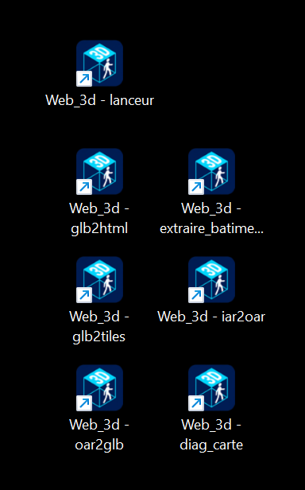

# Mes procédures : sites et serveur de présence

*03/11/2026. Pour l'hôte (Klaatou) : ses sites publiés et son serveur de présence. Créer une région : `GUIDE.md`. Livraisons et versions : `DEVELOPPEMENT.md` (en anglais : `DEVELOPMENT.md`). Dans les commandes, `NOM` est le nom de la région, `ANCIEN` et `NOUVEAU` l'ancien et le nouveau nom, `CHEMIN` un chemin, `UTILISATEUR` et `ADRESSE_VM` le compte et l'adresse de la VM.*

## 1. Mettre une région publiée au niveau d'une nouvelle version

À faire après une nouvelle version des outils : la page reçoit la nouvelle coquille `index.html` (l'ancienne est gardée sous un nom daté) et sa configuration est mise à jour, sans rien ressaisir ; les zones ne bougent pas. Ensuite Ctrl+F5 dans la page.

```powershell
cd "P:\_OpenSim\SL&OS\Web_3d\web_3d\dist"; python .\glb2html.py --update -o "P:\_OpenSim\SL&OS\Web_3d\Sites\houses\houses.html" --shared-shell "P:\_OpenSim\SL&OS\Web_3d\Sites\index.html"
```

## 2. Fixer le titre affiché dans l'onglet

La même commande avec `--title "Houses"`, ou à la main la ligne `"title": "Houses",` dans `NOM.config.json`. Les fichiers et le salon restent en minuscules.

## 3. Renommer une région en tuiles

Le script `renommer_region.py` (hors dépôt, dans `P:\_OpenSim\SL&OS\Web_3d`) renomme les fichiers et le dossier des tuiles, corrige l'index, la configuration, `default.json`, les liens des zones et la fiche de `regions.json`. Chaque ancien fichier modifié est copié dans `_avant_renommage\` (un dossier daté par lancement). D'abord la simulation :

```powershell
python "P:\_OpenSim\SL&OS\Web_3d\renommer_region.py" "P:\_OpenSim\SL&OS\Web_3d\Sites\houses" ANCIEN NOUVEAU --dry-run
```

Puis le renommage (ajouter `--remplacer` si le nouveau nom existe déjà : l'ancien fichier est mis de côté, jamais supprimé) :

```powershell
python "P:\_OpenSim\SL&OS\Web_3d\renommer_region.py" "P:\_OpenSim\SL&OS\Web_3d\Sites\houses" ANCIEN NOUVEAU
```

Finir par la mise à jour de la carte (§ 4). Le script peut être relancé : si la région est déjà renommée, il ne fait que les corrections.

## 4. Mettre à jour la carte des mondes

```powershell
cd "P:\_OpenSim\SL&OS\Web_3d\web_3d\dist"; python .\glb2html.py --scan-sites "P:\_OpenSim\SL&OS\Web_3d\Sites"
```

Pour retirer aussi les fiches dont la région n'existe plus (les fiches externes sont gardées), ajouter `--prune-missing`, de préférence avec `--dry-run` la première fois :

```powershell
python .\glb2html.py --scan-sites "P:\_OpenSim\SL&OS\Web_3d\Sites" --prune-missing --dry-run
```

La clé des pseudos se saisit dans le bloc replié « Clé des pseudos », en bas de `carte.html` : le navigateur la garde (`MANUEL.md` § 9.16). Si la carte n'affiche pas les pseudos, `diag_carte.py` interroge le serveur de présence avec et sans la clé et dit ce qui manque (il demande `pip install websockets` ; l'adresse du site, à la fin, n'est utile que si le serveur n'accepte que certains sites) :

```powershell
cd "P:\_OpenSim\SL&OS\Web_3d\web_3d\dist"; python .\diag_carte.py wss://ADRESSE CLE https://VOTRE-SITE
```

Codes de sortie : 0 serveur bon, 1 injoignable, 2 ancien serveur, 3 aucun pseudo avec la clé, 4 origine refusée (`MANUEL.md` § 9.22).

## 5. Compresser une grosse région déjà découpée

Pour une région neuve, `--compress` de `glb2tiles.py` suffit (`GUIDE.md` § 1.3). Pour des tuiles déjà découpées et non compressées : à la main, depuis le dossier qui contient `NOM.tiles`, vers un dossier `sortie` (Node requis ; jamais recompresser un fichier déjà compressé) :

```powershell
New-Item -ItemType Directory -Force ".\sortie" | Out-Null; Get-ChildItem ".\NOM.tiles" -Filter *.glb | ForEach-Object { npx -y gltfpack -i $_.FullName -o ".\sortie\$($_.Name)" -cc -kn -ke -km -vpf -vtf }
```

```powershell
npx -y gltfpack -i ".\NOM.overview.glb" -o ".\sortie\NOM.overview.glb" -cc -kn -ke -km -vpf -vtf
```

Remplacer ensuite les fichiers par ceux de `sortie`. Garder une sauvegarde avant.

## 6. Extraire des objets d'une région (bâtiments, meubles...)

Le script `extraire_batiments.py` (dans `web_3d\dist`) sort de l'OAR un GLB par groupe d'objets, recentré, avec un `.json` qui garde sa position d'origine. Son nom vient des bâtiments d'un gros OAR de maisons pour lequel il a été écrit, mais **c'est une extraction d'objets** : un groupe peut être une maison, un meuble, un arbre, un véhicule. Dans ses messages et ses fichiers, « bâtiment » se lit « objet ». Il lit l'OAR et le GLB fabriqué par `oar2glb.py` ; la première lecture est longue, la suite vient d'un cache.

Lancer le script **depuis le dossier de travail** `P:\_OpenSim\SL&OS\Web_3d`, pas depuis `dist\` : le dossier de sortie `batiments` et le dossier de cache `extraire_batiments.cache` sont créés là où la commande est lancée. Lister les groupes d'au moins 5 parties :

```powershell
cd "P:\_OpenSim\SL&OS\Web_3d"; python ".\web_3d\dist\extraire_batiments.py" "CHEMIN\NOM.oar" "CHEMIN\NOM.glb" --list --min-parts 5
```

Extraire par nom (ou `--group 12`, `--group 15,18,100-150`) ; `--ground 5` ajoute un sol d'essai de 5 m autour :

```powershell
python ".\web_3d\dist\extraire_batiments.py" "CHEMIN\NOM.oar" "CHEMIN\NOM.glb" --name "Jewel Box House" -o "CHEMIN\batiments"
```

Les autres options (boîtes de livraison, voisins, fusion, tout extraire) : `--help` ou `docs/REFERENCE_OPTIONS.md`. Les anciens noms français des options (`--groupe`, `--nom`, `--sol`...) restent acceptés. Le cache se déplace avec la commande ; il n'est relu que si l'OAR, le GLB, `glb2tiles.py` et `oar2glb.py` n'ont pas changé (chemin, taille, date). Si le script est copié seul ailleurs, `--tools DOSSIER` (ou la variable `WEB3D_TOOLS`) indique où sont `glb2tiles.py` et `oar2glb.py`.

### Extraire des objets d'un IAR (inventaire)

Le script `iar2oar.py` (dans `web_3d\dist`, à côté d'`oar2glb.py`) transforme une archive d'inventaire (IAR) en OAR minimal, que la suite traite comme une région : chaque objet de l'inventaire reçoit une case sur une grille (la région grandit par pas de 256 m si besoin), les objets combinés sont séparés en groupes, le contenu des boîtes est ajouté. Voir ce que contient l'IAR (n'écrit rien ; `--filter REGEX` et `--no-nested` limitent la liste) :

```powershell
cd "P:\_OpenSim\SL&OS\Web_3d"; python ".\web_3d\dist\iar2oar.py" "CHEMIN\NOM.iar" --list
```

Fabriquer l'OAR :

```powershell
python ".\web_3d\dist\iar2oar.py" "CHEMIN\NOM.iar" -o "CHEMIN\NOM.oar"
```

Fabriquer le GLB (`oar2glb.py` l'écrit à côté de l'OAR, sous le nom `NOM.glb` ; `--keep-invisible` garde les prims transparents ; convoar est fourni dans `dist/convoar/`, inutile de le préciser) :

```powershell
python ".\web_3d\dist\oar2glb.py" "CHEMIN\NOM.oar"
```

Puis lister et extraire comme ci-dessus, avec `NOM.oar` et `NOM.glb`. Les anciens noms français des options (`--liste`, `--filtre`, `--sans-imbriques`, `--marge`, `--sortie`) restent acceptés. Les erreurs de texture de convoar (« could not fetch texture asset », « unhandled number of components ») peuvent venir de l'IAR lui-même (assets absents ou vides, constaté sur le premier IAR essayé) : les faces concernées sont grises. Les attachements et les vêtements ne sont pas pris en charge.

Sous Linux, la commande est la même avec `python3` et `mono` installé (manuel, § 3.11). Si l'OAR contient du PBR (OpenSim 0.9.3), `oar2glb.py` l'applique ; il faut Pillow (`pip install pillow`) pour les textures, et `--pbr-size 256` allège le GLB (manuel, § 3.10).

## 7. Mettre à jour la démo en ligne

À faire quand `index.html`, `carte.html` ou l'icône changent. `ajout_og.py` (hors dépôt) remet dans `index.html` les balises d'aperçu de partage (image et titre affichés quand on partage le lien) ; le chemin indiqué est à confirmer :

```powershell
Copy-Item "P:\_OpenSim\SL&OS\Web_3d\web_3d\dist\index.html", "P:\_OpenSim\SL&OS\Web_3d\web_3d\dist\carte.html", "P:\_OpenSim\SL&OS\Web_3d\web_3d\dist\favicon.ico" "P:\_OpenSim\SL&OS\Web_3d\Web_3d_demo"; cd "P:\_OpenSim\SL&OS\Web_3d\Web_3d_demo"; python "P:\_OpenSim\SL&OS\Web_3d\ajout_og.py"; git add index.html carte.html favicon.ico; git commit -m "mise a jour"; git push
```

## 8. Le serveur de présence sur la VM

Ouvrir la console de modération depuis le PC ; pour en sortir sans arrêter le serveur : Ctrl+B puis D.

```powershell
ssh -t UTILISATEUR@ADRESSE_VM "tmux attach -t presence"
```

Dans la console : `version` donne la version et l'empreinte du serveur ; `liste`, `ejecter`, `bannir`, `creators`, `aide`. Mettre le serveur à jour **seulement** si l'empreinte affichée par `version` diffère de celle que `python build.py` liste pour `presence_server.py` : envoyer le fichier, puis, sur la VM en root, `systemctl restart web3d-presence`.

```powershell
scp "P:\_OpenSim\SL&OS\Web_3d\web_3d\dist\presence_server.py" UTILISATEUR@ADRESSE_VM:/home/UTILISATEUR/presence/
```

Installation complète de la VM : `PROCEDURES.md` § 11.

## 9. Accueillir un créateur sur mon serveur de présence

Ce que je lui envoie (message à copier) :

```text
Pour brancher ta région sur mon serveur de présence (positions, chat), envoie-moi :
1. l'origine de ta page : le début de son adresse, sans chemin (par exemple https://alice.example ; donne aussi la version avec www si elle marche) ;
2. un identifiant court (par exemple alice).
Je te réponds avec l'adresse du serveur (wss://...) et ton préfixe de salon (alice.NOM).
Chez toi, dans NOM.config.json, mets presenceUrl = l'adresse reçue et room = alice.NOM, puis recharge la page.
Si la présence est refusée, la page dit pourquoi (note aux créateurs, § 5).
```

Ce que je fais ensuite :

- Sur la VM, ouvrir ma copie de `presence_creators.json` et ajouter l'entrée du créateur (modèle : `docs/samples/presence_creators.sample.json`), par exemple `{"id": "alice", "origins": ["https://alice.example"]}`. Pas de redémarrage : le fichier est relu en 2 secondes au plus.
- Dans la console (§ 8), taper `creators` : il liste le créateur, ses origines et son état.
- Lui envoyer l'adresse `wss://` de mon serveur, son préfixe (`alice.`) et la note aux créateurs (`CREATEURS.md`, en anglais `CREATORS.md`).
- Facultatif : `visits-key alice.NOM` donne la clé de son journal des visites, à lui envoyer avec l'adresse de sa page suivie de `#visits`.

S'il n'a pas encore sa région en page web : lui envoyer `GUIDE.md`.

## 10. Mettre à jour un paquet déjà publié

**Ne dézippez pas le nouveau zip par-dessus votre dossier** : le zip contient la configuration, les zones et les images d'exemple, qui écraseraient les vôtres.

Pour un paquet (`galerie-photos.zip`, `region-simple.zip`) mis en ligne depuis un zip plus ancien : télécharger le nouveau zip, le dézipper à part, puis copier dans le dossier `site` publié **seulement les pages HTML qui dépendent de la version** : `index.html` et `carte.html`. Publier, puis Ctrl+F5 dans la page.

- **Ne pas écraser** : `NOM.config.json`, `NOM.zones.json`, `NOM.glb`, `medias\`, `regions.json`, `vignette.jpg`, `NOM.about.*.txt`, et `aide.html` si on l'a adaptée.
- **`aide.html`** : à recopier depuis le nouveau zip seulement si vous ne l'avez pas modifiée (c'est elle qui porte les nouveaux textes d'aide) ; sinon, gardez la vôtre.
- **`favicon.ico`** : le nouveau zip en contient un (le logo depuis la 1.6.14). Recopiez-le seulement si vous n'avez pas posé le vôtre : un `favicon.ico` déjà à côté de la page reste préféré à l'icône incorporée, donc l'onglet garderait l'ancienne icône.
- **Paquet d'avant la 1.5.0** : la carte (`carte.html`) lit `regions.json` et `vignette.jpg`, qu'il n'avait pas ; sans eux elle dit « Impossible de lire regions.json ». Les copier aussi depuis le nouveau zip, puis les adapter.
- **Dossier `lib\`** : seulement si le dossier `lib\three-…` du nouveau zip a un autre nom que le tien.
- **Numéro affiché** (fenêtre État, touche I, ligne « Version ») : la « page » est la version d'`index.html` (elle suit votre copie) ; la « configuration » est la clé `version` de `NOM.config.json`, que vous pouvez changer à la main (le numéro est dans `VERSION.txt` du zip).
- **Serveur de présence** : si tu l'héberges, remplacer `presence\presence_server.py` par celui du nouveau zip et le relancer.

Essayé (07/11/2026, Chromium sous Linux) : l'`index.html` actuel ouvre sans erreur un paquet dont la config, les zones et `default.json` datent de la 1.2.3 ; sans `regions.json`, la carte affiche le message ci-dessus. Non essayé : Windows, les autres navigateurs, un départ d'une autre version que la 1.2.3.

## 11. Ouvrir les outils dans une fenêtre, avec des raccourcis sur le bureau

Pour ne pas taper de commande : une fenêtre propose les sept outils, avec l'aide de chaque option (`MANUEL.md` § 3.9). Depuis la racine du dépôt :

```powershell
python .\dist\web3d_gui.py
```

Sous la liste des outils, la liste « Exemples » propose des usages de base de chaque outil : en choisir un remplit les champs ; il reste à remplacer les noms d'exemple par les tiens, puis à cliquer sur Lancer.

Pour des raccourcis sur le bureau (un pour la fenêtre, un par outil), d'abord ce qui serait créé, sans rien écrire :

```powershell
python .\dist\web3d_gui.py --shortcuts --dry-run
```

puis, si les chemins conviennent :

```powershell
python .\dist\web3d_gui.py --shortcuts
```



Relancer la même commande remplace les raccourcis. Pour les retirer : `python .\dist\web3d_gui.py --remove-shortcuts`. Essayé par Klaatou sous Windows (08/11/2026).

## 12. Corriger la mer d'une région déjà publiée

Depuis la 1.10.26, une conversion place la mer d'après le niveau d'eau de l'OAR. Pour une région publiée avant, ou dont la mer paraît trop haute ou trop basse, sans la reconvertir (la commande lit le niveau d'eau dans l'OAR et l'écrit dans la config de la région ; ses zones ne bougent pas) :

```powershell
cd "P:\_OpenSim\SL&OS\Web_3d\web_3d\dist"; python .\glb2html.py --update -o "P:\_OpenSim\SL&OS\Web_3d\Sites\houses\houses.html" --shared-shell "P:\_OpenSim\SL&OS\Web_3d\Sites\index.html" --water-from "J:\...\houses.oar"
```

Ensuite Ctrl+F5 dans la page. Sans l'OAR sous la main, donne la hauteur toi-même avec `--sea-m 9` à la place de `--water-from ...` : le nombre est celui que le curseur « Hauteur de la mer » de Réglages indique quand la mer paraît juste (même repère). Le choix fait avec ce curseur reste propre à chaque visiteur (dans son navigateur) : seule la config corrige la page pour tout le monde.

Pour tout un dossier d'OAR dont chacun a une région du même nom dans le site (non essayé) :

```powershell
Get-ChildItem "J:\...\OAR" -Filter *.oar | ForEach-Object { $n = $_.BaseName; python .\glb2html.py --update -o "P:\...\Sites\$n\$n.html" --shared-shell "P:\...\Sites\index.html" --water-from $_.FullName }
```

Un OAR sans `WaterHeight` est refusé avec un message : la boucle continue, et ces régions-là se règlent avec `--sea-m`. Essayé (14/11/2026, Chromium sous Linux, `tests/mer_auto.py`) : la commande unique.

## 13. Alléger les textures d'une région déjà convertie

Pour choisir la valeur sans deviner, lis le tableau des tailles : `oar2glb.py` l'affiche à la fin de chaque conversion, et `glb-stats.py` le donne pour un GLB déjà fait :

```powershell
python .\glb-stats.py "J:\...\NOM.glb"
```

Puis essaie des valeurs sans refaire la conversion : chaque essai écrit un nouveau fichier à côté, l'original n'est jamais modifié :

```powershell
python .\oar2glb.py --tex-only "J:\...\NOM.glb" --tex-size 1024
```

Regarde le résultat (`NOM-tex1024.glb`), puis copie le fichier retenu à la place du GLB de la région dans le site. `--tex-quality 60` ajoute une compression JPEG plus forte sans changer les pixels ; les textures transparentes ne sont réduites que par `--tex-size`. Détails : manuel § 3.12. Essayé (13/11/2026, faux convoar et GLB faits à la main) : non essayé sur un vrai GLB de plusieurs centaines de Mo.

## 14. Mettre une radio dans une région

**Je veux que les visiteurs entendent une webradio quand ils passent à un endroit de ma région.** Une zone « Radio » fait jouer un flux Icecast ou SHOUTcast (le même qu'une « music URL » de parcelle OpenSim) à ceux qui passent à portée en promenade (`MANUEL.md` § 5.19).

Il te faut : l'adresse d'un flux radio, ta région déjà en ligne (ou prête à l'être), Edge ou Chrome pour le viewer.

1. **Choisir le flux.** L'adresse doit commencer par `https://` (une page en `https` refuse un flux `http`). Colle-la dans un onglet : si le son démarre, le flux est lisible. Certaines radios refusent d'être jouées depuis un autre site (réponse 403 : la page dira « flux refusé ou illisible ») : prends une radio dont le propriétaire accepte la diffusion sur un site, et vérifie que tu as le droit de la diffuser.
2. **Ouvrir le viewer** (`glb-viewer.html`), ouvrir le `.glb` de la région, puis **importer ses zones actuelles** (« Importer zones (.json) », fichier `NOM.zones.json` de la région), sinon l'export de l'étape 5 ne contiendrait que la nouvelle zone (`PROCEDURES_SIMPLES.md` § 16, étapes 1 et 2).
3. **Poser la zone.** Dans le menu des types, choisir « Radio (flux Icecast / SHOUTcast à portée) », puis cliquer au sol à l'endroit voulu (ou, en promenade, touche P). Le repère (cône) montre qu'une radio est là.
4. **Remplir ses champs** : « Adresse du flux » (coller l'adresse), puis le bouton **« Essayer le flux (5 s) »** : il doit dire « Flux : lecture » ; sinon « Flux illisible (cause) ». Un nom (`label`) et la portée en mètres (20 par défaut, jusqu'à 200 ; le son baisse avec la distance).
5. **Exporter, remplacer le fichier de zones de la région, publier** : c'est la procédure du **§ 16** (exporter, renommer en `NOM.zones.json`, copier dans le dossier de la région, essayer chez soi, publier). Rien d'autre à copier pour une radio : le son vient du flux.
6. **Essayer en ligne** : ouvrir la page (F5 ou Ctrl+F5), passer en promenade (touche F), marcher dans la portée. Un premier clic ou une touche est nécessaire (règle du navigateur). La ligne « ♪ Radio : NOM » du bloc État (touche I) dit ce qui se passe. Le volume est celui de la case « Sons » de Réglages.
7. **Le titre du morceau (facultatif).** Sur le serveur de présence, un fichier `presence_radios.json` (liste JSON des adresses de flux) et l'option `--radios presence_radios.json` (`MANUEL.md` § 10.25). Radio qui n'écrit pas ses titres dans le flux : pas de titre, le nom de la zone seul.

Plusieurs flux dans la même zone (`radio`), distance affichée, bulle d'info : `MANUEL.md` § 5.19 et § 7.66.

Pochette et lien (facultatifs, 1.12.26) : les champs « Pochette » et « Lien de la pochette » de la zone, montrés dans la fenêtre Son quand cette radio parle : `MANUEL.md` § 5.19.

Un flux qui ne joue pas : `MANUEL.md` § 5.19, « La radio ne joue pas ? ».

## 15. Mettre une playlist de mes propres sons (mp3...) dans une région

**Je veux que les visiteurs entendent ma musique (des fichiers mp3, ogg, wav...) quand ils passent à un endroit.** Une zone « Musique » joue les fichiers d'un dossier, dans l'ordre alphabétique, en boucle (`MANUEL.md` § 5.20).

Il te faut : tes fichiers son (dont tu as les droits), le dossier de ta région (celui où est le `.glb`), Edge ou Chrome pour le viewer.

1. **Préparer le dossier des sons.** Dans le dossier de la région, créer un sous-dossier `audio` (ou `medias\audio`, si la région a un dossier `medias`) et y mettre les fichiers. **Numéroter les noms pour fixer l'ordre** : `01-intro.mp3`, `02-vagues.mp3`, `03-finale.mp3`. Sans numéros, l'ordre est alphabétique ; les nombres comptent comme des nombres (`2` avant `10`).
2. **Faire la liste de lecture** (`playlist.json`), avec la ligne de commande, depuis le dossier `dist` des outils : `python .\glb2html.py --audio-list "CHEMIN\NOM\audio"`, où `CHEMIN\NOM` est le dossier de la région. Elle écrit `playlist.json` dans le dossier `audio` : c'est la liste que la page lit. Ajouter `--dry-run` pour voir sans écrire. *Variante sans ligne de commande* : le bouton « Mettre à jour la liste (playlist.json) » de la fiche de la zone (étape 3) fait exactement la même chose ; inutile de faire les deux.
3. **Poser la zone dans le viewer.** Ouvrir `glb-viewer.html`, ouvrir le `.glb` de la région, **importer ses zones actuelles** (« Importer zones (.json) », `NOM.zones.json`). Type « Musique (fichiers son d'un dossier, joués en boucle à portée) », clic au sol (ou touche P en promenade). Dans « Dossier des pistes », écrire seulement le nom du sous-dossier : `audio`. Régler la portée (20 m par défaut, jusqu'à 200). Facultatif : « Essayer la première piste (5 s) » vérifie qu'un son se lit (le viewer demande d'abord le dossier de la région, une fois).
4. **Exporter, remplacer le fichier de zones de la région** : procédure du **§ 16**. La zone ne contient que `"folder": "audio"`, pas les sons.
5. **Mettre en ligne les sons** : copier le dossier `audio` **entier** (les sons **et** `playlist.json`) dans le dossier de la région sur l'hébergement, à côté de `NOM.glb`, avec le même fichier `NOM.zones.json` que celui du § 16. Sans le dossier `audio` en ligne, la ligne « ♪ Musique » dira « liste de lecture introuvable ».
6. **Essayer en ligne** : ouvrir la page (F5 ou Ctrl+F5), passer en promenade (touche F), entrer dans la portée : la ligne « ♪ Musique : NOM — piste » du bloc État (touche I) donne la piste en cours. Un clic ou une touche est nécessaire la première fois. Le volume baisse quand on s'éloigne, la lecture s'arrête hors portée et reprend à la piste quittée.
7. **Plus tard** : si tu ajoutes, retires ou renommes un son, **refaire la liste** (étape 2) et recopier le dossier `audio` en ligne ; la page relit la liste à chaque entrée dans la zone, sans refaire la page ni le fichier de zones.

Radio, musique et vidéo ne parlent jamais ensemble : dans Réglages, les cases « Radio des zones », « Musique des zones » et « Vidéos des zones » s'excluent, et la source la plus proche en mètres parle (`MANUEL.md` § 5.22). Pochette et lien facultatifs (1.12.26) : `MANUEL.md` § 5.20. Rien ne joue ? `MANUEL.md` § 5.20, « Ça ne joue pas ? ».

## 16. Mettre à jour les zones d'une région déjà en ligne

**Je veux ajouter, déplacer ou retirer une zone (arrivée, portail, panneau, image, radio, musique) dans une région déjà publiée.** Les zones d'une région sont dans un seul fichier, `NOM.zones.json` (NOM = nom du `.glb` sans extension, en minuscules). On le **modifie dans le viewer**, on l'**exporte**, on **remplace** celui de la région, on **republie**. La page n'est pas à refaire (cas A ci-dessous).

**Quel est ton cas ?** Regarde le dossier de la région :

- **A. Coquille commune** (le cas des paquets et de la démo) : la région s'ouvre par `index.html?region=NOM` et son dossier contient `NOM.glb`, `NOM.config.json` et `NOM.zones.json`. **C'est le cas décrit ci-dessous.**
- **B. Région en tuiles** : un `NOM.tiles.json` et des tuiles à la place du `.glb`. Le viewer a un bouton **« Enregistrer les zones dans le dossier de la région »** (Edge ou Chrome) qui écrit `NOM.zones.json` à ta place et garde l'ancien sous `NOM.zones.bak.json` (`MANUEL.md` § 5.15) : fais les étapes 1 à 3, puis ce bouton au lieu des étapes 4 et 5, et continue à l'étape 6.
- **C. Page autonome** (un seul fichier `NOM.html`, sans `NOM.zones.json` à côté) : les zones sont dans la page. Refabrique la page avec la même commande qu'à l'origine, en donnant les zones exportées : `--zones zones.json` (`MANUEL.md` § 6).

**Les étapes (cas A)**

1. **Ouvrir le viewer** : le fichier `glb-viewer.html` (dossier `dist` des outils) s'ouvre dans Edge ou Chrome par double-clic. Ouvrir le `.glb` de la région.
2. **Reprendre les zones déjà posées** : bouton **« Importer zones (.json) »**, puis le `NOM.zones.json` **actuel** de la région. **Ne pas sauter cette étape** : le fichier exporté à l'étape 4 contient seulement ce qui est dans le viewer à ce moment ; sans l'import, les zones existantes disparaîtraient de la région.
3. **Modifier** : ajouter une zone (type, clic au sol ou touche P en promenade), ouvrir sa fiche pour la régler, ou la supprimer (`MANUEL.md` § 5.2). Pour une image : les fichiers se mettent dans le sous-dossier `medias` de la région (`MANUEL.md` § 5.11) ; pour une musique : le dossier `audio` (§ 15) ; pour un écran vidéo : les vidéos (§ 17) ; une radio : rien à copier.
4. **Exporter** : bouton **« Exporter zones (.json) »**. Le navigateur télécharge un fichier nommé `zones.json` dans son dossier de téléchargements.
5. **Remplacer le fichier de la région** : d'abord **garder une copie** de l'ancien `NOM.zones.json` (par exemple le renommer `NOM.zones.avant.json`). Puis renommer le fichier téléchargé en **`NOM.zones.json`** (exactement le nom de l'ancien) et le copier dans le dossier de la région, à la place de l'ancien. Garder le nom exact : la page ne cherche que celui-là.
6. **Essayer chez soi avant de publier** : depuis le dossier du site, `python -m http.server 8000`, puis ouvrir `http://localhost:8000/index.html?region=NOM`. La page relit `NOM.zones.json` à chaque ouverture : **F5 suffit**, sans refaire la page (sauf si tu changes aussi les options de la page, qui sont dans `NOM.config.json`).
7. **Publier** : copier sur l'hébergement, en remplaçant, **seulement ce qui a changé** : `NOM.zones.json`, et selon ce que tu as ajouté le dossier `audio`, les images de `medias`. Avec GitHub Pages, depuis le dossier du site : `git add -A`, `git commit -m "zones"`, `git push` (une commande par ligne), puis attendre une à deux minutes.
8. **Vérifier en ligne** : ouvrir l'adresse publique, **Ctrl+F5** (le navigateur garde parfois l'ancien fichier), passer en promenade (touche F) et aller à la zone.

Une erreur ? Remettre l'ancien fichier (la copie de l'étape 5) à la place de `NOM.zones.json` et republier.


## 17. Mettre un écran vidéo dans une région

**Je veux qu'un écran sur un mur montre une vidéo (ou une suite de vidéos) quand les visiteurs s'approchent.** Une zone « Vidéo » est un écran qui joue à portée, en boucle, muet ou avec du son (`MANUEL.md` § 5.21).

Il te faut : tes fichiers vidéo (mp4 en H.264 : le plus compatible ; webm aussi ; dont tu as les droits), le dossier de ta région (celui où est le `.glb`), Edge ou Chrome pour le viewer.

1. **Ranger les vidéos.** Dans le dossier de la région, créer un sous-dossier `videos` (ou `medias\videos` si la région a un dossier `medias`) et y mettre les fichiers. Pour **une seule vidéo**, la mettre dans `medias` (ou à côté du `.glb`). **Numéroter les noms pour fixer l'ordre** d'une liste : `01-accueil.mp4`, `02-visite.mp4`.
2. **Pour une liste : faire `playlist.json`**, depuis le dossier `dist` des outils : `python .\glb2html.py --video-list "CHEMIN\NOM\videos"` (avec `--dry-run` : montre sans écrire). *Variante sans ligne de commande* : le bouton « Mettre à jour la liste (playlist.json) » de la fiche de la zone (étape 3). Une seule vidéo : pas de liste.
3. **Poser l'écran dans le viewer.** Ouvrir `glb-viewer.html`, ouvrir le `.glb`, **importer ses zones actuelles** (« Importer zones (.json) », `NOM.zones.json`). Type « Vidéo (écran sur un mur) », clic sur le mur. **Une seule vidéo** : écrire son nom dans « Fichier ou adresse de la vidéo » (`clip` ou `clip.mp4`). **Une liste** : laisser ce champ vide et écrire `videos` dans « Dossier de vidéos ». Régler la largeur (la hauteur à 0 suit la vidéo), la portée et, si tu veux du son, « Son de l'écran » (« avec son » : seul l'écran le plus proche parle).
4. **Exporter, remplacer le fichier de zones, mettre en ligne** : procédure du **§ 16** (étapes 4 à 8). Copier aussi le dossier `videos` **entier** (les vidéos **et** `playlist.json`) dans le dossier de la région sur l'hébergement.
5. **Essayer** : ouvrir la page (F5 ou Ctrl+F5), s'approcher de l'écran : il se charge puis joue. **Cliquer sur l'écran** : pause, puis lecture. Avec une liste, la **barre de pistes** (précédente, pause / lecture, suivante) apparaît sous l'écran quand on le survole. Le son demande un premier clic ou une première touche dans la page.
6. **Plus tard** : ajouter, retirer ou renommer une vidéo d'une liste : **refaire `playlist.json`** (étape 2) et recopier le dossier en ligne.

Rien ne joue ? La ligne **Vidéo** du diagnostic (bloc État, touche I, « Copier le diagnostic ») dit pourquoi : fichier introuvable, pas encore chargé, son demandé mais muet. `MANUEL.md` § 5.21, « Ça ne joue pas ? ».

**Variante : l'écran ouvre une page, un portail ou une commande** (1.12.42). Dans la fiche de l'écran, le menu **« Action de l'écran »** : « lien » met le titre de la vidéo en lien dans la barre sous l'écran (un clic sur le titre ouvre la page) ; « portail » et « commande » se déclenchent quand on s'approche, à la « Distance de déclenchement ». La vidéo sert à montrer ce que l'action ouvre. `MANUEL.md` § 5.21, « Action de l'écran ».

## 18. Poser un modèle 3D à part (un petit `.glb`)

**Je veux poser un objet (une statue, un poste de radio, un meuble) dans ma région sans refaire son modèle.** Une zone « Modèle 3D » charge un fichier `.glb` à l'endroit voulu, avec sa taille et son inclinaison (`MANUEL.md` § 5.23).

Il te faut : ton fichier `.glb` de l'objet, le dossier de ta région (celui où est le `.glb` de la région), Edge ou Chrome pour le viewer.

1. **Ranger le fichier.** Le mettre dans le dossier de la région (par exemple `statue.glb`).
2. **Poser le modèle dans le viewer.** Ouvrir `glb-viewer.html`, ouvrir le `.glb` de la région, **importer ses zones actuelles** (« Importer zones (.json) », `NOM.zones.json`). Type « Modèle 3D (fichier .glb posé à part) », clic à l'endroit voulu, nom du fichier dans « Fichier du modèle (.glb) ». **Pour voir le modèle dans le viewer**, clique sur « Choisir le dossier de la région (aperçu du modèle) » (Edge ou Chrome) et choisis le dossier qui contient le `.glb` de la région : le viewer y lit le modèle, comme les images. Sans ce choix, la zone est posée quand même et exportée correctement, mais le modèle n'apparaît pas dans le viewer.
3. **Régler** : « Taille (1 = telle quelle) », les deux inclinaisons (en degrés) et l'orientation ; cocher « Solide (on ne le traverse pas) » si les visiteurs ne doivent pas passer à travers.
4. **Pour qu'il fasse quelque chose** (par exemple un poste de radio posé sur une zone radio), ne crée pas de zone « Modèle 3D » : renseigne le champ « Fichier du modèle » de la fiche lien, portail, commande, radio ou musique. Un clic sur le modèle d'une radio ou d'une musique ouvre la fenêtre Son.
5. **Exporter, remplacer le fichier de zones, mettre en ligne** : procédure du **§ 16** (étapes 4 à 8). Copier aussi le fichier `.glb` du modèle dans le dossier de la région sur l'hébergement.
6. **Essayer** : ouvrir la page (F5 ou Ctrl+F5) et s'approcher : le modèle se charge à moins de 150 m de sa zone. Avec beaucoup de modèles, réduire cette distance sans refaire la page : `python .\glb2html.py --update --model-lazy 60` (voir `MANUEL.md` § 9.3).

Rien n'apparaît ? La console du navigateur (F12) dit « le modèle … n'a pas pu être lu » : nom de fichier faux, fichier absent en ligne, ou page ouverte depuis le disque (`file://`). `MANUEL.md` § 5.23.

### Variante : poser le modèle sans le viewer, en modifiant le fichier à la main

Même résultat en écrivant la zone à la main dans `NOM.zones.json`, le fichier de zones de la région. La page relit ce fichier à chaque ouverture : `glb2html.py` n'est pas nécessaire, il sert seulement à contrôler ce que tu as écrit.

1. **Garder une copie** : copier `NOM.zones.json` sous un autre nom dans le même dossier (par exemple `NOM.zones.avant.json`).
2. **Ajouter l'entrée du modèle** dans la liste de `NOM.zones.json` lui-même (dans le dossier de la région), avec un éditeur de texte :

```json
{"id": "poste", "label": "Poste", "model": "poste.glb", "x": 3, "y": 0, "z": -4, "yaw": 0, "scale": 1.5, "solid": true}
```

   `x`, `y`, `z` sont l'origine du `.glb` ; `yaw` est en radians. Pour un poste de radio, ajouter `"model": "poste.glb"` à la zone radio existante au lieu de créer une zone.
3. **Contrôler (facultatif)** : `python .\glb2html.py -o "CHEMIN\DOSSIER\NOM.html" --zones-only --zones "CHEMIN\DOSSIER\NOM.zones.json"`. Ici `-o` sert seulement à dire de quelle région il s'agit : `NOM.html` n'a pas besoin d'exister et n'est pas écrit, la coquille `index.html` commune n'est pas touchée. Comme tu lui donnes le fichier même de la région, le script le **lit sans le réécrire** : il annonce « zones déjà en place » et signale les clés refusées (par exemple `radius`, inutile sur un modèle seul). Rien n'est changé dans tes fichiers, les zones `private` y restent.
4. **Copier le `.glb` du modèle** dans le dossier de la région, puis essayer et publier comme au § 16 (étapes 6 à 8).

Si tu donnes à `--zones-only` un **autre** fichier de zones (une liste complète que tu gardes ailleurs), le script écrit le `NOM.zones.json` de la région en **version publique** (zones `private` retirées) et garde l'ancien sous `NOM.zones.json.bak`. De même, `--config-only`, `--update` et la régénération gardent l'ancien `NOM.config.json` sous `NOM.config.json.bak` quand ils le modifient. Un seul `.bak` est gardé : le plus récent.
