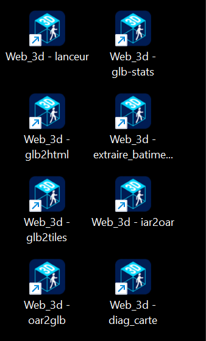

# Mes procédures : sites et serveur de présence

*03/11/2026. Pour l'hôte (Klaatou) : ses sites publiés et son serveur de présence. Créer une région : `GUIDE.md`. Livraisons et versions : `DEVELOPPEMENT.md` (en anglais : `DEVELOPMENT.md`). Dans les commandes, `NOM` est le nom de la région, `ANCIEN` et `NOUVEAU` l'ancien et le nouveau nom, `CHEMIN` un chemin, `UTILISATEUR` et `ADRESSE_VM` le compte et l'adresse de la VM.*

## 1. Mettre une région publiée au niveau d'une nouvelle version

À faire après une nouvelle version des outils : la page reçoit la nouvelle coquille `index.html` (l'ancienne est gardée sous un nom daté) et sa configuration est mise à jour, sans rien ressaisir ; les zones ne bougent pas. Ensuite Ctrl+F5 dans la page.

```powershell
cd "P:\_OpenSim\SL&OS\Web_3d\web_3d\dist"; python .\glb2html.py --update -o "P:\_OpenSim\SL&OS\Web_3d\Sites\houses\houses.html" --shared-shell "P:\_OpenSim\SL&OS\Web_3d\Sites\index.html"
```

## 2. Fixer le titre affiché dans l'onglet

La même commande avec `--title "Houses"`, ou à la main la ligne `"title": "Houses",` dans `NOM.config.json`. Les fichiers et le salon restent en minuscules.

## 3. Renommer une région en tuiles

Le script `renommer_region.py` (hors dépôt, dans `P:\_OpenSim\SL&OS\Web_3d`) renomme les fichiers et le dossier des tuiles, corrige l'index, la configuration, `default.json`, les liens des zones et la fiche de `regions.json`. Chaque ancien fichier modifié est copié dans `_avant_renommage\` (un dossier daté par lancement). D'abord la simulation :

```powershell
python "P:\_OpenSim\SL&OS\Web_3d\renommer_region.py" "P:\_OpenSim\SL&OS\Web_3d\Sites\houses" ANCIEN NOUVEAU --dry-run
```

Puis le renommage (ajouter `--remplacer` si le nouveau nom existe déjà : l'ancien fichier est mis de côté, jamais supprimé) :

```powershell
python "P:\_OpenSim\SL&OS\Web_3d\renommer_region.py" "P:\_OpenSim\SL&OS\Web_3d\Sites\houses" ANCIEN NOUVEAU
```

Finir par la mise à jour de la carte (§ 4). Le script peut être relancé : si la région est déjà renommée, il ne fait que les corrections.

## 4. Mettre à jour la carte des mondes

```powershell
cd "P:\_OpenSim\SL&OS\Web_3d\web_3d\dist"; python .\glb2html.py --scan-sites "P:\_OpenSim\SL&OS\Web_3d\Sites"
```

Pour retirer aussi les fiches dont la région n'existe plus (les fiches externes sont gardées), ajouter `--prune-missing`, de préférence avec `--dry-run` la première fois :

```powershell
python .\glb2html.py --scan-sites "P:\_OpenSim\SL&OS\Web_3d\Sites" --prune-missing --dry-run
```

La clé des pseudos se saisit dans le bloc replié « Clé des pseudos », en bas de `carte.html` : le navigateur la garde (`MANUEL.md` § 9.16). Si la carte n'affiche pas les pseudos, `diag_carte.py` interroge le serveur de présence avec et sans la clé et dit ce qui manque (il demande `pip install websockets` ; l'adresse du site, à la fin, n'est utile que si le serveur n'accepte que certains sites) :

```powershell
cd "P:\_OpenSim\SL&OS\Web_3d\web_3d\dist"; python .\diag_carte.py wss://ADRESSE CLE https://VOTRE-SITE
```

Codes de sortie : 0 serveur bon, 1 injoignable, 2 ancien serveur, 3 aucun pseudo avec la clé, 4 origine refusée (`MANUEL.md` § 9.22).

## 5. Compresser une grosse région déjà découpée

Pour une région neuve, `--compress` de `glb2tiles.py` suffit (`GUIDE.md` § 1.3). Pour des tuiles déjà découpées et non compressées : à la main, depuis le dossier qui contient `NOM.tiles`, vers un dossier `sortie` (Node requis ; jamais recompresser un fichier déjà compressé) :

```powershell
New-Item -ItemType Directory -Force ".\sortie" | Out-Null; Get-ChildItem ".\NOM.tiles" -Filter *.glb | ForEach-Object { npx -y gltfpack -i $_.FullName -o ".\sortie\$($_.Name)" -cc -kn -ke -km -vpf -vtf }
```

```powershell
npx -y gltfpack -i ".\NOM.overview.glb" -o ".\sortie\NOM.overview.glb" -cc -kn -ke -km -vpf -vtf
```

Remplacer ensuite les fichiers par ceux de `sortie`. Garder une sauvegarde avant.

## 6. Extraire des objets d'une région (bâtiments, meubles...)

Le script `extraire_batiments.py` (dans `web_3d\dist`) sort de l'OAR un GLB par groupe d'objets, recentré, avec un `.json` qui garde sa position d'origine. Son nom vient des bâtiments d'un gros OAR de maisons pour lequel il a été écrit, mais **c'est une extraction d'objets** : un groupe peut être une maison, un meuble, un arbre, un véhicule. Dans ses messages et ses fichiers, « bâtiment » se lit « objet ». Il lit l'OAR et le GLB fabriqué par `oar2glb.py` ; la première lecture est longue, la suite vient d'un cache.

Lancer le script **depuis le dossier de travail** `P:\_OpenSim\SL&OS\Web_3d`, pas depuis `dist\` : le dossier de sortie `batiments` et le dossier de cache `extraire_batiments.cache` sont créés là où la commande est lancée. Lister les groupes d'au moins 5 parties :

```powershell
cd "P:\_OpenSim\SL&OS\Web_3d"; python ".\web_3d\dist\extraire_batiments.py" "CHEMIN\NOM.oar" "CHEMIN\NOM.glb" --list --min-parts 5
```

Extraire par nom (ou `--group 12`, `--group 15,18,100-150`) ; `--ground 5` ajoute un sol d'essai de 5 m autour :

```powershell
python ".\web_3d\dist\extraire_batiments.py" "CHEMIN\NOM.oar" "CHEMIN\NOM.glb" --name "Jewel Box House" -o "CHEMIN\batiments"
```

Les autres options (boîtes de livraison, voisins, fusion, tout extraire) : `--help` ou `docs/REFERENCE_OPTIONS.md`. Les anciens noms français des options (`--groupe`, `--nom`, `--sol`...) restent acceptés. Le cache se déplace avec la commande ; il n'est relu que si l'OAR, le GLB, `glb2tiles.py` et `oar2glb.py` n'ont pas changé (chemin, taille, date). Si le script est copié seul ailleurs, `--tools DOSSIER` (ou la variable `WEB3D_TOOLS`) indique où sont `glb2tiles.py` et `oar2glb.py`.

### Extraire des objets d'un IAR (inventaire)

Le script `iar2oar.py` (dans `web_3d\dist`, à côté d'`oar2glb.py`) transforme une archive d'inventaire (IAR) en OAR minimal, que la suite traite comme une région : chaque objet de l'inventaire reçoit une case sur une grille (la région grandit par pas de 256 m si besoin), les objets combinés sont séparés en groupes, le contenu des boîtes est ajouté. Voir ce que contient l'IAR (n'écrit rien ; `--filter REGEX` et `--no-nested` limitent la liste) :

```powershell
cd "P:\_OpenSim\SL&OS\Web_3d"; python ".\web_3d\dist\iar2oar.py" "CHEMIN\NOM.iar" --list
```

Fabriquer l'OAR :

```powershell
python ".\web_3d\dist\iar2oar.py" "CHEMIN\NOM.iar" -o "CHEMIN\NOM.oar"
```

Fabriquer le GLB (`oar2glb.py` l'écrit à côté de l'OAR, sous le nom `NOM.glb` ; `--keep-invisible` garde les prims transparents ; convoar est fourni dans `dist/convoar/`, inutile de le préciser) :

```powershell
python ".\web_3d\dist\oar2glb.py" "CHEMIN\NOM.oar"
```

Puis lister et extraire comme ci-dessus, avec `NOM.oar` et `NOM.glb`. Les anciens noms français des options (`--liste`, `--filtre`, `--sans-imbriques`, `--marge`, `--sortie`) restent acceptés. Les erreurs de texture de convoar (« could not fetch texture asset », « unhandled number of components ») peuvent venir de l'IAR lui-même (assets absents ou vides, constaté sur le premier IAR essayé) : les faces concernées sont grises. Les attachements et les vêtements ne sont pas pris en charge.

Sous Linux, la commande est la même avec `python3` et `mono` installé (manuel, § 3.11). Si l'OAR contient du PBR (OpenSim 0.9.3), `oar2glb.py` l'applique ; il faut Pillow (`pip install pillow`) pour les textures, et `--pbr-size 256` allège le GLB (manuel, § 3.10).

## 7. Mettre à jour la démo en ligne

À faire quand `index.html`, `carte.html` ou l'icône changent. `ajout_og.py` (hors dépôt) remet dans `index.html` les balises d'aperçu de partage (image et titre affichés quand on partage le lien) ; le chemin indiqué est à confirmer :

```powershell
Copy-Item "P:\_OpenSim\SL&OS\Web_3d\web_3d\dist\index.html", "P:\_OpenSim\SL&OS\Web_3d\web_3d\dist\carte.html", "P:\_OpenSim\SL&OS\Web_3d\web_3d\dist\favicon.ico" "P:\_OpenSim\SL&OS\Web_3d\Web_3d_demo"; cd "P:\_OpenSim\SL&OS\Web_3d\Web_3d_demo"; python "P:\_OpenSim\SL&OS\Web_3d\ajout_og.py"; git add index.html carte.html favicon.ico; git commit -m "mise a jour"; git push
```

## 8. Le serveur de présence sur la VM

Ouvrir la console de modération depuis le PC ; pour en sortir sans arrêter le serveur : Ctrl+B puis D.

```powershell
ssh -t UTILISATEUR@ADRESSE_VM "tmux attach -t presence"
```

Dans la console : `version` donne la version et l'empreinte du serveur ; `liste`, `ejecter`, `bannir`, `creators`, `aide`. Mettre le serveur à jour **seulement** si l'empreinte affichée par `version` diffère de celle que `python build.py` liste pour `presence_server.py` : envoyer le fichier, puis, sur la VM en root, `systemctl restart web3d-presence`.

```powershell
scp "P:\_OpenSim\SL&OS\Web_3d\web_3d\dist\presence_server.py" UTILISATEUR@ADRESSE_VM:/home/UTILISATEUR/presence/
```

Installation complète de la VM : `PROCEDURES.md` § 11.

## 9. Accueillir un créateur sur mon serveur de présence

Ce que je lui envoie (message à copier) :

```text
Pour brancher ta région sur mon serveur de présence (positions, chat), envoie-moi :
1. l'origine de ta page : le début de son adresse, sans chemin (par exemple https://alice.example ; donne aussi la version avec www si elle marche) ;
2. un identifiant court (par exemple alice).
Je te réponds avec l'adresse du serveur (wss://...) et ton préfixe de salon (alice.NOM).
Chez toi, dans NOM.config.json, mets presenceUrl = l'adresse reçue et room = alice.NOM, puis recharge la page.
Si la présence est refusée, la page dit pourquoi (note aux créateurs, § 5).
```

Ce que je fais ensuite :

- Sur la VM, ouvrir ma copie de `presence_creators.json` et ajouter l'entrée du créateur (modèle : `docs/samples/presence_creators.sample.json`), par exemple `{"id": "alice", "origins": ["https://alice.example"]}`. Pas de redémarrage : le fichier est relu en 2 secondes au plus.
- Dans la console (§ 8), taper `creators` : il liste le créateur, ses origines et son état.
- Lui envoyer l'adresse `wss://` de mon serveur, son préfixe (`alice.`) et la note aux créateurs (`CREATEURS.md`, en anglais `CREATORS.md`).
- Facultatif : `visits-key alice.NOM` donne la clé de son journal des visites, à lui envoyer avec l'adresse de sa page suivie de `#visits`.

S'il n'a pas encore sa région en page web : lui envoyer `GUIDE.md`.

## 10. Mettre à jour un paquet déjà publié

**Ne dézippez pas le nouveau zip par-dessus votre dossier** : le zip contient la configuration, les zones et les images d'exemple, qui écraseraient les vôtres.

Pour un paquet (`galerie-photos.zip`, `region-simple.zip`) mis en ligne depuis un zip plus ancien : télécharger le nouveau zip, le dézipper à part, puis copier dans le dossier `site` publié **seulement les pages HTML qui dépendent de la version** : `index.html` et `carte.html`. Publier, puis Ctrl+F5 dans la page.

- **Ne pas écraser** : `NOM.config.json`, `NOM.zones.json`, `NOM.glb`, `medias\`, `regions.json`, `vignette.jpg`, `NOM.about.*.txt`, et `aide.html` si on l'a adaptée.
- **`aide.html`** : à recopier depuis le nouveau zip seulement si vous ne l'avez pas modifiée (c'est elle qui porte les nouveaux textes d'aide) ; sinon, gardez la vôtre.
- **`favicon.ico`** : le nouveau zip en contient un (le logo depuis la 1.6.14). Recopiez-le seulement si vous n'avez pas posé le vôtre : un `favicon.ico` déjà à côté de la page reste préféré à l'icône incorporée, donc l'onglet garderait l'ancienne icône.
- **Paquet d'avant la 1.5.0** : la carte (`carte.html`) lit `regions.json` et `vignette.jpg`, qu'il n'avait pas ; sans eux elle dit « Impossible de lire regions.json ». Les copier aussi depuis le nouveau zip, puis les adapter.
- **Dossier `lib\`** : seulement si le dossier `lib\three-…` du nouveau zip a un autre nom que le tien.
- **Numéro affiché** (fenêtre État, touche I, ligne « Version ») : la « page » est la version d'`index.html` (elle suit votre copie) ; la « configuration » est la clé `version` de `NOM.config.json`, que vous pouvez changer à la main (le numéro est dans `VERSION.txt` du zip).
- **Serveur de présence** : si tu l'héberges, remplacer `presence\presence_server.py` par celui du nouveau zip et le relancer.

Essayé (07/11/2026, Chromium sous Linux) : l'`index.html` actuel ouvre sans erreur un paquet dont la config, les zones et `default.json` datent de la 1.2.3 ; sans `regions.json`, la carte affiche le message ci-dessus. Non essayé : Windows, les autres navigateurs, un départ d'une autre version que la 1.2.3.

## 11. Ouvrir les outils dans une fenêtre, avec des raccourcis sur le bureau

Pour ne pas taper de commande : une fenêtre propose les sept outils, avec l'aide de chaque option (`MANUEL.md` § 3.9). Depuis la racine du dépôt :

```powershell
python .\dist\web3d_gui.py
```

Sous la liste des outils, la liste « Exemples » propose des usages de base de chaque outil : en choisir un remplit les champs ; il reste à remplacer les noms d'exemple par les tiens, puis à cliquer sur Lancer.

Pour des raccourcis sur le bureau (un pour la fenêtre, un par outil), d'abord ce qui serait créé, sans rien écrire :

```powershell
python .\dist\web3d_gui.py --shortcuts --dry-run
```

puis, si les chemins conviennent :

```powershell
python .\dist\web3d_gui.py --shortcuts
```



Relancer la même commande remplace les raccourcis. Pour les retirer : `python .\dist\web3d_gui.py --remove-shortcuts`. Essayé par Klaatou sous Windows (08/11/2026).
